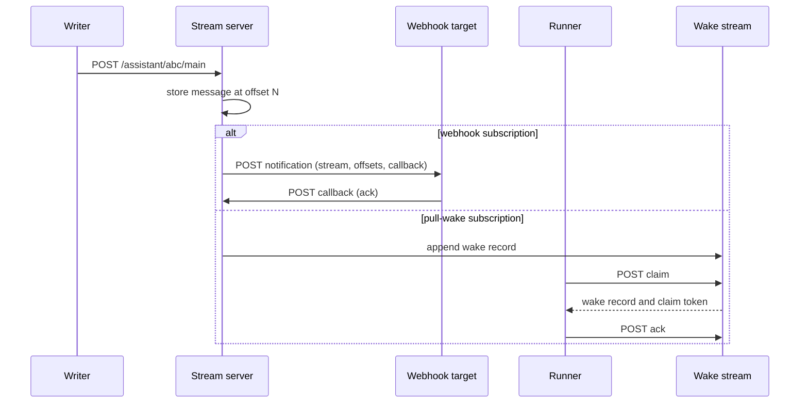
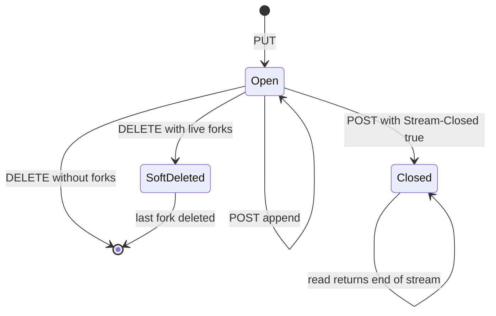

# The durable stream primitive

A durable stream is a URL that accepts bytes at the end and returns bytes from any saved position. That is the whole primitive. Everything else in Electric Agents is a convention layered on top: which bytes to write, which content type to use, and which subscription should hear about them.

This document explains the protocol at the depth needed to read the runtime code. The full specification is `PROTOCOL.md` in the Durable Streams repository.

## Stream model

A stream has six properties. Four are essential for understanding the agent runtime.

| Property | Meaning |
|----------|---------|
| Append-only | Bytes at an offset never change. New bytes go only at the tail. |
| Ordered | Every byte has a strictly increasing offset. |
| Typed | The stream has one content type, set at creation. |
| Addressable | The stream is a URL. Any client that knows the URL can read it. |
| Closeable | A stream can move to a closed state. The move is durable and monotonic. |
| Forkable | A stream can share a prefix with a source stream without copying bytes. |

Source: `PROTOCOL.md`, section 4.

## The six operations

The protocol defines six operations. Each operation is an ordinary HTTP method on the stream URL.

| Operation | HTTP | Key headers | Result |
|-----------|------|-------------|--------|
| Create | `PUT` | `Content-Type`, optional `Stream-Closed` | New stream, optional initial body |
| Append | `POST` | `Content-Type`, optional `Stream-Seq`, producer headers | New tail offset |
| Close | `POST` | `Stream-Closed: true` | Closed stream |
| Read | `GET` | `offset`, optional `live` | Bytes from the offset |
| Delete | `DELETE` | none | Stream removed or soft-deleted |
| Head | `HEAD` | none | Metadata without a body |

Source: `PROTOCOL.md`, section 5.

### Create

The create request has a body and a content type. The server returns the stream's content type and the first tail offset.

```http
PUT /v1/stream/assistant/abc/main HTTP/1.1
Content-Type: application/json

[{"type":"entityCreated","key":"entity-created",...}]
```

A create request on an existing stream with the same configuration returns `200 OK`. A create request that conflicts with the existing stream returns `409 Conflict`. This behavior makes create idempotent for identical configuration.

### Append

The append request adds bytes at the tail.

```http
POST /v1/stream/assistant/abc/main HTTP/1.1
Content-Type: application/json
Stream-Seq: 0000000001

[{"type":"inbox","key":"msg-in-1",...}]
```

The response carries `Stream-Next-Offset`, which is the new tail position.

### Read

A read request starts at an offset and can stay open.

```http
GET /v1/stream/assistant/abc/main?offset=-1 HTTP/1.1
```

Three read modes exist:

1. **Catch-up.** Return all bytes from the offset to the current tail, then stop.
2. **Long-poll.** Return all available bytes. If none exist, wait until data arrives or the timeout expires.
3. **Server-Sent Events (SSE).** Hold the connection open and push data events as they arrive.

Source: `PROTOCOL.md`, sections 5.6, 5.7, and 5.8.

## Offsets are opaque, sortable, and the only cursor

An offset is a token that names a position. Clients must not parse it. Clients may compare two offsets lexicographically to learn which position comes first. Servers must assign offsets that strictly increase.

Two sentinel values exist:

| Sentinel | Meaning |
|----------|---------|
| `-1` | The beginning of the stream |
| `now` | The current tail position; skip existing data |

These two strings are reserved. A server must never return them as real offsets.

**Aha:** opacity is what makes storage independent. Because clients never parse offsets, a server can change the offset format without breaking a client. The Node.js server can encode a segment file identifier in an offset. A future server can encode an object-store key. The client still treats the value as an opaque cursor.

Source: `PROTOCOL.md`, section 8.

## JSON mode: how the agent runtime gets message boundaries

The agent runtime creates every entity stream with `Content-Type: application/json`. JSON mode has four rules that the runtime depends on.

1. **Message boundaries are preserved.** One append request becomes one stored message. A read returns an array of messages.
2. **Arrays are flattened exactly one level.** An append body `[a, b]` stores two messages. A body `[[a, b]]` stores one message.
3. **Empty arrays are rejected on append.** `POST []` returns `400 Bad Request`.
4. **Reads always return a JSON array.** An empty range returns `[]`.

Source: `PROTOCOL.md`, section 9.1.

The flattening rule explains a line of server code that looks strange at first. In `entity-manager.ts`, the spawn path builds the initial body by hand:

```ts
// JSON-mode streams: server flattens one level. Append auto-wraps the
// body in [...] but create does not, so we wrap it ourselves.
const initialBody = `[${initialEvents.map((e) => JSON.stringify(e)).join(`,`)}]`
```

Source: `packages/agents-server/src/entity-manager.ts:824-826`.

The comment states the reason. The client library's `append` method wraps a single value in an array. The `create` method does not. If the spawn path passed an unwrapped array, the stream server would store the array as one message, not as separate messages. The manual wrap makes each event a separate message.

## Idempotent producers

A network retry can duplicate an append. The protocol prevents duplicates with producer headers.

| Header | Meaning |
|--------|---------|
| `Producer-Id` | Stable identifier for the writer |
| `Producer-Epoch` | Generation number for the writer |
| `Producer-Seq` | Sequence number within the epoch |

Rules:

- An append with a `(Producer-Id, Producer-Epoch, Producer-Seq)` tuple that the server already accepted returns success without writing again.
- An append with a lower sequence number in the same epoch returns `409 Conflict`.
- An append with a stale epoch returns `403 Forbidden` and the current epoch.

Source: `PROTOCOL.md`, section 5.2.1.

The runtime creates one producer per entity on each wake:

```ts
const producer = new IdempotentProducer(stream, `entity-${entityUrl}`)
```

Source: `packages/agents-runtime/src/process-wake.ts`.

This identifier is stable across wakes. If a wake retries after a network error, the server deduplicates the second attempt.

**Aha:** idempotency belongs to the transport layer, not the handler. The handler does not need to know that a retry occurred. It writes an event; the producer guarantees one stored copy.

## Subscriptions

A subscription is a server-side rule that watches one or more streams and delivers new data to a target. Two delivery types exist.

### Webhook subscriptions

A webhook subscription sends an HTTP `POST` to a URL for each batch of new data.

```json
{
  "type": "webhook",
  "streams": ["/assistant/abc/main"],
  "webhook": { "url": "https://server.example/_electric/subscription-webhooks/assistant-handler" }
}
```

The webhook payload contains the stream path, the offsets, and a callback URL. The receiver acknowledges the wake by calling the callback.

Source: `PROTOCOL.md`, sections 6 and 7.1.

### Pull-wake subscriptions

A pull-wake subscription writes a wake record into a separate *wake stream*. A runner then claims the wake.

```json
{
  "type": "pull-wake",
  "streams": ["/assistant/abc/main"],
  "wake_stream": "/_electric/runners/runner-1/wakes"
}
```

The runner claims a wake, processes it, and acknowledges it. Claims have a lease. An expired lease makes the wake claimable again.

Source: `PROTOCOL.md`, section 7.2.

## Delivery flow

The next diagram shows one append and the two delivery paths.



## Forking

A fork creates a new stream that inherits the source prefix without copying bytes. The fork has its own storage for offsets at or after the divergence point.

```http
PUT /v1/stream/assistant/fork-1/main HTTP/1.1
Stream-Forked-From: /assistant/abc/main
Stream-Fork-Offset: <offset returned by the source>
```

Rules that matter:

- Reads on the fork stitch source bytes and fork bytes into one sequence.
- The fork does not inherit producer state. A producer must re-bootstrap on the fork.
- The source stream gains a reference count. A deleted source with live forks becomes soft-deleted and returns `410 Gone` on its own URL.
- A fork can outlive its source.

Source: `PROTOCOL.md`, sections 4.2 and 5.1.

The agents-server uses forking to implement entity fork. The method `forkSubtree` reads a source entity at a frozen offset and creates forks for the root and selected descendants. Source: `packages/agents-server/src/entity-manager.ts:929-1000`.

**Aha:** forking turns "branch this conversation" into a constant-time metadata operation. The server does not copy the conversation history. It records a divergence offset and copies only future writes. This is why an agent can fork a long conversation instantly.

## Stream states



A closed stream rejects appends with `409 Conflict` and the `Stream-Closed: true` header. A soft-deleted stream rejects every client operation with `410 Gone` but still serves fork reads internally.

## Why the agent runtime uses JSON mode

The runtime could use a binary format with its own framing. It uses JSON mode for three reasons:

1. **Message boundaries are free.** The runtime does not need a length prefix or a delimiter.
2. **Reads are arrays.** The materializer can iterate the array and apply each event in order.
3. **Debugging is direct.** A developer can open a stream in a browser or with `curl` and read the events.

The price is size. JSON is larger than a binary encoding. The runtime accepts that price because event volume per entity is modest compared with model token volume.

## Related documents

- [02-system-architecture.md](02-system-architecture.md) — where the stream sits in the system.
- [04-how-the-runtime-sets-up-a-stream.md](04-how-the-runtime-sets-up-a-stream.md) — stream creation in code.
- [durable-streams/01-protocol-stream-model.md](durable-streams/01-protocol-stream-model.md) — full protocol model.
- [durable-streams/03-live-reads-and-subscriptions.md](durable-streams/03-live-reads-and-subscriptions.md) — delivery detail.
