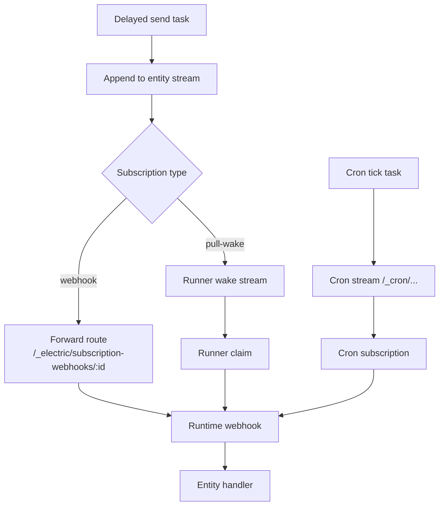
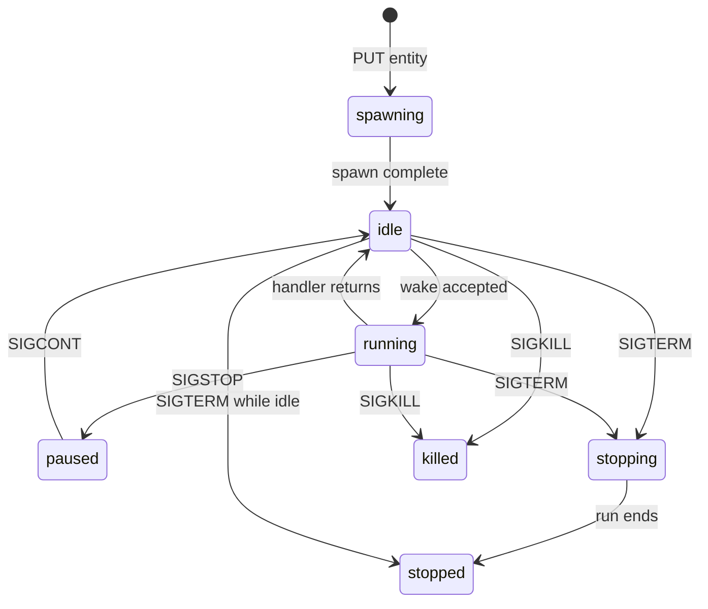

# Wake dispatch and entity lifecycle

A wake is a request to run an entity handler. Four sources can produce a wake: a stream subscription, a runner pull, a delayed send, and a cron tick. This document explains all four, how they are deduplicated, and how an entity moves between statuses.

## The four wake sources

| Source | Produced by | Target | Transport |
|--------|-------------|--------|-----------|
| Stream subscription | Durable Streams | Runtime webhook | Signed HTTP `POST` |
| Pull wake | Durable Streams subscription of type `pull-wake` | Runner poll loop | Claim, ack, release |
| Delayed send | PostgreSQL `scheduled_tasks` | Entity stream | Internal append |
| Cron tick | PostgreSQL `scheduled_tasks` | Cron stream | Internal append |



## Webhook dispatch

A webhook wake has five steps.

### Step 1: the stream server detects an append

The subscription holds a list of stream paths. When any of them grows, the server builds a notification. The notification names the stream, the new offset, the entity, and a callback URL.

### Step 2: the server forwards to itself

The subscription webhook URL is the agents-server forward route:

```text
${publicUrl}/_electric/subscription-webhooks/${encodeURIComponent(subscriptionId)}
```

Source: `packages/agents-server/src/routing/dispatch-policy.ts:326-331`.

The real target URL is in the `subscription_webhooks` table. The forward route reads it and rewrites loopback addresses when the target runs in another container.

### Step 3: the forward route signs the request

The server adds a `webhook-signature` header. The signature is an Ed25519 signature over the request body. The runtime verifies it against the JSON Web Key Set (JWKS) at `/__ds/jwks.json`.

Source: `packages/agents-server/src/webhook-signing.ts`.

### Step 4: the runtime claims the wake

`processWake` calls the notification's callback with `{ epoch, wakeId }`. The callback returns a write token. The write token authorizes appends for this wake.

The claim and the stream preload run in parallel:

```ts
const [claimed] = await Promise.all([claimPromise, preloadPromise])
```

Source: `packages/agents-runtime/src/process-wake.ts:1210`.

### Step 5: the runtime acknowledges

After the handler returns and the producer flushes, the runtime acknowledges the wake. A failed acknowledge leaves the wake open for recovery.

## Pull-wake dispatch

A pull-wake subscription is used when the runtime cannot accept inbound webhooks. Common cases are a laptop behind a network address translator, a sandbox, and a runner that the server cannot reach.

### Setup

`linkStreamToTargetSubscription` creates the subscription:

```ts
await ensureSubscriptionIncludesStream(ctx, subscriptionId, streamPath, {
  type: `pull-wake`,
  streams: [streamPath],
  wake_stream: wakeStream,
  description: `Electric Agents runner ${target.runnerId}`,
}, existing)
```

Source: `packages/agents-server/src/routing/dispatch-policy.ts:297-310`.

The wake stream is `runner.wake_stream` if the runner record has one. Otherwise it is `runnerWakeStream(runnerId)`.

### Claim, ack, release

| Operation | Endpoint | Effect |
|-----------|----------|--------|
| Claim | `POST /_electric/runners/:id/claim` | Takes one wake, returns a claim token and a lease |
| Ack | `POST /_electric/wake-callbacks/:consumerId` | Marks the wake complete |
| Release | subscription release route | Returns the wake for another runner |

A claim has a lease. If the runner crashes, the lease expires and another runner can claim the same wake.

Source: `packages/agents-server/src/routing/runners-router.ts:130`.

## Wake conditions

A wake registration has a condition. The `WakeRegistry` checks every event against every condition.

| Condition | Matches when |
|-----------|--------------|
| `runFinished` | A `run` event changes to status `completed` or `failed` |
| `{ on: 'change', collections?, ops? }` | A matching collection event occurs with a matching operation |

Source: `packages/agents-server/src/wake-registry.ts:19-31`.

A registration also carries:

| Field | Purpose |
|-------|---------|
| `subscriberUrl` | Where to send the wake |
| `sourceUrl` | Which stream to watch |
| `debounceMs` | Wait this long and merge events |
| `timeoutMs` | Fire even if no event arrives |
| `oneShot` | Remove the registration after the first wake |
| `includeResponse` | Include the matching event data |
| `manifestKey` | Tie the registration to a manifest entry |

**Aha: the wake registry is a shape consumer.** The registry does not poll PostgreSQL. It opens an Electric Shape stream:

```ts
const stream = new ShapeStream<WakeRegistrationShapeRow>({
  url: electricUrlWithPath(electricUrl, `/v1/shape`).toString(),
  params: {
    table: `wake_registrations`,
    ...(this.tenantId
      ? { where: `tenant_id = ${sqlStringLiteral(this.tenantId)}` }
      : {}),
    ...(electricSecret ? { secret: electricSecret } : {}),
    columns: [
      `id`, `tenant_id`, `subscriber_url`, `source_url`,
      `condition`, `debounce_ms`, `timeout_ms`, `one_shot`,
      `timeout_consumed`, `include_response`, `manifest_key`, `created_at`,
    ],
    replica: `full`,
  },
  ...
})
```

Source: `packages/agents-server/src/wake-registry.ts:190-213`.

This reuses the Electric Sync engine as a change feed for the control plane. The same protocol that synchronizes user data to browsers synchronizes wake rules to the server. The server keeps an in-memory cache and updates it from the shape messages.

## The scheduler

The scheduler owns two task kinds: `delayed_send` and `cron_tick`.

```ts
export type SchedulerTaskKind = 'delayed_send' | 'cron_tick'
```

Source: `packages/agents-server/src/scheduler.ts`.

### Task table

| Column | Purpose |
|--------|---------|
| `kind` | `delayed_send` or `cron_tick` |
| `run_at` | When the task becomes due |
| `payload` | Task-specific data |
| `claimed_by` | Which scheduler instance owns the task |
| `claimed_at` | When the claim was taken |
| `completed_at` | When the task finished |

Source: `packages/agents-server/src/scheduler.ts`.

### Claim and recovery

A scheduler instance claims a task and records the claim time. If the instance dies, the claim expires after `claimExpiryMs`, which defaults to 30,000 milliseconds. `reclaimStaleClaims()` finds expired claims and clears them.

Source: `packages/agents-server/src/scheduler.ts:285, 468-500`.

### Delayed send

`executeDelayedSend(payload, taskId)` appends a message to the target entity stream. It uses the same send path as a user message. The wake then follows the normal subscription path.

Source: `packages/agents-server/src/runtime.ts:328`.

### Cron tick

A cron schedule is encoded in a stream path:

```text
/_cron/<base64url of {expression, timezone}>
```

`getCronStreamPath` in `packages/agents-runtime/src/cron-utils.ts` builds the path. `parseCronStreamPath` reverses it.

On each tick the runtime appends a `cron_tick` event with an idempotent producer:

```ts
const tickEvent = {
  type: `cron_tick`,
  key: `tick-${tickNumber}`,
  value: {
    expression: spec.expression,
    timezone: spec.timezone,
    firedAt: new Date().toISOString(),
    tickNumber,
  },
  ...
}
await this.streamClient.appendIdempotent(
  streamPath,
  new TextEncoder().encode(JSON.stringify(tickEvent)),
  { producerId: `scheduler-cron-${encodedExpression}-${tickNumber}` }
)
await this.manager.evaluateWakes(streamPath, tickEvent)
```

Source: `packages/agents-server/src/runtime.ts:388-419`.

The producer identifier includes the tick number. A retry of the same tick deduplicates. A new tick gets a new identifier.

### Rehydration on restart

`rehydrateCronSchedules()` rebuilds cron state after a restart:

1. Read `wake_registrations`.
2. For each source that starts with `/_cron/`, parse the spec.
3. Recreate the cron stream if it is missing.
4. Register the next tick.

Then it replays each entity's `manifest` events from its main stream. A manifest entry can declare a cron schedule, a future send, a shared state link, or a child entity. Replay recreates those side effects.

Source: `packages/agents-server/src/runtime.ts`.

**Aha: schedules are derived, not primary.** The manifest events in the entity stream are the source of truth for an entity's schedules. The `scheduled_tasks` table is a projection. After a restart, the server replays the manifests and rebuilds the projection. This means a schedule survives a database restore, as long as the stream survives.

## Entity lifecycle

An entity has seven statuses.



| Status | Meaning | Accepts normal writes |
|--------|---------|----------------------|
| `spawning` | Creation in progress | No |
| `running` | A handler is active | Yes |
| `idle` | No handler is active | Yes |
| `paused` | Stopped by `SIGSTOP` | Yes |
| `stopping` | A stop was requested | No |
| `stopped` | Stopped normally | No |
| `killed` | Killed | No |

Source: `packages/agents-server/src/electric-agents-types.ts:19-26, 357-363`.

`rejectsNormalWrites` returns true for `stopping`, `stopped`, and `killed`. A write to such an entity returns an error, except for the system signal path that performs the transition.

### Signals

Seven signals exist:

| Signal | Expected result |
|--------|-----------------|
| `SIGINT` | Abort the active handler |
| `SIGHUP` | Reload or notify |
| `SIGTERM` | Stop; `idle` becomes `stopped`, `running` becomes `stopping` |
| `SIGKILL` | Kill immediately; status becomes `killed` |
| `SIGSTOP` | Pause; `idle` becomes `paused` |
| `SIGCONT` | Resume; `paused` becomes `idle` |
| `SIGUSR` | Application-defined |

Source: `packages/agents-server/src/electric-agents-types.ts:23-31, 366-380`.

A signal is stored as an event in the entity stream, not only as a database update. This keeps the stream as the audit log. The runtime also reacts to signals during a wake. For example, `SIGINT` aborts the active handler invocation.

Source: `packages/agents-runtime/src/process-wake.ts:868-872`.

## Run completion wakes

A parent entity often needs to know when a child finishes. The condition `runFinished` provides this.

`checkRunFinished` inspects a `run` event. The event matches when the operation is `update` and the status is `completed` or `failed`. The matching wake carries the final response if `includeResponse` is set.

This mechanism lets an agent spawn a child, continue its own work, and receive a wake when the child is done. It is the basis for hierarchical agent designs.

## Deduplication and ordering

Three mechanisms prevent duplicate work:

1. **Idempotent producers.** The producer tuple `(Producer-Id, Producer-Epoch, Producer-Seq)` deduplicates append retries.
2. **Wake identity.** A wake has a `wakeId`. The server records the notification and the claim. A repeated delivery with the same identifier is not a new unit of work.
3. **Per-entity wake queue.** The runtime tracks pending wakes per entity. A new wake for a busy entity waits in the queue instead of running two handlers in parallel.

Source: `packages/agents-runtime/src/create-handler.ts` (`dispatchWake`, `pendingWakes`) and `packages/agents-runtime/src/process-wake.ts` (`queuedNextWake`).

## Aha summary

| Insight | Why it matters |
|---------|----------------|
| The wake registry consumes an Electric Shape | Control-plane changes propagate through the same sync engine as user data |
| Cron schedules are projections of stream manifests | A schedule survives a database restore |
| Signals are stream events | The audit log and the control path agree |
| Claims have leases | A crashed runner does not block a wake forever |
| The forward route signs every delivery | The stream server never needs the runtime's address or secret |

## Related documents

- [04-how-the-runtime-sets-up-a-stream.md](04-how-the-runtime-sets-up-a-stream.md) — stream creation.
- [06-security-tenancy-and-permissions.md](06-security-tenancy-and-permissions.md) — signatures and grants.
- [agents-server/05-wake-registry-and-scheduler.md](agents-server/05-wake-registry-and-scheduler.md) — server detail.
- [agents-runtime/03-wake-processing.md](agents-runtime/03-wake-processing.md) — runtime detail.
- [durable-streams/03-live-reads-and-subscriptions.md](durable-streams/03-live-reads-and-subscriptions.md) — protocol detail.
