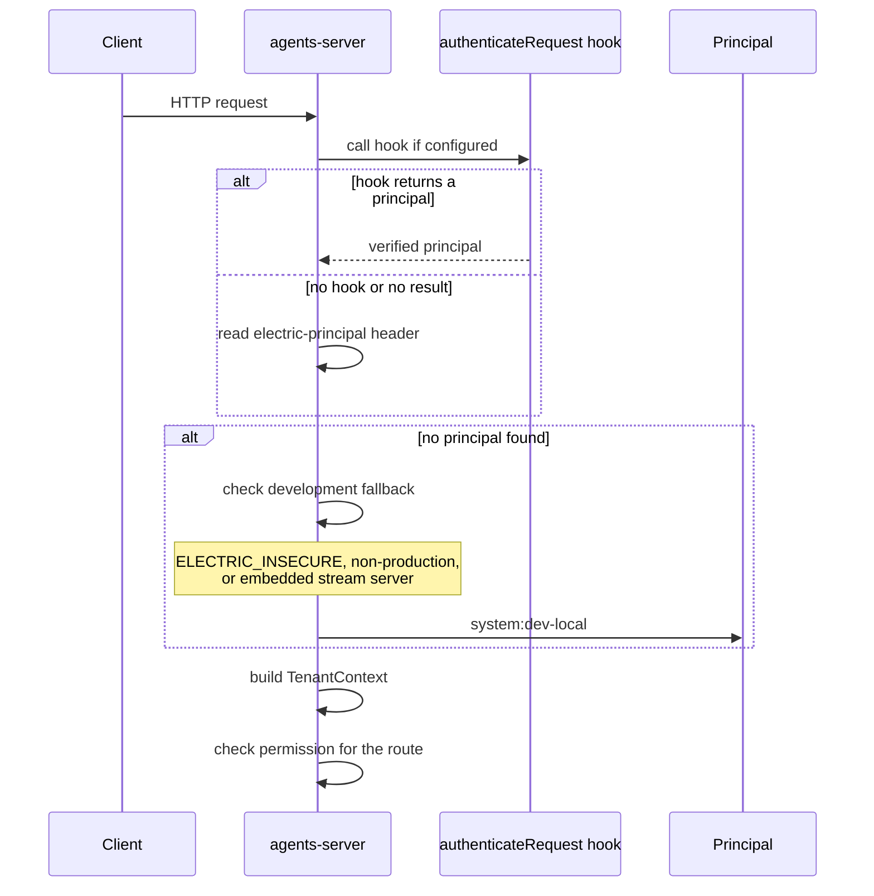
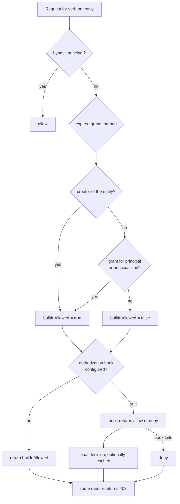

# Security, tenancy, and permissions

Electric Agents uses four security boundaries: the **principal**, the **tenant**, the **permission grant**, and the **webhook signature**. Each boundary answers a different question. This document explains each one and shows where the code enforces it.

| Boundary | Question it answers |
|----------|--------------------|
| Principal | Who is calling? |
| Tenant | Which isolated workspace does the call belong to? |
| Permission grant | May this principal perform this verb on this resource? |
| Webhook signature | Did this wake really come from the server? |

## Principals

A principal is an identity. It has four fields:

```ts
export interface Principal {
  kind: PrincipalKind
  id: string
  key: string
  url: string
}
```

Source: `packages/agents-server/src/principal.ts:3-8`.

The kind is one of `user`, `agent`, `service`, or `system`. The key has the form `kind:id`. The URL is `/principal/<encoded key>`.

```ts
export function parsePrincipalKey(input: string): Principal {
  const colon = input.indexOf(`:`)
  if (colon <= 0) throw new Error(`Invalid principal identifier`)
  const kind = input.slice(0, colon) as PrincipalKind
  const id = input.slice(colon + 1)
  if (!PRINCIPAL_KINDS.has(kind)) throw new Error(`Invalid principal kind`)
  if (!id || id.includes(`/`)) throw new Error(`Invalid principal id`)
  const key = `${kind}:${id}`
  return { kind, id, key, url: `/principal/${encodeURIComponent(key)}` }
}
```

Source: `packages/agents-server/src/principal.ts:20-30`.

### How a request gets a principal

`buildTenantContext` tries three sources in order:

1. The `authenticateRequest` hook, when the embedding application provides one.
2. The `electric-principal` request header.
3. The development principal `system:dev-local`.

Source: `packages/agents-server/src/server.ts:389-405`.



The order matters. A hook has priority over a header, so a deployment can ignore a client-supplied identity. The fallback comes last, but its condition is broad. An embedded server enables it even in a production process.

The development principal is allowed only when one of three conditions holds:

```ts
return (
  process.env.ELECTRIC_INSECURE === `true` ||
  process.env.NODE_ENV !== `production` ||
  Boolean(this.options.durableStreamsServer)
)
```

Source: `packages/agents-server/src/server.ts:393-401`.

**Warning:** an embedded stream server is enough to enable the fallback. A production deployment that embeds the stream server without `NODE_ENV=production` and without an authentication hook accepts anonymous requests as `system:dev-local`. Document [07-critical-assessment.md](07-critical-assessment.md) treats this as a deployment risk.

### Built-in system principals

Three system principal identifiers bypass permission checks:

| Identifier | Purpose |
|------------|---------|
| `system:framework` | Internal framework operations |
| `system:auth-sync` | Identity synchronization |
| `system:dev-local` | Local development |

Source: `packages/agents-server/src/principal.ts:74-78`.

The function `isPermissionBypassPrincipal` returns true for these three identities.

## Tenancy

A tenant is a service identifier. The default is `default`. The runtime, the registry, and the scheduler all take a `tenantId`.

Stream paths receive a tenant prefix through `prefixTenantStreamPath`:

```ts
export function prefixTenantStreamPath(path: string, tenantId: string): string {
  const normalized = withoutLeadingSlash(path)
  if (!normalized || normalized === tenantId) return tenantId
  if (normalized.startsWith(`${tenantId}/`)) return normalized
  return `${tenantId}/${normalized}`
}
```

Source: `packages/agents-server/src/routing/tenant-stream-paths.ts:8-14`.

In a multi-tenant deployment, the same entity URL in two tenants maps to two different stream paths:

| Tenant | Entity URL | Stream path |
|--------|------------|-------------|
| `acme` | `/assistant/abc` | `/acme/assistant/abc/main` |
| `globex` | `/assistant/abc` | `/globex/assistant/abc/main` |

PostgreSQL tables carry a `tenant_id` column. The wake registry adds a tenant filter to its Shape query. The permission tables carry the tenant identifier in their primary selection.

**Aha: tenancy is enforced at the path level, not only at the query level.** Even if two tenants use the same entity identifier, the stream backend sees different paths. A path mistake cannot leak bytes across tenants unless the prefix is removed deliberately.

## Permission grants

An entity permission is one of eight verbs:

| Verb | Allows |
|------|--------|
| `read` | Read the entity and its stream |
| `write` | Send messages and write collections |
| `delete` | Kill the entity |
| `signal` | Send a signal |
| `fork` | Fork the entity |
| `schedule` | Create and delete schedules |
| `spawn` | Create child entities |
| `manage` | Manage grants |

Source: `packages/agents-server/src/electric-agents-types.ts:76-85`.

An entity type permission is one of two verbs: `spawn` and `manage`.

### Grant record

An entity grant has these fields:

| Field | Meaning |
|-------|---------|
| `entity_url` | The protected entity |
| `permission` | One of the eight verbs |
| `subject_kind` | `principal` or `principal_kind` |
| `subject_value` | A principal URL or a principal kind |
| `propagation` | `self` or `descendants` |
| `copy_to_children` | Copy the grant when a child is created |
| `created_by` | The granting principal |
| `expires_at` | Optional expiry time |

Source: `packages/agents-server/src/db/schema.ts:144-192`.

A grant with `subject_kind = principal_kind` and `subject_value = agent` allows every agent principal. This is useful for broad agent-to-agent collaboration inside one tenant.

### The check

`canAccessEntity` is the main check:

```ts
export async function canAccessEntity(
  ctx: TenantContext,
  entity: ElectricAgentsEntity,
  permission: EntityPermission,
  request?: Request
): Promise<boolean> {
  if (isPermissionBypassPrincipal(ctx)) return true
  await ctx.entityManager.registry.pruneExpiredPermissionGrants?.()

  const builtInAllowed =
    entity.created_by === ctx.principal.url ||
    (await ctx.entityManager.registry.hasEntityPermission(
      entity.url,
      permission,
      principalSubject(ctx.principal)
    ))

  return await applyAuthorizationHook(ctx, {
    verb: permission,
    resourceKey: `entity:${entity.url}`,
    resource: { kind: `entity`, entity },
    builtInAllowed,
    request,
  })
}
```

Source: `packages/agents-server/src/permissions.ts:30-49`.

The rule is: **the creator always has access, and a grant can add access.** The function then passes the decision to an optional authorization hook.



The hook is where a product adds its own policy. It receives the built-in answer and the full request. A failure inside the hook becomes a denial, which is the safe default.

### The authorization hook

The hook is a function of type `AuthorizeRequest`. It receives:

| Field | Meaning |
|-------|---------|
| `tenant` | The service identifier |
| `principal` | The caller |
| `verb` | The requested permission |
| `resource` | The entity, type, or shared state |
| `request` | Method, URL, and headers |
| `builtInAllowed` | The result of the built-in check |

It returns `{ decision: 'allow' | 'deny', expires_at?: string }`.

The hook can override the built-in decision in either direction. A failed hook is treated as a denial, not as an error. A decision with `expires_at` is cached until that time.

Source: `packages/agents-server/src/permissions.ts:158-210`.

**Aha: the built-in rules are a floor, not a ceiling.** An embedding application can deny access that the built-in rules would allow. It can also allow access that the built-in rules would deny, because it receives `builtInAllowed` as input and returns the final answer. This is how a product adds organization roles, billing checks, or policy engines without forking the server.

### Shared state

Shared state has a second authorization rule. Access is allowed if the caller can access **any** linked entity.

```ts
for (const entityUrl of linkedEntityUrls) {
  const entity = await ctx.entityManager.registry.getEntity(entityUrl)
  if (!entity) continue
  if (
    entity.created_by === ctx.principal.url ||
    (await ctx.entityManager.registry.hasEntityPermission(entity.url, permission, principalSubject(ctx.principal)))
  ) {
    return await applyAuthorizationHook(ctx, { ... builtInAllowed: true ... })
  }
}
```

Source: `packages/agents-server/src/permissions.ts:99-155`.

This rule lets two agents collaborate through a shared board when either agent has access to the board through its own entity.

## Webhook signatures

Every webhook delivery carries a `webhook-signature` header. The format is:

```text
t=<unix seconds>,kid=<key id>,ed25519=<base64url signature>
```

The signed bytes are the timestamp, a dot, and the request body:

```ts
export function bytesWithTimestamp(
  timestamp: number | string,
  body: Uint8Array | string
): Buffer {
  const prefix = encoder.encode(`${timestamp}.`)
  const bodyBytes = typeof body === `string` ? encoder.encode(body) : body
  return Buffer.concat([Buffer.from(prefix), Buffer.from(bodyBytes)])
}
```

Source: `packages/agents-server/src/webhook-signing.ts:100-110`.

The signing key is Ed25519. The server generates one at start if no key is provided. The public key is published as a JSON Web Key Set at `/__ds/jwks.json`.

The runtime verifies the signature before it processes a wake. The verification also rejects an old timestamp outside the tolerance window.

Source: `packages/agents-runtime/src/create-handler.ts` (`handleWebhookRequest`).

### Why sign the body and the timestamp

The timestamp prevents a replay attack. An attacker who captures one valid request cannot replay it later, because the verified timestamp moves outside the tolerance window. The body signature prevents tampering. An attacker cannot change the stream path or the callback URL without breaking the signature.

**Aha: the runtime never trusts the request fields.** The stream path, the entity URL, and the callback URL all arrive in the signed body. The runtime verifies the signature first, then parses the body. An unsigned request is dropped before any lookup.

## Write tokens

A runner often has no principal. The server issues a per-entity `write_token` when it creates the entity. The token authorizes appends to that entity's stream.

The claim callback returns a write token scoped to one wake. The runtime attaches it to producer writes:

```ts
const producer = new IdempotentProducer(stream, `entity-${entityUrl}`, {
  epoch,
  autoClaim: true,
  fetch: (input, init) => {
    const headers = new Headers(init?.headers)
    if (writeToken) {
      applyClaimTokenHeader(
        headers,
        config.claimTokenHeader ?? `authorization`,
        writeToken
      )
    }
    return globalThis.fetch(input, { ...init, headers })
  },
  ...
})
```

Source: `packages/agents-runtime/src/process-wake.ts:536-553`.

The claim token can travel in three header positions, selected by `claimTokenHeader`:

| Value | Header |
|-------|--------|
| `authorization` | `Authorization: Bearer <token>` |
| `electric-claim-token` | `Electric-Claim-Token: <token>` |
| `both` | Either header |

Source: `packages/agents-runtime/src/process-wake.ts:214-236`.

## Threat summary

| Threat | Control |
|--------|---------|
| Anonymous caller in production | Authentication hook or production mode; development fallback is disabled |
| Cross-tenant data read | Tenant prefix on every stream path; `tenant_id` on every table |
| Unauthorized entity access | Creator rule plus grant check plus optional hook |
| Forged wake | Ed25519 signature over timestamp and body |
| Replayed wake | Timestamp tolerance window |
| Unauthorized append | Per-wake claim token |
| Duplicate append after retry | Idempotent producer tuple |
| Deleted stream still readable through a fork | Soft deletion with `410 Gone` on the source URL |

## Related documents

- [05-wake-dispatch-and-entity-lifecycle.md](05-wake-dispatch-and-entity-lifecycle.md) — where the signature is checked.
- [agents-server/08-tenancy-permissions-and-principals.md](agents-server/08-tenancy-permissions-and-principals.md) — server detail.
- [durable-streams/02-protocol-operations.md](durable-streams/02-protocol-operations.md) — protocol security rules.
- [07-critical-assessment.md](07-critical-assessment.md) — the development fallback risk.
