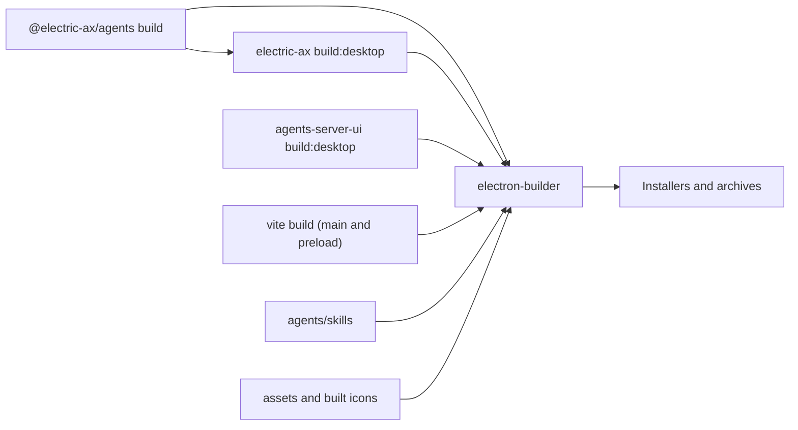
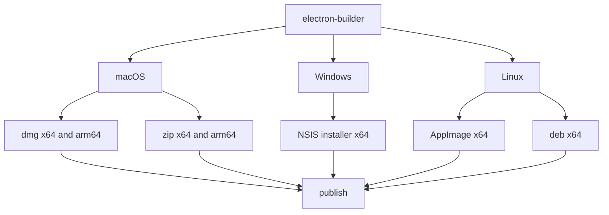

# Packaging and release

The desktop package produces two Node.js bundles: the main process bundle and the preload bundle. It assembles an application from those bundles, a renderer copy built by another package, a command-line interface, agent skills, and assets. The result is one or more installers and archives per platform. This document explains the build chain, the Vite configuration, the electron-builder configuration, and the update policy.

## The build chain



The package build script runs four commands in order:

```json
// packages/agents-desktop/package.json:12
"build": "pnpm --filter @electric-ax/agents build && pnpm --filter electric-ax build:desktop && pnpm --filter @electric-ax/agents-server-ui build:desktop && vite build",
```

1. Build the embedded agents package. The command-line interface build bundles `@electric-ax/agents`, so that output must exist first.
2. Build the command-line interface for the desktop bundle. The build writes `packages/electric-ax/dist-desktop`.
3. Build the user interface in desktop mode. This writes `packages/agents-server-ui/dist-desktop`.
4. Build the Electron main and preload bundles. This writes `packages/agents-desktop/dist`.

The last step does not depend on the first three. The Electron Vite configuration compiles only `src/main.ts` and `src/preload.ts`. The earlier commands exist because `electron-builder` needs their output. Source: `packages/agents-desktop/vite.config.ts:60-84` and `packages/electric-ax/tsdown.desktop.config.ts:13-35`.

## Development build

The development script runs one setup command, then starts two child processes:

```json
// packages/agents-desktop/package.json:13
"dev": "pnpm run ensure:electron && concurrently -k -n ui,desktop -c cyan,green \"pnpm run dev:ui\" \"pnpm run dev:desktop\"",
```

- `ensure:electron` runs the Electron package install script. It downloads the Electron binary for the installed version.
- `dev:ui` starts the `agents-server-ui` development server on port 5183.
- `dev:desktop` waits for that port with `wait-on`, then starts Vite with the Electron plugin.

Source: `packages/agents-desktop/package.json:13-16`.

The Electron plugin does four things in development:

1. Builds the main bundle in watch mode.
2. Builds the preload bundle in watch mode.
3. Starts Electron after the first build.
4. Restarts the Electron child process after a rebuild.

Source: `packages/agents-desktop/vite.config.ts:68-79`.

The plugin sets `ELECTRIC_DESKTOP_DEV_SERVER_URL` in the environment before it starts Electron. The main process reads this value and loads the development server. Source: `packages/agents-desktop/vite.config.ts:111-118`.

## The Electron bundles

```ts
// packages/agents-desktop/vite.config.ts:127
output: [
  {
    entryFileNames: `main.cjs`,
    format: `cjs`,
    inlineDynamicImports: true,
  },
],
```

Both the main build and the preload build set these values. The excerpt shows only the output names.

| Setting | Value | Reason |
|---------|-------|--------|
| Format | CommonJS (CJS) | Electron can load a `.cjs` main script and preload script without a module-type negotiation |
| Output directory | `dist` | The package `main` field points to `./dist/main.cjs` |
| Empty output directory | `false` | The main and preload builds share one directory |
| Source maps | `inline` | A packaged build stays debuggable without extra map files |
| Minify | `false` | The bundles stay readable, and the size cost is small |
| Dynamic imports | Inline | The main bundle is one file |

Source: `packages/agents-desktop/vite.config.ts:119-155` and `packages/agents-desktop/package.json:10`.

The preload path resolves at runtime:

```ts
// packages/agents-desktop/src/shared/paths.ts:18
export const PRELOAD_PATH = path.resolve(MODULE_DIR, `preload.cjs`)
```

`MODULE_DIR` is the directory of the compiled main bundle. In development it is `dist`. In the packaged application it is inside the application archive. Source: `packages/agents-desktop/src/shared/paths.ts:5-18`.

### External modules

Some modules must stay outside the bundle. They either contain native code, have optional parts, or load optional dependencies at runtime.

```ts
// packages/agents-desktop/vite.config.ts:12
const MUST_EXTERNALIZE = new Set([
  `electron`,
  `electron-updater`,
  `better-sqlite3`,
  `sqlite-vec`,
  `canvas`,
  `bufferutil`,
  `utf-8-validate`,
  `jsdom`,
  `pino`,
  `pino-pretty`,
  `dockerode`,
  `ssh2`,
  `cpu-features`,
  `e2b`,
])
```

Source: `packages/agents-desktop/vite.config.ts:12-32`.

The list covers four groups:

1. Electron and its updater: `electron` and `electron-updater`.
2. Native database modules: `better-sqlite3` and `sqlite-vec`.
3. Native or optional libraries: `canvas`, `bufferutil`, `utf-8-validate`, `jsdom`, `pino`, and `pino-pretty`.
4. Optional remote execution modules: `dockerode`, `ssh2`, `cpu-features`, and `e2b`. The Docker and remote sandbox profiles are optional execution modes for agent sessions.

A regex also externalises a package when a transitive import resolves through a nested `node_modules` path. The regex extracts the package name and tests it against the same set. Source: `packages/agents-desktop/vite.config.ts:34-49`.

## Renderer and resources

`electron-builder` copies five resource entries into the application:

| Source | Destination | Purpose |
|--------|-------------|---------|
| `../agents-server-ui/dist-desktop` | `renderer` | The user interface |
| `assets` | `assets` | Tray and application icons |
| `../agents/skills` | `agent-skills` | Built-in agent skills |
| `../electric-ax/dist-desktop` | `cli/electric-ax/dist` | The bundled `electric` command |
| `../electric-ax/docker-compose.full.yml` | `cli/electric-ax/docker-compose.full.yml` | Local server compose file |

Source: `packages/agents-desktop/electron-builder.yml:15-33`.

The `@electric-ax/agents` build output is not a resource entry. The command-line interface build bundles it into `dist-desktop`. The Vite main build also compiles it through an alias. Source: `packages/agents-desktop/vite.config.ts:88-96`.

The bundled command-line interface becomes the `electric` command at run time. The installer is a small shim script, not a symbolic link. On macOS and Linux it is `~/.local/bin/electric`. On Windows it is `AppData\Local\Electric\bin\electric.cmd`. The shim starts the Electron binary with `ELECTRON_RUN_AS_NODE=1` and the bundled entry path. Source: `packages/agents-desktop/src/cli/controller.ts:132-145` and `packages/agents-desktop/src/cli/controller.ts:224-241`.

The application archive packs `dist`, `assets`, and `package.json`. The `assets` directory appears twice: once inside the archive from the `files` list, and once in the application resources from `extraResources`. The tray and icon paths read the resource copy. The `files` list does not exclude production dependencies except `node_modules/@rollup`, so the external modules stay in the archive as production dependencies. Every native `.node` file, `better-sqlite3`, and `sqlite-vec` is unpacked from the archive. A native module cannot load from inside an archive. Source: `packages/agents-desktop/electron-builder.yml:9-39`.

```yaml
# packages/agents-desktop/electron-builder.yml:35
asar: true
asarUnpack:
  - '**/*.node'
  - '**/node_modules/better-sqlite3/**/*'
  - '**/node_modules/sqlite-vec/**/*'
```

## Release targets



| Platform | Targets | Architectures | Notes |
|----------|---------|---------------|-------|
| macOS | `dmg`, `zip` | `x64`, `arm64` | Hardened runtime on, Gatekeeper assessment off. The configuration sets no signing identity and no notarization. |
| Windows | `nsis` | `x64` | |
| Linux | `AppImage`, `deb` | `x64` | The `deb` package records the maintainer name and address as `ElectricSQL <info@electric-sql.com>`. |

Source: `packages/agents-desktop/electron-builder.yml:41-73`.

A macOS build without a Developer ID certificate is unsigned. The updater section below explains the result.

The artifact name is `Electric-Agents-${os}-${arch}.${ext}`. The output directory is `release`. Source: `packages/agents-desktop/electron-builder.yml:3-7`.

### Publish channel

The update provider is `generic`, not `github`. A generic provider is a static file host. The updater reads a metadata file, such as `latest-mac.yml`, from the configured URL. That file names the newest version and the installer files. The configuration comment explains why the project does not use the GitHub provider: the repository publishes many packages to the same Releases page, and GitHub's "latest" marker follows the most recent tag from any package. A desktop build would then find the wrong release metadata.

```yaml
# packages/agents-desktop/electron-builder.yml:84
provider: generic
url: 'https://github.com/electric-sql/electric/releases/download/agents-desktop-latest'
```

Source: `packages/agents-desktop/electron-builder.yml:75-85`.

The release workflow `.github/workflows/agents_desktop_build.yml` moves the `agents-desktop-latest` tag. A canary build overrides the URL to `agents-desktop-canary` with an electron-builder command-line setting, `-c.publish.url=...`. Source: `.github/workflows/agents_desktop_build.yml:161-162`, `.github/workflows/agents_desktop_build.yml:258-259`, and `.github/workflows/agents_desktop_build.yml:275-276`.

## Icons

`build-icons.mjs` removes two directories, `build` and `build-mac-icon`, then runs `electron-icon-builder` twice:

1. The general `assets/icon.png` produces Windows and Linux icon sets in `build/icons`.
2. The macOS `assets/icon-mac.png` produces the macOS icon set in the temporary `build-mac-icon` directory.

The script copies `build-mac-icon/icons/mac/icon.icns` to `build/icons/mac/icon.icns`, then removes the temporary directory. `build` is the electron-builder `buildResources` directory. Source: `packages/agents-desktop/scripts/build-icons.mjs:8-39` and `packages/agents-desktop/electron-builder.yml:5-6`.

The `dist` scripts run the icon build and the native module rebuild before `electron-builder`. Source: `packages/agents-desktop/package.json:18-23`.

## Installer scripts

| Script | Effect |
|--------|--------|
| `dist` | Build for the current platform, without publishing |
| `dist:linux` | Build Linux targets only |
| `dist:mac` | Build macOS targets only |
| `dist:win` | Build Windows targets only |
| `publish:desktop` | Build and publish |
| `rebuild:native` | Rebuild native modules for the Electron application binary interface |
| `ensure:electron` | Download and install the Electron binary for the installed Electron package |

Source: `packages/agents-desktop/package.json:17-25`.

`rebuild:native` runs `electron-builder install-app-deps`. A native module built for the Node.js version on the machine may not load in Electron. Source: `packages/agents-desktop/package.json:24`.

## Type checking and tests

`typecheck` runs `tsc --noEmit`. The TypeScript configuration is strict and includes `src` and `vite.config.ts`. Source: `packages/agents-desktop/package.json:27` and `packages/agents-desktop/tsconfig.json:2-22`.

The package has two test files:

- `src/cloud/auth-injection.test.ts`
- `src/cloud/server-fetch.test.ts`

They use the Node.js built-in test runner (`node:test`) and `node:assert/strict`. Source: `packages/agents-desktop/src/cloud/auth-injection.test.ts:1-2` and `packages/agents-desktop/src/cloud/server-fetch.test.ts:1-2`.

The package defines no `test` script. The `coverage` script is the literal command `true`, which does nothing. Source: `packages/agents-desktop/package.json:26`. A reader should not expect an automated desktop test suite in this package.

## Update behaviour after release

The updater reads the `generic` provider URL. It checks 10 seconds after startup. `autoDownload` is `false`, so the application shows a native dialog with a Download action before it downloads an installer. After the download, it shows a restart prompt. Source: `packages/agents-desktop/src/app/updater.ts:49-56` and `packages/agents-desktop/src/app/updater.ts:259-261`.

On macOS this version is notifier-only. `MAC_AUTO_INSTALL_SUPPORTED` is `false`, because Squirrel.Mac needs a Developer ID signature. The source comment says signing and notarization are not in continuous integration (CI) yet. A manual check opens the releases page. On Windows and Linux, the application downloads the update and offers a restart. If the user dismisses the restart prompt, the installer runs on the next quit, because `autoInstallOnAppQuit` is true. Source: `packages/agents-desktop/src/app/updater.ts:7-23` and `packages/agents-desktop/src/app/updater.ts:148-165`.

A manual check comes from the application menu item `Check for Updates…` or the app-icon menu. The updater is disabled in an unpackaged build. A manual check shows a message that updates exist only in packaged builds. Source: `packages/agents-desktop/src/ui/application-menu.ts:83-84` and `packages/agents-desktop/src/app/updater.ts:246-281`.

## Aha: the installer is assembled from five independent builds

**Aha:** This package does not produce a self-contained application from its own source. It assembles an application from five build outputs: the embedded agents, the command-line interface, the renderer, the main bundle, and the preload bundle. `electron-builder` copies the renderer, the command-line interface, the agent skills, the assets, and the compose file as extra resources. It packs the main bundle and the preload bundle into the application archive. The embedded agents are compiled into the main bundle through a Vite alias and into the command-line interface bundle. This is why the build script runs three other package builds before `vite build`. A missing `dist-desktop` does not fail the TypeScript or Vite build, because the renderer is a separate project. The packaged window then has no `renderer/index.html`.

Most runtime paths switch between the development and packaged layouts in one place:

```ts
// packages/agents-desktop/src/shared/paths.ts:7
export const RESOURCE_DIR = app.isPackaged ? process.resourcesPath : PACKAGE_DIR
```

Most resource paths use `RESOURCE_DIR`. The preload path uses `MODULE_DIR`, because the preload must sit next to the compiled main bundle. A packaging change therefore needs a small number of path changes, not a search through the code. Source: `packages/agents-desktop/src/shared/paths.ts:5-31`.

## Related documents

- [Main process](01-main-process.md) explains the updater and the runtime that these bundles start.
- [Renderer and IPC](02-renderer-and-ipc.md) explains the preload bundle.
- [Overview](00-overview.md) explains the package boundaries.
- [agents-server-ui build and testing](../agents-server-ui/06-build-and-testing.md) explains the renderer build that this package copies.
