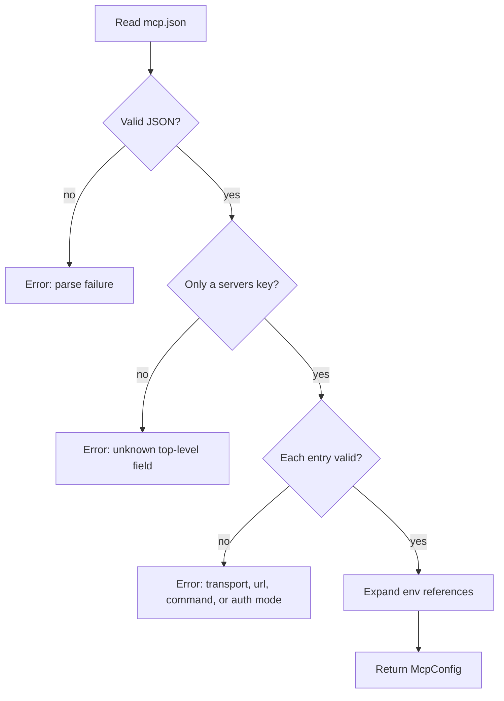
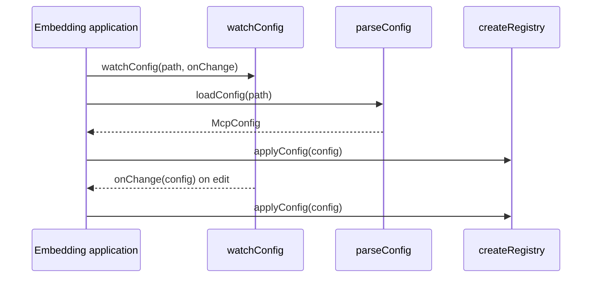

# Overview of the agents-mcp package

This document describes the package exports, the configuration file schema, and the data types that the rest of the package uses.

## Package exports

The public surface has seven groups.

| Group | Exports | Purpose |
|-------|---------|---------|
| Types | `McpAuthConfig`, `McpServerConfig`, `McpConfig`, `McpToolsSentinel`, `McpServerStatus`, `McpToolError` | Shared data shapes |
| Tools helper | `mcp`, `isMcpToolsSentinel`, `MCP_TOOLS_SENTINEL`, `filterByAllowlist` | Declare Model Context Protocol (MCP) tools in a tool list |
| Registry | `createRegistry` | Connect and track servers |
| Configuration | `loadConfig`, `parseConfig`, `watchConfig` | Read and watch `mcp.json` |
| Bridges | `bridgeMcpTool`, `prefixToolName`, `buildResourceTools`, `buildPromptTools` | Convert remote items to local tools |
| Persistence | `keychainPersistence`, `filePersistence` | Store Open Authorization (OAuth) tokens |
| Version | `VERSION` | Package constant |

```ts
export const VERSION = `0.1.0`

export * from './types'
```

Source: `packages/agents-mcp/src/index.ts:1-3`.

The code block shows the version and the type re-export. The other five groups are named in the table. `createRegistry` is the factory that this package exports. The built-in runtime refers to that factory as `createMcpRegistry`.

Note: `VERSION` is `0.1.0` while the package manifest states `0.6.0`. The constant is not read from the manifest, so the two values can disagree. The value is visible at runtime because the transport client sends `0.1.0` as its version. This is a source inconsistency, not only a documentation issue.

## The configuration file

The loader accepts one top-level key: `servers`. Any other key is an error.

```ts
export function parseConfig(
  raw: unknown,
  env: NodeJS.ProcessEnv = process.env
): McpConfig {
  if (!raw || typeof raw !== `object`) fail(`not an object`)
  const top = Object.keys(raw as object)
  for (const k of top)
    if (k !== `servers`) fail(`unknown top-level field "${k}"`)
```

Source: `packages/agents-mcp/src/config/loader.ts:22-29`.

Each server entry has a name key and a body. The file uses JavaScript Object Notation (JSON).

```json
{
  "servers": {
    "linear": {
      "transport": "http",
      "url": "https://mcp.linear.app/mcp",
      "auth": { "mode": "authorizationCode" }
    },
    "filesystem": {
      "transport": "stdio",
      "command": "npx",
      "args": ["-y", "@modelcontextprotocol/server-filesystem", "/tmp"]
    }
  }
}
```

The body rules are:

- `transport` must be `http` or `stdio`. `stdio` means standard input and output.
- A Hypertext Transfer Protocol (HTTP) server must have a string `url`.
- A stdio server must have a string `command`.
- `auth.mode` must be one of the four known modes. The `auth` object is optional; when it is absent, the mode is `none`.
- `timeoutMs` is optional and numeric.
- A stdio entry can also have an `env` map.



## Secret handling

The loader rejects three key names inside `auth`.

```ts
const FORBIDDEN_REF_KEYS = [`valueRef`, `clientIdRef`, `clientSecretRef`]
```

Source: `packages/agents-mcp/src/config/loader.ts:16`.

The error message states the design rule: secrets are not configured in `mcp.json`. They are passed inline on the auth config at the call site. For a file-loaded configuration, the call site is the code that calls `addServer` or `applyConfig`; that code can replace the auth object. This lets the embedding application read secrets from its own secret store. The alternative to the forbidden reference keys is to resolve the secret in the embedding application and pass the value inline.

## Environment expansion

The loader expands `${env:NAME}` references in three places:

1. The HTTP address (Uniform Resource Locator, URL).
2. The deep auth object.
3. The stdio command, arguments, and environment map.

```ts
const RE = /\$\{env:([A-Za-z_][A-Za-z0-9_]*)\}/g
```

Source: `packages/agents-mcp/src/config/env-expand.ts:1`.

An unset variable expands to an empty string. A detailed parse result also reports the missing names, so an embedder can warn the user.

Key insight: expansion replaces strings before the auth mode value is used. The mode name itself is not expanded. A configuration cannot choose an auth mode from an environment variable.

## The configuration watcher

`watchConfig` watches the file and reloads it after a debounce. A debounce is a short delay that merges rapid events into one reload.

```ts
const debounce = opts.debounceMs ?? 200
```

Source: `packages/agents-mcp/src/config/watcher.ts:26`.

When the file does not exist, the watcher attaches to the parent directory. This lets an operator create `mcp.json` after startup without a restart. An `ENOENT` during reload produces an empty server list. `ENOENT` is the system error code for "no such file or directory".

The caller performs the first load. The watcher only handles later changes.

## The data flow



## Aha: configuration is declarative, connection is imperative

The file describes what servers should exist. It does not describe how to connect. The registry reads the declaration and performs the connection. It then reports the result as a state.

Key insight: this separation lets the registry reject a bad server without failing the whole application. One server can be in `error` state while another is `ready`. The configuration file remains valid.

## Related documents

- [README.md](README.md) for the package introduction.
- [01-mcp-registry.md](01-mcp-registry.md) for the registry that consumes this configuration.
- [02-transports.md](02-transports.md) for the connection layer.
- [../README.md](../README.md) for the full exploration index.
