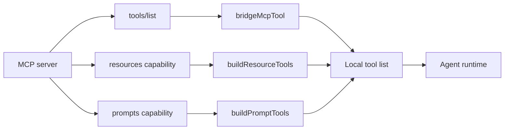
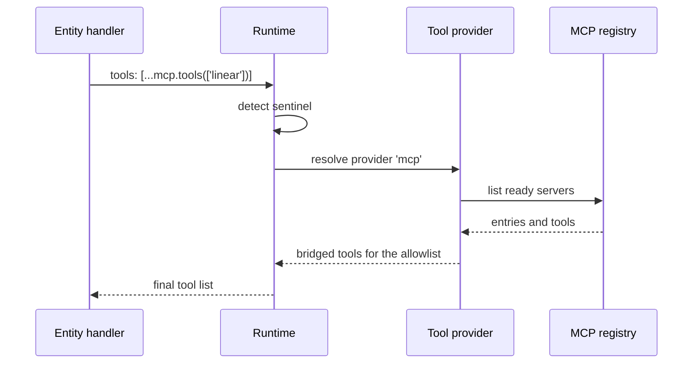

# Tools and resources

A Model Context Protocol (MCP) server exposes three kinds of item: tools, resources, and prompts. The package converts all three into local tools. The model therefore has one calling convention, no matter which kind it uses.

## The conversion pipeline



## Tool names

Every bridged tool gets a prefixed name.

```ts
const PREFIX = `mcp`
const MAX_LEN = 128

function sanitize(name: string): string {
  return name.replace(/[^A-Za-z0-9_-]/g, `_`)
}

export function prefixToolName(server: string, tool: string): string {
  const full = `${PREFIX}__${sanitize(server)}__${sanitize(tool)}`
  return full.length > MAX_LEN ? full.slice(0, MAX_LEN) : full
}
```

Source: `packages/agents-mcp/src/bridge/tool-bridge.ts:4-14`.

The name has three parts: `mcp`, the server name, and the tool name. Two underscores separate them. Any character outside letters, numbers, underscore, and hyphen becomes an underscore. The result is cut to 128 characters.

The prefix prevents a collision. A local tool named `search` and an MCP tool named `search` cannot clash, because the MCP tool is `mcp__<server>__search`.

The truncation has a cost. Two long names that share the first 128 characters become the same name. This is rare but possible with verbose server and tool names. The package does not add a hash suffix to break the tie. If two tools collide, the tool list holds two entries with the same name. The model can select only one of them, and the other tool is not reachable by name. The package does not report the collision.

## The schema normalizer

Some servers send an object schema with no `properties` key for a tool that takes no arguments.

```ts
if (s.type !== `object`) return schema
if (s.properties && typeof s.properties === `object`) return schema
return {
  ...s,
  properties: {},
  required: Array.isArray(s.required) ? s.required : [],
}
```

Source: `packages/agents-mcp/src/bridge/tool-bridge.ts:28-34`.

The normalizer adds empty `properties` and `required` fields. Without them, the agent library crashes when it walks the schema. The library is `pi-agent-core`, the model step loop that the runtime uses.

## The call wrapper

The SDK method signature has three positions. `SDK` means Software Development Kit. The second position is a result schema, not an options bag.

```ts
const callArgs: Parameters<typeof opts.client.callTool> =
  onProgress !== undefined || signal !== undefined
    ? [
        { name: opts.tool.name, arguments: args },
        undefined, // resultSchema — keep the SDK default (CallToolResultSchema)
        { onProgress, signal },
      ]
    : [{ name: opts.tool.name, arguments: args }]
```

Source: `packages/agents-mcp/src/bridge/tool-bridge.ts:140-147`.

Key insight: this comment in the source records a real defect that the code prevents. Passing an options object as the second argument corrupts the result schema. The SDK then throws `v3Schema.safeParse is not a function`. The code keeps the second argument as `undefined` and passes options in the third position.

## Error mapping

A tool call can fail with a timeout or with any other error.

```ts
try {
  return await invoke(args)
} catch (err) {
  const e = err as Partial<McpToolError> & { message?: string }
  if (e.kind === `timeout`) throw err
  const wrapped: McpToolError = {
    kind: `transport_error`,
    message: e.message ?? String(err),
  }
  throw wrapped
}
```

Source: `packages/agents-mcp/src/bridge/tool-bridge.ts:159-169`.

A timeout keeps its `timeout` kind. Every other error becomes `transport_error`. The thrown value is a `McpToolError`, one interface with a `kind` field, a `message` field, and an optional `details` field (`packages/agents-mcp/src/types.ts:119-123`). The `kind` field has the five-value `McpToolErrorKind` type (`:112-117`), so a caller can branch without parsing the message. The five kinds are:

| Kind | Meaning |
|------|---------|
| `auth_unavailable` | No credential is available |
| `transport_error` | The connection or call failed |
| `timeout` | The call exceeded its time limit |
| `server_error` | The server reported an error |
| `tool_not_found` | The named tool does not exist |

The bridge uses only two of these kinds directly. It produces `timeout` and `transport_error`. The registry produces `auth_unavailable` when a credential is missing (`packages/agents-mcp/src/registry.ts:206`, `:255`, `:284`). The types `server_error` and `tool_not_found` are declared in `types.ts:116-117`, but no code in the repository produces them. A search of every TypeScript file in `packages/` finds them only at that declaration.

## Resource tools

When a server advertises the `resources` capability, the bridge adds two tools. The bridge module `resource-bridge.ts` builds them. The built-in runtime adds them to the tool list. [Capability gating](#capability-gating) shows that second step.

```ts
{
  name: prefixToolName(opts.server, `list_resources`),
  server: opts.server,
  label: `list_resources`,
  description: `List resources on ${opts.server}`,
  schema: { type: `object`, properties: {}, required: [] },
  run: () => withTimeout(opts.client.listResources(), ms),
}
```

Source: `packages/agents-mcp/src/bridge/resource-bridge.ts:19-26`.

| Tool | Arguments | Result |
|------|-----------|--------|
| `mcp__<server>__list_resources` | None | The server resource list |
| `mcp__<server>__read_resource` | `uri` (required) | The resource content |

The read tool requires a Uniform Resource Identifier (URI). The schema marks it as required.

## Prompt tools

When a server advertises the `prompts` capability, the bridge adds two more tools. The bridge module `prompt-bridge.ts` builds them, and the built-in runtime adds them in the same way.

```ts
{
  name: prefixToolName(opts.server, `list_prompts`),
  server: opts.server,
  label: `list_prompts`,
  description: `List prompts on ${opts.server}`,
  schema: { type: `object`, properties: {}, required: [] },
  run: () => withTimeout(opts.client.listPrompts(), ms),
}
```

Source: `packages/agents-mcp/src/bridge/prompt-bridge.ts:20-27`.

| Tool | Arguments | Result |
|------|-----------|--------|
| `mcp__<server>__list_prompts` | None | The server prompt list |
| `mcp__<server>__get_prompt` | `name` (required), `arguments` (optional object) | The prompt template |

## Capability gating

The built-in agents runtime checks the capability object before it adds these tools.

```ts
if (caps?.resources) {
  tools.push(
    ...buildResourceTools({
      server: entry.name,
      client: live.transport.client as any,
      timeoutMs: live.config.timeoutMs,
    })
  )
}
if (caps?.prompts) {
  tools.push(
    ...buildPromptTools({
      server: entry.name,
      client: live.transport.client as any,
      timeoutMs: live.config.timeoutMs,
    })
  )
}
```

Source: `packages/agents/src/server.ts:279-296`.

A server that does not advertise a capability gets no tools for it. This keeps the tool list small and avoids calls that can only fail.

## The sentinel tool declaration

An entity handler can declare MCP tools without knowing the server list.

```ts
export const mcp = {
  tools(allowlist?: string[]): McpToolsSentinel[] {
    return [{ [MCP_TOOLS_SENTINEL]: true, allowlist }]
  },
}
```

Source: `packages/agents-mcp/src/tools.ts:19-29`.

The sentinel is an object with a symbol key. The key is `MCP_TOOLS_SENTINEL`, exported by the same module. The `McpToolsSentinel` type in `types.ts` declares the shape: the symbol key and an optional `allowlist`. The runtime recognizes the key at wake time and replaces the object with the current bridged tools. The allowlist names servers, not tools.

```ts
export function filterByAllowlist(
  serverNames: string[],
  allowlist: string[] | undefined
): string[] {
  if (allowlist === undefined) return [...serverNames]
  const set = new Set(allowlist)
  return serverNames.filter((n) => set.has(n))
}
```

Source: `packages/agents-mcp/src/tools.ts:31-38`.

An absent allowlist means every server. An empty allowlist means no server.



## Aha: the sentinel defers the decision

The tool list is built at wake time, not at code time. A server can connect after the entity starts. The add-on tools appear at the next wake without a restart or a new entity.

Key insight: the sentinel is the boundary between a static declaration and a dynamic registry. The handler says "give me MCP tools". The provider decides which servers exist at that moment.

## Related documents

- [01-mcp-registry.md](01-mcp-registry.md) for the server list that the provider reads.
- [02-transports.md](02-transports.md) for the calls behind these tools.
- [03-oauth-bridges.md](03-oauth-bridges.md) for the credentials those calls use.
- [../agents/04-tools-and-sandboxes.md](../agents/04-tools-and-sandboxes.md) for the provider registration in the built-in runtime.
