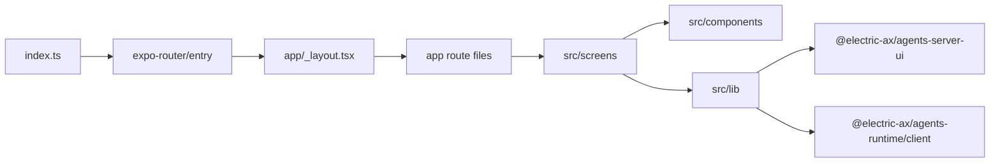
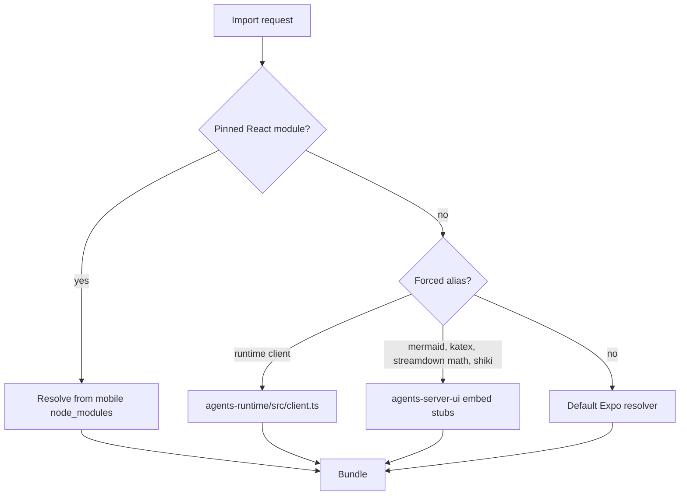

# Application structure

The mobile package has a small root and a clear split between routes, screens, shared components, and libraries. This document maps the files, the build configuration, and the provider tree.

## Entry point and routes

`index.ts` is the package entry point. It loads the gesture handler and a random UUID polyfill, then hands control to Expo Router:

```ts
// packages/agents-mobile/index.ts:1-11
import 'react-native-gesture-handler'

import 'react-native-random-uuid'

import 'expo-router/entry'
```

Expo Router reads the `app/` directory. Every file in that directory except `_layout.tsx` becomes a route. `_layout.tsx` is the shared layout: it holds the provider tree and the redirect rules. Most route files are thin adapters. They read route parameters, attach a route guard, and pass callbacks to a screen component in `src/screens`. Two route files do more: `_layout.tsx` and `oauth/callback.tsx`.

| Route file | Path | Screen component |
|------------|------|------------------|
| `app/index.tsx` | `/` | `SessionListScreen` |
| `app/session.tsx` | `/session` | `ChatSessionScreen` when `view` is absent or `chat`; `StateInspectorSessionScreen` when `view` is `state-explorer` |
| `app/new-session.tsx` | `/new-session` | `NewSessionScreen` |
| `app/session-share.tsx` | `/session-share` | `ShareSessionScreen` in a modal presentation |
| `app/onboarding.tsx` | `/onboarding` | `OnboardingScreen` |
| `app/server-setup.tsx` | `/server-setup` | `ServerSetupScreen` |
| `app/account.tsx` | `/account` | `AccountScreen` |
| `app/diagnostics.tsx` | `/diagnostics` | `DiagnosticsScreen` |
| `app/oauth/callback.tsx` | `/oauth/callback` | `OAuthCallbackRoute`, defined in the route file |
| `app/_layout.tsx` | No public path | The root layout and provider tree |

The session route reads the `view` parameter and defaults to `chat`: `params.view === 'state-explorer' ? 'state-explorer' : 'chat'`. The type `EmbedViewId` has exactly those two values. A modal presentation places the screen over the current screen as a sheet, so the user can dismiss it and return to the session. The Open Authorization (OAuth) callback route runs the sign-in state machine. It is not a thin adapter: it reads four query parameters, observes the authentication state, and redirects when the state resolves.

Source: `packages/agents-mobile/app/index.tsx:1-24`, `packages/agents-mobile/app/session.tsx:71-108`, `packages/agents-mobile/app/new-session.tsx:1-24`, `packages/agents-mobile/app/session-share.tsx:15-26`, `packages/agents-mobile/app/oauth/callback.tsx:52-167`, `packages/agents-mobile/src/lib/embedView.ts:1`, and `packages/agents-mobile/app/_layout.tsx:1-141`.



## Provider tree

The root layout nests a gesture root, a safe-area provider, a theme provider, an error boundary, an application state provider, and a cloud authentication provider. The gesture root and the error boundary are wrapper components, not React context providers. The code block stops at `RootNavigator`, so it does not show `AgentsProvider`. That provider is conditional and sits inside the navigator, further down this section.

```ts
// packages/agents-mobile/app/_layout.tsx:30-48
<GestureHandlerRootView style={styles.root}>
  <SafeAreaProvider initialMetrics={initialWindowMetrics}>
    <ThemeProvider>
      <Sentry.ErrorBoundary
        fallback={({ resetError }) => (
          <RootErrorFallback onRetry={resetError} />
        )}
      >
        <MobileAppStateProvider>
          <CloudAuthProvider>
            <RootNavigator />
          </CloudAuthProvider>
        </MobileAppStateProvider>
      </Sentry.ErrorBoundary>
    </ThemeProvider>
  </SafeAreaProvider>
</GestureHandlerRootView>
```

Each entry has one job:

| Wrapper or provider | Job |
|---------------------|-----|
| `GestureHandlerRootView` | Installs gesture handling for the navigation stack |
| `SafeAreaProvider` | Supplies screen insets |
| `ThemeProvider` | Resolves system, light, or dark tokens |
| `Sentry.ErrorBoundary` | Replaces a render crash with a retry screen |
| `MobileAppStateProvider` | Loads the active server URL and onboarding flag |
| `CloudAuthProvider` | Subscribes to the `cloudAuth` module singleton and listens for the authentication redirect |
| `AgentsProvider` | Creates the five collections for the active server |

A module singleton is one shared object for the whole process, not one object per component. The `cloudAuth` singleton holds the sign-in state and the pending request. The provider copies that state into React and exposes the sign-in, sign-out, and dashboard actions.

The provider also owns the global redirect listener, so a warm start and a cold start both reach the same handler. A warm start delivers the redirect through `Linking.addEventListener`. A cold start delivers it through `Linking.getInitialURL`, because the operating system launched the application with that intent. The `cloudAuth` singleton deduplicates the two paths. These paths authenticate against Electric Cloud, which has shut down (see [Overview](00-overview.md)). The provider still initialises, and it still handles a callback URL if one arrives.

Source: `packages/agents-mobile/app/_layout.tsx:28-50`, `packages/agents-mobile/src/lib/CloudAuthContext.tsx:12-75`, and `packages/agents-mobile/src/lib/AgentsProvider.tsx:40-64`.

`AgentsProvider` is inside `RootNavigator`, not in the fixed outer tree above. It exists only when `serverUrl` is set:

```ts
// packages/agents-mobile/app/_layout.tsx:135-139
return serverUrl ? (
  <AgentsProvider serverUrl={serverUrl}>{stack}</AgentsProvider>
) : (
  stack
)
```

## Directory map

```
packages/agents-mobile/
├── app/                  Expo Router routes and the root layout
│   ├── _layout.tsx       Root layout, provider tree, redirects
│   ├── index.tsx         Session list
│   ├── session.tsx       One session, chat or state explorer
│   ├── new-session.tsx   Session creation
│   ├── session-share.tsx Share sheet
│   ├── onboarding.tsx    First-launch wizard
│   ├── server-setup.tsx  Server address entry
│   ├── account.tsx       Account settings
│   ├── diagnostics.tsx   Server diagnostics
│   └── oauth/callback.tsx Authentication callback
├── src/
│   ├── components/       Native UI primitives and menus
│   ├── lib/              State stores, data client, authentication, helpers
│   ├── screens/          Screen-level components
│   └── types/            Type declarations for the web embed modules
├── plugins/              Expo configuration plugins
├── app.config.ts         Dynamic Expo configuration
├── eas.json              Expo Application Services (EAS) build and submit profiles
├── metro.config.js       Module resolution for the workspace
├── babel.config.js       Babel preset
├── tsconfig.json         TypeScript configuration
├── App.tsx               Empty fragment; not the entry point
├── index.ts              Entry point
└── package.json          Scripts and dependencies
```

The screens directory contains eight screen files. `SessionScreen.tsx` is the largest file by size, at 54,579 bytes. It exports three components. `SessionScreen` holds the native message composer and the keyboard handling. `ChatSessionScreen` and `StateInspectorSessionScreen` are small wrappers that pass a fixed `view` value to `SessionScreen`. Source: `packages/agents-mobile/src/screens/SessionScreen.tsx:61-178` and `packages/agents-mobile/src/screens/SessionScreen.tsx:80-143`.

## Module resolution

The application imports source files from two workspace packages:

- `@electric-ax/agents-runtime`
- `@electric-ax/agents-server-ui`

Metro is the JavaScript bundler that React Native and Expo use. Metro starts from the entry point, follows every import, and writes one bundle. It must resolve these workspace files and their browser dependencies. The configuration forces five aliases:

```js
// packages/agents-mobile/metro.config.js:12-24
const forcedAliases = {
  '@electric-ax/agents-runtime/client': path.resolve(
    workspaceRoot,
    `packages/agents-runtime/src/client.ts`
  ),
  mermaid: path.resolve(serverUiRoot, `src/embed/stubs/mermaid.ts`),
  katex: path.resolve(serverUiRoot, `src/embed/stubs/katex.ts`),
  '@streamdown/math': path.resolve(
    serverUiRoot,
    `src/embed/stubs/streamdown-math.ts`
  ),
  'shiki/bundle/web': path.resolve(serverUiRoot, `src/embed/stubs/shiki.ts`),
}
```

The aliases do two jobs. The runtime alias points at a source file, so the mobile bundle uses the client entry directly. The four stub aliases replace heavy browser libraries with small local modules:

- Mermaid is a diagram renderer.
- KaTeX is a mathematical typesetting library.
- `@streamdown/math` is the mathematics extension for the Streamdown Markdown renderer.
- Shiki is a syntax highlighter.

The chat transcript still renders its text and code, but the mobile bundle does not carry a diagram engine, a mathematics engine, or the full syntax highlighter. Each stub supplies the module shape that the web code imports and a small fallback.

Expo DOM components are bundled by Metro like every other module. At run time, the web code of a DOM component executes inside a `react-native-webview` web view. The bundle therefore carries the component, and the web view renders it.

The resolver also pins React, React DOM, and React Native Web to the mobile package's own copies:

```js
// packages/agents-mobile/metro.config.js:62-71
extraNodeModules: {
  ...(config.resolver.extraNodeModules ?? {}),
  react: path.resolve(projectRoot, `node_modules/react`),
  'react-dom': path.resolve(projectRoot, `node_modules/react-dom`),
  'react-native-web': path.resolve(
    projectRoot,
    `node_modules/react-native-web`
  ),
  ...forcedAliases,
},
```

Source: `packages/agents-mobile/metro.config.js:5-72`.



The first test covers React, React DOM, and React Native Web. The `resolveForcedModule` function checks those names before it looks in the `forcedAliases` table. The `extraNodeModules` block repeats the same three paths as a fallback for the default resolver.

The Metro configuration also adds the workspace root to `watchFolders`. Metro watches every file in that folder. When a watched file changes, Metro marks the modules that import it as stale. A running development server then sends the new modules to the application, and the bundle reloads. A change in `agents-server-ui` or `agents-runtime` is therefore visible without a restart. Source: `packages/agents-mobile/metro.config.js:45-47`.

## Babel and TypeScript

The Babel configuration has one preset:

```js
// packages/agents-mobile/babel.config.js:10-14
module.exports = function babelConfig(api) {
  api.cache(true)
  return {
    presets: [`babel-preset-expo`],
  }
}
```

Flow is a type annotation syntax that some React Native source files use in place of TypeScript. The Metro transformer is the build step that removes those annotations before the bundle runs. `babel-preset-expo` contains the Flow removal rules and the other Expo transforms. The preset is explicit because React Native 0.81 source files still contain Flow type annotations. Without the preset, the transformer fails on those files. Source: `packages/agents-mobile/babel.config.js:1-14`.

`tsconfig.json` extends the Expo base configuration and turns on `strict` mode. Strict mode makes the TypeScript compiler reject an implicit `any` type and a value that may be null or undefined where a value is required. The file also maps three embed modules to one local type file:

```json
// packages/agents-mobile/tsconfig.json:7-18
"paths": {
  "@electric-ax/agents-server-ui/src/embed/SessionDomEmbed": [
    "src/types/server-ui-dom"
  ],
  "@electric-ax/agents-server-ui/src/embed/SessionChatLogDomEmbed": [
    "src/types/server-ui-dom"
  ],
  "@electric-ax/agents-server-ui/src/embed/SessionStateInspectorDomEmbed": [
    "src/types/server-ui-dom"
  ]
},
"include": ["app", "App.tsx", "index.ts", "src"]
```

The `paths` table tells the TypeScript compiler to treat an import of one of those module names as an import of `src/types/server-ui-dom.d.ts`. That file declares each module with a default export of type `ComponentType<any>`. The mobile code therefore type-checks against a component signature, not against the web package source.

The web package cannot depend on Expo types for its normal browser build, because those types come from Expo. The local declaration keeps the Expo dependency out of the web package. The session route imports the chat log module and the state inspector module. The third mapping, `SessionDomEmbed`, is not imported in this package; it keeps the shared component name available for code that uses it. Source: `packages/agents-mobile/tsconfig.json:1-19` and `packages/agents-mobile/src/types/server-ui-dom.d.ts:1-20`.

## Module-level stores

Four libraries use the same small store pattern:

- `savedServers.ts`
- `pinnedEntities.ts`
- `sidebarPrefs.ts`
- `themePref.ts`

Each file holds a module variable, a listener set, and a hydration block. The hydration block runs once at module load and reads the stored value from AsyncStorage. Each file exports a hook that subscribes, plus synchronous getter and mutation functions. This pattern avoids a provider for data that non-React code must read. Source: `packages/agents-mobile/src/lib/savedServers.ts:32-104`, `packages/agents-mobile/src/lib/pinnedEntities.ts:12-85`, `packages/agents-mobile/src/lib/sidebarPrefs.ts:42-101`, and `packages/agents-mobile/src/lib/themePref.ts:26-56`.

Two of them, `savedServers` and `pinnedEntities`, also protect against a race. Hydration is asynchronous. A user action can therefore add an entry before the stored value arrives. Each file sets a `dirty` flag on the first mutation. When hydration then completes and sees the flag, it merges the stored entries with the new entries and removes duplicates by URL. Without the flag, the late stored value would replace the new entry. `sidebarPrefs` and `themePref` do not have this merge. Each stores one object or one value, not a list that grows. Source: `packages/agents-mobile/src/lib/savedServers.ts:37-66` and `packages/agents-mobile/src/lib/pinnedEntities.ts:17-48`.

## Tests

The package has ten test files. All of them are in `src/lib` and test pure logic:

- `agentsClient.test.ts`
- `availableServers.test.ts`
- `cloudAgentUrls.test.ts`
- `entityGrants.test.ts`
- `pinnedEntities.test.ts`
- `savedServers.test.ts`
- `serverHeaders.test.ts`
- `sessionLinks.test.ts`
- `slashAutocomplete.test.ts`
- `spawnArgs.test.ts`

Vitest is a JavaScript unit test runner. The test command is `vitest run --passWithNoTests`. The flag makes the command succeed when its selection matches no test file. The default selection matches the ten files above, so the flag does not change today's run. It keeps a filtered run from failing when the filter selects nothing. The package has no separate Vitest configuration file, so Vitest uses its defaults. Source: `packages/agents-mobile/package.json:12-13`.

## Aha: routes are adapters, screens are the application

**Aha:** Most files in `app/` are thin adapters, but the root layout is not. Each adapter reads the router, applies the guard, and passes callbacks. The behaviour lives in `src/screens`. The root layout is the exception: it owns the provider tree, the redirect rules, and the conditional `AgentsProvider`. `oauth/callback.tsx` is the second exception: it runs the sign-in state machine.

This split is why `app/session.tsx` can arrange the DOM embed and the native composer in one view, while `SessionScreen.tsx` owns the composer logic and the signal calls. A signal is a POSIX-style control message, such as `SIGINT` to stop the current run. The route file decides the layout: the embed fills the area above the composer, and the composer sits at the bottom with the keyboard inset. The screen component decides the actions. A reader who wants to change user actions can start in `src/screens`. A reader who wants to change navigation or the provider order starts in `app/_layout.tsx`.

The route adapter pattern is visible in the home route:

```ts
// packages/agents-mobile/app/index.tsx:10-22
return (
  <SessionListScreen
    onOpenSession={(entityUrl) => {
      router.push({
        pathname: `/session`,
        params: { entityUrl, view: `chat` },
      })
    }}
    onNewSession={() => router.push(`/new-session`)}
    onChangeServer={() => router.push(`/server-setup`)}
    onOpenDiagnostics={() => router.push(`/diagnostics`)}
    onOpenAccount={() => router.push(`/account`)}
  />
)
```

The `view` parameter selects the session surface. `chat` shows the conversation, the native composer, and the keyboard inset. `state-explorer` shows the entity state tree and sets the composer inset to zero. The home route always opens `chat`. The session menu changes the value through `router.setParams({ view: next })`.

The `onChangeServer` callback opens `/server-setup`. That route is also the first-run destination. After setup, the root layout permits the route for any user with a server URL, so the same screen serves both entry points.

## Related documents

- [Overview](00-overview.md) explains the layers and the data path.
- [Screens and navigation](02-screens-and-navigation.md) explains each route in use.
- [Native bridges](03-native-bridges.md) explains the embed modules that the TypeScript paths describe.
- [agents-server-ui build and testing](../agents-server-ui/06-build-and-testing.md) explains the web package. Metro bundles its embed modules, and the web view runs them.
