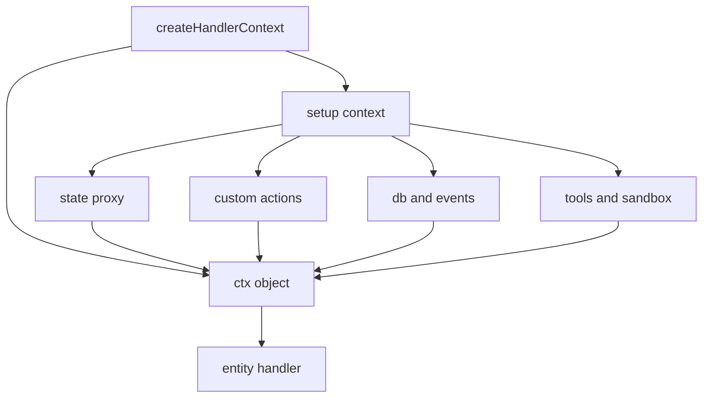
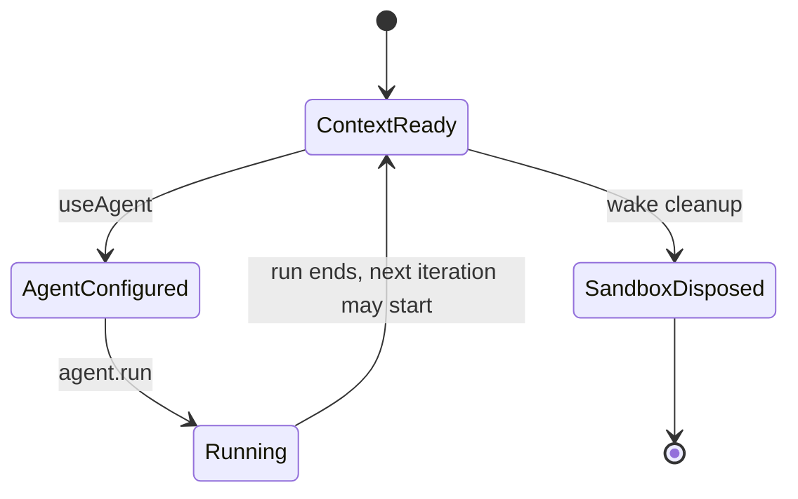

# Handler Context

The handler receives two arguments: a context object and a wake object. The context is the handler's whole interface to the runtime. It provides data, writes, model access, context management, collaboration, and lifecycle control.

`createHandlerContext` builds the object. Its return value is `{ ctx, getSleepRequested, maybeStartBackgroundCompaction, writeBackgroundCheckpoint, failBackgroundCheckpoint }`. The handler receives `ctx`. The handler signature is `(ctx, wake) => Promise<void> | void`.

The last three helpers belong to the wake loop, not to the handler. `maybeStartBackgroundCompaction` starts compaction when usage crosses the background threshold. `writeBackgroundCheckpoint` and `failBackgroundCheckpoint` record the result. `getSleepRequested` reads the flag that `ctx.sleep()` sets. Document [07-context-timeline-and-compaction.md](07-context-timeline-and-compaction.md) explains them.

## The interface

```ts
export interface HandlerContext {
  firstWake: boolean
  wake: HandlerWake
  slashCommands: SlashCommandHelpers
  tags: Readonly<EntityTags>
  principal?: RuntimePrincipal
  entityUrl: string
  entityType: string
  args: TArgs
  db: TDb
  state: TState
  events: Array<ChangeEvent>
  actions: TActions
  electricTools: Array<AgentTool>
  signal: AbortSignal
  sandbox: Sandbox
  agent: AgentHandle
  useAgent: (config: AgentConfig) => AgentHandle
  useContext: (config: UseContextConfig) => void
  // ...context, goal, collaboration, and lifecycle methods
}
```

The citation is `packages/agents-runtime/src/types.ts:1057-1234`.

## Field reference

### Wake and identity fields

| Field | Type | Meaning |
|-------|------|---------|
| `firstWake` | `boolean` | True on the first handler call for the entity, while the manifest is still empty |
| `wake` | `HandlerWake` | The wake that triggered this handler call |
| `slashCommands` | `SlashCommandHelpers` | Helpers for slash command input |
| `tags` | `Readonly<EntityTags>` | Current entity tags |
| `principal` | `RuntimePrincipal` or undefined | The principal that caused the wake |
| `entityUrl` | `string` | The entity URL, for example `/agent/id` |
| `entityType` | `string` | The entity type name |
| `args` | object | The validated creation arguments |
| `signal` | `AbortSignal` | Aborted when the invocation must stop |

`HandlerWake` has two shapes:

- `InboxHandlerWake`: type `inbox`, with a `message` that has `type`, `payload`, and optional `from`.
- `OtherHandlerWake`: type `other`, with `wakeType`, `source`, and optional `payload`.

The citation is `packages/agents-runtime/src/types.ts:922-941`.

Document [03-wake-processing.md](03-wake-processing.md) calls the stream event kind `wake`. That is the same wake. `other` is the handler-facing type name for a wake that is not an inbox message.

The `principal` field is the principal that caused this handler call. In a notification, the same principal is also the identity that the runtime uses for control-plane writes. It is not always the writer of every row in the stream. The field is declared at `packages/agents-runtime/src/types.ts:1072`.

The `signal` field is not decoration. A handler that performs non-model work, such as an HTTP request or a subprocess, must pass this signal to that work. A `SIGINT` aborts the signal.

### Data fields

| Field | Meaning |
|-------|---------|
| `db` | The full `EntityStreamDBWithActions` |
| `state` | A proxy over the entity's custom state collections |
| `events` | The change events consumed for this wake |
| `actions` | Custom actions from the entity definition |

`db` gives raw access to all 20 built-in collections and all custom collections. `state` gives a simpler create, read, update, delete interface for custom state only.

```ts
const proxy: StateCollectionProxy = {
  insert: (row) => insertAction({ row }),
  update: (key, updater) => updateAction({ key, updater }),
  delete: (key) => deleteAction({ key }),
  get: (key) => collection?.get(key),
  get toArray() {
    return collection?.toArray ?? []
  },
}
```

This snippet is shortened. The real proxy throws when an action is missing. The citation is `packages/agents-runtime/src/setup-context.ts:262-296`.

The proxy routes writes through the generated actions. The generated actions persist through the producer. The proxy routes reads directly to the TanStack DB collection.

`events` is an array of `ChangeEvent`. A handler can inspect the raw event that caused the wake. This is useful for custom wake conditions.

### Tool fields

| Field | Meaning |
|-------|---------|
| `electricTools` | Tools created by `createElectricTools` for this wake |
| `sandbox` | The sandbox for shell and file tools |
| `agent` | The agent handle; available even before `useAgent` |
| `useAgent(config)` | Configure and enable the model loop |

`useAgent` stores the configuration. It does not run the model. `agent.run()` runs the model. The call order is:

```ts
ctx.useAgent({
  systemPrompt: `You are a helpful agent.`,
  model: `claude-sonnet-4-5-20250929`,
  tools: [createBashTool(ctx.sandbox)],
})

if (ctx.wake.type === `inbox`) {
  await ctx.agent.run(ctx.wake.message.payload)
}
```

The guard is necessary. `message` exists only on `InboxHandlerWake`. An `OtherHandlerWake` has a `payload` field instead.

If a handler calls `agent.run()` before `useAgent()`, the runtime throws:

```ts
if (!agentConfig) {
  throw new Error(`[agent-runtime] agent.run() called without useAgent().`)
}
```

The citation is `packages/agents-runtime/src/context-factory.ts:787-791`.

The handler must not dispose the sandbox. `processWake` owns disposal. The type comment states this rule at `packages/agents-runtime/src/types.ts:1091-1098`.

### Context fields

| Field | Meaning |
|-------|---------|
| `useContext(config)` | Select which timeline sources enter the model context |
| `timelineMessages(opts?)` | Build messages from the timeline |
| `insertContext(id, entry)` | Add a durable context entry |
| `removeContext(id)` | Remove a durable context entry |
| `getContext(id)` | Read one context entry |
| `listContext()` | List all context entries |

`useContext` validates its input:

- `sourceBudget` must be a positive finite number. It is the token budget for all context sources.
- `sources` must not be empty.
- Each cache tier must be one of `pinned`, `stable`, `slow-changing`, `volatile`.
- A non-volatile source must give a `max` value.
- The sum of non-volatile maxima must not exceed `sourceBudget`.

The tiers differ in change frequency. `pinned` content never changes during a wake. `stable` content changes rarely. `slow-changing` content changes between turns. `volatile` content changes every turn and has no fixed maximum. Volatile sources are exempt from `max` because the runtime packs them into whatever budget remains.

The citation is `packages/agents-runtime/src/context-factory.ts:736-780`.

Document [07-context-timeline-and-compaction.md](07-context-timeline-and-compaction.md) explains the tiers and the assembly algorithm.

### Goal fields

| Field | Meaning |
|-------|---------|
| `setGoal(input)` | Set the entity goal |
| `clearGoal()` | Remove the goal |
| `getGoal()` | Read the goal |
| `markGoalComplete(summary?)` | Mark the goal complete |
| `updateGoalUsage(tokensUsed, opts?)` | Add token usage to the goal |

Goals are durable. The goal API stores a goal entry in the manifest and writes `manifest` events. The manifest is the keyed live view of durable handler state. It is not agent content. The citation is `packages/agents-runtime/src/goal-api.ts`.

### Collaboration fields

| Field | Meaning |
|-------|---------|
| `spawn(type, id, args?, opts?)` | Create a child entity |
| `fork(sourceEntityUrl, id, opts?)` | Fork an entity at its latest completed run |
| `forkSelf(id, opts?)` | Fork this entity |
| `observe(source, opts?)` | Observe an entity, shared database, or source |
| `unobserve(sourceRef)` | Stop observing a source |
| `mkdb(id, schema)` | Create or connect a shared-state database |
| `send(entityUrl, payload, opts?)` | Send a message to another entity |
| `attachments` | Read and create attachments |

`send` takes a target entity URL and a payload. Its options are `type` and `afterMs`. During the setup phase, `send` is restricted to child entities. The setup phase is the part of context construction before the handler's main work starts. The restriction stops an entity from sending work before its parent links exist. The citation is `packages/agents-runtime/src/setup-context.ts:326-355`.

`mkdb` creates a shared-state handle. If the handle already exists and the caller asks to create it again, the runtime throws. A caller that wants the existing handle uses `observe` with a `db` source.

`spawn` takes `observe: false` to opt out of the parent-child stream link. This is for high-fanout patterns where the parent never reads the child state.

### Lifecycle fields

| Field | Meaning |
|-------|---------|
| `onSignal(handler)` | Register a handler for `SIGHUP`, `SIGTERM`, and `SIGUSR` |
| `recordRun()` | Record a non-model run on the `runs` collection |
| `replyText(text)` | Write a synthetic assistant reply |
| `sleep()` | End the current handler iteration |
| `setTag(key, value)` | Set an entity tag |
| `deleteTag(key)` | Delete an entity tag |

`onSignal` does not receive `SIGINT`, `SIGSTOP`, `SIGCONT`, or `SIGKILL`. Those signals are runtime-controlled:

- `SIGINT` aborts the active invocation.
- `SIGSTOP` and `SIGCONT` control pause and resume.
- `SIGKILL` is terminal.

The citation is `packages/agents-runtime/src/types.ts:1202-1215`.

`recordRun` returns a `RunHandle`. It records a run row for work that does not use the model. The caller ends the run when the external work finishes. Observers that use the `runFinished` wake condition then wake. The model loop does not need `recordRun`; it records runs through the outbound bridge, the writer that maps model events to stream events.

`replyText` writes a complete run, text, and delta sequence. A run is one model or handler execution record. A text entry is the final assistant message. A delta sequence is the streamed fragments of that message. The chat user interface shows the result as a normal assistant message.

`sleep()` sets a flag. The wake loop reads the flag through `getSleepRequested` and stops the current iteration.

### Internal field

`__debug.useContextRegistrations()` returns the number of distinct `useContext` configurations seen in the wake. Tests use it to prove that a handler changed its context once, not on every run.

## Context construction



`setup context` is the construction phase. It wires the state proxy, the custom actions, the database views, and the tools. The result is the single `ctx` object that the handler receives.

## Which context fields are live

Not every field is available at the same time:

- `db`, `state`, `actions`, `events`, `sandbox`, `entityUrl`, `entityType`, `args`, `wake`, `tags`, `principal`, `electricTools`, and `signal` exist when the handler starts. Any field not listed here has its own timing.
- `agent.run()` requires a prior `useAgent()`.
- `send` has a setup-phase restriction: it can target only a child entity. The `send` method on a handle that `spawn` or `fork` returned always throws during the setup phase.
- `sandbox` is disposed during wake cleanup, after the last handler iteration. A detached task must not keep using it. The sandbox is the same object across iterations of one wake.



## Key insight

**Key insight:** `ctx.state` and `ctx.db` are two views of one store. `ctx.state` is the safe, small interface for custom data. `ctx.db` is the complete interface for everything, including the 20 built-in collections. A handler that mixes them does not create two databases. It creates two access paths to the same rows.

This matters for correctness. A write through `ctx.state` becomes a stream event, and the local collection applies it. A read through `ctx.db` reads that same local collection. The read does not wait for a remote round trip. The two views converge because both use the one projection that the stream updates. After an awaited write resolves, the row is visible; if the transaction identifier times out, the outcome is unknown.

## Next

Read [06-agent-loop-and-tools.md](06-agent-loop-and-tools.md) for the model loop that `useAgent` enables.
