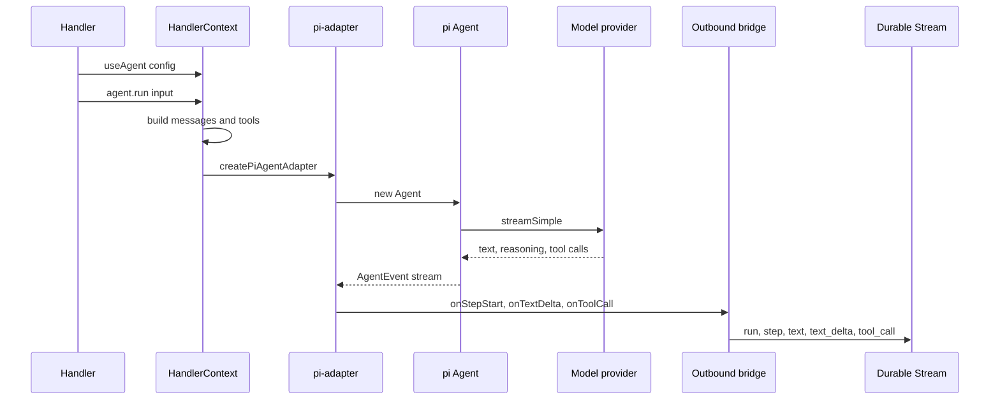
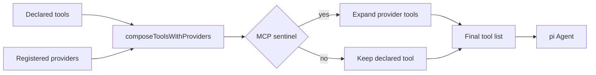

# Agent Loop and Tools

`ctx.useAgent(config)` enables a model loop. `ctx.agent.run(input)` runs it. The loop calls a model provider, streams text and reasoning, executes tools, and records every step as stream events.

The loop is an adapter over `@mariozechner/pi-agent-core`. That package supplies the model agent loop and its event stream. The companion package `@mariozechner/pi-ai` supplies the model registry and the streaming model call. The adapter maps pi events to state protocol writes. It does not invent a second model protocol.

The stream writer is created by `processWake`, the runtime entry point that opens the wake and owns the stream. Document [03-wake-processing.md](03-wake-processing.md) explains it.

## The call chain



The adapter is created per run. The bridge is created inside the adapter factory. The bridge writes through the `writeEvent` function that `processWake` supplied.

## Step one: message construction

`agent.run` prepares the message list before it calls the model:

1. Call the optional `prepareAgentRun` hook. The handler supplies this hook in the agent configuration. It can change the messages or the tools before the run starts.
2. Read the trigger message from the wake.
3. Compose the declared tools with registered tool providers.
4. Read the latest context usage. Usage is the cache-inclusive input plus output token count of the last step, divided by the context window.
5. Build a mid-turn compactor when the context is near the ceiling. The hard ceiling is 0.90 of the context window.
6. Truncate oversized tool results.
7. Add one token budget notice when usage reaches 0.25 of the context window. The runtime recomputes the notice on every turn.
8. Convert the messages to pi agent messages.

The citation is `packages/agents-runtime/src/context-factory.ts:793-907`.

The adapter receives the messages and the tools:

```ts
const adapterFactory = createPiAgentAdapter({
  systemPrompt: activeAgentConfig.systemPrompt,
  model: activeAgentConfig.model,
  provider: activeAgentConfig.provider,
  tools: [...composedTools, ...extraTools],
  streamFn: activeAgentConfig.streamFn,
  getApiKey: activeAgentConfig.getApiKey,
  reasoning: activeAgentConfig.reasoning,
  thinkingBudgets: activeAgentConfig.thinkingBudgets,
  modelTimeoutMs: activeAgentConfig.modelTimeoutMs,
  modelMaxRetries: activeAgentConfig.modelMaxRetries,
  onCompactContext,
})
```

This snippet is shortened. The same call also passes `onPayload`, `onStepEnd`, and an optional `initialContextTokens`. The citation is `packages/agents-runtime/src/context-factory.ts:883-900`.

This document explains step 3. Document [07-context-timeline-and-compaction.md](07-context-timeline-and-compaction.md) explains steps 4 through 7.

## Step two: model resolution

The adapter resolves the model from a provider and a model identifier. It uses pi-ai's `getModel` for known providers and `getMoonshotModel` for Moonshot. An unknown provider and model pair throws. It uses `streamSimple` unless the caller supplies `streamFn`.

```ts
const modelTimeoutMs = opts.modelTimeoutMs ?? DEFAULT_MODEL_TIMEOUT_MS
const modelMaxRetries = opts.modelMaxRetries ?? DEFAULT_MODEL_MAX_RETRIES
const baseStreamFn = opts.streamFn ?? streamSimple
const streamFn: StreamFn = (streamModel, context, streamOptions) =>
  baseStreamFn(streamModel, context, {
    ...streamOptions,
    timeoutMs: modelTimeoutMs,
    maxRetries: modelMaxRetries,
  })
```

This snippet is shortened. The same call also passes `reasoning` and `thinkingBudgets` when the caller configures them. The citation is `packages/agents-runtime/src/pi-adapter.ts:289-301`.

The defaults are:

- Model timeout: `30_000` milliseconds.
- Model retries: `2`.

The citations are `packages/agents-runtime/src/pi-adapter.ts:100-101`.

The adapter creates one `Agent` with the converted history and the stream function. The history is passed in the `agentOptions` object, not in the `createPiAgentAdapter` call shown above:

```ts
const agent = new Agent(agentOptions)
```

The citation is `packages/agents-runtime/src/pi-adapter.ts:369-371`.

## Step three: event mapping

The adapter consumes pi events through a queue. The queue exists because pi emits events synchronously and the stream write is asynchronous. The queue keeps events in emission order, and a slow write does not block the model stream.

| pi event | Runtime action |
|----------|----------------|
| `agent_start` | No write |
| `message_start` | Start a step; reset text and reasoning state |
| `message_update` with `text_delta` | Start or continue a text row |
| `message_update` with `thinking_start` | Start a reasoning row |
| `message_update` with `thinking_delta` | Append a reasoning delta |
| `message_update` with `thinking_end` | Close the reasoning row and parse its title |
| `message_end` | Close text and reasoning; call `onStepEnd` to write usage; detect errors |
| `tool_execution_start` | Write a tool call with status `started` |
| `tool_execution_end` | Update the tool call to `completed` or `failed` |
| `agent_end` | End the run with `stop` or `aborted` |

```ts
case `message_update`: {
  const assistantEvent = event.assistantMessageEvent
  if (assistantEvent?.type === `text_delta`) {
    if (!textStarted) {
      textStarted = true
      bridge.onTextStart()
    }
    bridge.onTextDelta(assistantEvent.delta ?? ``)
  }
}
```

The citation is `packages/agents-runtime/src/pi-adapter.ts:416-429`.

The adapter tolerates a missing `thinking_start`. Some providers send the first thinking delta without the start event. The adapter opens the reasoning row lazily and does not drop the chunk.

A `message_end` with `stopReason: "error"` becomes a `ModelProviderError`. The adapter classifies the error through `toModelProviderError`. The citation is `packages/agents-runtime/src/pi-adapter.ts:640-647`.

## The outbound bridge

The bridge owns key allocation and event writes. Its keys are deterministic counters. A process-local cache stores the last counter values, and a new bridge seeds the counters from the existing rows:

| Event | Key |
|-------|-----|
| Run | `run-N` |
| Step | `step-N` |
| Text | `msg-N` |
| Text delta | `msg-N:seq` |
| Reasoning | `reasoning-N` |
| Reasoning delta | `reasoning-N:seq` |
| Tool call | `tc-N` |
| Error | `run-N:error-<uuid>` |

```ts
onTextDelta(delta: string) {
  if (!currentMsgKey) return
  const runKey = requireActiveRun(`onTextDelta`)
  const seq = counters.deltaSeqs.get(currentMsgKey) ?? 0
  counters.deltaSeqs.set(currentMsgKey, seq + 1)
  writeEvent(
    entityStateSchema.textDeltas.insert({
      key: `${currentMsgKey}:${seq}`,
      value: { text_id: currentMsgKey, run_id: runKey, delta },
    })
  )
}
```

The citation is `packages/agents-runtime/src/outbound-bridge.ts:392-407`.

An error key is the exception to the counter rule. It uses a random universally unique identifier (UUID), because two errors in one run must not overwrite each other and no consumer needs a stable error key.

The bridge writes an insert for the start of a row and an update for the end. A text row starts with status `streaming` and ends with status `completed`. A tool call starts with status `started` and ends with `completed` or `failed`.

The bridge keeps its counters in a process-local cache keyed by the runs collection. A new bridge seeds the counters from the existing run, step, text, and tool rows. It also raises them to the cached value, so two writers in the same process do not allocate the same key.

## Run, step, and usage records

`onStepEnd` writes the step duration and token counts. The usage split is:

- `input`: all input tokens.
- `cacheWrite`: tokens written to the provider cache.
- `cacheRead`: tokens read from the provider cache.
- `output`: output tokens.

The bridge also records `context_input_tokens`, `context_window`, and a context breakdown. The citation is `packages/agents-runtime/src/outbound-bridge.ts:330-375`.

The `onStepEnd` hook receives three values: `input`, `uncachedInput`, and `output`. `uncachedInput` is the input tokens that were not served from the provider cache. The handler configuration can use this hook for billing or for a custom progress display.

## The tool set

The package exports these tool factories:

| Factory | Tool name | Notes |
|---------|-----------|-------|
| `createBashTool(sandbox)` | `bash` | 2-minute default timeout, 10-minute maximum, 50,000-byte cap |
| `createReadFileTool(sandbox)` | `read` | Reads through the sandbox |
| `createWriteTool(sandbox)` | `write` | Writes through the sandbox |
| `createEditTool(sandbox)` | `edit` | Edits through the sandbox |
| `createFetchUrlTool` | `fetch_url` | Fetches and extracts page content |
| `braveSearchTool` | `web_search` | Brave search integration; the caller supplies the Brave API key |
| `createScheduleTools` | `list_schedules`, `upsert_cron_schedule`, `upsert_future_send`, `delete_schedule` | Schedules |
| `createWebhookSourceTools` | `list_webhook_sources`, `list_webhook_source_subscriptions`, `subscribe_webhook_source`, `unsubscribe_webhook_source` | Webhook sources |
| `createSendTool` | `send` | Sends a message to a target entity URL supplied as a tool argument |
| `createMarkGoalCompleteTool` | `mark_goal_complete` | Marks the goal complete |
| `createContextTools` | `load_timeline_range`, `load_source_range`, `load_context_history` | Loads context on demand |

The citations are `packages/agents-runtime/src/tools.ts:1-10`, `packages/agents-runtime/src/index.ts:384` for `createContextTools`, and the individual tool files.

The `bash` tool passes the command to `sandbox.exec`. It caps output at 50,000 bytes and reports a timeout or truncation marker. This byte cap is separate from the 10,000-token cap on the tool result that enters the model context. The byte cap applies first, inside the tool. The token cap applies later, before the model call.

The default sandbox is the unrestricted provider. It is not a containment boundary. Document [08-sandbox.md](08-sandbox.md) explains the isolation options.

```ts
const result = await sandbox.exec({
  command,
  timeoutMs,
  maxOutputBytes: MAX_OUTPUT_BYTES,
})
```

The citation is `packages/agents-runtime/src/tools/bash.ts:36-40`.

The default timeout is `120_000` milliseconds. The maximum is `600_000` milliseconds. The citation is `packages/agents-runtime/src/tools/bash.ts:5-6`.

## Tool providers

A process can register tool providers outside the entity definition. The provider registry is a module-level map:

```ts
export function registerToolProvider(p: ToolProviderEntry): void {
  providers.set(p.name, p)
}
```

The citation is `packages/agents-runtime/src/tool-providers.ts:48-50`.

`composeToolsWithProviders` expands model context protocol (MCP) sentinel objects into the matching provider tools. It warns when a named server does not resolve:

```
requested MCP server(s) unavailable: ...
```

The citation is `packages/agents-runtime/src/tool-providers.ts:69-112`.

The sentinel uses `Symbol.for('@electric-ax/agents-mcp/tools-sentinel')`. The declared tool carries this symbol instead of a server name. `composeToolsWithProviders` replaces the sentinel with the tools from the matching provider.

The runtime does not import the full `agents-mcp` package. That package depends on a Node.js transport. The runtime package also ships browser subpaths, so a static import would put the transport in a browser bundle. The symbol is the shared key that avoids the import.



## Errors and aborts

The adapter has two failure paths:

1. A model error becomes a `ModelProviderError` with a provider and model identifier.
2. An abort ends the run with `finishReason: "aborted"`.

The adapter also aborts the pi agent when the caller's signal fires. It uses a zero-delay fallback timer to make sure the abort does not wait on a pi abort acknowledgement that never arrives. The citation is `packages/agents-runtime/src/pi-adapter.ts:759-778`.

The bridge writes an error event when the run fails. Its key is `run-N:error-<uuid>`, and its value carries the provider error code. The runtime also writes an error event for a handler failure, with the code `HANDLER_FAILED`. The two paths are distinct, so a consumer can tell a provider failure from a handler failure.

## Key insight

**Key insight:** the model is not the source of truth. The stream is. Every model token, reasoning chunk, and tool result becomes an event with a stable key. The next run rebuilds its prompt from those events. This makes the agent loop replayable and makes a model provider replaceable without losing history.

The bridge is the part that enforces this rule. A tool result that only lives in the pi agent's memory would vanish after the run. The bridge writes it to the `toolCalls` collection before the next model step.

## Next

Read [07-context-timeline-and-compaction.md](07-context-timeline-and-compaction.md) to see how the next run turns those events back into a prompt.
