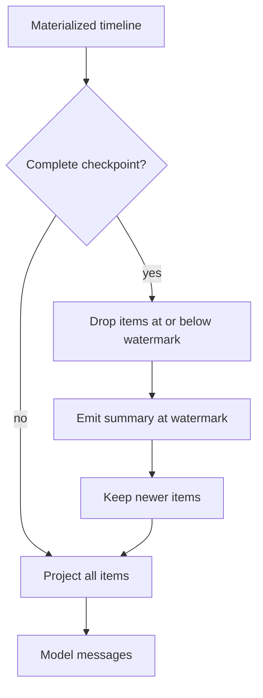
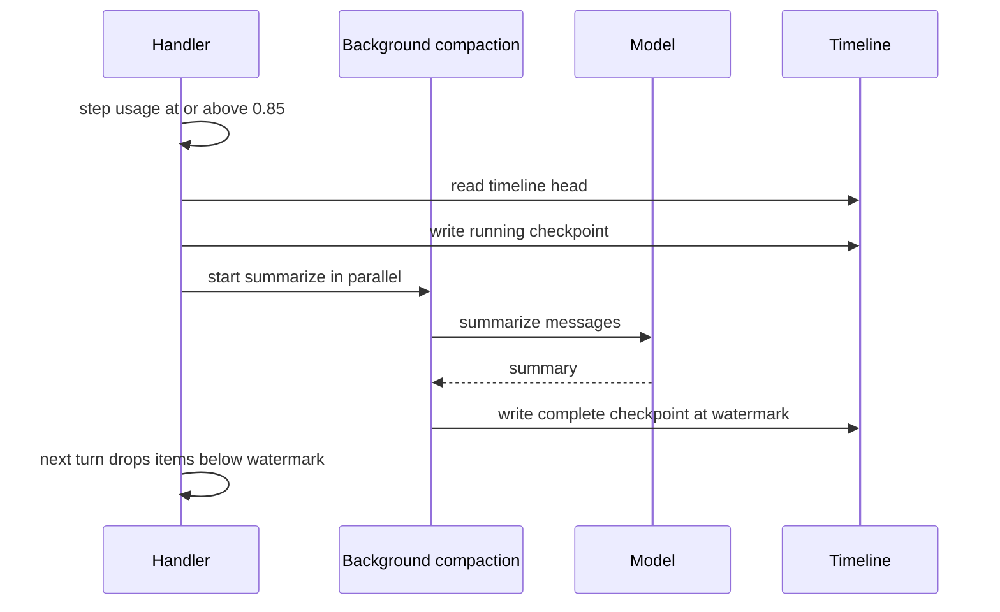

# Context, Timeline, and Compaction

The model needs a prompt. The stream holds the history. The runtime must turn one into the other without loading an unbounded amount of text. It does this with three mechanisms: a timeline order, a context assembly budget, and compaction checkpoints.

This document explains all three.

## The timeline order

Every row carries `_timeline_order`, a string token. The token comes from the event pointer:

```
stream:<zero-padded-offset>:<zero-padded-sub-offset>
```

The offset is padded to 24 characters. The sub-offset is padded to 8 characters. The citation is `packages/agents-runtime/src/event-pointer.ts:54-87`.

The offset is the anchor for the log entry that holds the event. The anchor is the end offset of the preceding log entry, or the previous batch offset for the first log entry in a batch. The sub-offset is the position of the event inside that one log entry, not the position inside the whole batch. One batch can hold several log entries, and one log entry can hold several events, so the pair is necessary. An example token is `stream:000000000000000000000123:00000001`.

The token is lexicographically sortable:

```ts
export function compareTimelineOrders(
  left: TimelineOrder,
  right: TimelineOrder
): number {
  return toComparableTimelineOrderValue(left).localeCompare(
    toComparableTimelineOrderValue(right)
  )
}
```

The citation is `packages/agents-runtime/src/entity-timeline.ts:572-579`.

The tokens are fixed-width ASCII digit strings. For that shape, `localeCompare` order matches code-unit order, so the comparison is safe. The helper normalizes each token before it compares.

`materializeTimeline` uses this order. It also applies two corrections:

1. An interrupted run is reordered before its `SIGINT` marker. An interrupted run is a run that has no normal end event. The runtime buffers run rows through its producer, but the server appends the `SIGINT` signal directly. The signal can therefore get a lower stream offset than the aborted run. The natural order puts the marker first. The correction restores the logical order.
2. A superseded context entry is removed by last-wins on its identifier.

The citation is `packages/agents-runtime/src/timeline-context.ts:341-463`.

A row without a timeline token falls back through three levels:

1. `__electricRowOffsets`, which is the stored pointer.
2. `_seq`, which is a local sequence number.
3. A pending token, for optimistic rows. An optimistic row is a local row that a writer added before the stream confirmed it. When the real offset arrives, the row gets the stream token and the pending token is no longer used.

The citation is `packages/agents-runtime/src/entity-timeline.ts:588-613`.

## Context entries

A handler can add durable context with `ctx.insertContext(id, entry)` and remove it with `ctx.removeContext(id)`.

The insert writes two things:

1. A `context_inserted` event with key `context:<id>:<suffix>`.
2. A manifest entry with key `context:<id>`.

The remove writes a `context_removed` event with key `context:<id>:removed:<suffix>` and removes the manifest entry.

```ts
const event = entityStateSchema.contextInserted.insert({
  key: `context:${id}:${suffix}`,
  value: { id, name: entry.name, attrs, content: entry.content, timestamp: now() },
})
opts.writeEvent(event)
```

The citation is `packages/agents-runtime/src/context-entries.ts:77-102`.

The insert also writes the manifest row. Its key is `context:<id>`, and its value carries the context identifier, the name, the attributes, and the current content. `attrs` holds structured metadata such as the compaction status and watermark.

The suffix comes from a millisecond clock. A collision gets an underscore and a counter. The counter is local to the process. Two inserts in the same millisecond on different runners can still collide in theory; the stream order then decides which row is current.

The manifest is the live view. `getContext` and `listContext` read the manifest, not the event log. The event log is the history.

## Building messages from the timeline

`timelineMessages(db, opts)` does the following:

1. Materialize the timeline.
2. Find the latest complete compaction checkpoint.
3. Drop every item at or below the checkpoint watermark.
4. Emit the summary at the watermark.
5. Skip compaction checkpoint rows.
6. Attach inbox attachments to their messages.
7. Project each remaining item to model messages.

```ts
const activeCheckpoint = latestCompleteCompactionCheckpoint(items)
const compactionWatermark = activeCheckpoint
  ? compactionWatermarkOf(activeCheckpoint)
  : Number.NEGATIVE_INFINITY
```

The citation is `packages/agents-runtime/src/timeline-context.ts:483-486`.

Only a `complete` checkpoint acts as a watermark. A `running` or `failed` checkpoint does not hide history. The citation is `packages/agents-runtime/src/timeline-context.ts:533-546`.

The summary is a synthetic message that replaces the dropped range. It comes before the surviving newer items in the model message list. The runtime rebuilds it on each projection; it is not a new stream row.



## Context assembly

`useContext` selects sources. `assembleContext` packs them into a token budget. This happens during message construction in `agent.run`, before the model call. Document [06-agent-loop-and-tools.md](06-agent-loop-and-tools.md) shows that call site.

The assembly has four cache tiers:

```ts
const TIER_ORDER: Array<CacheTier> = [
  `pinned`,
  `stable`,
  `slow-changing`,
  `volatile`,
]
```

The citation is `packages/agents-runtime/src/context-assembly.ts:10-15`.

The rules are:

- `pinned`, `stable`, and `slow-changing` sources must declare `max`.
- A string source is truncated to its max and gets a `load_source_range` marker. The marker is literal text in the prompt. It gives the source name, the dropped character range, and the snapshot identifier. The model can call the `load_source_range` tool to read the rest.
- An array source takes messages in order until its max is reached.
- `volatile` sources have no fixed max. The runtime packs them newest-first into the remaining budget.
- A tool call and its result stay together.
- A dropped range gets a `load_timeline_range` marker. It gives the offsets to read.

The volatile loop walks backward:

```ts
const accepted: Array<VolatileMessage> = []
for (let i = volatileMessages.length - 1; i >= 0; i--) {
  const message = volatileMessages[i]!
  const nextTokens = approxTokens(message.content)
  if (volatileBudgetUsed + nextTokens > remainingBudget) {
    droppedOffsets.push(message.at)
    continue
  }
  volatileBudgetUsed += nextTokens
  accepted.push(message)
}
accepted.reverse()
```

The loop walks backward so it keeps the newest messages first. `accepted.reverse()` restores chronological order before the messages are appended. A tool message that does not fit gets a short `load_timeline_range` stub when the stub itself fits. Otherwise its offset joins the dropped range.

The citation is `packages/agents-runtime/src/context-assembly.ts:321-362`.

The result includes `messages`, `snapshots`, and `overflowLog`. A snapshot is the raw content of a source, keyed by a snapshot identifier. The `load_source_range` tool reads from it. The overflow log records which source overflowed and why.

## Token thresholds

The runtime uses one set of thresholds for the runtime and for the user interface. An awareness notice is text in the model prompt. The user interface reads the same ratio for its gauge.

| Threshold | Value | Effect |
|-----------|-------|--------|
| Awareness | 0.25 | Add one budget notice, recomputed on every turn |
| Background start | 0.85 | Start background compaction |
| Hard ceiling | 0.90 | Compact before the next model call |

The citation is `packages/agents-runtime/src/token-accountant.ts:20-22`.

The threshold array also holds 0.5 and 0.75, but the notice rule tests only the first value, 0.25. The notice gives the current percentage, so it changes on each turn without a second threshold event.

Usage is the cache-inclusive input plus output of the last step, divided by the context window. The input part is `input + cacheRead + cacheWrite`. The output tokens count because they re-enter the prompt on the next turn. The citation is `packages/agents-runtime/src/token-accountant.ts:60-66`.

A single tool result is capped at 10,000 tokens. The citation is `packages/agents-runtime/src/token-accountant.ts:260`. A result above the cap is truncated before the model call.

## Compaction checkpoints

A checkpoint is a `context_inserted` row with these attributes:

- `kind`: `compaction`.
- `status`: `running`, `complete`, or `failed`.
- `watermark`: the timeline position that the summary covers.
- `background`: optional boolean that is true for a background job.

The constants are:

```ts
export const COMPACTION_CHECKPOINT_KIND = `compaction`
export const COMPACTION_CHECKPOINT_NAME = `compaction_summary`
export const COMPACTION_CHECKPOINT_ID = `compaction`
```

The citation is `packages/agents-runtime/src/compaction.ts:11-18`.

There is one foreground checkpoint identifier: `compaction`. A background checkpoint uses `compaction-bg-<watermark>`. The citation is `packages/agents-runtime/src/context-factory.ts:1278-1280`.

The foreground identifier is self-superseding. A new checkpoint replaces the old one in the live view. The watermark in the checkpoint keeps the correct position. While the new checkpoint is `running`, only the old complete checkpoint is gone from the live view, so the old summary is not active. The events below the old watermark become visible again until the new checkpoint is complete.

## Mid-turn compaction

Mid-turn compaction runs before a model step. It uses pi-agent's `transformContext` hook.

```ts
const overCeiling = currentTokens >= deps.ceiling * contextWindow
if (!overCeiling) return compactedView(messages)
```

The citation is `packages/agents-runtime/src/compaction-midturn.ts:83-104`.

When the context crosses the ceiling, the compactor folds the whole context into a summary. It keeps the summary and any messages appended after the covered count. The covered count is the number of messages that the summary includes. It does not keep a verbatim tail before the watermark.

The comment explains the reason with this sequence:

1. Messages A, B, and C exist. The summary covers A and B. A verbatim tail keeps C.
2. The next reconstruction drops everything at or below the watermark. If the watermark covers C, the tail loses C.
3. The summary does not include C either. C is lost without a trace.

The runtime avoids that loss by summarizing the whole context and keeping only messages added after the summary.

The compactor caches the summary for the rest of the turn. A second crossing chains the previous summary with the new middle. The new middle is the set of messages added since the first summary. The composition order is previous summary, then new middle, then the new summary. The citation is `packages/agents-runtime/src/compaction-midturn.ts:68-118`.

## Background compaction

Background compaction starts when the latest step usage is at or above 0.85. The threshold can be changed with the environment variable `ELECTRIC_AGENTS_COMPACT_BG_CEILING`.

```ts
const ceiling = ratioFromEnv(
  process.env.ELECTRIC_AGENTS_COMPACT_BG_CEILING,
  CONTEXT_USAGE_BACKGROUND_START
)
if (usage.ratio < ceiling) return null
```

The citation is `packages/agents-runtime/src/context-factory.ts:1314-1317`.

The runtime captures the timeline head as the watermark. The head is the latest timeline item at the moment compaction starts. Items added after that point are not covered by the summary. It writes a `running` checkpoint. It summarizes in parallel with the handler. When the summary is ready, it writes a `complete` checkpoint at the same watermark.

If the job fails, it writes a `failed` checkpoint. The next turn proceeds without compaction.

## Summarization

The summary uses the conversation's own model by default. A cheaper model with a smaller context window would overflow on a near-full context, which is the condition that starts compaction. The prompt is the Codex checkpoint prompt. The summary gets a handoff prefix: a preamble that tells the resuming model that the text is a handoff summary, not a user message.

The defaults are:

- Summary token limit: `2_048`.
- Summary timeout: `120_000` milliseconds.

The citations are `packages/agents-runtime/src/compaction-summarize.ts:11-23`.

An empty summary throws. A slow summary becomes a failure, not an unbounded wait. The timeout exists because background compaction runs at the same time as the main model stream and may share the same rate-limit token or concurrency slot. A stalled concurrent stream would otherwise hang the compaction call forever.



## Replay watermarks

The `replay_watermark` event and the `replayWatermarks` collection are part of the built-in schema. The runtime defines and exports them. The consumer is in the agents-server fork path, which uses the watermark to record how far a replayed fork has progressed. A fork is a new entity that copies the history of an existing entity up to a chosen point.

This package study does not trace that server code. The fact that the schema exists here is verified. The exact replay algorithm is outside this package.

## Key insight

**Key insight:** compaction does not delete history. It changes the default projection. The stream still holds every event. A complete checkpoint hides the events below its watermark from the model context, but the events remain available to a reader that ignores the watermark. The runtime can therefore change the compaction policy without losing the audit trail.

The watermark is the safety mechanism. A bad summary can hide context, but it cannot destroy it. A new checkpoint at a later watermark can recover. The runtime writes the new checkpoint as `running`, so the old complete checkpoint is no longer the active projection. The events become visible again, the summarizer can read them, and the new complete checkpoint replaces the old one.

## Next

Read [08-sandbox.md](08-sandbox.md) for the environment that the tools use, or [09-server-client-signals-and-testing.md](09-server-client-signals-and-testing.md) for the control-plane client and test utilities.
