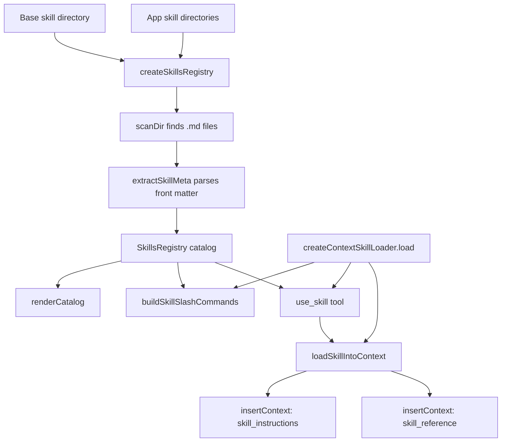
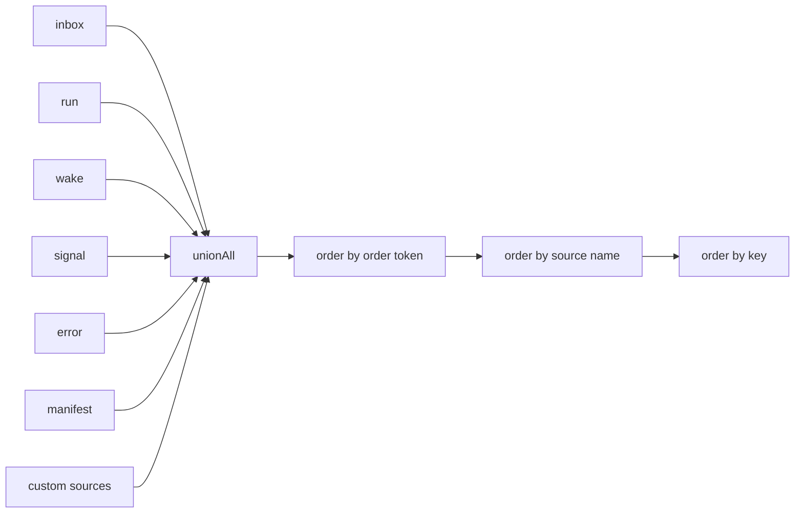
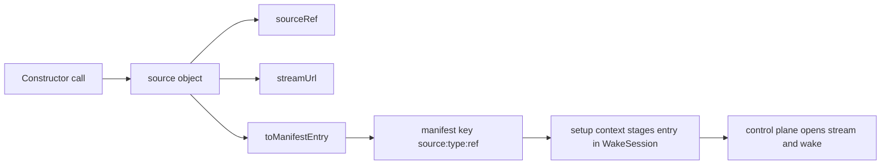
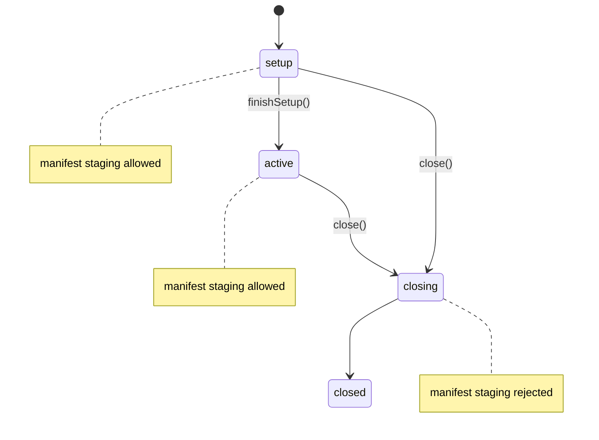

# Skills and Runtime Helpers

This document covers seven helper surfaces in `@electric-ax/agents-runtime`. The surfaces are skills, the browser entry point, manifest key builders, the goal application programming interface (API), timeline query helpers, observation source constructors, and `createWakeSession`. Each surface is small. Each surface is tied to the same rule: the entity stream is the source of truth.

Ten terms are needed here:

- An **entity** is an identified worker. It has an entity type, an instance identifier, and one append-only durable stream. The stream path is usually `/agent/<id>`.
- The **runtime** is the `@electric-ax/agents-runtime` package. It projects the entity stream into typed collections, runs the entity handler for each wake, and writes results to the same stream.
- A **wake** is one claimed processing turn for an entity. The agents-server control plane starts a wake when an inbox message, a cron schedule, a signal, or a child state change arrives.
- The **entity stream** is the append-only event log for one entity. It is the source of truth. A collection is a projection that the runtime rebuilds from that log.
- A **handler context** (`HandlerContext`) is the object that the runtime gives to the entity handler for one wake. It holds the methods and the helpers that this document describes.
- A **skill** is a Markdown document that holds instructions for a large language model (LLM). A skill can have reference documents.
- A **catalog** is the in-memory list of skill metadata. The runtime builds it with `createSkillsRegistry`.
- A **manifest** is the entity's durable list of children, sources, effects, attachments, context entries, and goals. A manifest entry has a `key` and a `kind`.
- An **observation source** is a description of a stream that an entity watches. The constructor returns a stream address and a manifest entry.
- A **wake session** is the per-wake collector for staged manifest writes, handles, and pending sends. `processWake` creates one for each wake.

Document [00-overview.md](00-overview.md) gives the source citations for the entity, wake, and runtime definitions. The handler context interface is at `packages/agents-runtime/src/types.ts:1057-1234`. Document [04-entity-stream-db.md](04-entity-stream-db.md) explains the stream database. Document [05-handler-context.md](05-handler-context.md) explains the context that receives these helpers.

## Skills

A skill is a plain Markdown file. The runtime does not use a separate package format. It scans directories for `.md` files, reads a small metadata block, and stores the metadata in a catalog. The file body stays on disk until an agent or a user loads it.

The whole path is this:



### How a skill is declared

A skill declares itself with a front matter block at the top of the file. The first line is exactly `---`. The parser looks for the closing `---` line within the first 25 lines. The citation is `packages/agents-runtime/src/skills/preamble.ts:10-21`.

```ts
export function parsePreamble(content: string): PreambleFields {
  const lines = content.split(`\n`)
  if (lines[0]?.trim() !== `---`) return {}

  let closingIndex = -1
  for (let i = 1; i < Math.min(lines.length, 25); i++) {
    if (lines[i]?.trim() === `---`) {
      closingIndex = i
      break
    }
  }
  if (closingIndex === -1) return {}
```

The citation is `packages/agents-runtime/src/skills/preamble.ts:10-21`.

The parser reads six keys. It reads `description`, `whenToUse`, `keywords`, `arguments`, `argument-hint`, and `user-invocable`. The citation is `packages/agents-runtime/src/skills/preamble.ts:32-84`.

| Key | Type | Meaning |
|-----|------|---------|
| `description` | string | One-line summary in the catalog |
| `whenToUse` | string | The trigger sentence that tells the model when to load the skill |
| `keywords` | list of strings | Search words in the full catalog view |
| `arguments` | list of strings | Named arguments that the skill accepts |
| `argument-hint` | string | Short usage hint after the slash command |
| `user-invocable` | boolean | Enables a slash command; `false` is not emitted, so the directory default applies |

The key names use camel case for `whenToUse`. The file uses `argument-hint` and `user-invocable`, not camel case. The parser maps `argument-hint` to `argumentHint`. For `user-invocable`, it stores `true` only when the raw value is exactly `true`. The citation is `packages/agents-runtime/src/skills/preamble.ts:78-83`.

```ts
      case `argument-hint`:
        result.argumentHint = stripQuotes(rawValue)
        break
      case `user-invocable`:
        result.userInvocable = rawValue === `true`
        break
```

The citation is `packages/agents-runtime/src/skills/preamble.ts:78-83`.

The parser accepts a comma-separated list or a multi-line list for `keywords` and `arguments`:

```ts
      case `keywords`: {
        if (rawValue.length === 0) {
          // Multi-line YAML list: collect subsequent `  - value` lines
          const items: Array<string> = []
          for (let j = i + 1; j < closingIndex; j++) {
            const next = lines[j]!
            const match = next.match(/^\s+-\s+(.+)$/)
            if (match) {
              items.push(match[1]!.trim())
              i = j // advance outer loop past consumed lines
            } else {
              break
            }
          }
          result.keywords = items
        } else {
          result.keywords = parseKeywords(rawValue)
        }
        break
      }
```

The citation is `packages/agents-runtime/src/skills/preamble.ts:39-58`.

The parser does not read a `name` key. The skill name comes from the file path. The registry uses the file base name. If the file is named `SKILL.md`, the registry uses the parent directory name. The citation is `packages/agents-runtime/src/skills/registry.ts:117-123`.

```ts
    const parsed = path.parse(entryPath)
    const name =
      parsed.name === `SKILL` ? path.basename(parsed.dir) : parsed.name
    out.set(name, {
      source: entryPath,
      userInvocableByDefault: opts.userInvocableByDefault,
    })
```

The citation is `packages/agents-runtime/src/skills/registry.ts:117-123`.

A skill can also have reference documents. The reference files are Markdown files in a subdirectory. The loader reads them only when a caller loads the skill. See the loading section below.

### The registry and the catalog

`createSkillsRegistry` scans the base directory and zero or more app directories. The base directory is the required `baseSkillsDir` input. App directories are the optional `appSkillsDir` and `appSkillsDirs` inputs. The parameter names and the default flags are the only contract in the source: the base directory is required and its skills default to not user-invocable; app directories are optional and their skills default to user-invocable. The factory scans the base directory first, then each app directory. All scans write into one map with `out.set(name, ...)`, so a later scan replaces an earlier skill with the same name. An app skill therefore replaces a base skill with the same name. The citation is `packages/agents-runtime/src/skills/registry.ts:11-36` and `packages/agents-runtime/src/skills/registry.ts:105-123`.

```ts
  await scanDir(baseSkillsDir, files, { userInvocableByDefault: false })
  if (appSkillsDir) {
    await scanDir(appSkillsDir, files, { userInvocableByDefault: true })
  }
  for (const dir of appSkillsDirs ?? []) {
    await scanDir(dir, files, { userInvocableByDefault: true })
  }
```

The citation is `packages/agents-runtime/src/skills/registry.ts:30-36`.

The factory takes four inputs. `baseSkillsDir` and `cacheDir` are required. `appSkillsDir` and `appSkillsDirs` are optional. The caller supplies `cacheDir`; the factory does not choose a default. The citation is `packages/agents-runtime/src/skills/registry.ts:11-23`.

```ts
interface SkillsRegistryOptions {
  baseSkillsDir: string
  appSkillsDir?: string
  appSkillsDirs?: ReadonlyArray<string>
  cacheDir: string
}

type CacheFile = Record<string, SkillMeta>
type SkillFile = { source: string; userInvocableByDefault: boolean }

export async function createSkillsRegistry(
  opts: SkillsRegistryOptions
): Promise<SkillsRegistry> {
```

The citation is `packages/agents-runtime/src/skills/registry.ts:11-23`.

The scan skips `node_modules` and `.git`. It reads every file whose name ends in `.md`. The citation is `packages/agents-runtime/src/skills/registry.ts:111-116`.

For each skill file, the registry reads the content and computes a Secure Hash Algorithm 256-bit (SHA-256) hash. It reuses a cached metadata record when the hash and the source path match. Otherwise it calls `extractSkillMeta`. It stores the name, the metadata, the user-invocable flag, the character count, the hash, and the source path. The citation is `packages/agents-runtime/src/skills/registry.ts:38-61`.

```ts
  const catalog = new Map<string, SkillMeta>()
  for (const [name, file] of files) {
    const filePath = file.source
    const content = await fs.readFile(filePath, `utf-8`)
    const hash = sha256(content)

    const cached = existingCache[name]
    if (cached && cached.contentHash === hash && cached.source === filePath) {
      catalog.set(name, cached)
      continue
    }

    runtimeLog.info(`[skills]`, `extracting metadata for "${name}"`)
    const meta = await extractSkillMeta(name, content)
    const entry: SkillMeta = {
      name,
      ...meta,
      userInvocable: meta.userInvocable ?? file.userInvocableByDefault,
      charCount: content.length,
      contentHash: hash,
      source: filePath,
    }
    catalog.set(name, entry)
  }
```

The citation is `packages/agents-runtime/src/skills/registry.ts:38-61`.

The hash cache lives in a file named `skills-cache.json` inside `cacheDir`. The registry also writes a `.gitignore` file with the content `*`. The source does not state why. The citation is `packages/agents-runtime/src/skills/registry.ts:9` and `packages/agents-runtime/src/skills/registry.ts:136-148`.

The metadata parser has two branches. When the front matter supplies `description`, `whenToUse`, and `keywords`, the parser returns the supplied values for the six fields. In this branch, `arguments` and `argumentHint` are included only when they are present, and `userInvocable` is included only when it is true. When any one of the three values is missing, the parser enters the fallback branch. That branch returns only `description`, `whenToUse`, and `keywords`. For each of the three, it keeps the front-matter value when present and substitutes a default when absent. The defaults are `humanize(name)`, `User asks about <name>`, and `[name]`. The fallback branch always drops `arguments`, `argumentHint`, and `userInvocable`, even when the front matter supplied them. The citation is `packages/agents-runtime/src/skills/extract-meta.ts:12-35`.

```ts
export async function extractSkillMeta(
  name: string,
  content: string
): Promise<ExtractedMeta> {
  const preamble = parsePreamble(content)

  if (preamble.description && preamble.whenToUse && preamble.keywords) {
    return {
      description: preamble.description,
      whenToUse: preamble.whenToUse,
      keywords: preamble.keywords,
      ...(preamble.arguments && { arguments: preamble.arguments }),
      ...(preamble.argumentHint && { argumentHint: preamble.argumentHint }),
      ...(preamble.userInvocable && { userInvocable: true }),
    }
  }

  return {
    description: preamble.description ?? humanize(name),
    whenToUse:
      preamble.whenToUse ?? `User asks about ${humanize(name).toLowerCase()}`,
    keywords: preamble.keywords ?? [name],
  }
}
```

The citation is `packages/agents-runtime/src/skills/extract-meta.ts:12-35`.

`userInvocable` has a second rule. The parser only emits the field when the value is true. The registry then uses `meta.userInvocable ?? file.userInvocableByDefault`. A base skill with `user-invocable: false` stays false. An app skill with `user-invocable: false` becomes true, because the parser emits no false value. The citation is `packages/agents-runtime/src/skills/extract-meta.ts:25` and `packages/agents-runtime/src/skills/registry.ts:55`.

### Listing a skill

`renderCatalog` renders the catalog as text. It has three size modes. It tries the full list first. If the full list is over the budget, it tries a compact list with descriptions cut to 100 characters. If the compact list is still over the budget, it returns names only. The names mode has no further budget check, so the result can exceed the budget. The interface comment in `types.ts` says the result fits within the budget; the code enforces that limit only for the first two modes. The citation is `packages/agents-runtime/src/skills/registry.ts:67-81` and `packages/agents-runtime/src/skills/types.ts:18-19`.

```ts
    renderCatalog(budget?: number) {
      if (catalog.size === 0) return ``
      const skills = Array.from(catalog.values())

      // Phase 1: full detail
      const full = renderSkillList(skills, `full`)
      if (!budget || full.length <= budget) return full

      // Phase 2: compact (truncated descriptions, no keywords)
      const compact = renderSkillList(skills, `compact`)
      if (compact.length <= budget) return compact

      // Phase 3: names only
      return renderSkillList(skills, `names`)
    },
```

The citation is `packages/agents-runtime/src/skills/registry.ts:67-81`.

The full mode shows the character count, the description, the trigger sentence, the keywords, and a usage line. The usage line is `Usage: use_skill("<name>", "<argumentHint>")`. The compact mode cuts descriptions to 100 characters and omits keywords. The names mode shows a slash prefix for user-invocable skills and a description cut to 60 characters. The citation is `packages/agents-runtime/src/skills/registry.ts:154-199`.

`readContent` reads the current file from disk. It returns `null` when the catalog has no such name or the read fails. The citation is `packages/agents-runtime/src/skills/registry.ts:82-90`.

```ts
    async readContent(name: string) {
      const meta = catalog.get(name)
      if (!meta) return null
      try {
        return await fs.readFile(meta.source, `utf-8`)
      } catch {
        return null
      }
    },
```

The citation is `packages/agents-runtime/src/skills/registry.ts:82-90`.

### How a skill is loaded and invoked

There are two load paths. An agent loads a skill with the `use_skill` tool. A user loads a skill with a slash command through `createContextSkillLoader`. Both paths call `loadSkillIntoContext`.

`loadSkillIntoContext` performs six steps for the instructions, then a seventh step for reference documents. The six steps are: look up the metadata, reject an unknown name, reject an already loaded skill, read the file, substitute arguments, and insert the instructions into the handler context. The seventh step reads each reference document and inserts it as a separate context entry. The citation is `packages/agents-runtime/src/skills/tools.ts:20-89`.

```ts
export async function loadSkillIntoContext(
  registry: SkillsRegistry,
  ctx: Pick<HandlerContext, `insertContext` | `getContext`>,
  name: string,
  args?: string
): Promise<LoadSkillResult> {
  const meta = registry.catalog.get(name)
  if (!meta) {
    const available = Array.from(registry.catalog.keys()).join(`, `)
    return {
      loaded: false,
      message: `Skill "${name}" not found. Available skills: ${available || `none`}`,
    }
  }

  const contextId = skillContextId(name)
  if (ctx.getContext(contextId)) {
    return {
      loaded: false,
      alreadyLoaded: true,
      message: `Skill "${name}" is already loaded.`,
    }
  }

  let content = await registry.readContent(name)
  if (content === null) {
    return {
      loaded: false,
      message: `Error: could not read skill file for "${name}".`,
    }
  }

  if (args) {
    content = substituteArgs(content, args, meta.arguments)
  }

  ctx.insertContext(contextId, {
    name: `skill_instructions`,
    attrs: { skill: name, type: `directive` },
    content,
  })
```

The citation is `packages/agents-runtime/src/skills/tools.ts:20-60`.

On success, `loadSkillIntoContext` returns `{ loaded: true, chars, message, contextSource }`. `contextSource` is the `SKILL ACTIVATED` text, the optional skill directory note, the instructions, and the reference sections. The skill loader uses that value as the content of the volatile context source. The citation is `packages/agents-runtime/src/skills/tools.ts:89-97`.

The context identifier is `skill:<name>`. The `skillContextId` function builds it. The citation is `packages/agents-runtime/src/skills/tools.ts:8-10`.

`insertContext` writes a `contextInserted` event and stages a `context` manifest entry with the fixed key `context:<id>`. A later insert with the same identifier replaces the staged manifest entry. A context entry is a durable manifest entry: no code in this package removes it at the end of a wake, and it stays until `removeContext` removes it. `getContext` scans the local `manifests` collection, not the staged wake-session map. The skill loader prevents a second load: it calls `getContext` first and returns `alreadyLoaded` when the identifier exists. The citation is `packages/agents-runtime/src/context-entries.ts:67-99`, `packages/agents-runtime/src/context-entries.ts:110-124`, and `packages/agents-runtime/src/skills/tools.ts:27-37`.

The argument substitution supports three placeholder forms. A named argument uses `$name`. A positional argument uses `$0`, `$1`, and so on. The whole argument string uses `$ARGUMENTS`. If no placeholder matches, the loader appends `Arguments: <raw>` to the end. The citation is `packages/agents-runtime/src/skills/tools.ts:199-240`.

```ts
function substituteArgs(
  content: string,
  rawArgs: string,
  argNames?: Array<string>
): string {
  const parsed = parseArgs(rawArgs)
  let result = content
  let matched = false

  // Named arguments: $arg_name → value (by position in argNames)
  if (argNames) {
    for (let i = 0; i < argNames.length && i < parsed.length; i++) {
      const pattern = new RegExp(`\\$${argNames[i]!}\\b`, `g`)
      if (pattern.test(result)) {
        result = result.replace(pattern, parsed[i]!)
        matched = true
      }
    }
  }

  // Indexed: $0, $1, ...
  for (let i = 0; i < parsed.length; i++) {
    const pattern = new RegExp(`\\$${i}\\b`, `g`)
    if (pattern.test(result)) {
      result = result.replace(pattern, parsed[i]!)
      matched = true
    }
  }

  // Full string: $ARGUMENTS
  if (result.includes(`$ARGUMENTS`)) {
    result = result.replace(/\$ARGUMENTS/g, rawArgs)
    matched = true
  }

  // Fallback: append if no placeholders matched
  if (!matched) {
    result += `\n\nArguments: ${rawArgs}`
  }

  return result
}
```

The citation is `packages/agents-runtime/src/skills/tools.ts:199-240`.

`parseArgs` splits the raw argument string on spaces and tabs. A single or double quote groups a multi-word value. The citation is `packages/agents-runtime/src/skills/tools.ts:171-197`.

The three passes run in the order shown. The source has no guard against a substituted value that itself contains a later placeholder. A second pass can therefore replace text that the first pass inserted. The source does not state whether this is intended.

After the instruction insert, the loader looks for reference documents. It builds the skill directory with `path.join(path.dirname(meta.source), name)`. It lists every file below that directory. `listRefFiles` walks subdirectories, so the list is recursive. The loader reads each `.md` file. It inserts each file as a `skill_reference` context entry with the identifier `skill:<name>:<file>`. It also appends each file to the returned message. The citation is `packages/agents-runtime/src/skills/tools.ts:62-89` and `packages/agents-runtime/src/skills/tools.ts:242-258`.

```ts
  const skillDir = path.join(path.dirname(meta.source), name)

  const allRefFiles = listRefFiles(skillDir)
  const mdFiles = allRefFiles.filter((f) => f.endsWith(`.md`))
  const refContents: Array<string> = []
  for (const f of mdFiles) {
    try {
      const refContent = await fsPromises.readFile(
        path.join(skillDir, f),
        `utf-8`
      )
      const refId = `${skillContextId(name)}:${f}`
      ctx.insertContext(refId, {
        name: `skill_reference`,
        attrs: { skill: name, file: f },
        content: refContent,
      })
      refContents.push(`--- ${f} ---\n${refContent}`)
    } catch {
      // skip unreadable files
    }
  }
```

The citation is `packages/agents-runtime/src/skills/tools.ts:62-83`.

The returned message starts with `SKILL ACTIVATED`. It tells the model that the instructions override the default behaviour. It also says that the content is already present, so the model must not read files to find it. The citation is `packages/agents-runtime/src/skills/tools.ts:89`.

`createSkillTools` returns two tools. `use_skill` takes a name and optional arguments. `remove_skill` takes a name. Both tools return text content for the model. The citation is `packages/agents-runtime/src/skills/tools.ts:99-169`.

```ts
export function createSkillTools(
  registry: SkillsRegistry,
  ctx: Pick<HandlerContext, `insertContext` | `removeContext` | `getContext`>
): Array<AgentTool> {
  const useSkill: AgentTool = {
    name: `use_skill`,
    label: `Use Skill`,
    description: `Load a skill into your context. Call with a skill name to load it. Pass args if the skill accepts arguments.`,
    parameters: Type.Object({
      name: Type.String({
        description: `Name of the skill to load`,
      }),
      args: Type.Optional(
        Type.String({
          description: `Arguments to pass to the skill (space-separated, or quoted for multi-word values)`,
        })
      ),
    }),
```

The citation is `packages/agents-runtime/src/skills/tools.ts:99-116`.

`remove_skill` removes the instruction context entry and all reference context entries. It finds the reference names the same way as the loader. The citation is `packages/agents-runtime/src/skills/tools.ts:134-169`.

### The skill loader for a handler

`createContextSkillLoader` connects the registry to a handler context. The function takes the registry, which can be `null` or `undefined`, and an optional options object. The options are a slash command owner, a catalog source name, and a catalog budget. The defaults are `skills`, `skills_catalog`, and 2,000 characters. The citation is `packages/agents-runtime/src/skills/context-loader.ts:12-23` and `packages/agents-runtime/src/skills/context-loader.ts:78-87`.

```ts
export function createContextSkillLoader(
  registry: SkillsRegistry | null | undefined,
  opts: ContextSkillLoaderOptions = {}
): ContextSkillLoader {
```

The citation is `packages/agents-runtime/src/skills/context-loader.ts:78-82`.

```ts
const DEFAULT_SLASH_COMMAND_OWNER = `skills`
const DEFAULT_CATALOG_SOURCE_NAME = `skills_catalog`
const DEFAULT_CATALOG_BUDGET = 2_000

const SLASH_COMMAND_NAME_PATTERN = /^[a-z][a-z0-9]*(?:-[a-z0-9]+)*$/
const SLASH_COMMAND_ARGUMENT_NAME_PATTERN = /^[a-z][a-zA-Z0-9_]*$/
```

The citation is `packages/agents-runtime/src/skills/context-loader.ts:12-17`.

The loader has one method, `load(ctx)`. The method first registers the slash commands. `buildSkillSlashCommands` accepts a missing registry and returns an empty list, so this call is safe before the guard. The method then returns an empty result when the registry is missing or its catalog is empty. Next, it reads the first composer slash command from the wake. A composer input is a structured user message with nodes of kind `text`, `slash_command`, `file`, `symbol`, or `branch`. An inbox wake is a wake whose `type` is `inbox`; it carries one message. `firstComposerSlashCommand` accepts only an inbox wake whose message type is `composer_input`. It returns the first `slash_command` node. The method loads the named skill only when the skill is user-invocable. It reads the arguments with `textAfterNode(composerCommand.payload, command)`, which returns the composer source text after the slash command node. It returns the skill tools, the catalog source, and the names of the skills that the user command loaded in this wake. The citation is `packages/agents-runtime/src/skills/context-loader.ts:91-168` and `packages/agents-runtime/src/composer-input.ts:255-260`.

```ts
    async load(ctx) {
      ctx.slashCommands.replaceOwned(
        slashCommandOwner,
        buildSkillSlashCommands(registry)
      )

      if (!registry || registry.catalog.size === 0) {
        return { tools: [], sources: {}, autoLoadedSkills: [] }
      }

      const autoLoadedSources: Record<string, SourceConfig> = {}
      const autoLoadedSkills: Array<string> = []
      const composerCommand = firstComposerSlashCommand(ctx.wake)
      const command = composerCommand?.command
      const skill =
        command && registry.catalog.get(command.name)?.userInvocable
          ? registry.catalog.get(command.name)
          : undefined

      if (composerCommand && command && skill) {
        const args = textAfterNode(composerCommand.payload, command).trim()
        const result = await loadSkillIntoContext(
          registry,
          ctx,
          command.name,
          args || undefined
        )
        if (result.contextSource) {
          autoLoadedSkills.push(command.name)
          autoLoadedSources[`skill:${command.name}`] = {
            content: () => result.contextSource!,
            max: result.contextSource.length,
            cache: `volatile`,
          }
        }
      }

      return {
        tools: createSkillTools(registry, ctx),
        sources: {
          [catalogSourceName]: {
            content: () => registry.renderCatalog(catalogBudget),
            max: catalogBudget,
            cache: `stable`,
          },
          ...autoLoadedSources,
        },
        autoLoadedSkills,
      }
    },
```

The citation is `packages/agents-runtime/src/skills/context-loader.ts:91-140`.

`ctx.slashCommands.replaceOwned(owner, commands)` replaces the set of dynamic slash commands for that owner. It validates the commands and keeps commands from other owners. The citation is `packages/agents-runtime/src/composer-input.ts:97-105` and `packages/agents-runtime/src/context-factory.ts:487-500`.

The catalog is a `stable` context source. A skill that the user command loads is a `volatile` context source under the source name `skill:<name>`. The `autoLoadedSkills` array lists the names. The load itself is user-triggered: it happens only when the wake carries a matching composer slash command.

`cache` is one of the four tiers in `CACHE_TIERS`: `pinned`, `stable`, `slow-changing`, and `volatile`. A `SourceConfig` has a `content` function that returns text or messages. It has a `max` token cap. `max` is required for every tier except `volatile`. `assembleContext` groups sources by tier and places the volatile group in a separate section at the end of the context. The citation is `packages/agents-runtime/src/types.ts:270-311` and `packages/agents-runtime/src/context-assembly.ts:221-307`.

`buildSkillSlashCommands` filters the catalog to user-invocable skills with valid names. It sorts the names. It maps the `arguments` list to slash command argument definitions. The citation is `packages/agents-runtime/src/skills/context-loader.ts:45-76`.

The loader is an exported helper. This package does not call `createContextSkillLoader` inside `process-wake.ts`. A caller must call the loader and pass its `tools` and `sources` to the handler configuration. The citation is `packages/agents-runtime/src/index.ts:337-348`.

### The skill manifest shape

The catalog entry has a fixed shape. The citation is `packages/agents-runtime/src/skills/types.ts:1-21`.

```ts
export interface SkillMeta {
  name: string
  description: string
  whenToUse: string
  keywords: Array<string>
  arguments?: Array<string>
  argumentHint?: string
  userInvocable?: boolean
  charCount: number
  contentHash: string
  source: string
}

export interface SkillsRegistry {
  /** All skill metadata, keyed by name. */
  catalog: ReadonlyMap<string, SkillMeta>
  /** Render the skill catalog as text for context injection. Fits within budget (chars). */
  renderCatalog: (budget?: number) => string
  /** Read skill content from disk. Returns null if skill not found. */
  readContent: (name: string) => Promise<string | null>
}
```

The citation is `packages/agents-runtime/src/skills/types.ts:1-21`.

| Field | Meaning |
|-------|---------|
| `name` | Catalog key, from the file name or the `SKILL.md` parent directory |
| `description` | One-line summary |
| `whenToUse` | Trigger sentence |
| `keywords` | Words for the full catalog view |
| `arguments` | Optional named arguments |
| `argumentHint` | Optional usage hint |
| `userInvocable` | Optional flag; a missing value means "use the directory default" |
| `charCount` | Length of the whole file in characters, including the front matter |
| `contentHash` | SHA-256 hash of the whole file content |
| `source` | Absolute path of the Markdown file |

### A limitation in the reference file path

The loader computes the reference directory as `path.join(path.dirname(meta.source), name)`. Consider a skill file named `quickstart.md` in `/skills`. The computed directory is `/skills/quickstart`. Consider a skill file named `SKILL.md` in `/skills/designing-entities`. The computed directory is `/skills/designing-entities/designing-entities`.

The source does not state the intended convention for a flat file. The loader looks only in the computed directory. For `quickstart.md` in `/skills`, a reference document must be at `/skills/quickstart/<file>.md` for the loader to find it. For a `SKILL.md` file, the computed directory adds a second copy of the directory name. `remove_skill` inherits the same path rule, because it finds reference names the same way as the loader. The citation for both path rules is `packages/agents-runtime/src/skills/tools.ts:62` and `packages/agents-runtime/src/skills/tools.ts:134-169`.

The shipped skill `designing-entities` stores its reference files in `skills/designing-entities/references/`. The computed path does not match that layout. This study found no test for the reference path in this package. Treat reference loading for `SKILL.md` skills as unverified.

The citation for the path expression is `packages/agents-runtime/src/skills/tools.ts:62`. The shipped layout is `packages/agents-runtime/skills/designing-entities/references/`.

## Browser helpers available to handlers

The package publishes a `./client` subpath. These functions are not fields on the handler context. The source of `HandlerContext` has no `createEntityTimelineQuery` field. Handler code and browser views import the functions from the `./client` subpath. The citation is `packages/agents-runtime/package.json:47-56`.

```json
    "./client": {
      "import": {
        "types": "./dist/client.d.ts",
        "default": "./dist/client.js"
      },
      "require": {
        "types": "./dist/client.d.cts",
        "default": "./dist/client.cjs"
      }
    },
```

The citation is `packages/agents-runtime/package.json:47-56`.

The source file `src/client.ts` is a re-export list. It does not define new behaviour. The citation is `packages/agents-runtime/src/client.ts:1-14`.

```ts
export { createEntityStreamDB } from './entity-stream-db'
export { createAgentsClient } from './agents-client'
export {
  compareTimelineOrders,
  buildEntityTimelineData,
  createPendingTimelineOrder,
  createEntityErrorsQuery,
  createEntityIncludesQuery,
  createEntityTimelineQuery,
  getEntityState,
  normalizeEntityTimelineData,
  normalizeTimelineEntities,
  TIMELINE_ORDER_FALLBACK,
} from './entity-timeline'
```

The citation is `packages/agents-runtime/src/client.ts:1-14`.

The entry also re-exports observation sources, the path helper, the attachment helpers, the composer helpers, and the goal parser:

```ts
export {
  canonicalPgSyncOptions,
  db,
  entities,
  entity,
  getPgSyncStreamPath,
  pgSync,
  pgSyncObservationCollections,
  sourceRefForPgSync,
  webhook,
  getWebhookStreamPath,
  webhookObservationCollections,
  webhookEventRowSchema,
} from './observation-sources'
export { appendPathToUrl } from './url'
export {
  getEntityAttachmentStreamPath,
  manifestAttachmentKey,
} from './manifest-helpers'
```

The citation is `packages/agents-runtime/src/client.ts:15-33`.

```ts
export {
  COMPOSER_INPUT_MESSAGE_TYPE,
  serializeComposerInput,
  normalizeCommandName,
  formatSlashCommandArgumentHint,
  detectSlashCommandTrigger,
  createSlashCommandTokenRegex,
  SLASH_COMMAND_TRIGGER_REGEX,
} from './composer-input'
// The /goal text grammar — pure parsing, shared with the UI so composer
// behavior (e.g. which subcommands interrupt a running agent) can't
// drift from the runtime dispatcher.
export { isGoalCommandText, parseGoalCommand } from './goal-command'
```

The citation is `packages/agents-runtime/src/client.ts:35-47`.

The browser entry groups the helpers by purpose:

| Group | Exports | Purpose |
|-------|---------|---------|
| Stream database and client | `createEntityStreamDB`, `createAgentsClient` | Build the local collection projection and the control-plane client |
| Timeline | `createEntityTimelineQuery`, `createEntityIncludesQuery`, `createEntityErrorsQuery`, `buildEntityTimelineData`, `getEntityState`, `compareTimelineOrders`, `normalizeEntityTimelineData`, `normalizeTimelineEntities`, `createPendingTimelineOrder`, `TIMELINE_ORDER_FALLBACK` | Read and shape the timeline |
| Observation | `entity`, `entities`, `db`, `webhook`, `pgSync`, and related helpers; `cron` is exported from the package root, not from `./client` | Describe a watched stream |
| Composer | `serializeComposerInput`, `normalizeCommandName`, `detectSlashCommandTrigger`, and related helpers | Parse and build composer input |
| Goal text | `isGoalCommandText`, `parseGoalCommand` | Parse `/goal` text without the runtime dispatcher |
| Token accounting | `formatTokenCount`, `computeContextUsage`, `computeContextBreakdown`, and related helpers | Display context usage |

`ensureEntityTimelineIndexes` is exported from `src/entity-timeline.ts`, but `./client` does not re-export it. The citation is `packages/agents-runtime/src/client.ts:1-14`.

The token accounting group comes from two modules. `formatTokenCount` comes from `token-budget`. The other helpers come from `token-accountant`. `computeContextUsage` takes the last step's input and output token counts and the context window size, and returns `usedTokens` and a clamped `ratio`; it returns `null` when the window is unknown or not positive. `computeContextBreakdown` splits the used and free window into `system`, `tools`, `messages`, and `free` segments, given optional system and tools token counts. The citation for the group is `packages/agents-runtime/src/client.ts:48-58`, `packages/agents-runtime/src/token-accountant.ts:41-66`, and `packages/agents-runtime/src/token-accountant.ts:97-122`.

## Manifest key helpers

A manifest entry is keyed by a string. The key encodes the kind and the identity of the entry. The helpers are pure string builders. The citation is `packages/agents-runtime/src/manifest-helpers.ts:1-24`.

```ts
export function manifestChildKey(entityType: string, id: string): string {
  return `child:${entityType}:${id}`
}

export { manifestSourceKey } from './observation-sources'

export function manifestSharedStateKey(id: string): string {
  return `shared-state:${id}`
}

export function manifestEffectKey(functionRef: string, id: string): string {
  return `effect:${functionRef}:${id}`
}

export function manifestAttachmentKey(id: string): string {
  return `attachment:${id}`
}

export function getEntityAttachmentStreamPath(
  entityUrl: string,
  attachmentId: string
): string {
  return `${entityUrl.replace(/\/+$/, ``)}/attachments/${attachmentId}`
}
```

The citation is `packages/agents-runtime/src/manifest-helpers.ts:1-24`.

| Helper | Key | Manifest `kind` | Meaning |
|--------|-----|-----------------|---------|
| `manifestChildKey(entityType, id)` | `child:<type>:<id>` | `child` | A spawned child entity and its wake subscription |
| `manifestSourceKey(sourceType, sourceRef)` | `source:<type>:<ref>` | `source` | An observed stream, such as an entity, cron, webhook, database, or PostgreSQL synchronization |
| `manifestSharedStateKey(id)` | `shared-state:<id>` | `shared-state` | A shared-state database that the entity creates or connects to |
| `manifestEffectKey(functionRef, id)` | `effect:<functionRef>:<id>` | `effect` | A registered side effect |
| `manifestAttachmentKey(id)` | `attachment:<id>` | `attachment` | A file attachment record |
| `getEntityAttachmentStreamPath(entityUrl, attachmentId)` | `<entityUrl>/attachments/<id>` | not an entry key | Stream path for attachment bytes |

`manifestSourceKey` is defined in the observation source file, not in the manifest helper file. The citation is `packages/agents-runtime/src/observation-sources.ts:178-183`.

```ts
export function manifestSourceKey(
  sourceType: string,
  sourceRef: string
): string {
  return `source:${sourceType}:${sourceRef}`
}
```

The citation is `packages/agents-runtime/src/observation-sources.ts:178-183`.

The manifest kinds are declared in the entity schema. The field names are literal TypeScript properties. The names do not use one convention: a child entry has `entity_type`, `entity_url`, a `wake`, and an `observed` flag; a source entry has `sourceType`, `sourceRef`, an optional `wake`, and a `config` object. A shared-state entry has `mode`, `collections`, and an optional `wake`. An effect entry has `function_ref` and `config`. An attachment entry has `streamPath`; `status` (`pending`, `complete`, or `failed`); `subject` (`{ type, key }`, where type is `inbox`, `run`, `text`, `tool_call`, or `context`); `role` (`input` or `output`); `mimeType`; and an optional `filename`, `byteLength`, `sha256`, `createdBy`, `error`, and `meta`. It also has `createdAt`. The citation is `packages/agents-runtime/src/entity-schema.ts:278-344`.

`manifestChildKey` is used when the runtime spawns a child and registers its wake. The citation is `packages/agents-runtime/src/process-wake.ts:1400`.

## Goal command API

The goal API stores one goal in the manifest. The key is the constant `goal`. The default token budget is 50,000. The citation is `packages/agents-runtime/src/goal-api.ts:11-30`.

```ts
export interface GoalApi {
  setGoal: (input: GoalInput) => GoalEntry
  clearGoal: () => boolean
  getGoal: () => GoalEntry | undefined
  markGoalComplete: (summary?: string) => GoalEntry | undefined
  /**
   * Persist an accurate `tokensUsed` from an authoritative source (e.g. the
   * runtime's in-memory step accumulator, which doesn't suffer from the
   * round-trip lag of summing the steps collection). Optionally also flips
   * status. Never decreases `tokensUsed`.
   */
  updateGoalUsage: (
    tokensUsed: number,
    opts?: { status?: GoalEntry[`status`] }
  ) => GoalEntry | undefined
}

export const GOAL_MANIFEST_KEY = `goal`
const GOAL_ID = `goal`
export const DEFAULT_TOKEN_BUDGET = 50_000
```

The citation is `packages/agents-runtime/src/goal-api.ts:11-30`.

`createGoalApi` takes the stream database, the wake session, an optional write function, and an optional clock. The citation is `packages/agents-runtime/src/goal-api.ts:64-69`.

```ts
export function createGoalApi(opts: {
  db: EntityStreamDBWithActions
  wakeSession: WakeSession
  writeEvent?: (event: ChangeEvent) => void
  now?: () => string
}): GoalApi {
```

The citation is `packages/agents-runtime/src/goal-api.ts:64-69`.

The API has five functions:

| Function | Input | Output | Behaviour |
|----------|-------|--------|-----------|
| `setGoal` | `GoalInput` | `GoalEntry` | Writes a `goal` manifest entry. A new objective resets usage. The same objective keeps usage. |
| `clearGoal` | none | boolean | Deletes the `goal` entry. Returns true when a goal existed. |
| `getGoal` | none | `GoalEntry` or undefined | Reads the goal, including a same-wake write. |
| `markGoalComplete` | optional summary | `GoalEntry` or undefined | Sets status to `complete`. Returns undefined when no goal exists. |
| `updateGoalUsage` | token count and optional status | `GoalEntry` or undefined | Raises `tokensUsed` to the larger value. Never lowers it. |

The citation is `packages/agents-runtime/src/goal-api.ts:122-225`.

The API returns a `GoalEntry`, not a raw manifest row. `GoalEntry` has `id`, `objective`, `status`, `tokenBudget`, `tokensUsed`, an optional `summary`, `createdAt`, and `updatedAt`. It has no `key` and no `kind`. The manifest row has the same fields plus `key: goal` and `kind: goal`. `toGoalEntry` converts the row. When `tokenBudget` is `null`, it keeps `null`. When `tokenBudget` is missing or is any value that is not a number and not `null`, it uses 50,000. The citation is `packages/agents-runtime/src/types.ts:344-370` and `packages/agents-runtime/src/goal-api.ts:42-62`.

`GoalInput` has `objective`, an optional `status`, and an optional `tokenBudget`. A `tokenBudget` of `null` means unbounded. An omitted `tokenBudget` means the runtime default. The citation is `packages/agents-runtime/src/types.ts:345-350`.

The API keeps a read-your-writes cache for the wake. A write through `writeEvent` reaches the local manifest collection only after a stream round trip. A read straight after the write could see the previous value. The cache holds the last written entry and a cleared flag. The citation is `packages/agents-runtime/src/goal-api.ts:72-93`.

```ts
  // Read-your-writes cache for the duration of this wake. Events written via
  // writeEvent only reach the local manifests collection after a round-trip
  // through the stream, so a read straight after a write would observe the
  // previous value — e.g. mark_goal_complete firing mid-run would snapshot a
  // stale tokensUsed and clobber the fresher per-step counter.
  let lastWritten: ManifestGoalEntry | undefined
  let clearedThisWake = false

  function readRaw():
    | (ManifestGoalEntry & Record<string, unknown>)
    | undefined {
    if (clearedThisWake) return undefined
    if (lastWritten) {
      return lastWritten as ManifestGoalEntry & Record<string, unknown>
    }
    for (const row of opts.db.collections.manifests.toArray) {
      if (isGoalManifest(row)) {
        return row as ManifestGoalEntry & Record<string, unknown>
      }
    }
    return undefined
  }
```

The citation is `packages/agents-runtime/src/goal-api.ts:72-93`.

Every mutation goes through one write channel. When `writeEvent` is present, the API writes a manifest upsert or delete directly. Otherwise it stages the entry in the wake session. The source comment says the staged path is a fallback for tests. The citation is `packages/agents-runtime/src/goal-api.ts:100-120`.

```ts
  function persist(entry: ManifestGoalEntry): GoalEntry {
    if (opts.writeEvent) {
      opts.writeEvent(
        entityStateSchema.manifests.upsert({
          key: GOAL_MANIFEST_KEY,
          value: entry as never,
        }) as ChangeEvent
      )
    } else {
      opts.wakeSession.registerManifestEntry(entry)
    }
    lastWritten = entry
    clearedThisWake = false
    return toGoalEntry(entry as unknown as Record<string, unknown>)
  }
```

The citation is `packages/agents-runtime/src/goal-api.ts:106-120`.

`clearGoal` is the delete path. With `writeEvent`, it writes a manifest delete for `goal` only when a goal exists. Without `writeEvent`, it calls `wakeSession.removeManifestEntry`. `markGoalComplete` copies the current row, sets `status` to `complete`, and stores the trimmed summary as `summary` when the summary is not empty. The summary is stored on the same manifest entry. The citation is `packages/agents-runtime/src/goal-api.ts:154-189`.

`setGoal` has two budget cases. An omitted budget uses 50,000. A `null` budget means unlimited. The citation is `packages/agents-runtime/src/goal-api.ts:129-132` and `packages/agents-runtime/src/types.ts:345-350`.

```ts
    setGoal(input) {
      const existing = readRaw()
      const timestamp = now()
      // Re-setting the same objective (e.g. to raise the budget) preserves
      // accumulated usage; a new objective starts from zero.
      const isSameObjective = existing?.objective === input.objective
      const tokenBudget =
        input.tokenBudget === undefined
          ? DEFAULT_TOKEN_BUDGET
          : input.tokenBudget
      const entry: ManifestGoalEntry = {
        key: GOAL_MANIFEST_KEY,
        kind: `goal`,
        id: GOAL_ID,
        objective: input.objective,
        status: input.status ?? `active`,
        tokenBudget,
        tokensUsed: isSameObjective
          ? typeof existing?.tokensUsed === `number`
            ? existing.tokensUsed
            : 0
          : 0,
        createdAt:
          isSameObjective && typeof existing?.createdAt === `string`
            ? existing.createdAt
            : timestamp,
        updatedAt: timestamp,
      }
      return persist(entry)
    },
```

The citation is `packages/agents-runtime/src/goal-api.ts:123-152`.

`updateGoalUsage` clamps the new count to zero or more, then takes the maximum of the previous count and the new count. It skips the write when neither the count nor the status changes. The citation is `packages/agents-runtime/src/goal-api.ts:191-225`.

```ts
    updateGoalUsage(tokensUsed, opts2) {
      const existing = readRaw()
      if (!existing) return undefined
      const previousTokens =
        typeof existing.tokensUsed === `number` ? existing.tokensUsed : 0
      // Never decrease — guards against a stale value clobbering a fresher one.
      const nextTokens = Math.max(previousTokens, Math.max(0, tokensUsed))
      const nextStatus = (opts2?.status ??
        existing.status ??
        `active`) as ManifestGoalEntry[`status`]
      if (nextTokens === previousTokens && nextStatus === existing.status) {
        return toGoalEntry(existing as unknown as Record<string, unknown>)
      }
```

The citation is `packages/agents-runtime/src/goal-api.ts:191-203`.

The goal API is wired into the handler context. `createHandlerContext` creates it at `packages/agents-runtime/src/context-factory.ts:540-544`. It exposes five methods on `ctx` at `packages/agents-runtime/src/context-factory.ts:1096-1100`.

### The goal command grammar

`GOAL_SLASH_COMMAND` is a static slash command definition. The composer shows it in autocomplete. The citation is `packages/agents-runtime/src/goal-command.ts:8-31`.

```ts
export const GOAL_SLASH_COMMAND: SlashCommandDefinition = {
  name: `goal`,
  description: `Session goal: set <objective> [--tokens N|unlimited] | show | complete | clear`,
  arguments: [
    {
      name: `subcommand`,
      type: `string`,
      required: true,
      description: `set | show | complete | clear`,
    },
    {
      name: `args`,
      type: `string`,
      description: `objective text and flags, e.g. "ship X" --tokens 50k`,
    },
  ],
}

export type GoalCommand =
  | { kind: `set`; objective: string; tokenBudget?: number | null }
  | { kind: `clear` }
  | { kind: `show` }
  | { kind: `complete` }
  | { kind: `error`; message: string }
```

The citation is `packages/agents-runtime/src/goal-command.ts:8-31`.

`isGoalCommandText` checks for the `/goal` prefix and a word boundary. `parseGoalCommand` splits the text into tokens. It accepts `set`, `clear`, `show` or `status`, and `complete` or `done`. Any other word becomes an error command. The citation is `packages/agents-runtime/src/goal-command.ts:36-72`.

```ts
export function parseGoalCommand(text: string): GoalCommand {
  const trimmed = text.trim()
  const afterPrefix = trimmed.slice(GOAL_PREFIX.length).trim()
  if (afterPrefix.length === 0) {
    return {
      kind: `error`,
      message: `Usage: /goal set <objective> [--tokens N|unlimited] | /goal clear | /goal show | /goal complete`,
    }
  }
  const tokens = tokenize(afterPrefix)
  const [subcommand, ...rest] = tokens
  switch (subcommand) {
    case `set`:
      return parseSet(rest)
    case `clear`:
      return { kind: `clear` }
    case `show`:
    case `status`:
      return { kind: `show` }
    case `complete`:
    case `done`:
      return { kind: `complete` }
    default:
      return {
        kind: `error`,
        message: `Unknown subcommand "${subcommand}". Use /goal set, /goal clear, /goal show, or /goal complete.`,
      }
  }
}
```

The citation is `packages/agents-runtime/src/goal-command.ts:44-72`.

`parseSet` accepts `--tokens <value>`, `-t <value>`, `--tokens=<value>`, and `--unlimited`. A token value can be a positive integer, a number with a `k` or `m` suffix, or one of `infinite`, `unlimited`, and `none`. The citation is `packages/agents-runtime/src/goal-command.ts:74-147`.

`dispatchGoalCommand` maps a parsed command to the goal API. A `set` command calls `ctx.setGoal`. A `clear` command calls `ctx.clearGoal`. A `complete` command calls `ctx.markGoalComplete`. A `show` command calls `ctx.getGoal`. An `error` command returns its message. Every branch returns `handled: true`. The citation is `packages/agents-runtime/src/goal-command.ts:185-241`.

```ts
export function dispatchGoalCommand(
  ctx: Pick<
    HandlerContext,
    `setGoal` | `clearGoal` | `getGoal` | `markGoalComplete`
  >,
  command: GoalCommand
): GoalDispatchResult {
  switch (command.kind) {
    case `set`: {
      const input =
        command.tokenBudget === undefined
          ? { objective: command.objective }
          : { objective: command.objective, tokenBudget: command.tokenBudget }
      const entry = ctx.setGoal(input)
      const budgetLabel =
        entry.tokenBudget === null
          ? `unlimited`
          : `${formatTokenCount(entry.tokenBudget)} tokens`
      return {
        handled: true,
        message: `Goal set: ${entry.objective} (budget: ${budgetLabel})`,
      }
    }
    case `clear`: {
      const cleared = ctx.clearGoal()
      return {
        handled: true,
        message: cleared ? `Goal cleared` : `No goal to clear`,
      }
    }
```

The citation is `packages/agents-runtime/src/goal-command.ts:185-214`.

`formatTokenCount` comes from `token-budget`. It writes a value below 1,000 as digits. It writes a larger value in compact form, such as `1.2k` or `12k`. The citation is `packages/agents-runtime/src/token-budget.ts:40-43`.

The model also gets a `mark_goal_complete` tool. The tool calls `ctx.getGoal` first. If no goal exists, it returns `completed: false`. Otherwise it calls `ctx.markGoalComplete` with the optional summary. The citation is `packages/agents-runtime/src/tools/goal-tools.ts:19-51`.

```ts
export function createMarkGoalCompleteTool(
  ctx: Pick<HandlerContext, `markGoalComplete` | `getGoal`>
): AgentTool {
  return {
    name: `mark_goal_complete`,
    label: `Mark Goal Complete`,
    description: `Mark the active goal as complete. Call this when you have finished the work described in the goal. After this is called, the runtime will stop driving you toward the goal.`,
    parameters: Type.Object({
      summary: Type.Optional(
        Type.String({
          description: `Optional short summary of what was accomplished. Recorded with the goal but not required.`,
        })
      ),
    }),
    execute: async (_toolCallId, params) => {
      const before = ctx.getGoal()
      if (!before) {
        return asToolResult({
          completed: false,
          message: `No active goal to mark complete.`,
        })
      }
      const { summary } = (params ?? {}) as { summary?: string }
      const updated = ctx.markGoalComplete(summary)
      return asToolResult({
        completed: true,
        objective: updated?.objective ?? before.objective,
        status: updated?.status ?? `complete`,
        ...(updated?.summary ? { summary: updated.summary } : {}),
      })
    },
  }
}
```

The citation is `packages/agents-runtime/src/tools/goal-tools.ts:19-51`.

The command path and the tool path end at the same API. The command path is for a user. The tool path is for the model.

## Timeline query helpers

The timeline helpers turn stream collections into ordered rows and live queries. In this section, a query builder is a function that receives an `InitialQueryBuilder` from TanStack DB and returns a query. The citation is `packages/agents-runtime/src/entity-timeline.ts:30-39`.

```ts
export const TIMELINE_ORDER_FALLBACK = `~`

export type EntityTimelineState =
  | `pending`
  | `queued`
  | `working`
  | `idle`
  | `error`

export type TimelineOrder = string | number
```

The citation is `packages/agents-runtime/src/entity-timeline.ts:30-39`.

The exported helpers are:

| Helper | Returns | Purpose |
|--------|---------|---------|
| `createPendingTimelineOrder(index)` | string | Builds a sortable token for a row that is not yet synced |
| `compareTimelineOrders(left, right)` | number | Compares two order tokens |
| `normalizeTimelineEntities(entities)` | array | Merges duplicate entity rows by uniform resource locator (URL) |
| `normalizeEntityTimelineData(data)` | object | Sorts runs and normalizes entities |
| `getEntityState(runs, inbox)` | `EntityTimelineState` | Derives the entity status |
| `buildEntityTimelineData(db)` | `EntityTimelineData` | Builds a full in-memory snapshot |
| `ensureEntityTimelineIndexes(db)` | void | Adds indexes once per database; exported from `entity-timeline.ts`, not from `./client` |
| `createEntityTimelineQuery(db, options)` | query builder | Builds the live multi-source timeline |
| `createEntityIncludesQuery(db)` | query builder | Builds one row with runs, inbox, wakes, signals, and entities |
| `createEntityErrorsQuery(db)` | query builder | Returns errors with no run |

The citation is `packages/agents-runtime/src/entity-timeline.ts:552-1956`.

### Order tokens

A timeline row can carry `_timeline_order` as a string. `readRequiredOrderToken` has three fallbacks:

- The stream event pointer in the collection's `__electricRowOffsets` map for the row key. `formatPointerOrderToken` writes it as `stream:<24-digit offset>:<8-digit subOffset>`. An empty or `null` offset pads to zeros.
- The `_seq` inline sequence number. `toSeqOrderToken` writes it as `seq:<12-digit seq>`.
- A pending token built from the collection identifier and the row index. The internal form is `pending:<collection>:<12-digit index>`.

The exported `createPendingTimelineOrder` uses a different form: `~pending:<12-digit index>`. The inbox filter uses the `~pending:%` prefix to identify a local row that is not yet synced. `TIMELINE_ORDER_FALLBACK` is the string `~`, and the live query uses that value as the coalesce sentinel for a missing order. The citation is `packages/agents-runtime/src/entity-timeline.ts:542-613`, `packages/agents-runtime/src/entity-timeline.ts:1393-1407`, and `packages/agents-runtime/src/event-pointer.ts:44-87`.

`createPendingTimelineOrder` gives the token a fixed-width index, so two tokens of this form keep order under string comparison. The source defines the shape of each form but not a single total order across all four forms. All four go through the same `localeCompare` call. The citation is `packages/agents-runtime/src/entity-timeline.ts:552-579`.

```ts
export function createPendingTimelineOrder(index: number): string {
  return `${TIMELINE_ORDER_FALLBACK}pending:${index.toString().padStart(12, `0`)}`
}
```

The citation is `packages/agents-runtime/src/entity-timeline.ts:552-554`.

`compareTimelineOrders` turns a number into a 20-character zero-padded string, then calls `localeCompare`. The citation is `packages/agents-runtime/src/entity-timeline.ts:568-579`.

```ts
function toComparableTimelineOrderValue(order: TimelineOrder): string {
  return typeof order === `number` ? order.toString().padStart(20, `0`) : order
}

export function compareTimelineOrders(
  left: TimelineOrder,
  right: TimelineOrder
): number {
  return toComparableTimelineOrderValue(left).localeCompare(
    toComparableTimelineOrderValue(right)
  )
}
```

The citation is `packages/agents-runtime/src/entity-timeline.ts:568-579`.

### Entity state

`getEntityState` returns a state from the last run and the last inbox message. The rules are:

- No rows means `pending`.
- No run means `queued`.
- A newer inbox message means `queued`.
- A failed run means `error`.
- A completed run means `idle`. This check comes before the error check, so a completed run with errors is `idle`, not `error`.
- Any other run with errors means `error`.
- Any other run means `working`.

The citation is `packages/agents-runtime/src/entity-timeline.ts:763-784`.

```ts
export function getEntityState(
  runs: Array<IncludesRun>,
  inbox: Array<IncludesInboxMessage>
): EntityTimelineState {
  if (runs.length === 0 && inbox.length === 0) return `pending`

  const lastRun = runs.at(-1)
  const lastInbox = inbox.at(-1)

  if (!lastRun) return `queued`

  if (lastInbox && compareTimelineOrders(lastInbox.order, lastRun.order) > 0) {
    return `queued`
  }

  if (lastRun.status === `failed`) return `error`
  if (lastRun.status === `completed`) return `idle`

  if (lastRun.errors.length > 0) return `error`

  return `working`
}
```

The citation is `packages/agents-runtime/src/entity-timeline.ts:763-784`.

The comparison in the third and fourth bullets inherits the order-token limitation above. If the inbox row and the run row use different token forms, the source does not define which token is newer. In the normal path, rows from the same stream carry `stream:` tokens.

### Snapshot build

`buildEntityTimelineData` reads every relevant collection. It adds order tokens. It builds one order index across the collections. It then builds runs, inbox messages, wakes, signals, context inserts and removals, and entities. The citation is `packages/agents-runtime/src/entity-timeline.ts:1091-1177`.

```ts
export function buildEntityTimelineData(
  db: EntityStreamDB
): EntityTimelineData {
  const runs = withOrderToken(db.collections.runs)
  const texts = withOrderToken(db.collections.texts)
  const textDeltas = withOrderToken(db.collections.textDeltas)
  const toolCalls = withOrderToken(db.collections.toolCalls)
  const steps = withOrderToken(db.collections.steps)
  const inbox = withOrderToken(db.collections.inbox)
  const wakes = withOrderToken(db.collections.wakes)
  const signals = withOrderToken(db.collections.signals)
```

The citation is `packages/agents-runtime/src/entity-timeline.ts:1091-1101`.

The function also reads `contextInserted`, `contextRemoved`, `manifests`, and `childStatus`. It builds one order index from the ordered rows. The index includes the eight collections above, the two context collections, and the manifest rows that have an order token. `childStatus` is read but is not part of the index. Its rows still pass through `withOptionalOrderFromOrderIndex`. A child-status row with an order token gets the index value, or `~` when the token is not in the index. The citation is `packages/agents-runtime/src/entity-timeline.ts:1102-1152` and `packages/agents-runtime/src/entity-timeline.ts:740-755`.

```ts
  const orderIndex = createOrderIndex([
    runs,
    texts,
    textDeltas,
    toolCalls,
    steps,
    inbox,
    wakes,
    signals,
    contextInserted,
    contextRemoved,
    manifests.filter(hasOrderToken),
  ])
```

The citation is `packages/agents-runtime/src/entity-timeline.ts:1140-1152`.

```ts
  return normalizeEntityTimelineData({
    runs: buildIncludesRuns({
      runs: withOrderFromOrderIndex(runs, orderIndex),
      texts: withOrderFromOrderIndex(texts, orderIndex),
      textDeltas: withOrderFromOrderIndex(textDeltas, orderIndex),
      toolCalls: withOrderFromOrderIndex(toolCalls, orderIndex),
      steps: withOrderFromOrderIndex(steps, orderIndex),
      errors: db.collections.errors.toArray,
    }),
    inbox: buildInboxMessages(withOrderFromOrderIndex(inbox, orderIndex)),
    wakes: buildWakeMessages(withOrderFromOrderIndex(wakes, orderIndex)),
    signals: buildSignalMessages(withOrderFromOrderIndex(signals, orderIndex)),
    contextInserted: buildContextInsertedMessages(
      withOrderAndHistoryOffsetFromOrderIndex(contextInserted, orderIndex)
    ),
    contextRemoved: buildContextRemovedMessages(
      withOrderAndHistoryOffsetFromOrderIndex(contextRemoved, orderIndex)
    ),
    entities: buildTimelineEntities({
      manifests: withOptionalOrderFromOrderIndex(manifests, orderIndex),
      childStatuses: withOptionalOrderFromOrderIndex(childStatuses, orderIndex),
    }),
  })
}
```

The citation is `packages/agents-runtime/src/entity-timeline.ts:1154-1177`.

The result shape is `EntityTimelineData`. It has seven arrays. The citation is `packages/agents-runtime/src/entity-timeline.ts:194-202`.

```ts
export interface EntityTimelineData {
  runs: Array<IncludesRun>
  inbox: Array<IncludesInboxMessage>
  wakes: Array<IncludesWakeMessage>
  signals: Array<IncludesSignal>
  contextInserted: Array<IncludesContextInserted>
  contextRemoved: Array<IncludesContextRemoved>
  entities: Array<IncludesEntity>
}
```

The citation is `packages/agents-runtime/src/entity-timeline.ts:194-202`.

`normalizeEntityTimelineData` sorts runs by their order and calls `normalizeTimelineEntities` for the entity list. `normalizeTimelineEntities` groups rows by `url`. When two rows share a URL, `mergeTimelineEntities` returns one row. The first row is `existing`; the second row is `incoming`. A child row supplies `key`, `kind: child`, `url`, and `wake` when either row is a child. A source row supplies `id` when there is no child. For `type` and `status`, the merge takes the first defined value in this order: the child row, the source row, `existing`, `incoming`. `observed` is true when either row is observed. The citation is `packages/agents-runtime/src/entity-timeline.ts:430-500`.

### Live queries

`createEntityTimelineQuery` calls `ensureEntityTimelineIndexes`, then returns a query function. The query has built-in sources named `inbox`, `run`, `wake`, `signal`, `error`, and `manifest`. The interface comment lists five names and omits `error`; the source object adds `error`. A caller can add custom sources, but a name that collides with a built-in name throws. The citation is `packages/agents-runtime/src/entity-timeline.ts:1380-1386` and `packages/agents-runtime/src/entity-timeline.ts:1670-1685`.

```ts
export function createEntityTimelineQuery(
  db: EntityStreamDB,
  opts: EntityTimelineQueryOptions = {}
): EntityTimelineQueryBuilder {
  ensureEntityTimelineIndexes(db)
  return (q: InitialQueryBuilder) => buildEntityTimelineQuery(q, db, opts)
}
```

The citation is `packages/agents-runtime/src/entity-timeline.ts:1380-1386`.

```ts
export interface EntityTimelineQueryOptions {
  inboxMode?: EntityTimelineInboxMode
  /**
   * Additional sources merged into the timeline, keyed by row name. Names
   * must not collide with the built-in sources (`inbox`, `run`, `wake`,
   * `signal`, `manifest`).
   */
  customSources?: Record<string, EntityTimelineCustomSource>
}
```

The citation is `packages/agents-runtime/src/entity-timeline.ts:215-223`.

The `inboxMode` option has two values. `processed` keeps rows whose status is `processed` or missing. It also keeps a local pending row: `$synced === false`, status `pending` or missing, and `_timeline_order` that starts with `~pending:`. It hides other pending rows. `all` keeps every inbox row. The default is `processed`. The citation is `packages/agents-runtime/src/entity-timeline.ts:1393-1407`.

The returned function is a TanStack DB query builder. The runtime imports `InitialQueryBuilder` and the operators from `@tanstack/db`. A query is composed with `q.from(...)`, `.where(...)`, `.select(...)`, `.unionAll(...)`, and `.orderBy(...)`. TanStack DB keeps the query live: it recomputes the result when a source collection changes. Document [04-entity-stream-db.md](04-entity-stream-db.md) explains the collection layer. The citation for the imports is `packages/agents-runtime/src/entity-timeline.ts:1-28`.

The query unions the sources. It orders the union by the order reference, then by the source name, then by the row key. The citation is `packages/agents-runtime/src/entity-timeline.ts:1694-1710`.



`createEntityIncludesQuery` returns one row with nested arrays. The row contains `runs`, `inbox`, `wakes`, `signals`, and `entities`. Each run contains `texts`, `toolCalls`, `steps`, and `errors`. It also computes per-run token totals from the steps. The citation is `packages/agents-runtime/src/entity-timeline.ts:1715-1940`.

```ts
export function createEntityIncludesQuery(
  db: EntityStreamDB
): EntityQueryBuilder {
  ensureEntityTimelineIndexes(db)
  const seedCollection = getTimelineSeedCollection(db)
  const runsCollection = getEntityRunsCollection(db)
  const inboxCollection = getEntityInboxCollection(db)
  const wakesCollection = getEntityWakesCollection(db)
  const signalsCollection = getEntitySignalsCollection(db)
  const entitiesCollection = getEntityEntitiesCollection(db)

  return (q: InitialQueryBuilder) =>
    q.from({ timeline: seedCollection }).select(({ timeline }) => ({
```

The citation is `packages/agents-runtime/src/entity-timeline.ts:1715-1727`.

`createEntityErrorsQuery` returns errors that have no `run_id`. The citation is `packages/agents-runtime/src/entity-timeline.ts:1942-1956`.

```ts
export function createEntityErrorsQuery(
  db: EntityStreamDB
): EntityQueryBuilder {
  return (q: InitialQueryBuilder) =>
    q
      .from({ errors: db.collections.errors })
      .where(({ errors }) =>
        or(isNull(errors.run_id), isUndefined(errors.run_id))
      )
      .select(({ errors }) => ({
        key: errors.key,
        error_code: errors.error_code,
        message: errors.message,
      }))
}
```

The citation is `packages/agents-runtime/src/entity-timeline.ts:1942-1956`.

`ensureEntityTimelineIndexes` adds indexes on `texts.run_id`, `textDeltas.text_id`, `toolCalls.run_id`, `reasoning.run_id`, `reasoningDeltas.reasoning_id`, `steps.run_id`, and `errors.run_id`. It uses a weak set, so each database gets the indexes once. The citation is `packages/agents-runtime/src/entity-timeline.ts:1345-1359`.

## Observation source constructors

An observation source constructor returns an object with a `sourceType`, a `sourceRef`, a `streamUrl`, an optional `wake` function, and a `toManifestEntry` function. The citation is `packages/agents-runtime/src/types.ts:616-627`.

```ts
export interface ObservationSource {
  readonly sourceType: string
  readonly sourceRef: string
  readonly streamUrl?: string
  readonly schema?: Record<string, CollectionDefinition>
  readonly ensureStream?: {
    contentType: string
  }

  wake?: () => SourceWakeConfig
  toManifestEntry: () => ManifestSourceEntry
}
```

The citation is `packages/agents-runtime/src/types.ts:616-627`.

Two optional fields need a definition. `schema` maps collection names to collection definitions. The setup context uses it to create the observation database for the source. `ensureStream` holds the content type for the source stream. The stream client calls `ensureStream` with that content type before it reads the source. The citation is `packages/agents-runtime/src/setup-context.ts:884-896` and `packages/agents-runtime/src/agents-client.ts:94-97`.

The package root exports six constructors. The `./client` subpath re-exports five of them; it does not re-export `cron`. The citations are `packages/agents-runtime/src/index.ts:303` and `packages/agents-runtime/src/client.ts:15-33`.

The constructors are:

| Constructor | Source type | Source reference | Stream |
|-------------|-------------|------------------|--------|
| `entity(entityUrl)` | `entity` | The entity URL | The entity URL |
| `cron(expression, opts)` | `cron` | A hash of the normalized schedule | The cron stream path |
| `entities(query)` | `entities` | A hash of the normalized tags | The entities index stream |
| `webhook(endpointKey, opts)` | `webhook` | The endpoint key, with an optional bucket | `/_webhooks/<endpoint>/<bucket>` |
| `db(id, schema)` | `db` | The database identifier (ID) | The shared-state stream path |
| `pgSync(options)` | `pgSync` | A hash of the canonical options | The PostgreSQL synchronization stream path |

The citation is `packages/agents-runtime/src/observation-sources.ts:185-418`.

A constructor does not register itself. The handler passes the object to `ctx.observe`. The context factory forwards `ctx.observe` to `config.doObserve`. `processWake` supplies `doObserve` in the handler configuration. `doObserve` calls `source.wake()` when the caller gives no `opts.wake` value. It calls `serverClient.registerWake` with the subscriber entity URL, the source URL, and the wake condition. The setup context also stages the manifest entry through `wakeSession.registerManifestEntry`. `SourceWakeConfig` is therefore the input to the control-plane wake registration. The citation is `packages/agents-runtime/src/context-factory.ts:1105-1109`, `packages/agents-runtime/src/process-wake.ts:1766-1876`, and `packages/agents-runtime/src/setup-context.ts:700-715`.

A wake condition is either the string `runFinished` or an object `{ on: 'change', collections?, ops? }`. The optional `collections` list limits the change to named collections. The optional `ops` list limits it to operation tags. The citation is `packages/agents-runtime/src/types.ts:629-641`.

`entity` is the simplest constructor. It uses the entity URL as the source reference and the stream URL. It returns a `source` manifest entry with an `entityUrl` config. It has no `wake` function. The caller supplies the wake configuration to `ctx.observe`. The citation is `packages/agents-runtime/src/observation-sources.ts:185-201` and `packages/agents-runtime/src/context-factory.ts:1105-1109`.

```ts
export function entity(entityUrl: string): EntityObservationSource {
  return {
    sourceType: `entity`,
    sourceRef: entityUrl,
    entityUrl,
    streamUrl: entityUrl,
    toManifestEntry(): ManifestSourceEntry {
      return {
        key: manifestSourceKey(`entity`, entityUrl),
        kind: `source`,
        sourceType: `entity`,
        sourceRef: entityUrl,
        config: { entityUrl },
      }
    },
  }
}
```

The citation is `packages/agents-runtime/src/observation-sources.ts:185-201`.

`cron` normalizes the expression and the timezone. It returns a wake config with `on: change`. The source reference and the stream path come from the cron utilities. A change on the cron stream is the wake trigger. The runtime asks the control plane to create the stream with `serverClient.ensureCronStream`. The schedule producer is outside this package. The citation is `packages/agents-runtime/src/observation-sources.ts:203-231` and `packages/agents-runtime/src/process-wake.ts:1800-1804`.

```ts
export function cron(
  expression: string,
  opts?: { timezone?: string }
): CronObservationSource {
  const spec = resolveCronScheduleSpec(expression, opts?.timezone)
  const sourceRef = getCronSourceRef(spec.expression, spec.timezone)
  const cronStreamUrl = getCronStreamPath(spec.expression, spec.timezone)
  return {
    sourceType: `cron`,
    sourceRef,
    expression: spec.expression,
    timezone: spec.timezone,
    wake() {
      return {
        sourceUrl: cronStreamUrl,
        condition: { on: `change` as const },
      }
    },
```

The citation is `packages/agents-runtime/src/observation-sources.ts:203-220`.

`entities` takes an `EntitiesQuery`. The query has required `tags`, an optional `where` string, and an optional `select` list of strings. The constructor normalizes the tags with `normalizeTags(assertTags(query.tags))`. It stores the tags, the optional `where` clause, and the optional `select` list in the manifest config. The constructor does not interpret the `where` string or the `select` names. No code in this package reads `config.where` or `config.select`; the manifest passes them to the control plane. The citation is `packages/agents-runtime/src/observation-sources.ts:158-168` and `packages/agents-runtime/src/observation-sources.ts:233-257`.

`webhook` validates the endpoint key and the optional bucket. The endpoint key must match `^[a-z0-9][a-z0-9._-]{0,62}$`. The bucket must have URL-safe path segments. The wake condition is a change to the `webhook_event` collection with the `insert` operation. `getWebhookStreamPath` normalizes the bucket itself, so the stream path and the source reference use the same normalized value. The citation is `packages/agents-runtime/src/observation-sources.ts:296-305`, `packages/agents-runtime/src/observation-sources.ts:307-350`, and `packages/agents-runtime/src/observation-sources.ts:420-446`.

```ts
export function webhook(
  endpointKey: string,
  opts: WebhookOptions = {}
): WebhookObservationSource {
  const normalizedBucket = opts.bucket
    ? normalizeWebhookBucket(opts.bucket)
    : undefined
  const streamUrl = getWebhookStreamPath(endpointKey, opts.bucket)
  const sourceRef = normalizedBucket
    ? `${endpointKey}/${normalizedBucket}`
    : endpointKey
  return {
    sourceType: `webhook`,
    sourceRef,
    endpointKey,
    ...(normalizedBucket ? { bucket: normalizedBucket } : {}),
    streamUrl,
    schema: webhookObservationCollections,
    ensureStream: { contentType: `application/json` },
    wake() {
      return {
        sourceUrl: streamUrl,
        condition: {
          on: `change` as const,
          collections: [`webhook_event`],
          ops: [`insert`],
        },
      }
    },
```

The citation is `packages/agents-runtime/src/observation-sources.ts:307-335`.

`db` uses the shared-state stream path. It stores the collection names, types, and primary keys in the manifest config. The citation is `packages/agents-runtime/src/observation-sources.ts:361-390`.

```ts
export function db<const TSchema extends SharedStateSchemaMap>(
  id: string,
  dbSchema: TSchema
): DbObservationSource<TSchema> {
  const streamPath = getSharedStateStreamPath(id)
  return {
    sourceType: `db`,
    sourceRef: id,
    streamUrl: streamPath,
    schema: dbSchema,
    dbId: id,
    toManifestEntry(): ManifestSourceEntry {
      return {
        key: manifestSourceKey(`db`, id),
        kind: `source`,
        sourceType: `db`,
        sourceRef: id,
        config: {
          id,
          collections: Object.fromEntries(
            Object.entries(dbSchema).map(([name, def]) => [
              name,
              { type: def.type, primaryKey: def.primaryKey },
            ])
          ),
        },
      }
    },
  }
}
```

The citation is `packages/agents-runtime/src/observation-sources.ts:361-390`.

`pgSync` is the most complex constructor. It canonicalizes the options, then hashes the identity. The identity includes the connection URL, the table, the columns, the `where` clause, the parameters, the replica mode, and the identity metadata. The replica mode is `default` or `full`; the source does not describe their effect. The identity metadata is every metadata field that is not ephemeral. It includes `tenantId`, the `principal*` fields, `entityUrl`, and `entityType`. The hash excludes three ephemeral metadata fields: `wakeId`, `runtimeConsumerId`, and `streamPath`. `identityPgSyncMetadata` sorts the remaining keys before it builds the hash input. The citation is `packages/agents-runtime/src/observation-sources.ts:24-35`, `packages/agents-runtime/src/observation-sources.ts:93-145`.

`pgSync` calls `canonicalPgSyncOptions` and then passes the result to `sourceRefForPgSync`. That function canonicalizes the input again. The second call returns the same values: it copies arrays and sorts object keys, and both operations are idempotent. The citation is `packages/agents-runtime/src/observation-sources.ts:80-107` and `packages/agents-runtime/src/observation-sources.ts:392-395`.

```ts
export function sourceRefForPgSync(options: PgSyncOptions): string {
  // Identity-bearing metadata (tenant, principal, observing entity) scopes the
  // long-lived Electric request, so it must change the source identity —
  // otherwise different principals would share one bridge bound to whoever
  // registered first. Only ephemeral per-request fields are excluded.
  const { metadata, ...identity } = canonicalPgSyncOptions(options)
  const identityMetadata = identityPgSyncMetadata(metadata)
  return hashString(
    JSON.stringify(
      identityMetadata ? { ...identity, metadata: identityMetadata } : identity
    )
  )
}
```

The citation is `packages/agents-runtime/src/observation-sources.ts:133-145`.

```ts
export function pgSync(options: PgSyncOptions): PgSyncObservationSource {
  const config = canonicalPgSyncOptions(options)
  const sourceRef = sourceRefForPgSync(config)
  const streamUrl = getPgSyncStreamPath(sourceRef)
  return {
    sourceType: `pgSync`,
    sourceRef,
    streamUrl,
    schema: pgSyncObservationCollections,
    options: config,
    wake() {
      return {
        sourceUrl: streamUrl,
        condition: { on: `change`, collections: [`pg_sync_change`] },
      }
    },
```

The citation is `packages/agents-runtime/src/observation-sources.ts:392-407`.

Every constructor returns a manifest entry with the key `source:<sourceType>:<sourceRef>`. The entry kind is `source`. The constructor does not stage the entry. When the handler calls `ctx.observe`, the setup context stages the entry through the wake session. The citation is `packages/agents-runtime/src/observation-sources.ts:178-183` and `packages/agents-runtime/src/setup-context.ts:700-715`.



## createWakeSession

`createWakeSession` builds the per-wake collector. The input is a small database view and an optional write channel. The output is a `WakeSession`. The citation is `packages/agents-runtime/src/wake-session.ts:25-39`.

```ts
export type WakeSessionOptions =
  | {
      writeEvent: (event: ChangeEvent) => void
      flushWrites: () => Promise<void>
    }
  | { writeEvent?: undefined; flushWrites?: undefined }

const MANIFEST_TXID_TIMEOUT_MS = 20_000

export function createWakeSession(
  db: WakeSessionDb,
  options: WakeSessionOptions = {}
): WakeSession {
  return new BasicWakeSession(db, loadExistingManifestEntries(db), options)
}
```

The citation is `packages/agents-runtime/src/wake-session.ts:25-39`.

`createWakeSession` returns a new `BasicWakeSession`. `BasicWakeSession` is the class that implements the `WakeSession` interface. A pending send has `targetUrl`, `payload`, an optional `type`, and an optional `afterMs` delay in milliseconds. The citation is `packages/agents-runtime/src/wake-session.ts:40-66` and `packages/agents-runtime/src/types.ts:458-464`.

The database input needs only two parts. It needs `utils.awaitTxId` and the `manifests` collection. The citation is `packages/agents-runtime/src/wake-session.ts:16-19`.

```ts
type WakeSessionDb = {
  utils: Pick<EntityStreamDBWithActions[`utils`], `awaitTxId`>
  collections: Pick<EntityStreamDBWithActions[`collections`], `manifests`>
}
```

The citation is `packages/agents-runtime/src/wake-session.ts:16-19`.

The output has sixteen methods. The citation is `packages/agents-runtime/src/types.ts:808-825`.

```ts
export interface WakeSession {
  getPhase: () => WakePhase
  registerManifestEntry: (entry: ManifestEntry) => boolean
  removeManifestEntry: (key: string) => boolean
  commitManifestEntries: () => Promise<void>
  rollbackManifestEntries: () => void
  registerSharedStateHandle: (id: string, handle: SharedStateHandleInfo) => void
  registerSpawnHandle: (id: string, handle: SpawnHandleInfo) => void
  registerSourceHandle: (id: string, handle: SourceHandleInfo) => void
  enqueueSend: (send: PendingSend) => void
  getManifest: () => Array<ManifestEntry>
  getPendingSends: () => Array<PendingSend>
  getSharedStateHandles: () => Map<string, SharedStateHandleInfo>
  getSpawnHandles: () => Map<string, SpawnHandleInfo>
  getSourceHandles: () => Map<string, SourceHandleInfo>
  finishSetup: () => SetupCompleteResult
  close: () => Promise<void>
}
```

The citation is `packages/agents-runtime/src/types.ts:808-825`.

A handle is a live connection that the runtime keeps for the wake. It is not a manifest entry. `SharedStateHandleInfo` describes a shared-state database handle, `SpawnHandleInfo` describes a child entity that the wake spawned, and `SourceHandleInfo` describes an observation. `finishSetup` returns `SetupCompleteResult`, which has four fields: `manifest`, `sharedStateHandles`, `spawnHandles`, and `sourceHandles`. The citation is `packages/agents-runtime/src/types.ts:852-857`.

The session has four phases: `setup`, `active`, `closing`, and `closed`. The citation is `packages/agents-runtime/src/types.ts:806`.



The session starts in `setup`. `finishSetup` moves it to `active` and returns the manifest, the shared-state handles, the spawn handles, and the source handles. `close` moves it to `closing`, rolls back a pending manifest transaction, and then moves it to `closed`. The citation is `packages/agents-runtime/src/wake-session.ts:41-62`, `packages/agents-runtime/src/wake-session.ts:174-196`.

Manifest writes are staged, not written immediately. `registerManifestEntry` checks the setup or active phase, compares the new entry with the previous entry, stores the entry in an in-memory map, and stages the mutation. A duplicate entry returns false. `removeManifestEntry` does the same for a delete. The citation is `packages/agents-runtime/src/wake-session.ts:68-91`.

```ts
  registerManifestEntry(entry: ManifestEntry): boolean {
    this.assertSetupOrActive(`manifest`)
    const previous =
      this.manifest.get(entry.key) ?? this.persistedManifest.get(entry.key)
    if (previous && deepEquals(previous, entry)) {
      return false
    }

    this.manifest.set(entry.key, entry)
    this.stageManifestEntry(entry)
    return true
  }
```

The citation is `packages/agents-runtime/src/wake-session.ts:68-79`.

`commitManifestEntries` commits the staged transaction. It updates the persisted map from the transaction mutations. It starts a new transaction. It returns early when the transaction has no mutations. The citation is `packages/agents-runtime/src/wake-session.ts:93-118`.

```ts
  async commitManifestEntries(): Promise<void> {
    if (this.manifestTransaction.mutations.length === 0) {
      return
    }

    const transaction = this.manifestTransaction
    await transaction.commit()

    for (const mutation of transaction.mutations) {
      if (mutation.type === `delete`) {
        this.persistedManifest.delete(mutation.key)
        continue
      }

      if (!isManifestEntry(mutation.modified)) {
        continue
      }

      this.persistedManifest.set(
        mutation.key,
        normalizeManifestEntry(mutation.modified)
      )
    }

    this.manifestTransaction = this.createManifestTransaction()
  }
```

The citation is `packages/agents-runtime/src/wake-session.ts:93-118`.

The transaction has two modes. Without `writeEvent`, it calls `this.db.collections.manifests.utils.acceptMutations(transaction)` and applies the mutations to the local collection. This call is legal because `WakeSessionDb` takes the full `manifests` collection, and that collection includes its `utils` field. The source does not say when this path is used in production. The goal API calls its analogous path a fallback for tests. With `writeEvent`, it writes typed manifest events with a shared transaction identifier (txid), flushes the writes, and waits for `awaitTxId`. The timeout is 20,000 milliseconds. The source does not state what happens when the wait times out. The citation is `packages/agents-runtime/src/wake-session.ts:16-19` and `packages/agents-runtime/src/wake-session.ts:234-279`.

```ts
  private createManifestTransaction(): ManifestTransaction {
    const { writeEvent, flushWrites } = this.options
    return createTransaction<Record<string, unknown>>({
      autoCommit: false,
      mutationFn: async ({ transaction }) => {
        if (!writeEvent) {
          this.db.collections.manifests.utils.acceptMutations(transaction)
          return
        }

        const txid = crypto.randomUUID()
        for (const mutation of transaction.mutations) {
          if (mutation.type === `delete`) {
            writeEvent(
              entityStateSchema.manifests.delete({
                key: mutation.key,
                headers: { txid },
              }) as ChangeEvent
            )
            continue
          }
```

The citation is `packages/agents-runtime/src/wake-session.ts:234-254`.

The next block continues inside the same `for (const mutation of transaction.mutations)` loop, after the delete branch.

```ts
          const entry = this.manifest.get(mutation.key)
          if (!entry) {
            throw new Error(
              `[agent-runtime] manifest mutation for key "${mutation.key}" has no in-memory entry`
            )
          }

          const helper =
            mutation.type === `insert`
              ? entityStateSchema.manifests.insert
              : entityStateSchema.manifests.update
          writeEvent(
            helper({
              value: entry as never,
              headers: { txid },
            }) as ChangeEvent
          )
        }

        await flushWrites()
        await this.db.utils.awaitTxId(txid, MANIFEST_TXID_TIMEOUT_MS)
      },
    })
  }
```

The citation is `packages/agents-runtime/src/wake-session.ts:256-279`.

The transaction identifier is a universally unique identifier (UUID) from `crypto.randomUUID`. The citation is `packages/agents-runtime/src/wake-session.ts:244`.

The session also collects handles and sends:
- `registerSharedStateHandle` stores a shared-state handle.
- `registerSpawnHandle` stores a spawn handle.
- `registerSourceHandle` stores a source handle.
- `enqueueSend` appends a pending send and rejects after `closing`.
The citation is `packages/agents-runtime/src/wake-session.ts:130-152`.

The getters return copies of the maps and arrays. `getManifest` returns a copy of the in-memory entries. `getPendingSends` returns a copy of the send array. The citation is `packages/agents-runtime/src/wake-session.ts:154-172`.

`loadExistingManifestEntries` copies the current manifest collection into the persisted map at construction. `normalizeManifestEntry` removes six synchronization metadata fields before it stores an entry: `_offset`, `_seq`, `$collectionId`, `$key`, `$origin`, and `$synced`. The citation is `packages/agents-runtime/src/wake-session.ts:298-342`.

### The role of the session in a wake

`processWake` creates the session after it opens the stream database and before it creates the setup context. It passes the live event writer and the flush function. The citation is `packages/agents-runtime/src/process-wake.ts:1602-1605`.

```ts
    const wakeSession = createWakeSession(db, {
      writeEvent,
      flushWrites: flushProducedWrites,
    })
```

The citation is `packages/agents-runtime/src/process-wake.ts:1602-1605`.

`processWake` passes the session to the setup context at `packages/agents-runtime/src/process-wake.ts:1730`. It passes the session to the handler context at `packages/agents-runtime/src/process-wake.ts:2224`. The goal API and the context entry API receive it too.

`processWake` commits staged manifest entries at three points:
1. Before an agent run, in `prepareAgentRun`.
2. After the handler returns.
3. After a background compaction applies during idle.

The citations are `packages/agents-runtime/src/process-wake.ts:2246`, `packages/agents-runtime/src/process-wake.ts:2345`, and `packages/agents-runtime/src/process-wake.ts:2504`.

When the handler throws, `processWake` rolls back the staged manifest entries. It then reads the in-memory manifest to find children that were spawned before the failure. It unregisters their wakes. The citation is `packages/agents-runtime/src/process-wake.ts:2358-2402`.

The session closes in the cleanup path. The citation is `packages/agents-runtime/src/process-wake.ts:2552-2557`.

One detail is worth stating. In this source revision, `process-wake.ts` does not call `finishSetup`. A search of the package finds `finishSetup` only in the interface, the class, and the tests. The session therefore stays in `setup` for the whole wake. This has no visible effect, because `registerManifestEntry` and the handle registration methods accept both `setup` and `active`. The runtime does not need the return value of `finishSetup`: it reads the same data with `getManifest`, `getSharedStateHandles`, `getSpawnHandles`, and `getSourceHandles`. Those getters have no phase check. The citation is `packages/agents-runtime/src/wake-session.ts:154-172`, `packages/agents-runtime/src/wake-session.ts:174-183`, and `packages/agents-runtime/src/process-wake.ts:2383-2416`.

## Key insight

**Key insight:** every helper in this document is an adapter over the stream, not a second state store. Skills are one exception: the catalog is a filesystem scan plus a cache file, not a projection of the entity stream. The loaded skill text then enters the stream as context events. A goal is one manifest entry with the fixed key `goal`. An observation is one manifest entry with the key `source:<type>:<ref>`. A wake session only stages manifest events and writes them through the same producer as every other event. The producer is the wake's event writer; `processWake` passes it to the session as `writeEvent`. The citation is `packages/agents-runtime/src/process-wake.ts:1602-1605`.

This design has three useful effects:

1. A restart rebuilds the goal from the manifest stream.
2. A skill file changes on disk without a runtime migration, because the catalog is a scan and the body is read on demand.
3. Each manifest kind except goal has a distinct key prefix: `child:`, `source:`, `shared-state:`, `effect:`, `attachment:`, and `context:`. A goal uses the fixed key `goal`. Entries of different kinds therefore cannot collide. The helpers do not escape the `:` delimiter. For the constructors in this package, the source type is a fixed word, so the delimiter is not ambiguous. A direct call with arbitrary strings can build the same key for different inputs.

The goal API adds one local rule on top of the stream. `updateGoalUsage` never lowers the count. `setGoal` keeps the usage when the objective does not change. The source explains why: a write that returns through the stream can be stale, and a stale write must not undo a fresher count. The citation is `packages/agents-runtime/src/goal-api.ts:72-78` and `packages/agents-runtime/src/goal-api.ts:196-197`.

## Related documents

- [00-overview.md](00-overview.md) gives the package layers and the public export map.
- [04-entity-stream-db.md](04-entity-stream-db.md) explains the collections that the timeline helpers read.
- [05-handler-context.md](05-handler-context.md) lists the context fields that the goal API and the skill loader write.
- [06-agent-loop-and-tools.md](06-agent-loop-and-tools.md) explains how `use_skill` and `mark_goal_complete` reach the model.
- [07-context-timeline-and-compaction.md](07-context-timeline-and-compaction.md) explains the timeline projection and compaction.
- [09-server-client-signals-and-testing.md](09-server-client-signals-and-testing.md) explains the control-plane client and the test utilities.
