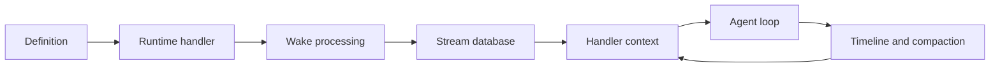
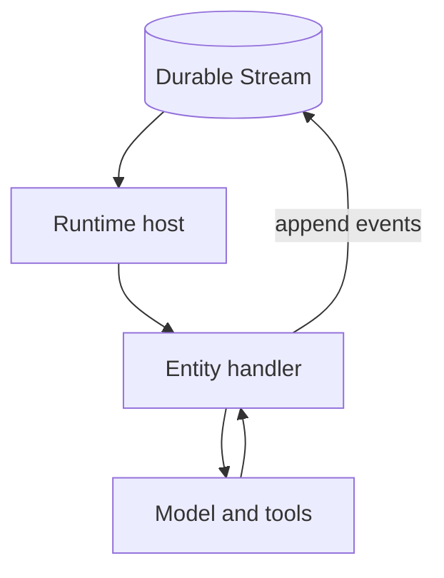

# agents-runtime

This directory explains the `@electric-ax/agents-runtime` package. The package is the behavioral stack for Electric agents.

Three terms are used throughout:

- An **entity** is an identified worker. It owns one append-only durable stream.
- A **wake** is one unit of work for an entity. A wake notification tells the runtime that new work exists.
- A **handler** is the function in an entity definition that the runtime calls. One wake can call the handler more than once when more work arrives.
- The **control plane** is the agents-server. It owns entity lifecycle. It chooses when a wake fires. It sends the wake notification.

The package defines entity types. It materializes entity streams into a local database. It runs the entity handler when a wake starts. It records the work of the handler back into the same stream.

The source is at `/Users/darkvoid/GitSources/src.Electric/electric/packages/agents-runtime`. The package version is `0.6.3`. The license is Apache-2.0.

The parent study is [Electric and Durable Streams](../README.md). The package index is in the [parent repository map](../01-repository-map.md).

## What the package does

1. **Entity definition.** `defineEntity` registers a name, a handler, state collections, and optional actions.
2. **Runtime registration.** `createRuntimeHandler` exposes a webhook endpoint and returns a `registerTypes()` method. The application calls that method to register each entity type with the control plane.
3. **Wake processing.** `processWake` claims a wake, preloads the stream, opens the database, and runs the handler.
4. **Stream database.** `createEntityStreamDB` maps append-only events into typed TanStack DB collections. TanStack DB is an in-memory reactive store.
5. **Agent loop.** The handler context (`ctx`) provides `ctx.useAgent()`. That call configures a model loop through `pi-agent-core`, the model agent library. `ctx.agent.run()` runs the loop. The loop writes runs, steps, text, reasoning, and tool calls.
6. **Context management.** The runtime builds a model context from the timeline. It compacts the context when the token budget is tight.
7. **Sandboxing.** File and shell tools call a `Sandbox` interface. The interface has unrestricted, Docker, and remote providers.
8. **Server client.** `createRuntimeServerClient` wraps the agents-server HTTP interface.

## Documents

| Document | What you learn |
|----------|----------------|
| [00-overview.md](00-overview.md) | The purpose, layers, and public exports of the package |
| [01-entity-model.md](01-entity-model.md) | `defineEntity`, the registry, the 20 built-in event schemas, collections, and actions |
| [02-runtime-handler-and-registration.md](02-runtime-handler-and-registration.md) | The handler, registration body, webhook signatures, dispatch, drain, and errors |
| [03-wake-processing.md](03-wake-processing.md) | `processWake` from notification to acknowledgement |
| [04-entity-stream-db.md](04-entity-stream-db.md) | The stream database, transactions, generated actions, and timeline order |
| [05-handler-context.md](05-handler-context.md) | Every field of `HandlerContext` |
| [06-agent-loop-and-tools.md](06-agent-loop-and-tools.md) | The model loop, streaming events, tool definitions, and `pi-agent-core` |
| [07-context-timeline-and-compaction.md](07-context-timeline-and-compaction.md) | Timeline ordering, context assembly, compaction, and checkpoints |
| [08-sandbox.md](08-sandbox.md) | Sandbox types, providers, identity, persistence, and errors |
| [09-server-client-signals-and-testing.md](09-server-client-signals-and-testing.md) | The server client, signals, cron, tags, and test utilities |
| [10-skills-and-runtime-helpers.md](10-skills-and-runtime-helpers.md) | Skills, the browser entry point, manifest keys, goal and timeline helpers, observation sources, and `createWakeSession` |



The last arrow is the feedback cycle. The agent loop appends events. The next handler iteration rebuilds its context from those events through the timeline.



## Key insight

**Key insight:** the stream is the only state store. The runtime holds a database in memory, but that database is a projection, not a second source of truth. A restart rebuilds it from the stream. This is why the package has no migrations. No persistent schema exists outside the stream, so there is no stored table to alter. A schema change applies when the runtime rebuilds the projection.

The same property makes the stream a message bus. An appended event can satisfy a wake condition. The control plane reads the stream, sees the event, and sends the next wake.

## Reading order

Read [00-overview.md](00-overview.md) first. Then read [01-entity-model.md](01-entity-model.md) and [02-runtime-handler-and-registration.md](02-runtime-handler-and-registration.md). These two documents define the entry points.

Read [03-wake-processing.md](03-wake-processing.md) next. It shows the full request path. Then read [04-entity-stream-db.md](04-entity-stream-db.md) and [05-handler-context.md](05-handler-context.md).

Read [06-agent-loop-and-tools.md](06-agent-loop-and-tools.md) and [07-context-timeline-and-compaction.md](07-context-timeline-and-compaction.md) together. The agent loop produces the timeline. The context builder consumes the timeline.

Read [08-sandbox.md](08-sandbox.md) for the tool boundary. Read [09-server-client-signals-and-testing.md](09-server-client-signals-and-testing.md) last.

## Related studies

- [agents-server](../agents-server/README.md) supplies the control plane and the wake transport.
- [durable-streams](../durable-streams/README.md) supplies the stream protocol and the state layer.
- [agents](../agents/README.md) contains built-in entity types that use this runtime.
- [04-how-the-runtime-sets-up-a-stream.md](../04-how-the-runtime-sets-up-a-stream.md) gives the byte-level stream setup view. This file is in the parent `electric/markdown` directory. It is not `04-entity-stream-db.md` in this directory.

## Source map

All paths are relative to `/Users/darkvoid/GitSources/src.Electric/electric`.

| Area | File |
|------|------|
| Public exports | `packages/agents-runtime/src/index.ts` |
| Entity registry | `packages/agents-runtime/src/define-entity.ts` |
| Event schemas | `packages/agents-runtime/src/entity-schema.ts` |
| Runtime handler | `packages/agents-runtime/src/create-handler.ts` |
| Wake processing | `packages/agents-runtime/src/process-wake.ts` |
| Stream database | `packages/agents-runtime/src/entity-stream-db.ts` |
| Handler context | `packages/agents-runtime/src/context-factory.ts` |
| Agent adapter | `packages/agents-runtime/src/pi-adapter.ts` |
| Timeline | `packages/agents-runtime/src/entity-timeline.ts` |
| Sandbox | `packages/agents-runtime/src/sandbox/` |
| Server client | `packages/agents-runtime/src/runtime-server-client.ts` |

## Code entry points

The definition call is the first entry point:

```ts
export function defineEntity<
  const TCreationSchema extends EntitySchema | undefined = undefined,
  const TState extends EntityStateDefinition | undefined = undefined,
  TActions extends EntityActionMap = {},
>(
  name: string,
  definition: EntityDefinition<TCreationSchema, TState, TActions>
): void {
  defaultRegistry.define(name, definition)
}
```

The citation is `packages/agents-runtime/src/define-entity.ts:55-64`.

The registry rejects a duplicate name:

```ts
define<
  const TCreationSchema extends EntitySchema | undefined = undefined,
  const TState extends EntityStateDefinition | undefined = undefined,
  TActions extends EntityActionMap = {},
>(
  name: string,
  definition: EntityDefinition<TCreationSchema, TState, TActions>
): void {
  if (this.entries.has(name)) {
    throw new Error(`Entity type "${name}" is already registered`)
  }
  this.entries.set(name, {
    name,
    definition: definition as AnyEntityDefinition,
  })
}
```

The citation is `packages/agents-runtime/src/define-entity.ts:13-28`.

The stream database is the third entry point:

```ts
export function createEntityStreamDB(
  streamUrl: string,
  customState?: EntityDefinition[`state`],
  actionsFactory?: EntityDefinition[`actions`],
  opts?: EntityStreamDBOptions
): EntityStreamDBWithActions
```

The citation is `packages/agents-runtime/src/entity-stream-db.ts:167-172`.

## Build

The package is a TypeScript library. Its source is an ECMAScript module (ESM). The build emits both an ESM file and a CommonJS file: `module` points to the ESM file, and `main` points to the CommonJS file for older tooling. Its `package.json` exposes these subpaths. The `exports` map is not shown in the overview snippet.

- `.` for the full runtime.
- `./client` for browser-side helpers.
- `./react` for React hooks.
- `./tools` for tool factories.
- `./sandbox` for portable sandbox providers.
- `./sandbox/docker` for the Docker provider.

The Docker subpath is separate on purpose. Importing it loads `dockerode` and its native dependencies. Callers that use only the unrestricted provider avoid that cost.
