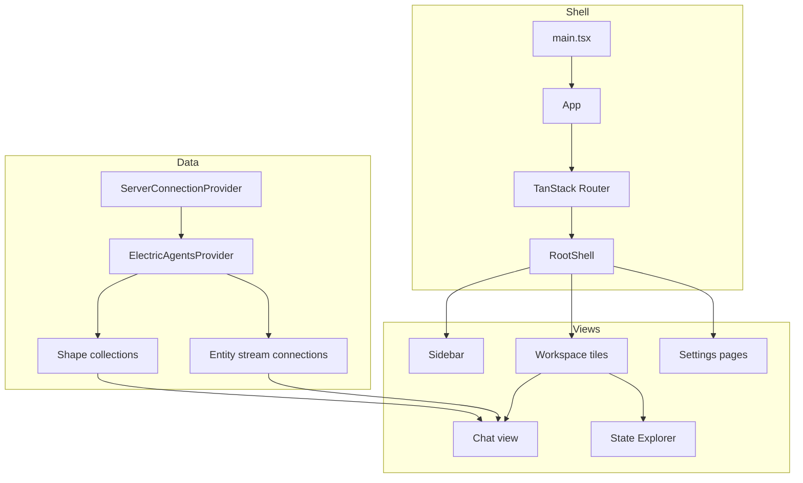
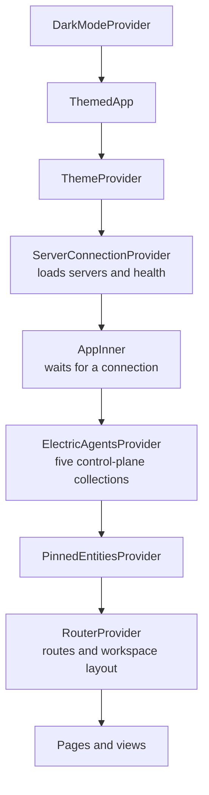

# Overview of agents-server-ui

`@electric-ax/agents-server-ui` is the user interface for Electric Agents. It is a React single-page application. The agents server serves it at the path `/__agent_ui/`. The desktop application also loads it inside an Electron window.

The package has one job: show the state of an agents server and send commands to it. It does not run agents, store messages, or decide permissions. Those actions belong to the agents server and to the agent runtime.

## The short answer

The application has three layers:

1. A **shell** that selects a server, builds routes, and holds shared providers.
2. A **data layer** that syncs Electric shapes and reads one Durable Stream per open entity.
3. A **view layer** that renders a session sidebar, a chat timeline, entity controls, a state explorer, and settings.



## Technology stack

| Area | Choice | Source |
|------|--------|--------|
| User interface library | React `19.1.0` | `packages/agents-server-ui/package.json:39` |
| Language | TypeScript `^5.9.3` | `packages/agents-server-ui/package.json:50` |
| Build tool | Vite `^7.1.7` | `packages/agents-server-ui/package.json:53` |
| Router | TanStack Router `^1.167.4` | `packages/agents-server-ui/package.json:26` |
| Live tables | TanStack DB `^0.6.6` and `@tanstack/electric-db-collection` `^0.3.5` | `packages/agents-server-ui/package.json:23-24` |
| Entity stream client | `@durable-streams/client` `^0.2.6` | `packages/agents-server-ui/package.json:18` |
| Stream state helper | `@durable-streams/state` `^0.3.1` | `packages/agents-server-ui/package.json:19` |
| Interface primitives | Base UI `@base-ui/react` `^1.4.1` | `packages/agents-server-ui/package.json:17` |
| Markdown and math | `streamdown`, `katex`, `shiki`, `mermaid` | `packages/agents-server-ui/package.json:34-46` |
| Test runner | Vitest `^4.1.0` | `packages/agents-server-ui/package.json:54` |

The project instruction file says to use Base UI primitives when a suitable component exists (`packages/agents-server-ui/AGENTS.md:1`). The components in `src/ui` wrap Base UI. Example primitives include Box, Button, Dialog, Menu, Select, Switch, and Text.

## What the application can show

The interface has these main surfaces:

- **Session sidebar.** A list of entities, grouped by date, type, status, runner, or working directory. It also has pinned sessions.
- **Workspace.** A tree of tiles. A tile shows one entity or the new-session picker. Tiles can split right or down.
- **Chat view.** A timeline of messages, runs, manifests, comments, signals, and compaction events. It has a composer with slash commands and image attachments.
- **State Explorer.** A view of shared state collections and the event log.
- **Comments view.** A comment-only timeline for entity types that declare a comments collection.
- **Settings.** Eight categories. Some categories work only in the desktop application.
- **Share dialog.** A role-based grant editor for an entity.

The application embeds the chat log and the state inspector in other products. The mobile application imports `SessionChatLogDomEmbed` and `SessionStateInspectorDomEmbed` from `src/embed`. This is why the chat renderer must work without a full app shell.

## Two build modes

Vite uses the `desktop` mode flag to change the base path and the output directory.

```ts
// packages/agents-server-ui/vite.config.ts:43
base: desktop ? (desktopServe ? `/` : `./`) : `/__agent_ui/`,
```

- **Web mode.** The output directory is `dist`. The base path is `/__agent_ui/`. The agents server serves these files.
- **Desktop mode.** The output directory is `dist-desktop`. A desktop development server uses `/`. A packaged desktop build uses `./` so that `file:` loading works.
- **Desktop marker.** A plugin writes `data-electric-desktop="true"` and `data-electric-platform="darwin"` into the HTML element. Source: `packages/agents-server-ui/vite.config.ts:19-41`.

The output directory selection is:

```ts
// packages/agents-server-ui/vite.config.ts:74
outDir: desktop ? `dist-desktop` : `dist`,
```

## Provider tree

The entry point mounts the application into the `#root` element. It also patches `window.fetch` for ngrok hosts. ngrok is a tunnelling service. The patch adds the `ngrok-skip-browser-warning` header. Without the header, the free ngrok tier returns an HTML warning page and the request fails a Cross-Origin Resource Sharing check. Source: `packages/agents-server-ui/src/main.tsx:51-65`.

```tsx
// packages/agents-server-ui/src/main.tsx:73
createRoot(root).render(
  <StrictMode>
    <App />
  </StrictMode>
)
```

`App` builds the provider chain. The order matters:

```tsx
// packages/agents-server-ui/src/App.tsx:17
<ElectricAgentsProvider
  baseUrl={connected ? (activeServer?.url ?? null) : null}
>
  <PinnedEntitiesProvider>
    <RouterProvider router={router} />
  </PinnedEntitiesProvider>
</ElectricAgentsProvider>
```

The full chain is `DarkModeProvider`, `ThemedApp`, `ThemeProvider`, `ServerConnectionProvider`, `AppInner`, `ElectricAgentsProvider`, `PinnedEntitiesProvider`, and `RouterProvider`. Source: `packages/agents-server-ui/src/App.tsx:1-50`.

The order encodes dependency. A provider can call only the providers above it. The server connection must exist before the data providers, because the data providers need a base URL. The router comes last, because every route can read all the state above it.



A provider that moves up the chain loses access to the state below it. A provider that moves down the chain makes its state available to more components. This is the whole reason the chain has a fixed order.

## State ownership

| State | Owner | Where it lives |
|-------|-------|----------------|
| Servers and active server | `ServerConnectionProvider` | React context plus browser local storage and desktop settings |
| Synced control-plane tables | `ElectricAgentsProvider` | TanStack DB collections |
| Open entity streams | `entity-connection` module cache | Module-level cache with reference counts |
| Workspace tiles | `WorkspaceProvider` | React reducer plus URL search parameters |
| Sidebar width and collapsed groups | Browser local storage | Keyed by `electric-agents-ui.sidebar.width` and related keys |
| Pinned entities | `PinnedEntitiesProvider` | Local storage |
| Settings form values | Page components | Local state, sent to the desktop bridge or the server |

**Aha:** The browser URL is part of the workspace state. The route `/entity/$` plus the `?layout=` search parameter can rebuild a split-tile workspace. The same layout link works on the index route. This turns a complex tile tree into a shareable link. The route schema is at `packages/agents-server-ui/src/router.tsx:471-475`.

## What the package does not do

- It does not start or stop agent processes. It sends signals such as `SIGINT` and `SIGKILL` to the server.
- It does not write to the entity stream directly. It sends HTTP messages to `${entityUrl}/send` and the server writes the event.
- It does not enforce permissions. It hides controls, but the server checks every request.
- It does not own credentials in the browser. In the desktop application, the main process holds keys and injects headers.

## The browser and desktop split

The desktop application injects `window.electronAPI`. The user interface checks for this object in several places:

- `serverFetch` sends mutating requests through the desktop main process when the active server is local. Source: `packages/agents-server-ui/src/lib/auth-fetch.ts:218`.
- The native application menu sends `desktop:command` events. The router handles them in one switch statement. Source: `packages/agents-server-ui/src/router.tsx:288-347`.
- Settings pages show desktop-only categories: Account, Command Line, Local Runtime, and MCP Servers.
- The application calls `window.electronAPI.setNativeAppearance` when the theme preference changes.

```ts
// packages/agents-server-ui/src/lib/auth-fetch.ts:218
export async function serverFetch(
  input: RequestInfo | URL,
  init?: RequestInit
): Promise<Response> {
  // ...
}
```

The function merges registered server headers and routes serializable mutation bodies through the desktop bridge.

## A second key insight

**Key insight:** The application has no global store such as Redux. Shared state is split by lifetime. Server connection data lives in context. Table data lives in TanStack DB. Workspace layout lives in a reducer and the URL. Entity stream data lives in a per-entity database cache. This split lets the chat view unmount and remount without losing stream data, and it lets the sidebar update without reconnecting a chat stream.

## Related documents

- [App shell and routing](01-app-shell-and-routing.md) explains the entry point and route tree.
- [Data and streams](02-data-and-streams.md) explains the two data planes.
- [Chat and timeline](03-chat-and-timeline.md) explains the conversation renderer.
- [Electric and Durable Streams](../README.md) gives the platform context.
