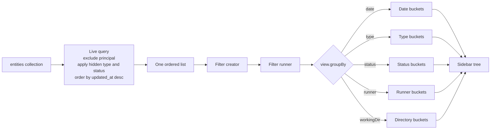
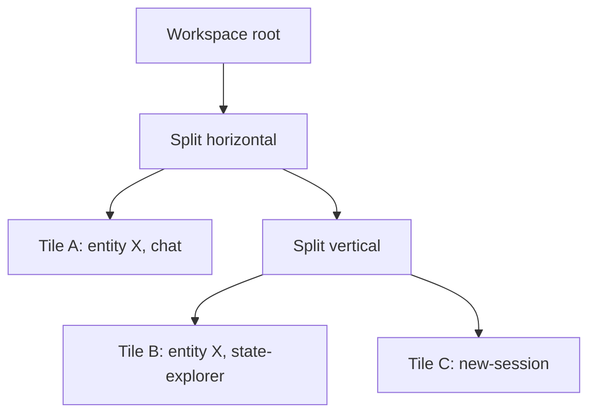

# Entity management

An entity is one agent session. The interface offers four ways to manage entities:

1. The session sidebar lists and groups them.
2. The entity header shows status and view controls.
3. The new-session view creates them.
4. The workspace tiles arrange them side by side.

This document covers each path.

## The sidebar

`Sidebar` reads the `entities` collection with one live query. It excludes the `principal` type and applies the user's hidden type and status filters in the query itself.

```ts
// packages/agents-server-ui/src/components/Sidebar.tsx:217
const { data: visibleEntities = [] } = useLiveQuery(
  (query) => {
    if (!entitiesCollection) return undefined
    let builder = query
      .from({ e: entitiesCollection })
      .where(({ e }) => not(eq(e.type, `principal`)))

    for (const type of view.hiddenTypes) {
      builder = builder.where(({ e }) => not(eq(e.type, type)))
    }
    for (const status of view.hiddenStatuses) {
      builder = builder.where(({ e }) => not(eq(e.status, status)))
    }

    return builder.orderBy(({ e }) => e.updated_at, `desc`)
  },
  [entitiesCollection, view.hiddenTypes, view.hiddenStatuses]
)
```

Results are ordered by `updated_at` in descending order. A recent session therefore appears near the top.

Two filters run in JavaScript because their source value is not a plain column:

- **Creator.** The value comes from `created_by`, normalized to a principal URL. Source: `packages/agents-server-ui/src/components/Sidebar.tsx:251-257`.
- **Runner.** The value comes from `dispatch_policy`, which is a JavaScript Object Notation (JSON) column. The helper `getEntityRunnerId` reads it. Source: `packages/agents-server-ui/src/components/Sidebar.tsx:259-268`.

The `RUNNER_NONE` sentinel represents an entity with no pinned runner. The definition is at `packages/agents-server-ui/src/hooks/useSidebarView.ts:214`; `Sidebar.tsx:15` only imports it.

### Grouping

The sidebar view settings select one grouping mode:

```ts
// packages/agents-server-ui/src/components/Sidebar.tsx:290
const ungroupedBuckets = useMemo(() => {
  switch (view.groupBy) {
    case `type`:
      return groupByType(unpinnedRoots)
    case `status`:
      return groupByStatus(unpinnedRoots)
    case `workingDir`:
      return groupByWorkingDirectory(unpinnedRoots)
    case `runner`:
      return groupByRunner(unpinnedRoots, runnerLabelById)
    case `date`:
    default:
      return bucketEntities(unpinnedRoots)
  }
}, [unpinnedRoots, view.groupBy, runnerLabelById])
```

| Grouping | Buckets | Source |
|----------|---------|--------|
| Date (default) | Today, Yesterday, Previous 7 days, Previous 30 days, each month, Older | `packages/agents-server-ui/src/lib/sessionGroups.ts:81-122` |
| Type | One bucket per entity type, largest first | `packages/agents-server-ui/src/lib/sessionGroups.ts:136-161` |
| Status | Lifecycle order, active states first | `packages/agents-server-ui/src/lib/sessionGroups.ts:166-197` |
| Runner | One bucket per runner label, then `None` | `packages/agents-server-ui/src/lib/sessionGroups.ts:209-243` |
| Working directory | One bucket per spawn working directory, then `None` | `packages/agents-server-ui/src/lib/sessionGroups.ts:252-301` |

Date grouping sorts entities by `updated_at` before it assigns buckets. Source: `packages/agents-server-ui/src/lib/sessionGroups.ts:89`.

**Aha:** Grouping does not change the query. The sidebar always reads one ordered list and then buckets it in memory. A new grouping is therefore instant and costs no network request. The only server-side filters are the hidden type and status filters.



The in-memory step is deliberate. A server-side grouping would need a different query for every mode and would make a mode change wait for the network. The cost is that the whole visible list must be in memory, which is acceptable for a sidebar.

### Parent tree

Child entities form a tree. `buildEntityTree` puts an entity under its parent only when the parent URL is also present in the visible set:

```ts
// packages/agents-server-ui/src/components/Sidebar.tsx:487
function buildEntityTree(entities: ReadonlyArray<ElectricEntity>): {
  roots: Array<ElectricEntity>
  childrenByParent: Map<string, Array<ElectricEntity>>
} {
  const urlSet = new Set(entities.map((e) => e.url))
  const childrenByParent = new Map<string, Array<ElectricEntity>>()
  const roots: Array<ElectricEntity> = []
  for (const entity of entities) {
    const parent = entity.parent
    if (parent && urlSet.has(parent)) {
      const list = childrenByParent.get(parent) ?? []
      list.push(entity)
      childrenByParent.set(parent, list)
    } else {
      roots.push(entity)
    }
  }
  return { roots, childrenByParent }
}
```

A child whose parent is filtered out becomes a root. The sidebar never shows an orphan with no way to reach it.

### Pins

Pinned entities are removed from the grouped list and shown in a separate pinned section. Source: `packages/agents-server-ui/src/components/Sidebar.tsx:270-288`.

The pinned URL list lives in `PinnedEntitiesProvider`. Source: `packages/agents-server-ui/src/hooks/usePinnedEntities.tsx`.

### Width

The sidebar width is stored in local storage under `electric-agents-ui.sidebar.width`. Source: `packages/agents-server-ui/src/components/Sidebar.tsx:32`.

```ts
// packages/agents-server-ui/src/components/Sidebar.tsx:33
const SIDEBAR_DEFAULT_WIDTH = 240
const SIDEBAR_MIN_WIDTH = 200
const SIDEBAR_MAX_WIDTH = 600
```

A stored width outside the minimum and maximum is ignored, and the default applies. Source: `packages/agents-server-ui/src/components/Sidebar.tsx:102-121`.

On a narrow viewport, the sidebar becomes an overlay with a backdrop. Selecting a row closes it. Source: `packages/agents-server-ui/src/components/Sidebar.tsx:151-164`.

### Selection gestures

| Gesture | Result |
|---------|--------|
| Click | Replace the active tile with the entity. |
| Command-click or Control-click | Open the entity in a split to the right. |
| Middle-click | Open the entity in a split to the right. |
| Drag a row | Move or copy the row into a drop target. |

The split gesture matches the "open to side" gesture in Visual Studio Code. Source: `packages/agents-server-ui/src/router.tsx:371-388`.

## The entity header

`EntityHeader` is the top strip of an entity tile. It has these parts:

- An editable title.
- A copyable session identifier.
- A status badge.
- Runtime badges.
- A view strip.
- A share button.
- A tile menu slot.

Source: `packages/agents-server-ui/src/components/EntityHeader.tsx:58-93`.

### Status colours

```ts
// packages/agents-server-ui/src/components/EntityHeader.tsx:18
const STATUS_TONE: Record<string, BadgeTone> = {
  active: `info`,
  running: `info`,
  idle: `success`,
  spawning: `warning`,
  paused: `warning`,
  stopping: `warning`,
  stopped: `neutral`,
  killed: `danger`,
}
```

An unknown status falls back to `neutral`. Source: `packages/agents-server-ui/src/components/EntityHeader.tsx:239`.

Note that `active` is in this map but is not in the entity schema's status enum. The schema allows `spawning`, `running`, `idle`, `paused`, `stopping`, `stopped`, and `killed`. Source: `packages/agents-server-ui/src/lib/ElectricAgentsProvider.tsx:13-20` and `:33-41`. The map is therefore more permissive than the schema.

### Title editing

A click on the title opens an input. On blur or Enter, the code sends the new title:

```ts
// packages/agents-server-ui/src/components/EntityHeader.tsx:139
const saveEdit = () => {
  const nextTitle = draftTitle.trim()
  if (!nextTitle) {
    cancelEdit()
    return
  }
  setEditing(false)
  setDraftTitle(nextTitle)
  if (nextTitle === title || !setEntityTitle) return
  const tx = setEntityTitle({ entityUrl: entity.url, title: nextTitle })
  void tx.isPersisted.promise.catch(() => {
    setDraftTitle(title)
  })
}
```

The optimistic action writes `tags.title` and then calls `POST <entityUrl>/tags/title`. Source: `packages/agents-server-ui/src/lib/ElectricAgentsProvider.tsx:685-723`.

If the request fails, the input returns to the old title.

The session identifier is the entity URL without the leading slash. A click copies it. The check icon shows for 1,200 milliseconds. Source: `packages/agents-server-ui/src/components/EntityHeader.tsx:105-132`.

### View strip

The view buttons come from `listViews(entity)`. The first registered entity view is the default. Source: `packages/agents-server-ui/src/components/EntityHeader.tsx:228-234`.

The strip appears only when more than one view is available. With one view, the buttons would add noise. Source: `packages/agents-server-ui/src/components/EntityHeader.tsx:234`.

### Share button

The share button appears only when the current principal has the `manage` permission. Source: `packages/agents-server-ui/src/components/EntityHeader.tsx:231` and `:270`.

`ShareEntityDialog` edits grants. It uses three roles:

```ts
// packages/agents-server-ui/src/lib/sharePermissions.ts:27
export const SHARE_ROLE_PERMISSIONS = {
  view: [`read`, `fork`],
  chat: [`read`, `write`, `signal`, `fork`, `schedule`, `spawn`],
  manage: [`manage`, `delete`],
} as const satisfies Record<ShareRole, ReadonlyArray<SharePermission>>
```

- `view` can read and fork.
- `chat` can also write, signal, schedule, and spawn.
- `manage` has the management and delete permissions. The permission check treats `manage` as a superset of every other permission.

Source: `packages/agents-server-ui/src/hooks/useEntityPermission.ts:40-47`.

`roleFromGrants` maps a grant set back to a role for display. It checks `manage` first, then `write`, then `read`. Source: `packages/agents-server-ui/src/lib/sharePermissions.ts:33-41`.

## Creating an entity

The new-session view creates an entity in four steps:

1. Generate a 10-character name with `nanoid`.
2. Call `spawnEntity`.
3. Wait for the optimistic action to persist.
4. Upload attachments, if any, and open the new entity.

Source: `packages/agents-server-ui/src/components/views/NewSessionView.tsx:340-415`.

```ts
// packages/agents-server-ui/src/components/views/NewSessionView.tsx:363
const tx = spawnEntity({
  type: typeName,
  name,
  args,
  ...(effectiveRunnerId
    ? {
        dispatch_policy: {
          targets: [{ type: `runner` as const, runnerId: effectiveRunnerId }],
        },
      }
    : {}),
  ...(sandboxProfile
    ? {
        sandbox: {
          profile: sandboxProfile,
          key: `/${typeName}/${name}`,
        },
      }
    : {}),
  ...(initialMessage !== undefined && !hasInitialAttachments
    ? { initialMessage }
    : {}),
  ...(initialMessageType ? { initialMessageType } : {}),
})
```

Three choices are important:

- **Dispatch policy.** If the user selected a runner, the spawn pins wakes to that runner.
- **Sandbox key.** The sandbox key is the entity URL. Files therefore survive across wakes, and spawned child agents share the same container. Source: `packages/agents-server-ui/src/components/views/NewSessionView.tsx:376-377`.
- **Initial message.** The initial message goes in the spawn request only when no attachment is present. With an attachment, the code sends the message after the spawn succeeds. Source: `packages/agents-server-ui/src/components/views/NewSessionView.tsx:386-402`.

The spawn action adds a temporary row with status `spawning` before the server answers. Source: `packages/agents-server-ui/src/lib/ElectricAgentsProvider.tsx:526-542`.

The HTTP request is `PUT /_electric/entities/<type>/<name>`. The helper `entitySpawnApiUrl` builds the path, and the action sends the request at `packages/agents-server-ui/src/lib/ElectricAgentsProvider.tsx:564`. Source: `packages/agents-server-ui/src/lib/entity-api.ts:18-27`.

After a successful spawn, the view opens the entity in the current tile by replacing it. Source: `packages/agents-server-ui/src/components/views/NewSessionView.tsx:403-405`.

## Tiles and splits

A workspace is a tree. A leaf is a `Tile`. An internal node is a `Split`.

```ts
// packages/agents-server-ui/src/lib/workspace/types.ts:22
export type Tile = {
  kind: `tile`
  id: string
  entityUrl: string | null
  viewId: ViewId
  viewParams?: TileViewParams
}
```

A standalone tile has `entityUrl: null`. The new-session tile is the only current example. Source: `packages/agents-server-ui/src/lib/workspace/types.ts:11-28`.

```ts
// packages/agents-server-ui/src/lib/workspace/types.ts:46
export type Split = {
  kind: `split`
  id: string
  direction: `horizontal` | `vertical`
  children: Array<{ node: WorkspaceNode; size: number }>
}
```

A split holds two or more children. Each child has a size fraction, and the fractions sum to about 1. A split with one child is not allowed. The reducer collapses it. Source: `packages/agents-server-ui/src/lib/workspace/types.ts:39-51`.

### Tile actions

The workspace helpers are:

| Helper | Effect |
|--------|--------|
| `openEntity(url, options)` | Open an entity, defaulting to the `chat` view and replacing the active tile. |
| `openNewSession(options)` | Open a standalone new-session tile. |
| `closeTile(id)` | Close a tile and collapse the parent split if needed. |
| `moveTile(id, target)` | Move a tile to a drop target. |
| `setActiveTile(id)` | Change which tile receives keyboard actions. |
| `setTileView(id, viewId)` | Swap the view in place. The tile identifier does not change. |
| `splitTileWithView(id, viewId, direction)` | Split a tile and put a different view in the new pane. |
| `splitTile(id, direction)` | Split a tile and put a new-session form in the new pane. |
| `resizeSplit(id, sizes)` | Change the child sizes. |

Source: `packages/agents-server-ui/src/hooks/useWorkspace.tsx:31-75` and `:88-166`.

A view swap keeps the tile identifier. Per-tile state such as scroll position can therefore survive a view change. Source: `packages/agents-server-ui/src/hooks/useWorkspace.tsx:54-59`.



Two tiles can show the same entity through different views. They are independent leaves with independent state. Source: `packages/agents-server-ui/src/lib/workspace/types.ts:5-9`.

### Drop targets

A drop target names a tile and an edge:

```ts
// packages/agents-server-ui/src/lib/workspace/types.ts:82
export type DropPosition =
  | `replace`
  | `split-right`
  | `split-down`
  | `split-left`
  | `split-up`
```

`replace` is used by URL navigation and a plain sidebar click. It is not a visible drop zone. The other four positions are the drop edges. Source: `packages/agents-server-ui/src/lib/workspace/types.ts:72-93`.

### Navigation and splits

The keyboard and menu commands act on the active tile:

- `mod+w` or the `close-tile` desktop command closes the active tile.
- `split-right` and `split-down` split the active tile.
- `cycle-tile` moves to the next tile in tree order.

Source: `packages/agents-server-ui/src/hooks/useWorkspaceHotkeys.ts:31-54` and `packages/agents-server-ui/src/router.tsx:321-345`. The `mod+w` binding and its `closeTile` call are at `:46-54`.

## The view registry

Views are registered, not hard-coded in a switch. `registerView` adds a definition to a map. Source: `packages/agents-server-ui/src/lib/workspace/viewRegistry.tsx:74-82`.

A view has one of two kinds:

- `entity`: it receives a `baseUrl`, an `entityUrl`, the entity record, a stopped flag, a spawning flag, a `tileId`, and optional view parameters.
- `standalone`: it receives a `baseUrl`, a `tileId`, and an optional title setter.

Source: `packages/agents-server-ui/src/lib/workspace/viewRegistry.tsx:22-70`.

The built-in registrations are in `src/lib/workspace/registerViews.ts`:

- `chat` is the default entity view.
- `comments` is available only when the entity type advertises the comments collection.
- `state-explorer` shows shared state collections.
- `new-session` is the standalone view.

Source: `packages/agents-server-ui/src/lib/workspace/registerViews.ts`.

Because `ViewId` is a free-form string, a new view needs no type change. Source: `packages/agents-server-ui/src/lib/workspace/viewRegistry.tsx:6-14`.

## Permissions summary

`useEntityPermission` grants a permission in three cases:

1. The principal is a built-in system principal: `system:framework`, `system:auth-sync`, or `system:dev-local`.
2. The principal is the creator of the entity.
3. The effective permissions include the requested permission or `manage`.

Source: `packages/agents-server-ui/src/hooks/useEntityPermission.ts:40-47` and `:96-108`.

The built-in principal list is a client-side convenience. It does not replace the server check. A hidden button is not a security boundary.

## Aha: management is one live query plus local view state

**Aha:** The sidebar has no create, update, or delete calls. Every change comes from the `entities` shape. A spawn, a title edit, or a status signal updates one collection, and the sidebar, header, and search palette all re-render from it. The only local state is presentation state: filters, grouping, pinning, and width. This is why two browser windows on the same server stay consistent without a refresh.

## Related documents

- [Chat and timeline](03-chat-and-timeline.md) explains the entity conversation.
- [Settings and permissions](05-settings-and-permissions.md) explains grants and shares in more detail.
- [App shell and routing](01-app-shell-and-routing.md) explains how tiles map to addresses.
- [Overview](00-overview.md) gives the package summary.
