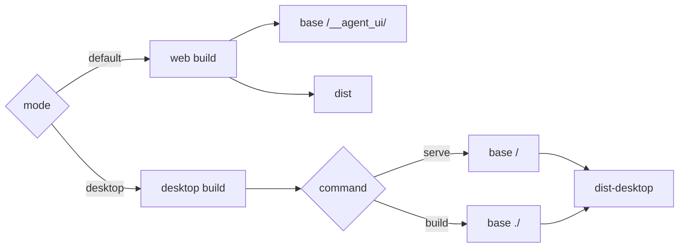
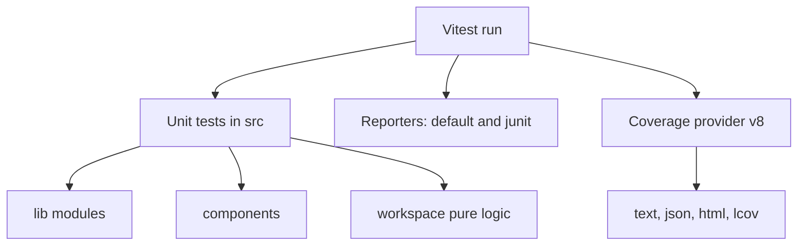

# Build and testing

The package builds with Vite and tests with Vitest. It has two build modes and one test configuration. This document explains the commands, the configuration, and the test surface.

## Scripts

```bash
# Web build, served by the agents server at /__agent_ui/
pnpm --filter @electric-ax/agents-server-ui build

# Desktop build, loaded from file:// inside Electron
pnpm --filter @electric-ax/agents-server-ui build:desktop

# Development server
pnpm --filter @electric-ax/agents-server-ui dev
pnpm --filter @electric-ax/agents-server-ui dev:desktop

# Tests, coverage, type check
pnpm --filter @electric-ax/agents-server-ui test
pnpm --filter @electric-ax/agents-server-ui coverage
pnpm --filter @electric-ax/agents-server-ui typecheck
```

Source: `packages/agents-server-ui/package.json:6-15`.

The desktop development script uses port 5183 by default:

```json
// packages/agents-server-ui/package.json:10
"dev:desktop": "vite dev --mode desktop --port ${ELECTRIC_DESKTOP_UI_PORT:-5183} --strictPort",
```

`--strictPort` makes the command fail if the port is already in use. It does not silently choose another port. The desktop main process expects this fixed port in development.

## Build modes



The mode check and base path are:

```ts
// packages/agents-server-ui/vite.config.ts:34
export default defineConfig(({ command, mode }) => {
  const desktop = mode === `desktop`
  // Desktop *build* serves the bundle via file:// from the Electron
  // app, so assets must be referenced with relative URLs (`./`). The
  // dev server, on the other hand, serves over http and needs an
  // absolute base (`/`) for HMR and dynamic imports to resolve.
  const desktopServe = desktop && command === `serve`

  return {
    base: desktop ? (desktopServe ? `/` : `./`) : `/__agent_ui/`,
```

This distinction is load-bearing:

- A web build is served by the agents server under `/__agent_ui/`.
- A desktop development server runs at `http://localhost:5183/` and needs an absolute base for hot module replacement.
- A desktop production build is loaded from `file://`. Assets must use relative paths, so the base is `./`.

A single base value for both desktop cases would break one of them.

The output directory is selected here:

```ts
// packages/agents-server-ui/vite.config.ts:73
build: {
  outDir: desktop ? `dist-desktop` : `dist`,
  emptyOutDir: true,
},
```

`emptyOutDir: true` removes stale files from the previous build. It also means a web build and a desktop build cannot share one output directory without deleting each other.

### Desktop marker

A small plugin edits the built HyperText Markup Language (HTML) before Vite processes it:

```ts
// packages/agents-server-ui/vite.config.ts:19
function desktopHtmlMarker(platform: `darwin` | `win32` = `darwin`): Plugin {
  return {
    name: `electric-desktop-html-marker`,
    transformIndexHtml: {
      order: `pre`,
      handler(html) {
        return html.replace(
          `<html lang="en">`,
          `<html lang="en" data-electric-desktop="true" data-electric-platform="${platform}">`
        )
      },
    },
  }
}
```

The plugin runs only in desktop mode. Source: `packages/agents-server-ui/vite.config.ts:63`.

The default platform is `darwin`. The preload script later sets the true platform. The default prevents a flash of Windows or Linux title bar styles on macOS. Source: `packages/agents-server-ui/vite.config.ts:11-17`.

### Dependency resolution

The Vite configuration has three resolution rules that prevent duplicate copies of libraries:

1. The runtime client alias points to source, not to the built package:

```ts
// packages/agents-server-ui/vite.config.ts:46
{
  find: /^@electric-ax\/agents-runtime\/client$/,
  replacement: resolve(PACKAGE_DIR, `../agents-runtime/src/client.ts`),
},
```

2. React resolves from this package's own `node_modules`. Source: `packages/agents-server-ui/vite.config.ts:50-59`.
3. `react`, `react-dom`, and `@tanstack/db` are de-duplicated. Source: `packages/agents-server-ui/vite.config.ts:61`.

A duplicate copy of TanStack DB would create two independent collection stores. The de-duplication rule prevents that class of bug.

`optimizeDeps` excludes `@durable-streams/state`, `@tanstack/db`, and `@tanstack/react-db` from pre-bundling, and includes the React entries. Source: `packages/agents-server-ui/vite.config.ts:64-72`.

The TypeScript path for the runtime client matches the Vite alias. Source: `packages/agents-server-ui/tsconfig.json:18-20`.

## Type checking

The TypeScript configuration is strict:

```json
// packages/agents-server-ui/tsconfig.json:2
"compilerOptions": {
  "target": "ES2022",
  "module": "ESNext",
  "moduleResolution": "Bundler",
  "lib": ["ES2022", "DOM", "DOM.Iterable"],
  "jsx": "react-jsx",
  "strict": true,
  "noEmit": true,
```

`typecheck` runs `tsc --noEmit`; it does not write output. Source: `packages/agents-server-ui/package.json:14`.

The configuration includes `src` and `vite.config.ts`. Source: `packages/agents-server-ui/tsconfig.json:22`.

The comment at `packages/agents-server-ui/tsconfig.json:15-17` explains the alias choice: only the browser-safe `client` entry is mapped to source. The main package entry resolves through package exports to the built files. This keeps Node.js-only modules out of the browser type graph.

## Tests



The test configuration is:

```ts
// packages/agents-server-ui/vitest.config.ts:3
export default defineConfig({
  test: {
    passWithNoTests: true,
    coverage: {
      provider: `v8`,
      reporter: [`text`, `json`, `html`, `lcov`],
      include: [`src/**/*.{ts,tsx}`],
    },
    reporters: [`default`, `junit`],
    outputFile: `./junit/test-report.junit.xml`,
  },
})
```

- **Provider.** Coverage uses the V8 engine's built-in coverage.
- **Reporters.** The default terminal reporter and a JUnit Extensible Markup Language (XML) report.
- **Output.** The JUnit file is written to `./junit/test-report.junit.xml`.
- **Pass with no tests.** The run succeeds when no test file matches. The package script also sets this flag. Source: `packages/agents-server-ui/package.json:12`.

### Test files

The package has 18 test files. They are concentrated in pure logic:

| Area | Examples |
|------|----------|
| Authentication | `src/lib/auth-fetch.test.ts` |
| Entity connection | `src/lib/entity-connection.test.ts`, `src/lib/entity-connection.custom-state.test.ts` |
| Comments and compaction | `src/lib/comments.test.ts`, `src/lib/compactionIndicator.test.ts` |
| Display helpers | `src/lib/entityRuntime.test.ts`, `src/lib/modelCapabilities.test.ts` |
| Grouping and sharing | `src/lib/sessionGroups.test.ts`, `src/lib/sharePermissions.test.ts` |
| Workspace | `src/lib/workspace/workspaceReducer.test.ts`, `src/lib/workspace/layoutCodec.test.ts` |
| Components | `src/components/InlineEventCard.test.tsx`, `src/components/ReasoningSection.test.tsx` |

The list comes from a file search under `packages/agents-server-ui/src` for names ending in `.test.ts` or `.test.tsx`.

The two component tests handle the environment differently. `InlineEventCard.test.tsx` uses `renderToStaticMarkup`, so it needs no DOM. `ReasoningSection.test.tsx` starts with `// @vitest-environment jsdom` and uses `createRoot`. Source: `packages/agents-server-ui/src/components/InlineEventCard.test.tsx:2` and `packages/agents-server-ui/src/components/ReasoningSection.test.tsx:1`. The shared configuration does not declare an environment, so Vitest uses its default `node` environment. A component test that needs a DOM must opt in per file.

The package has no end-to-end test file. There is no Playwright or Cypress configuration in the package. The conformance suite in `agents-server-conformance-tests` is a separate package and tests servers, not this interface.

### What the tests protect

The test names point to the risky logic:

- Principal parsing and header injection.
- Entity connection custom state and the comments gate.
- Timeline compaction indicators.
- Session grouping and ordering.
- Share role to grant mapping.
- Workspace reducer invariants and layout encoding.

These are the places where a wrong string or a wrong order causes a user-visible bug. The tests do not cover the visual layout, the virtual list, or the stream transport.

## Embedding

The package exports an embedding entry for the mobile application. The mobile code imports two modules by deep path:

```ts
// packages/agents-mobile/app/session.tsx:34
import SessionChatLogDomEmbedModule from '@electric-ax/agents-server-ui/src/embed/SessionChatLogDomEmbed'
```

The second import is `SessionStateInspectorDomEmbed`. Source: `packages/agents-mobile/app/session.tsx:36`.

The embed root builds a memory-history router and mounts the same providers as the full application. The router is built in `EmbeddedRouter` at `packages/agents-server-ui/src/embed/EmbedApp.tsx:144-184`; `createMemoryHistory` is at `:167`.

Three differences matter:

- **Memory history.** The embed does not touch the browser address.
- **Injected headers.** The native shell passes `serverHeaders` across the WebView boundary. The embed registers them before the provider creates its collections, because the first fetch happens during render. Source: `packages/agents-server-ui/src/embed/EmbedApp.tsx:44-57`.
- **Injected fork transport.** The native shell can pass `onRequestForkEntity`, so a fork runs over React Native networking rather than the WebView fetch. Source: `packages/agents-server-ui/src/embed/EmbedApp.tsx:60-75`.

The embed renders one of three views: `chat`, `chat-log`, or `state-explorer`. Source: the `EmbedView` type at `packages/agents-server-ui/src/embed/EmbedApp.tsx:34`; the rendering branches are at `:267-274`.

This is why the package builds no separate embed bundle. The mobile Metro bundler consumes the TypeScript source directly through the workspace dependency. The mobile Metro configuration stubs heavy web-only modules such as mermaid, katex, and shiki. Source: `packages/agents-mobile/metro.config.js`.

## The desktop build chain

The desktop application drives this package in its own build:

```json
// packages/agents-desktop/package.json:12
"build": "pnpm --filter @electric-ax/agents build && pnpm --filter electric-ax build:desktop && pnpm --filter @electric-ax/agents-server-ui build:desktop && vite build",
```

The order is:

1. Build the built-in agents.
2. Build the command-line interface.
3. Build this user interface for desktop.
4. Build the Electron main and preload bundles.

The desktop Vite configuration does not bundle the renderer. It expects `dist-desktop` to exist. Source: `packages/agents-desktop/vite.config.ts:63-83`.

The desktop development script starts the interface development server on port 5183 and loads it in the Electron window. The combined `dev` script is at `packages/agents-desktop/package.json:13`, the interface server is `dev:ui` at `:14`, and `dev:desktop` at `:15` waits for it and starts Electron.

## Aha: one source tree, three delivery paths

**Aha:** The package has one source tree but three delivery paths: a static web bundle under `/__agent_ui/`, a file-loaded Electron bundle in `dist-desktop`, and raw TypeScript compiled by Metro for mobile. The Vite base path, the desktop HTML marker, and the embed entry exist to serve those three paths from the same components. The base path is the only difference between the web and packaged desktop bundles; the embed entry is the only difference between the full application and the mobile surface.

## Related documents

- [Overview](00-overview.md) explains the build modes in context.
- [App shell and routing](01-app-shell-and-routing.md) explains the entry point.
- [agents-desktop packaging and release](../agents-desktop/03-packaging-and-release.md) explains the Electron side.
- [agents-mobile build and release](../agents-mobile/04-build-and-release.md) explains the Expo side.
