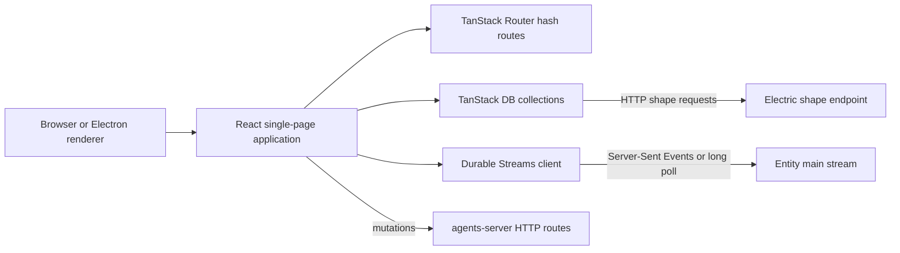
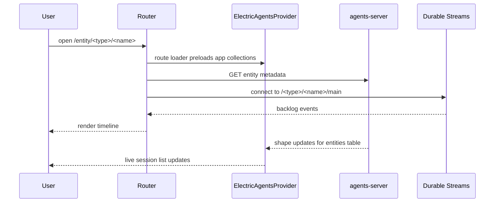

# agents-server-ui

This directory studies `packages/agents-server-ui`, the browser application that an agents server serves to its users. The package name is `@electric-ax/agents-server-ui`. Its version is `0.6.4`.

The application is a React single-page application. A single-page application runs all screens in one browser document and changes the address without a full page load. The build tool is Vite. The application reads live data from two places:

1. Electric shapes at `/_electric/electric/v1/shape`. A shape is a live, filtered view of a database table.
2. One Durable Stream per entity at `${entityUrl}/main`. A Durable Stream is an append-only event log.

The desktop application loads the same build. The desktop application is an Electron program. Electron is a runtime that puts a web page inside a native window. Therefore this package has two build modes and one set of screens.



The most important design fact is that this package does not own a database. Every list on screen is a live query over a synced collection or an entity stream. The server owns the truth. The browser owns a cache and a view.

## Documents

| Order | Document | What it explains |
|-------|----------|------------------|
| 1 | [00-overview.md](00-overview.md) | Purpose, stack, data planes, and application boundaries |
| 2 | [01-app-shell-and-routing.md](01-app-shell-and-routing.md) | Entry point, provider tree, hash routes, loaders, hotkeys, workspace shell |
| 3 | [02-data-and-streams.md](02-data-and-streams.md) | Server discovery, shape collections, entity streams, cache and optimistic writes |
| 4 | [03-chat-and-timeline.md](03-chat-and-timeline.md) | Timeline query, virtual rows, manifests, composer, attachments, queue |
| 5 | [04-entity-management.md](04-entity-management.md) | Session sidebar, grouping, header controls, signals, spawning, split tiles |
| 6 | [05-settings-and-permissions.md](05-settings-and-permissions.md) | Eight settings categories, grants, share roles, runner health |
| 7 | [06-build-and-testing.md](06-build-and-testing.md) | Vite modes, TypeScript, Vitest, outputs, and embedding |

## Quick facts

| Fact | Value | Source |
|------|-------|--------|
| Package name | `@electric-ax/agents-server-ui` | `packages/agents-server-ui/package.json:2` |
| Version | `0.6.4` | `packages/agents-server-ui/package.json:4` |
| User interface framework | React `19.1.0` | `packages/agents-server-ui/package.json:39` |
| Build tool | Vite `^7.1.7` | `packages/agents-server-ui/package.json:53` |
| Test runner | Vitest `^4.1.0` | `packages/agents-server-ui/package.json:54` |
| Router | TanStack Router `^1.167.4` | `packages/agents-server-ui/package.json:26` |
| Table state and live query | TanStack DB `^0.6.6` | `packages/agents-server-ui/package.json:23` |
| Stream client | `@durable-streams/client` `^0.2.6` | `packages/agents-server-ui/package.json:18` |
| Web base path | `/__agent_ui/` | `packages/agents-server-ui/vite.config.ts:43` |
| Desktop output | `dist-desktop` | `packages/agents-server-ui/vite.config.ts:74` |

## Build commands

```bash
# Web build served by agents-server at /__agent_ui/
pnpm --filter @electric-ax/agents-server-ui build

# Desktop build loaded from file inside Electron
pnpm --filter @electric-ax/agents-server-ui build:desktop

# Development server
pnpm --filter @electric-ax/agents-server-ui dev

# Tests and type check
pnpm --filter @electric-ax/agents-server-ui test
pnpm --filter @electric-ax/agents-server-ui typecheck
```

The scripts come from `packages/agents-server-ui/package.json:7-14`.

## How a screen gets data



The route loader calls `preloadAppCollections` before the route renders. The entity route also calls `preloadEntityStream`. Source: `packages/agents-server-ui/src/router.tsx:511-516` and `packages/agents-server-ui/src/lib/entity-connection.ts:196`.

## Aha: two data planes with different guarantees

**Aha:** The session list and the chat timeline do not use the same transport. Control-plane tables such as `entities` and `runners` arrive as Electric shapes and can be queried like local tables. One entity's conversation arrives as a raw append-only stream. This split is why the sidebar can update when any session changes, while the open chat can show events in exact stream order.

The provider creates shape-backed collections in one place:

```ts
// packages/agents-server-ui/src/lib/ElectricAgentsProvider.tsx:217
return createCollection(
  electricCollectionOptions({
    id: `entities`,
    schema: entitySchema,
    shapeOptions: {
      url: appendPathToUrl(baseUrl, `/_electric/electric/v1/shape`),
      params: {
        table: `entities`,
        columns: [
          `url`, `type`, `status`, `tags`, `spawn_args`, `sandbox`,
          `dispatch_policy`, `parent`, `created_by`, `type_revision`,
          `inbox_schemas`, `state_schemas`, `created_at`, `updated_at`,
        ],
      },
      fetchClient: serverFetch,
      parser: { int8: (v: string) => Number(v) },
    },
    getKey: (item) => item.url,
  })
)
```

The entity stream uses a different client and a different path:

```ts
// packages/agents-server-ui/src/lib/entity-connection.ts:278
const streamUrl = appendPathToUrl(baseUrl, getMainStreamPath(entityUrl))
// ...
const db = createEntityStreamDB(streamUrl, mergedCustomState, undefined, {
  stream,
})
```

`getMainStreamPath` returns `${entityUrl}/main` (`packages/agents-server-ui/src/lib/entity-connection.ts:15`).

## A note about Electric Cloud

The package README says: "Electric Cloud has been shut down. The Electric Cloud sign-in and server discovery in this app no longer work. Connect to a self-hosted agents server instead." Source: `packages/agents-server-ui/README.md:3`. The code still contains cloud sign-in and cloud server discovery paths. This exploration documents what the code does and marks the cloud paths as historical where the shutdown matters.

## Related documents

- [Electric and Durable Streams](../README.md) is the top-level index.
- [How the runtime sets up a stream](../04-how-the-runtime-sets-up-a-stream.md) explains the server side of the entity stream used here.
- [agents-desktop](../agents-desktop/README.md) explains how the desktop shell loads this application.
- [agents-mobile](../agents-mobile/README.md) explains the mobile client that reuses several modules from this package.
