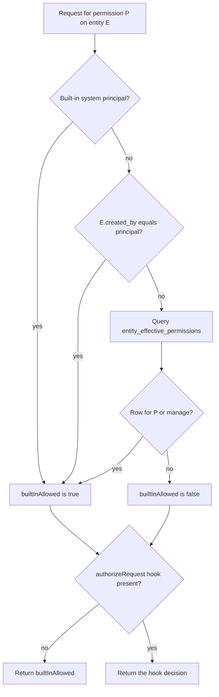
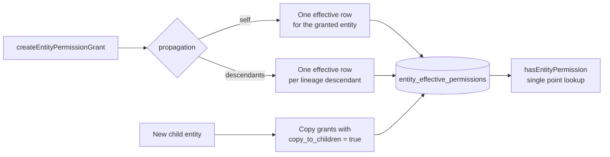

# Entity registry and Postgres

`src/entity-registry.ts` has 2,186 lines. It is the main module for the control tables, but it is not the only writer. Six other modules touch the tables directly:

- `src/scheduler.ts` runs Structured Query Language (SQL) queries on `scheduled_tasks`.
- `src/wake-registry.ts` reads and writes `wake_registrations`.
- `src/routing/runners-router.ts` writes `consumer_callbacks`.
- `src/routing/internal-router.ts` also inserts into `consumer_callbacks`.
- `src/routing/dispatch-policy.ts` inserts into `subscription_webhooks`.
- `src/routing/durable-streams-router.ts` writes `subscription_webhooks`.

The registry wraps a Drizzle database object and a tenant identifier. Every other module in this list either wraps a narrower concern or writes a table that it owns.

```ts
// packages/agents-server/src/entity-registry.ts:195-197
export function runnerWakeStream(runnerId: string): string {
  return `/runners/${runnerId}/wake`
}
```

That helper shows the general rule for stream paths: the code usually derives them from a registry identifier. Three paths are stored instead: `runners.wake_stream`, `entity_bridges.stream_url`, and `pg_sync_bridges.stream_url`. Each table has a unique constraint on `(tenant_id, wake_stream)` or `(tenant_id, stream_url)`. See [09-runners-and-sandboxes.md](09-runners-and-sandboxes.md).

## Tenancy

Every table has a `tenant_id` column with the default value `default`. The registry sets it on every write. Every read includes it in the `WHERE` clause. The constant comes from `src/tenant.ts`:

```ts
// packages/agents-server/src/tenant.ts:1
export const DEFAULT_TENANT_ID = `default`
```

The composite primary key of `entities` is `(tenant_id, url)`. Two tenants can therefore use the same Uniform Resource Locator (URL) for an entity. The same pattern applies to the other multi-row tables.

The tenant does not select a separate Postgres connection. The package uses one connection pool for all tenants. Tenant isolation is logical, not physical. A shared-process host registers several `PostgresRegistry` instances on the same pool. See [08-tenancy-permissions-and-principals.md](08-tenancy-permissions-and-principals.md).

## The 21 tables

| Table | Purpose | Key columns |
|-------|---------|-------------|
| `entity_types` | Type definitions | `(tenant_id, name)` primary key, `revision`, schemas |
| `entities` | Entity control rows | `(tenant_id, url)` primary key, `status`, `tags` |
| `entity_type_permission_grants` | Type-level grants | `permission` in `spawn` or `manage` |
| `entity_lineage` | Ancestor-descendant closure | `(tenant_id, ancestor_url, descendant_url)` |
| `entity_permission_grants` | Direct entity grants | `propagation`, `copy_to_children` |
| `entity_effective_permissions` | Materialized grant view | `source_grant_id`, `entity_url` |
| `shared_state_links` | Owner to shared-state stream | `owner_entity_url`, `shared_state_id` |
| `users` | Authenticated user records | `(tenant_id, id)`, `profile` |
| `runners` | Runner registrations | `kind`, `admin_status`, `wake_stream` |
| `runner_runtime_diagnostics` | Last heartbeat and client diagnostics | `runner_id` |
| `entity_dispatch_state` | Per-entity dispatch bookkeeping | `pending_source_streams` |
| `wake_notifications` | Outstanding wake rows | `delivery_status`, `claim_status` |
| `consumer_claims` | Active work claims | `consumer_id`, `epoch`, `lease_expires_at` |
| `wake_registrations` | Wake conditions | `subscriber_url`, `source_url`, `condition` |
| `subscription_webhooks` | Subscription to target webhook map | `subscription_id` |
| `consumer_callbacks` | Callback URL per consumer | `consumer_id` |
| `scheduled_tasks` | Delayed sends and cron ticks | `kind`, `fire_at`, `cron_tick_number` |
| `pg_sync_bridges` | Postgres sync registrations | `source_ref`, `options` |
| `entity_bridges` | Membership stream registrations | `source_ref`, `shape_handle` |
| `entity_manifest_sources` | Manifest to source index | `owner_entity_url`, `manifest_key` |
| `tag_stream_outbox` | Tag change outbox | `id`, `attempt_count`, `dead_lettered_at` |

The schema file is `src/db/schema.ts` with 748 lines. It uses Drizzle `pgTable` declarations with indexes and check constraints.

Some key columns need a definition:

- `epoch` is the claim generation number from the Durable Streams claim protocol. The pair `(consumer_id, epoch)` identifies one claim, and a new claim gets a new number. The code uses it as a fencing token, so a late write from an old claim cannot win.
- `delivery_status` tracks one wake row through `queued`, `delivered`, `failed`, or `superseded`.
- `claim_status` tracks the same row through `unclaimed`, `claimed`, `completed`, or `expired`.
- `shape_handle` is the resume handle that the Electric shape stream returns. A bridge stores it to continue from the same point after a restart.
- `source_ref` is a deterministic key for a bridge source. For a Postgres sync bridge it is a hash of the canonical options plus identity metadata; for an entity bridge it is a hash of the tags plus the principal scope. The tenant is a separate column, not part of the entity bridge hash.

The check constraints for `delivery_status`, `claim_status`, and the other status columns are also in this file.

### Tables and columns with no writer

Several objects exist in the schema but have no production writer in version 0.6.4. They are part of the intended design, not of the current control path:

- `wake_notifications` has no `INSERT` and no `UPDATE` anywhere in `src`. The table is read only by the Electric proxy allowlist in `src/utils/server-utils.ts`. The wake registry writes `wake_registrations` instead, and the Durable Streams subscription carries the wake. The `delivery_status` and `claim_status` values are never set by this package.
- `entity_dispatch_state.outstanding_wake_id` is never written. `entity_dispatch_state.pending_source_streams` is written once, as an empty array, by `createEntity`. The health route counts both columns, so the counts are always zero unless another process fills them.
- `users` is written by `ensureUserForPrincipal`, and only for a principal of kind `user`. A principal of another kind gets no `users` row.
- `consumer_claims` allows the status values `expired` and `failed`, but the package writes only `active` and `released`. Expiry is computed from `lease_expires_at`.

These gaps matter for operations. A recovery pass that reads `outstanding_wake_id` has no data to read. See [09-runners-and-sandboxes.md](09-runners-and-sandboxes.md) and [11-operations-testing-and-conformance.md](11-operations-testing-and-conformance.md).

### Important constraints

`entities` has these constraints:

- Primary key `(tenant_id, url)`.
- Indexes on `(tenant_id, type)`, `(tenant_id, status)`, `(tenant_id, parent)`, and `(tenant_id, created_by)`.
- A Generalized Inverted Index (GIN) on `tags_index`, named `entities_tags_index_gin`.
- A check that `status` is one of `spawning`, `running`, `idle`, `paused`, `stopping`, `stopped`, `killed`.

`entity_permission_grants` has checks for these values:

- `permission` in `read`, `write`, `delete`, `signal`, `fork`, `schedule`, `spawn`, `manage`.
- `propagation` in `self`, `descendants`.
- `subject_kind` in `principal`, `principal_kind`.

`runners` has checks for `kind` in `local`, `cloud-worker`, `sandbox`, `ci`, `server` and for `admin_status` in `enabled`, `disabled`.

`scheduled_tasks` has a unique constraint `uq_cron_tick` on `(tenant_id, cron_expression, cron_timezone, cron_tick_number)`. The constraint makes a duplicate tick impossible even with several server instances.

## Migration history

The `drizzle/` directory holds 17 SQL files.

| Number | Name | Change |
|--------|------|--------|
| 0000 | `baseline` | Six base tables and the first indexes |
| 0001 | `entity_tags_and_bridges` | Tags and `tags_index`, `entity_bridges`, the tag outbox; sets `REPLICA IDENTITY FULL` on `entities` |
| 0002 | `tag_outbox_hardening` | `attempt_count`, `last_error`, `dead_lettered_at` |
| 0003 | `entity_manifest_sources` | Creates the manifest source table and its index |
| 0004 | `tenant_scoping` | Adds `tenant_id` across tables and rewrites primary keys |
| 0005 | `pull_wake_control_plane` | Dispatch policy, `users`, `runners`, dispatch state, wake notifications, consumer claims |
| 0006 | `principals` | `entities.created_by` |
| 0007 | `runner_diagnostics_and_principal` | Runner owner becomes `owner_principal` |
| 0008 | `runner_runtime_diagnostics` | Moves runner diagnostics into their own table |
| 0009 | `entity_signal_statuses` | Status check values for signals |
| 0010 | `sandbox_profiles` | Runner sandbox profiles and `entities.sandbox` |
| 0011 | `entity_permissions` | Three permission tables, `entity_lineage`, `shared_state_links`, and `principal_url` plus `principal_kind` on `entity_bridges` |
| 0012 | `horton_user_manage_permission` | Grants `manage` to users on the Horton type, when that type exists |
| 0013 | `worker_user_manage_permission` | The same grant for the worker type, when that type exists |
| 0014 | `entity_type_slash_commands` | `entity_types.slash_commands` |
| 0015 | `pg_sync_bridges` | The Postgres sync bridge table |
| 0016 | `entity_type_externally_writable_collections` | The collection allowlist column |

Two migration rows need an explanation.

- `REPLICA IDENTITY FULL` makes Postgres write the whole old row into its logical replication stream on `UPDATE` and `DELETE`. Electric uses that stream to compute a shape diff. Without the full row, a delete carries only the primary key, and the bridge cannot tell which cached row to remove. The migration sets the mode on `entities` only.

  This leaves one asymmetry. `wake_registrations` is also read through a shape that asks for `replica: full` (see [05-wake-registry-and-scheduler.md](05-wake-registry-and-scheduler.md)), but its migration never sets `REPLICA IDENTITY FULL`. If Electric cannot supply `old_value.id` on a delete, the wake registry clears its whole in-memory cache instead of guessing. The cache then rebuilds from the table. The cost of the missing mode is a rebuild, not a stale registration. The source does not explain why the mode covers only one table. Treat it as an observed asymmetry.
- Migrations 0012 and 0013 are seed data, not schema changes. Each inserts a `manage` grant for the principal kind `user` on an entity type named `horton` or `worker`. The insert selects from `entity_types` and adds the grant only when a row with that name already exists and the same grant is absent. On a fresh database, or on a tenant that never created those types, the insert selects zero rows. The migration is a no-op and is not an error. The package does not create either type; the names come from the deployment. A tenant that creates a `horton` type after the migration ran does not get the grant, because migrations run once.

The migration runner is `runMigrations` in `src/db/index.ts`. It opens its own Postgres client with `max: 1` and closes it when the migration ends. The server calls `runMigrations` before `createDb`, so the application pool does not exist yet. The separate client is what lets the migration finish and release its connection before the pool opens. `max: 1` also makes the migration serial: Drizzle runs the migration files in order on that one connection. The source does not add its own lock around `runMigrations`; any cross-instance protection comes from Drizzle.

```ts
// packages/agents-server/src/db/index.ts:43-52
export async function runMigrations(postgresUrl: string): Promise<void> {
  const migrationClient = postgres(postgresUrl, {
    max: 1,
    onnotice: () => {},
  })
  const db = drizzle(migrationClient)
  await migrate(db, {
    migrationsFolder: resolveMigrationsFolder(),
  })
  await migrationClient.end()
}
```

The normal database object uses a larger pool. `createDb` reads `ELECTRIC_AGENTS_PG_POOL_MAX` and defaults to 100 (`packages/agents-server/src/db/index.ts:12-23`). `fetch_types: true` makes the client fetch Postgres type metadata. Without it, some array and range types arrive as strings.

## Entity creation in one transaction

`createEntity()` inserts five things in one transaction:

1. The `entities` row.
2. An `entity_dispatch_state` row with an empty pending list.
3. A self-lineage row with depth 0.
4. One lineage row for each ancestor of the parent, with depth plus one.
5. Effective permission rows inherited from ancestor grants with `propagation = 'descendants'`.

```ts
// packages/agents-server/src/entity-registry.ts:823-852
await tx.execute(sql`
  INSERT INTO ${entityEffectivePermissions} (
    tenant_id,
    entity_url,
    source_entity_url,
    source_grant_id,
    permission,
    subject_kind,
    subject_value,
    expires_at
  )
  SELECT
    ${this.tenantId},
    ${entity.url},
    grants.entity_url,
    grants.id,
    grants.permission,
    grants.subject_kind,
    grants.subject_value,
    grants.expires_at
  FROM ${entityPermissionGrants} grants
  JOIN ${entityLineage} lineage
    ON lineage.tenant_id = grants.tenant_id
   AND lineage.ancestor_url = grants.entity_url
   AND lineage.descendant_url = ${entity.url}
  WHERE grants.tenant_id = ${this.tenantId}
    AND grants.propagation = 'descendants'
    AND (grants.expires_at IS NULL OR grants.expires_at > now())
  ON CONFLICT DO NOTHING
`)
```

The insert returns the transaction identifier:

```ts
// packages/agents-server/src/entity-registry.ts:779-781
.returning({
  txid: sql<string>`pg_current_xact_id()::xid::text`,
})
```

A duplicate `(tenant_id, url)` raises Postgres error `23505`. The registry maps it to `EntityAlreadyExistsError`. The entity manager uses that error to decide that another spawn won the race.

## How a permission check resolves

A check has up to four layers. The registry answers only the database layers. The permission module adds the principal bypass and the external authorization hook.



Layer 1 is the built-in principal bypass. The principals `system:framework`, `system:auth-sync`, and `system:dev-local` bypass entity checks.

Layer 2 is creator access. The `created_by` column is compared with the principal URL.

Layer 3 is the materialized grant table. `hasEntityPermission()` asks for the requested permission *or* `manage`:

```ts
// packages/agents-server/src/entity-registry.ts:1175-1195
const permissions = [permission, `manage`] as const
const rows = await this.db
  .select({ id: entityEffectivePermissions.id })
  .from(entityEffectivePermissions)
  .where(
    and(
      eq(entityEffectivePermissions.tenantId, this.tenantId),
      eq(entityEffectivePermissions.entityUrl, entityUrl),
      inArray(entityEffectivePermissions.permission, [...permissions]),
      sql`(${entityEffectivePermissions.expiresAt} IS NULL OR ${entityEffectivePermissions.expiresAt} > now())`,
      sql`(
        (${entityEffectivePermissions.subjectKind} = 'principal'
          AND ${entityEffectivePermissions.subjectValue} = ${subject.principalUrl})
        OR
        (${entityEffectivePermissions.subjectKind} = 'principal_kind'
          AND ${entityEffectivePermissions.subjectValue} = ${subject.principalKind})
      )`
    )
  )
  .limit(1)
return rows.length > 0
```

The query is one point lookup. It does not walk the lineage at request time. That work happens when a grant or an entity is created.

Layer 4 is the authorization hook. It runs on every permission-aware request when it is configured, including a request that the first three layers allow. The hook receives `builtInAllowed` and its decision wins. A hook error denies access. The hook returns an optional `expires_at` in its own decision object. The module caches the decision until that time, but only when the hook supplied the value. The cache lives in a `WeakMap` keyed by the hook function, and the entry key is `service|principalUrl|verb|resourceKey`. See [08-tenancy-permissions-and-principals.md](08-tenancy-permissions-and-principals.md).

### Grant materialization

`createEntityPermissionGrant()` writes the grant and calls `materializeEntityPermissionGrant()` in the same transaction.

- A `self` grant produces one effective row for the granted entity.
- A `descendants` grant produces one effective row for every row in `entity_lineage` where `ancestor_url` equals the grant entity.



```ts
// packages/agents-server/src/entity-registry.ts:1347-1372
if (grant.propagation === `descendants`) {
  await tx.execute(sql`
    INSERT INTO ${entityEffectivePermissions} (
      tenant_id,
      entity_url,
      source_entity_url,
      source_grant_id,
      permission,
      subject_kind,
      subject_value,
      expires_at
    )
    SELECT
      ${this.tenantId},
      descendant_url,
      ${grant.entityUrl},
      ${grant.id},
      ${grant.permission},
      ${grant.subjectKind},
      ${grant.subjectValue},
      ${grant.expiresAt}
    FROM ${entityLineage}
    WHERE tenant_id = ${this.tenantId}
      AND ancestor_url = ${grant.entityUrl}
    ON CONFLICT DO NOTHING
  `)
  return
}
```

**Aha: lineage is a closure table.** `entity_lineage` stores every ancestor-descendant pair, not only direct parents. A subtree permission query is therefore a single indexed scan. The cost moves to spawn, where the closure grows by the depth of the parent.

Deleting a grant deletes the effective rows by `source_grant_id` in the same transaction. Expiry needs no write. The check query ignores rows with `expires_at <= now()`. An opportunistic pruner removes expired rows. It runs on each permission-aware request, but a throttle limits it to one pass per 30,000 ms. The constant is `PERMISSION_PRUNE_INTERVAL_MS`.

### Copy on spawn

Two independent flags control inheritance, and they answer different questions.

- `propagation` controls the *effective permission rows* of the existing subtree. A `descendants` grant writes a row for every entity in `entity_lineage` below the granted entity. `createEntity` also writes such rows for a new child, because the child joins that subtree.
- `copy_to_children` controls a *new grant row* on the child. After the spawn, the entities router calls `copyEntityPermissionGrantsForSpawn()` when the request names a parent (`packages/agents-server/src/routing/entities-router.ts:1499-1504`). The method copies only direct parent grants with `copy_to_children = true`. The copy has `propagation = 'self'` and keeps the parent's `copy_to_children` value.

A grant with `propagation = 'descendants'` but `copy_to_children = false` gives the child effective access, but the child does not receive its own grant row. A grant with both flags gives the child both. The copy uses `self` propagation, so the row grants the child directly and does not create a descendants grant for the child's own subtree.

## Entity listing with a reader filter

`listEntities()` accepts a `readableBy` filter. When the filter is present, the query keeps an entity when `created_by` equals the principal, or when an `entity_effective_permissions` row gives the principal or its principal kind `read` or `manage`. The registry builds this condition inline with Drizzle. The management list route (`GET /_electric/entities/`) uses this filter.

The Electric proxy uses a separate builder, `buildReadableEntitiesWhere` in `src/utils/server-utils.ts:328`. The same builder serves the entity bridge shape query in `src/entity-bridge-manager.ts`. It returns the same shape of condition as text: tenant, then `created_by`, then a subquery on `entity_effective_permissions` for `read` or `manage`. A *shape-stream filter* is that query parameter.

The two implementations are not identical. The registry query checks `expires_at IS NULL OR expires_at > now()`. `buildReadableEntitiesWhere` does not check `expires_at`. A principal can therefore see an entity in the shape stream after the grant has expired, while the same principal cannot see it in the management list. The cause is duplicated logic, not a deliberate rule.

## Status updates and terminal states

`updateStatus()` has a guard. A normal update refuses to change an entity that is already `stopped` or `killed`. A terminal status can always be written.

```ts
// packages/agents-server/src/entity-registry.ts:1391-1403
async updateStatus(entityUrl: string, status: EntityStatus): Promise<void> {
  const whereClause = isTerminalEntityStatus(status)
    ? this.entityWhere(entityUrl)
    : and(
        this.entityWhere(entityUrl),
        ne(entities.status, `stopped`),
        ne(entities.status, `killed`)
      )

  await this.db
    .update(entities)
    .set({ status, updatedAt: Date.now() })
    .where(whereClause)
}
```

This rule gives terminal states a one-way property without a distributed lock. Two instances that race to signal an entity cannot bring it back to `idle`.

## Registry surface, grouped

The class has dozens of public methods. They group into these areas:

| Area | Representative methods |
|------|------------------------|
| Entity types | `createEntityType`, `ensureEntityType`, `getEntityType`, `listEntityTypes`, `deleteEntityType`, `updateEntityTypeInPlace` |
| Entities | `createEntity`, `getEntity`, `getEntityByStream`, `listEntities`, `updateStatus`, `deleteEntity` |
| Lineage | `listEntitySubtree`, written during spawn |
| Permissions | `hasEntityPermission`, `hasEntityTypePermission`, grant create, list, delete, `pruneExpiredPermissionGrants` |
| Runners | `createRunner`, `listRunners`, `heartbeatRunner`, `setRunnerAdminStatus`, `listSandboxProfiles` |
| Claims | `materializeActiveClaim`, `materializeHeartbeatClaim`, `materializeReleasedClaim`, `getActiveClaimsForRunner` |
| Wakes | Registration rows are managed by `WakeRegistry` through the same Drizzle object |
| Bridges | `upsertEntityBridge`, `touchEntityBridge`, `listStaleEntityBridges`, `updateEntityBridgeCursor` |
| Manifests | `replaceEntityManifestSource`, `clearEntityManifestSources` |
| Outbox | `claimTagOutboxRows`, `failTagOutboxRow`, `releaseTagOutboxClaims` |

`getEntityByStream()` handles one shape only. It strips a trailing `/main` before the lookup and returns null for every other path. The stream append router therefore resolves a main-stream append with this method. An attachment path such as `/{type}/{id}/attachments/{attachmentId}` needs a different step: the durable streams router calls `entityUrlFromAttachmentStreamPath` and then `getEntity` with the derived owner URL. See [06-http-routing.md](06-http-routing.md).

## Related documents

- [02-entity-manager.md](02-entity-manager.md) shows the callers of these methods.
- [08-tenancy-permissions-and-principals.md](08-tenancy-permissions-and-principals.md) explains the full authorization order.
- [09-runners-and-sandboxes.md](09-runners-and-sandboxes.md) explains runner rows and claims.
- [11-operations-testing-and-conformance.md](11-operations-testing-and-conformance.md) explains the schema check in the test backend.
