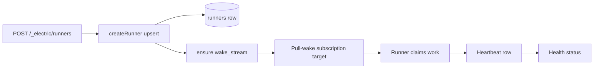
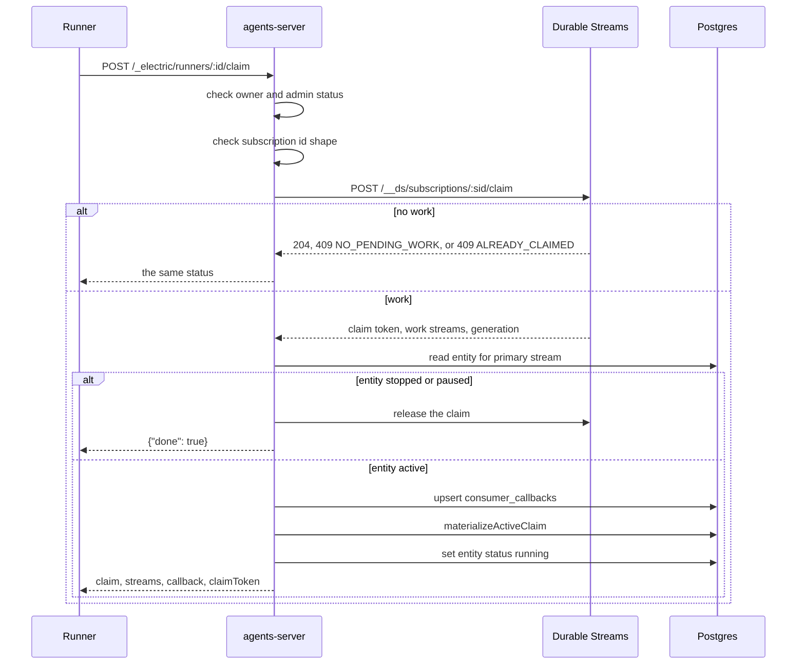

# Runners and sandboxes

A runner is a process that executes agent work. It is not an entity. It has a row in PostgreSQL (Postgres), an owner principal, a wake stream, and an advertised set of sandbox profiles. This document describes the runner lifecycle, the claim handshake, the two leases, and the sandbox rules at spawn. The version under study is package version 0.6.4.

Five terms carry the document:

- An *entity* is one agent instance. It has a Uniform Resource Locator (URL) such as `/worker/abc` and a main stream at `/worker/abc/main`.
- A *principal* is the caller identity, in the form `<kind>:<id>`, with the URL `/principal/<encoded key>`. See [08-tenancy-permissions-and-principals.md](08-tenancy-permissions-and-principals.md).
- A *tenant* is the isolation key for rows and streams. One server can hold several tenants, and every row carries a `tenant_id`.
- A *wake* is a notification that a registered stream condition matched. It does not carry the work itself; it tells a worker that work is ready on a stream.
- *Durable Streams* is the separate stream server that stores the streams and runs the subscriptions. The document calls it *upstream* when a request goes to it.

A *spawn* creates an entity. A *wake time* is the moment a runner receives a wake and decides how to run the entity. A *dispatch policy* chooses where work goes: to a runner, to a webhook, or to the parent of a child entity. To *pin* a runner is to name exactly one runner target in the dispatch policy.

Two streams are involved in a runner claim. The *work streams* are the entity main streams that hold the events. The *wake stream* holds notifications only. A subscription groups the work streams and names one wake stream.

## The runner record

A runner row has these fields:

| Field | Default | Meaning |
|-------|---------|---------|
| `id` | none | Caller-chosen identifier |
| `owner_principal` | authenticated principal | The only principal that may claim with this runner |
| `label` | none | Display name |
| `kind` | `local` | `local`, `cloud-worker`, `sandbox`, `ci`, or `server` |

The `kind` value is a label. A check constraint accepts those five strings, and no code in this package branches on the value. The same behaviour applies to every kind.
| `admin_status` | `enabled` | `enabled` or `disabled` |
| `wake_stream` | `/runners/<id>/wake` | Stream on which the runner receives wake notices |
| `sandbox_profiles` | `[]` | Advertised profiles |

The table has a unique constraint on `(tenant_id, wake_stream)`. Two runners cannot share a wake stream.



Only the first four nodes happen during registration. The claim, the heartbeat, and the health check are later, separate requests. The arrow from `E` to `F` means that the subscription enables a claim; it does not mean that registration performs one.

### Registration

Registration requires an authenticated principal. The owner principal defaults to that principal. A different owner value returns `403`:

```ts
// packages/agents-server/src/routing/runners-router.ts:230-236
if (canonicalOwner !== principal.url) {
  throw new ElectricAgentsError(
    ErrCodeUnauthorized,
    `owner_principal must match the authenticated principal`,
    403
  )
}
```

Registration is an upsert on `(tenant_id, id)`. A second registration with the same identifier replaces the owner, label, kind, status, wake stream, and, when supplied, the full sandbox profile list. If the profile field is omitted, the old list stays. An omitted `kind` returns to `local`, and an omitted `admin_status` returns to `enabled`, because the upsert always writes both fields (`packages/agents-server/src/entity-registry.ts:258-271`). The registration route ensures the wake stream exists before it returns 201.

A runner can only claim for its owner. `claimWake` rejects a different principal with 403 and a disabled runner with `409 NOT_RUNNING`.

Every runner route needs the owner. Health, get, heartbeat, enable, and disable all call `assertRunnerOwnerIfAuthenticated`, which first requires an authenticated principal (401 when absent) and then returns 403 for a different principal (`packages/agents-server/src/routing/runners-router.ts:428-439`). The list route ignores that helper and always filters to the authenticated principal's own rows, so a caller cannot list another owner's runners (`packages/agents-server/src/routing/runners-router.ts:253-280`).

## The wake stream and the subscription

A runner does not poll its own wake stream for work. The Durable Streams server manages a subscription. The server links each entity main stream to a pull-wake subscription. A *pull-wake* subscription is one where the worker claims pending work and reads the stream itself; a *webhook* subscription posts the event to a URL. The link runs per entity, through `linkEntityDispatchSubscription()`, and it uses an in-memory cache keyed by tenant, subscription identifier, and stream path. A repeated link for the same triple makes no network call.

The snippet shows one call. `subscriptionId` is `runner:<id>:<suffix>`, `streamPath` is the entity main stream, and `existing` is the subscription that the cache read returned, or `undefined` when there is none. `ensureSubscriptionIncludesStream` creates the subscription when it is missing and adds the stream to it otherwise; it never replaces the stream list.

```ts
// packages/agents-server/src/routing/dispatch-policy.ts:301-312
await ctx.streamClient.ensure(wakeStream, {
  contentType: `application/json`,
})
await ensureSubscriptionIncludesStream(
  ctx,
  subscriptionId,
  streamPath,
  {
    type: `pull-wake`,
    streams: [streamPath],
    wake_stream: wakeStream,
    description: `Electric Agents runner ${target.runnerId}`,
  },
  existing
)
```

The subscription identifier has two parts. The base is `runner:<runnerId>`. The per-entity form appends a suffix: the first 16 hexadecimal characters of the Secure Hash Algorithm 256-bit (SHA-256) digest of the entity Uniform Resource Locator (URL). The full identifier is therefore `runner:<runnerId>:<16 hex characters>`.

A webhook target has a different rule. Without an explicit `subscription_id`, its base is `webhook:<16 hex characters of the SHA-256 digest of the webhook URL>`, and it stays base-only for every entity. With an explicit `subscription_id`, the identifier gains the per-entity suffix. See [06-http-routing.md](06-http-routing.md).

When a spawn has an initial message and a dispatch target exists, the server links the subscription before it sends the message. `shouldLinkDispatchBeforeInitialMessage` returns true when a target exists. Without that order, a fast append could reach the stream before the subscription includes it, and the runner would never wake. When either condition is absent, the link runs after the send, or after entity creation when there is no send.

## The claim handshake

A claim is one round trip that gives a runner exclusive work on one stream.



The server returns 204 when the backend reports no work. It passes `409 NO_PENDING_WORK` and `409 ALREADY_CLAIMED` through, because both are normal contention, not errors.

The claim body may omit `subscription_id`. The default is the base `runner:<runnerId>`. The route accepts the base or any identifier that starts with `base:`. Any other value returns `400`. A claim on the base identifier asks the Durable Streams server for a stream from the whole subscription.

`notificationFromClaim` chooses the primary stream. It prefers a stream with `has_pending: true`, then falls back to the first stream. The `has_pending` flag is a field of the upstream claim response; this package does not compute it. In the fallback case the claim can name a stream with no pending work, and the runner gets a wake for a stream that looks empty. The code resolves the entity from that stream path. A path counts as attached when `getEntityByStream` finds the entity that owns it; the lookup strips a trailing `/main`, so `/worker/abc/main` resolves to the entity at `/worker/abc`. A stream that is not attached to an entity returns 404.

A stopped or paused entity releases the claim at once and returns `{ done: true }`. This is the safe path: a stale pending append cannot start work on a dead entity.

Otherwise the server writes a callback row and a claim row, and sets the entity status to `running`. The response contains:

- `consumerId` and `wakeId`. Both equal the upstream `wake_id`.
- `epoch`. This is the upstream `generation`, not the `wake_id`. It is the claim generation number and the fencing token for later writes.
- `streamPath` and every stream with its tail offset.
- the callback URL `/_electric/wake-callbacks/<wakeId>`
- the upstream `claimToken`
- `triggerEvent: "message_received"`
- a snapshot of the entity and its creator principal

The `claimToken` is the upstream claim credential. It authorizes `ack` and `release` on the subscription. It is not the write token for a stream append; that token is minted later on the claim callback and returned in the `writeToken` field. See [08-tenancy-permissions-and-principals.md](08-tenancy-permissions-and-principals.md).

The runner then reads the stream from the offsets in the response.

## Two leases

The system has two leases, and they are not the same:

1. The **claim lease** is `consumer_claims.lease_expires_at`. `materializeActiveClaim` sets it to `now + lease_ttl_ms`, where `lease_ttl_ms` is the *lease time to live*, in milliseconds, from the upstream claim response. This package supplies no default. When the upstream claim has no `lease_ttl_ms`, the claim row and the dispatch row store `null`, and the claim has no expiry. It limits exclusive access to the stream.
2. The **liveness lease** is `runner_runtime_diagnostics.liveness_lease_expires_at`. It limits how long the runner counts as alive.

Durable Streams enforces the claim lease. The agents-server records the value and never sweeps it. When the lease passes, another consumer can claim the same stream. This package does not revoke the old write token at that moment; a new claim mints a new token and replaces the old one in `ClaimWriteTokenStore`. The old runner can still append until that replacement if it still holds the token, so the lease is a coordination signal, not a hard write barrier in this package.

The runner heartbeat route writes the liveness lease. `heartbeatRunner` sets it to `now + leaseMs`, and `leaseMs` defaults to `DEFAULT_RUNNER_LEASE_MS`, which is 30,000 ms. The request field is `lease_ms`, and the alternative absolute field is `liveness_lease_expires_at`. The absolute field wins when both are present: the code is `livenessLeaseExpiresAt ?? now + leaseMs`. The route also stores `wake_stream_offset`, the runner's read position on its wake stream, and a sanitized diagnostics object. The word *sanitized* is literal: the route copies only known keys, drops wrong types, and limits status strings to a fixed set, so arbitrary fields from a runner never reach the table (`packages/agents-server/src/routing/runners-router.ts:158-206`).

The claim lease does not change on that route. It changes only through `materializeHeartbeatClaim`, which the wake callback calls. That method updates `last_heartbeat_at`, and it updates `lease_expires_at` only when the callback supplies a value:

```ts
// packages/agents-server/src/entity-registry.ts:495-511
async materializeHeartbeatClaim(
  input: MaterializeHeartbeatClaimInput
): Promise<void> {
  const heartbeatAt = input.heartbeatAt ?? new Date()
  // Only touch leaseExpiresAt when the caller explicitly provides one.
  // The lease was set at materializeActiveClaim time from the upstream
  // lease_ttl_ms and remains the authoritative expiry; heartbeats are
  // alive-pings, not lease extensions.
  await this.db
    .update(consumerClaims)
    .set({
      lastHeartbeatAt: heartbeatAt,
      ...(input.leaseExpiresAt !== undefined
        ? { leaseExpiresAt: input.leaseExpiresAt }
        : {}),
      updatedAt: heartbeatAt,
    })
```

A claim heartbeat therefore does not extend the claim by default. Only a new claim, or a callback that carries an explicit expiry, moves the claim lease.

## Health

`GET /_electric/runners/:id/health` computes two separate statuses.

The liveness status is one of `online`, `offline`, or `expired`:

- A disabled runner is `offline`.
- An enabled runner with a future lease is `online`.
- A past lease is `expired`.
- No lease row is `offline`.

The health status is one of `healthy`, `degraded`, or `unhealthy`. The "client" in the table is the runner process. Its reports arrive through the `diagnostics` object on the heartbeat route, and the stored sanitized copy is what the health route reads.

| Condition | Status | Issue text |
|-----------|--------|------------|
| Disabled | `unhealthy` | `Runner is disabled` |
| Lease expired | `unhealthy` | `Heartbeat lease expired <n>s ago` |
| Enabled, no heartbeat | `degraded` | `Runner has never sent a heartbeat` |
| Client reports stream down | `degraded` | `Client reports stream disconnected` |
| Client reports heartbeat failed | `degraded` | `Client reports last heartbeat failed` |
| More than 5 reconnects | `degraded` | `Client has reconnected <n> times` |
| No diagnostics but a seen time | `degraded` | `No client diagnostics available` |

The `<n>` values are computed at request time. The reconnect rule fires only when `reconnect_count` is a number greater than 5. The no-diagnostics issue fires only when a last-seen time exists; a runner with no diagnostics and no last-seen time gets no issue for that condition.

The response also includes the active claims and the dispatch statistics. Each active claim carries the consumer identifier, epoch, entity URL, stream path, claim time, heartbeat time, and lease expiry. The dispatch statistics are three counts over `entity_dispatch_state` rows whose active runner is this runner:

| Field | Counts rows where |
|-------|-------------------|
| `entities_with_active_claim` | `active_consumer_id` is set |
| `entities_with_outstanding_wake` | `outstanding_wake_id` is set and `active_consumer_id` is not |
| `entities_with_pending_work` | `pending_source_streams` is a non-empty array |

The query first selects rows where `active_runner_id` is this runner. The three conditions then apply inside that set, so every count describes rows already assigned to this runner. Two of the three counters are always zero in version 0.6.4. No code writes `outstanding_wake_id`, and the only write of `pending_source_streams` is the empty array in `createEntity` (`packages/agents-server/src/entity-registry.ts:788`). The fields and the query are in place for a recovery pass: a periodic job that would find a claim whose lease has passed or a wake that never produced a claim, and would clear or retry it. No such job runs in this package. See [03-entity-registry-and-postgres.md](03-entity-registry-and-postgres.md).

The active-claim list has no time filter. `getActiveClaimsForRunner` reads every row with `status = 'active'` for the runner and does not compare `lease_expires_at` with the current time (`packages/agents-server/src/entity-registry.ts:575-591`). A claim whose lease has passed still appears as active until a release or a new claim rewrites the row. The phrase "expiry is detected" in [Claims in Postgres](#claims-in-postgres) means detected from the timestamp by a reader, not by a written status. Durable Streams is the component that enforces the lease when a new claim arrives.

## Claims in Postgres

Two tables record a claim:

- `consumer_claims` has primary key `(tenant_id, consumer_id, epoch)`. Its status type allows `active`, `released`, `expired`, and `failed`.
- `entity_dispatch_state` has primary key `(tenant_id, entity_url)` and the active consumer, runner, epoch, claim time, and lease expiry.

`materializeActiveClaim` writes both in one transaction. It writes `status: active` and sets `released_at` to null, so a repeated claim on the same `(consumer_id, epoch)` re-activates the row. A release or a claim heartbeat on the same key updates the same rows.

The `expired` and `failed` status values are in the type and in a check constraint, but this package writes neither. A claim ends as `active` or `released`. Expiry is detected from `lease_expires_at`, not from a status write.

`materializeReleasedClaim` marks the claim released and clears the active fields of the entity dispatch row. It clears them only when the caller still owns the active claim. A newer claim keeps its fields:

```ts
// packages/agents-server/src/entity-registry.ts:549-568
const cleared = await this.db
  .update(entityDispatchState)
  .set({
    activeConsumerId: null,
    activeRunnerId: null,
    activeEpoch: null,
    activeClaimedAt: null,
    activeLeaseExpiresAt: null,
    lastReleasedAt: releasedAt,
    lastCompletedAt: releasedAt,
    updatedAt: releasedAt,
  })
  .where(
    and(
      eq(entityDispatchState.tenantId, this.tenantId),
      eq(entityDispatchState.entityUrl, claim.entity_url),
      eq(entityDispatchState.activeConsumerId, input.consumerId),
      eq(entityDispatchState.activeEpoch, input.epoch)
    )
  )
```

**Aha: the epoch is the fencing token.** A delayed release from an old consumer cannot clear a new consumer's state, because the row only clears when both the consumer identifier and the epoch match. No distributed lock is involved.

The dispatch state also records the pending source streams and the last claim times. It is the bookkeeping that a recovery pass would use. In version 0.6.4 no such pass runs: the server options declare `dispatchRecoveryIntervalMs` and `staleOutstandingWakeAfterMs`, but no code reads them. [11-operations-testing-and-conformance.md](11-operations-testing-and-conformance.md) describes that gap.

## Sandbox selection at spawn

A sandbox is not created by this package. The server stores a *selection* on the entity, and the runner uses it. The selection has five fields:

A spawn can name a `parent` entity. The new entity is then a child, and the parent link feeds lineage and inherited dispatch. Two entities that share one sandbox key are *collaborators*. The server keeps only the selection. The runner reads that selection from the claim response and starts or attaches to the sandbox; this package never starts a container or a virtual machine.

| Field | Meaning |
|-------|---------|
| `profile` | A profile name that a runner advertises |
| `key` | A shared sandbox identifier across entities |
| `scope` | `entity` (the default) or `wake`; the runner derives a key from it when `key` is absent |
| `persistent` | Keep the sandbox after the run; defaults by scope |
| `owner` | `false` means attach to another entity's sandbox; `true` is the default and is not stored |

The stored selection keeps `key` when the caller supplied one, and otherwise keeps `scope`. It never stores both. `persistent` is stored only when the caller supplied it. `owner: false` is stored, because the default is owner. The runner resolves a `scope` to a concrete key at wake time:

```ts
// packages/agents-runtime/src/sandbox/identity.ts:62-74
const scope = config.scope ?? `entity`
const sandboxKey =
  config.key ??
  (scope === `wake` ? `${wake.entityUrl}#${wake.wakeId}` : wake.entityUrl)
const defaultPersistent = config.key !== undefined ? true : scope !== `wake`
const persistent = config.persistent ?? defaultPersistent
const owner = config.owner ?? true
return { sandboxKey, persistent, owner }
```

The rule is: an explicit key wins. Without a key, `scope: 'wake'` gives `<entity URL>#<wakeId>`, and `scope: 'entity'` gives the entity URL. Durability defaults to persistent for an explicit key and for `scope: 'entity'`, and to throwaway for `scope: 'wake'`. An explicit `persistent` value always wins.

`resolveSandboxForSpawn()` runs only when the request has a sandbox choice. It applies `inherit`, validates the profile, checks co-location, and stores the selection.

```ts
// packages/agents-server/src/routing/sandbox.ts:24-34
export async function resolveSandboxForSpawn(
  registry: PostgresRegistry,
  dispatchPolicy: DispatchPolicy | undefined,
  requested: SandboxChoice | undefined,
  parentEntity: ElectricAgentsEntity | null
): Promise<EntitySandboxSelection | undefined> {
  if (!requested) return undefined

  const choice = applyInheritedSandbox(requested, parentEntity)
  // `inherit` against a parent with no shareable (keyed) sandbox yields none.
  if (!choice) return undefined
```

### Inherit

`inherit: true` copies the parent's keyed sandbox. The child takes the parent's profile, key, and durability, and it becomes an attacher (`owner: false`). If the parent has no key, the child gets no sandbox. It does not fail. The inherit form ignores any `persistent` value next to `inherit` in the same request, because the child cannot change how the parent's sandbox is torn down. The server reads the parent's stored sandbox, not the live sandbox of a running parent. The stored selection is what the database row holds; the live sandbox is the process or container that the runner started for the parent wake.

### Profile validation

The server validates the profile name in one of two ways:

- If the dispatch policy pins one or more runners, each pinned runner must advertise the name.
- If no runner is pinned, at least one tenant runner must advertise it.

A *pinned* dispatch policy has one or more targets of type `runner`, named by identifier. A profile is *remote* when the sandbox runs off the runner host and every runner can reach it, such as a cloud sandbox. A profile without `remote: true` is host-local.

A pinned runner that does not advertise the name returns 400. The error lists the advertised names.

The server also decides whether the profile is remote. With pinned runners, the profile is remote only when every pinned runner marks it `remote: true`. With no pin, it is remote only when every advertiser marks it remote.

The validation does not look at `admin_status`. A disabled runner still counts as an advertiser, in both the pinned path and the tenant-wide path (`packages/agents-server/src/entity-registry.ts:286-316`). A spawn can therefore pass profile validation for a profile that only a disabled runner offers, and the first claim cannot go to that runner. The choice is stored and fails later, at wake time. The failure is visible in the runner claim loop: that runner returns `409 NOT_RUNNING` for every claim, so no consumer starts the sandbox, and the entity stays waiting until the runner is enabled or another runner advertises the same profile.

### Co-location

A shared local sandbox lives on one host. Every collaborator, meaning every entity that uses the same sandbox key, must land on that host. The server therefore requires a single-runner pin when the sandbox has a key and is not remote:

```ts
// packages/agents-server/src/routing/sandbox.ts:162-172
if (key === undefined || chosenIsRemote) return
const targets = dispatchPolicy?.targets ?? []
const pinnedToSingleRunner =
  targets.length === 1 && targets[0]?.type === `runner`
if (!pinnedToSingleRunner) {
  throw new ElectricAgentsError(
    ErrCodeInvalidRequest,
    `a shared sandbox (sandbox.key / sandbox.inherit) requires the entity to be pinned to a single runner via dispatch_policy, so all collaborators share one host.`,
    400
  )
}
```

A remote shared sandbox skips the rule, because every runner can reach it. A local profile with the same name on several runners is not enough, because a profile name says what to start, not where the existing sandbox is. The guard stays in place unless every advertiser is remote.

## Sandbox profiles on a runner

A profile advertisement has a name, a label, an optional description, and an optional `remote` flag. The runner owns the list. A registration with a list replaces the whole list. A registration without a list keeps it.

The server never starts a sandbox. It records the choice and the profile advertisement. The runner reads the entity snapshot from the claim response and acts on the `sandbox` field: it resolves the key or scope, finds or starts the named profile, and either owns the sandbox or attaches to an existing one. The agent runtime in `packages/agents-runtime/src/sandbox/identity.ts` performs that resolution; this package only stores the selection.

## Related documents

- [03-entity-registry-and-postgres.md](03-entity-registry-and-postgres.md) describes the runner and claim tables.
- [05-wake-registry-and-scheduler.md](05-wake-registry-and-scheduler.md) describes the wake conditions that lead to a claim.
- [06-http-routing.md](06-http-routing.md) lists the runner routes and the dispatch link.
- [08-tenancy-permissions-and-principals.md](08-tenancy-permissions-and-principals.md) explains owner principals and write tokens.
