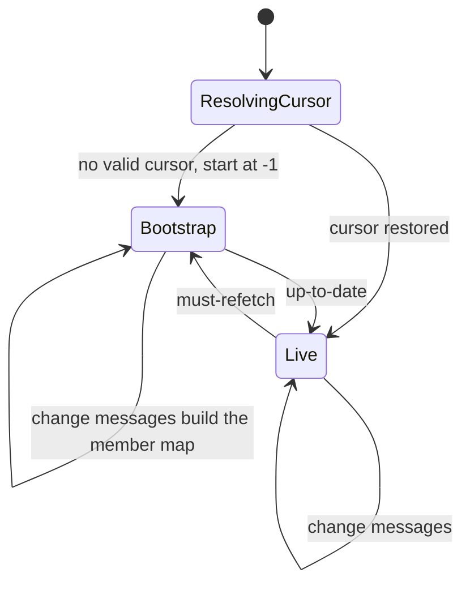
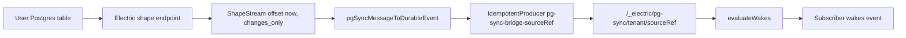

# Postgres sync and bridges

Two features place external data into Durable Streams:

- An **entity bridge** turns a tag query over the `entities` table into a membership stream.
- A **PostgreSQL (Postgres) sync bridge** turns an Electric shape over a user table into a change stream.

This document describes both bridge managers, the tag outbox that publishes tag changes, and the manifest rows that keep bridges alive.

The document uses two storage systems and two kinds of stream. Keep them apart:

- **PostgreSQL (Postgres)** holds the control tables: entities, tags, permissions, bridge rows, and the tag outbox.
- **Durable Streams** is an append-only event log served over Hypertext Transfer Protocol (HTTP). Each entity owns a main stream at `/<entity path>/main`. The tag outbox and the entity registry write control events there.
- An **Electric shape** is a live query result over one Postgres table. The Electric sync service serves it at `/v1/shape`. A *shape stream* is the HTTP response that carries the initial rows and then the changes. It uses offsets: `-1` means the start of the shape log, and `now` means the current tail. A *shape handle* is an opaque server identifier for one shape log. A *shape page* is one batch of messages in a response.
- A **membership stream** is a Durable Stream that an entity bridge owns at `/_entities/<sourceRef>`. It carries `members` events. It is not the same stream as an entity main stream.
- A **change stream** is a Durable Stream that a Postgres sync bridge owns at `/_electric/pg-sync/<tenant>/<sourceRef>`. It carries `pg_sync_change` events.

Other terms:

- A *principal* is the authenticated identity that reads a membership stream. It has a kind (`user`, `agent`, `service`, or `system`), an identifier, a key, and a Uniform Resource Locator (URL). The bridge filter uses all four.
- A *wake* is a notification that a stream changed. A subscriber registers a wake against a source stream. After an append, the wake evaluator matches the event against the registrations and delivers a wake.
- A *manifest* is a `manifest` event in an entity stream. It lists the sources, schedules, and shared-state links that the entity owns. The *manifest key* is the key of that event. A *source reference* (`sourceRef`) is the deterministic identifier of one bridge source.
- A *producer* is a client identity for idempotent appends. An append is idempotent when the server can drop a repeat of the same `(producerId, epoch, seq)` triple. The *epoch* fences out an older writer: a producer that restarts and claims epoch plus one makes every append from the old epoch fail with a conflict. `autoClaim: true` makes the client read the current epoch and claim the next one when it starts.
- The `int8` parser converts Postgres 8-byte integers to JavaScript numbers. Without the parser, they arrive as strings.
- A *dead-letter* row is a failed outbox row that the drainer stops retrying and keeps for inspection.

The two option names `replica` and `log` sound alike and are different:

- `replica` is a *shape subscription* option. `full` sends the whole row plus `old_value` on update; `default` sends only the changed columns on update.
- `log` is an *Electric client* option. `full` replays the log from the cursor; `changes_only` asks the endpoint for changes without a replay of the existing log.

## Entity bridges

`src/entity-bridge-manager.ts` (745 lines) runs one shape request per registered tag set. This is the implementation that the single-tenant standalone runtime uses. The multi-tenant projector in [07-entity-projector.md](07-entity-projector.md) shares one shape request instead.

### The shape query

Each bridge builds a `where` clause from three parts: the tenant, the readable-entity filter, and the tag index:

```ts
// packages/agents-server/src/entity-bridge-manager.ts:123-140
function buildTenantTagsWhereClause(
  tenantId: string,
  tags: EntityTags,
  principalUrl?: string,
  principalKind?: string,
  permissionBypass?: boolean
): string {
  const readableWhere =
    principalUrl && principalKind
      ? buildReadableEntitiesWhere({
          tenantId,
          principalUrl,
          principalKind,
          permissionBypass,
        })
      : `tenant_id = ${sqlStringLiteral(tenantId)} AND FALSE`
  return `${readableWhere} AND (${buildTagsWhereClause(tags)})`
}
```

A tag set is a string-to-string map such as `{ team: 'support', env: 'prod' }`. `normalizeTags` only sorts the keys. It does not trim or lower-case the values. Each index entry is a JavaScript Object Notation (JSON) array of one key and its value, and the entries are sorted. The example above produces `["env","prod"]` and `["team","support"]`. A query for `{ env: 'prod' }` therefore matches every row whose array contains `["env","prod"]`.

The tag part is a Postgres array containment test on `tags_index`:

```ts
// packages/agents-server/src/entity-bridge-manager.ts:109-117
function buildTagsWhereClause(tags: EntityTags): string {
  const encoded = buildTagsIndex(tags).map(
    (entry) => `'${entry.replace(/'/g, `''`)}'`
  )
  if (encoded.length === 0) {
    return `TRUE`
  }
  return `tags_index @> ARRAY[${encoded.join(`, `)}]::text[]`
}
```

The shape has `replica: full`, twelve columns, and the `int8` parser. The columns are `tenant_id`, `url`, `type`, `status`, `tags`, `spawn_args`, `parent`, `type_revision`, `inbox_schemas`, `state_schemas`, `created_at`, and `updated_at`. Neither `created_by` nor `sandbox` is in the list. The `where` clause still names `created_by`, because Electric applies the filter to the table and then projects the selected columns. For this bridge, "the whole row" in the `replica: full` definition means the whole selected row, not every table column.

A member event from this bridge therefore has no `created_by` and no sandbox field. Its value is `{ url, type, status, tags, spawn_args, parent, type_revision, inbox_schemas, state_schemas, created_at, updated_at }`. The `sandbox` column holds the sandbox descriptor that an entity runs in; the standalone membership view does not carry it. The multi-tenant projector selects `created_by` for its permission test and puts `sandbox` in its member row. See [07-entity-projector.md](07-entity-projector.md).

`buildReadableEntitiesWhere` builds the permission predicate. It selects rows where the principal is the creator, or where `entity_effective_permissions` holds `read` or `manage` for that entity and the subject is the principal URL or the principal kind. A bypass principal skips the predicate and sees every row in the tenant. The statement does not filter on expiry; the effective table is expected to hold current rows. The bridge does not run that check in JavaScript; the shape sends only the rows that pass the `where` clause (`packages/agents-server/src/utils/server-utils.ts:328-356`).

The `where` clause includes the permission filter, so the database does the access check. A bridge with no principal URL uses `AND FALSE` and emits no members. That is a fail-closed default.

### Bootstrap and cursor

A bridge persists two cursor values: the shape handle and the shape offset. On restart it resumes from both values. When either value is missing or invalid, it starts at offset `-1` and performs a bootstrap. Here `-1` is an offset in the *shape log*, not in the Durable Stream:

1. Create the stream at `/_entities/<sourceRef>` if it does not exist.
2. Create the producer `entity-bridge-<sourceRef>` with `autoClaim: true`.
3. Read the current membership stream from its first offset into a map keyed by entity URL.
4. Take a copy of that map as the stale set and subscribe to the shape from `-1`.
5. For each change, remove the URL from the stale set and append the new state. An insert or update appends `{ type: 'members', key: url, value: row, headers: { operation, timestamp } }`. A delete appends the same envelope with `old_value` instead of `value`.
6. On `up-to-date`, append a `delete` for every remaining stale member.

The read in step 3 is what makes the bootstrap correct after a crash. The stream already holds the old members, and the shape supplies the current truth. Any member that the shape does not send is stale. The stale set does not record *why* a member is absent. A row that a tag edit removed from the query and a row that a `DELETE` removed from the table look the same, and both produce one `delete` event. The result is the same membership view either way.

`autoClaim: true` matters on restart. The producer identifier is stable, so the stream server still remembers the old epoch. The client asks for the next epoch and writes with it. A producer that omitted `autoClaim` and kept epoch 0 would receive a conflict on its first append after a restart.

The shape client sends control messages in band on the same response. `up-to-date` means "the bootstrap set is complete". `must-refetch` means "the cursor is invalid, start again". The code has two `must-refetch` branches. When a bootstrap is in progress, it resolves that bootstrap and stops the live stream. When no bootstrap is in progress, it requests a full resync.

`resync()` repeats the load-and-bootstrap loop until the shape reports `up-to-date`, with no attempt limit and no backoff between attempts. Each loop waits for a shape round trip, so it is not a busy loop with no input/output. A source that keeps sending `must-refetch` still retries at the speed of the round trip. The pg-sync bridge deliberately backs off on errors instead. The shape request sets no `log` parameter, so the bridge takes the default log mode of the Electric client, which is `full`.



```ts
// packages/agents-server/src/entity-bridge-manager.ts:399-422
for (const message of messages) {
  if (isControlMessage(message)) {
    if (message.headers.control === `must-refetch`) {
      await this.registry.clearEntityBridgeCursor(this.sourceRef)
      const bootstrapState = this.clearBootstrapState()
      if (bootstrapState) {
        this.stopLiveStream()
        bootstrapResult = `must-refetch`
        bootstrapState.resolve(`must-refetch`)
        return
      }
      await this.requestResync(`shape-reset`)
      return
    }
    if (
      message.headers.control === `up-to-date` &&
      this.bootstrapState
    ) {
      this.finalizeBootstrap()
      bootstrapResult = `up-to-date`
    }
    shouldPersistCursor = true
    continue
  }
```

The producer identifier is `entity-bridge-<sourceRef>`. The event type is `members`, and the key is the entity URL.

### Lifecycle

`EntityBridgeManager.start()` loads every row of the `entity_bridges` table for its tenant and starts each bridge. The row stores the tag set, the principal URL and kind, the stream path, the shape handle, the shape offset, and the last observer activity time.

`register()` is the only entry point that creates a row. It takes a tag map, a principal URL, and a principal kind. It computes the tag hash with `sourceRefForTags`, scopes that hash with the principal, upserts `entity_bridges`, touches the row, and starts the bridge. The observations route `POST /_electric/observations/entities/ensure-stream` reaches it through `EntityManager.ensureEntitiesMembershipStream`. A registration with identical inputs is idempotent: the source reference is the same, so the upsert updates the same row and `ensureBridge` returns early when the bridge is already running. A different tag set produces a different source reference, so it creates a second bridge and leaves the first one to the idle sweep.

A sweep runs every 5 minutes. It touches every source reference that a manifest still lists. It then deletes a bridge row when all three conditions hold:

1. No manifest references the source.
2. No client read is active.
3. The row's `last_observer_activity_at` is older than 15 minutes.

The read count is an in-memory map per source reference. For a `GET`, `beginClientRead` increments it and returns a close function that decrements it. The caller runs that close function in a `finally` block after `responseFromUpstream` builds the response object. The count is therefore held during the upstream request and the response construction, not for the whole life of a streaming body. A long download does not keep the bridge alive by itself. `touchByStreamPath` handles a `HEAD` request and only updates `last_observer_activity_at` and `updated_at`. A `HEAD` is a cheap heartbeat: the client asks for the stream metadata without starting a body. The manager stops a bridge before it deletes the row, so no producer writes to a stream whose row is gone. The stream and its history stay in the stream server.

The producer uses `autoClaim: true`, the same option that the projector uses. The producer identifier is stable across restarts, so a restart can find a higher epoch from an earlier process and claim the next one. See [07-entity-projector.md](07-entity-projector.md).

`onEntityChanged` is a no-op with an explanatory comment: membership updates come only from the shape. A direct write through the entity registry does not push into the stream. The call sites still exist. They are grant create, grant delete, tag update, tag delete, and the `done` callback that returns an entity to `idle` or `stopped`.

The multi-tenant projector in [07-entity-projector.md](07-entity-projector.md) uses the same method name for a different job: its facade re-applies one entity to the shared projection, because that projection also writes permission-scoped streams. In the standalone runtime the bridge holds no second copy of the filter: every appended row has already passed the shape's `where` clause. The no-op therefore does not leave a stale in-memory permission decision.

**Aha: a bridge is a materialized view in stream form.** The client never queries Postgres and never polls. It reads an append-only list of `members` events. The shape is the only writer *to the membership stream*; the tag outbox below writes a different stream, the entity main stream. The bootstrap exists because a shape can report a reset at any time.

## Postgres sync bridges

`src/pg-sync-bridge-manager.ts` (652 lines) mirrors a user-owned Postgres table. The source is an Electric shape endpoint, not a database connection string.

### Registration and probe

`POST /_electric/pg-sync/register` accepts a source URL, a table, optional columns, an optional `where` clause, optional parameters, and an optional `replica` mode. The route adds the tenant identifier, the principal kind, identifier, key, and URL to the metadata, then calls the manager. A missing manager returns 503. An empty URL or an empty table name returns 400. The `replica` value defaults to `default`. With `default`, an update event carries only the changed columns, so a mirrored `update` event has a partial `value`. With `full`, it carries the whole row and an `old_value`.

The source URL is mandatory. The manager has no server-side default shape URL, and a row without a URL is deleted at start with a warning.

The manager probes the source before it creates a bridge. The probe fetches one shape page at `offset=now`. A *page* is one response body from the shape endpoint. `now` asks for the current tail, so the probe does not download the existing table. A valid shape response must carry the `electric-handle` header. The handle identifies the shape log on the Electric server; without it the response is some other HTTP resource, not a shape:

```ts
// packages/agents-server/src/pg-sync-bridge-manager.ts:638-644
if (!response.headers.get(`electric-handle`)) {
  const suggestion = new URL(source.url)
  suggestion.pathname = `/v1/shape`
  throw new PgSyncSourceValidationError(
    `pgSync source at ${source.url} responded but is not a shape log (missing electric-handle header) — the Electric shape API is usually served at ${suggestion.origin}/v1/shape`
  )
}
```

A failed probe returns 400. The registration does not create a bridge that would fail silently in a retry loop. The probe timeout defaults to 10,000 milliseconds (ms).

The source reference is a 64-bit Fowler–Noll–Vo (FNV-1a) hash, printed as 16 hexadecimal characters. The "1a" variant XORs each byte into the hash before the multiply step; the exact arithmetic is in `packages/agents-runtime/src/tags.ts:53-62`. The input is `JSON.stringify` of a canonical object, not a general stable serializer.

`canonicalPgSyncOptions()` fixes the field order as `url`, `table`, `columns`, `where`, `params`, `replica`, and `metadata`; drops absent optional fields; copies `columns`; sorts the keys of `params`; and fills `replica` with `default` (`packages/agents-runtime/src/observation-sources.ts:93-107`). The identity metadata is merged after that, with keys in sorted order. The route supplies `tenantId`, `principalKind`, `principalId`, `principalKey`, and `principalUrl`; the client may supply `entityUrl` and `entityType` in the optional `metadata` body field. A change to any identity field changes the reference, so two principals never share one bridge. The ephemeral fields `wakeId`, `runtimeConsumerId`, and `streamPath` are removed before hashing. That lets one bridge serve many wakes for the same observation (`packages/agents-runtime/src/observation-sources.ts:118-145`).

An *observation* is one entity's declared interest in a source, such as a Postgres table. The bridge outlives one wake; the wake is one delivery of a change to the observing entity.

The stream path is:

`/_electric/pg-sync/<encoded tenant>/<sourceRef>`

The tenant namespace is optional in the helper. The manager passes the registry tenant.

### Change flow



The bridge starts at `offset=now` with `log: changes_only`. It does not copy the existing table. It mirrors changes from the registration time onward. That is the correct choice for an observation: the old rows are not new events.

`startStream` chooses the log mode from the offset. When the offset is `now`, the mode is `changes_only`; for any stored offset, the mode is `full`. A resume therefore replays the changes between the cursor and the tail, and a first start does not.

A change message becomes one event with type `pg_sync_change`. The key comes from the message key, a string `headers.key`, or `rowKeyForMessage`. That last function tries `headers.key`, `headers.rowKey`, `value.id`, `value.key`, `old_value.id`, and `old_value.key`, in that order, and serializes the result with `stableJson`. `stableJson` is a small canonical serializer: object keys are sorted, arrays keep their order, and a `bigint` becomes a string. Two equal objects therefore produce the same key text.

The event `value` is the whole change message after `jsonSafe` conversion, not only the row. The event `headers` are the message headers plus the normalized `operation`. A message with no key or with an unknown operation is dropped with a warning.

```ts
// packages/agents-server/src/pg-sync-bridge-manager.ts:221-243
export function pgSyncMessageToDurableEvent(message: PgSyncChangeMessage): {
  type: `pg_sync_change`
  key: string
  value: Record<string, unknown>
  headers: Record<string, unknown> & { operation: PgSyncOperation }
} | null {
  const operation = message.headers.operation
  if (
    operation !== `insert` &&
    operation !== `update` &&
    operation !== `delete`
  ) {
    return null
  }

  const key =
    message.key ??
    (typeof message.headers.key === `string`
      ? message.headers.key
      : undefined) ??
    rowKeyForMessage(message)
  if (!key) {
    return null
  }
```

The producer identifier is `pg-sync-bridge-<sourceRef>`. The producer is created without `autoClaim`, unlike the entity-bridge producer. The bridge flushes each append, then calls the wake evaluator with the stream path. The evaluator reads the wake registrations whose `source_url` is that path, applies their conditions, and delivers a wake to each subscriber. A subscriber therefore sees the change as soon as the stream has it.

### Cursor and recovery

The bridge persists the shape handle and offset after each batch. It also stores `initialSnapshotComplete`, a boolean that marks the first catch-up as passed. On start, it sets the in-memory `skipChangesUntilUpToDate` to `!initialSnapshotComplete`. A fresh start therefore skips change messages until the first `up-to-date`. That first `up-to-date` sets `skipChangesUntilUpToDate` to false and persists `initialSnapshotComplete = true`. A restart then starts with no skip. A restart whose stored `initialSnapshotComplete` is still false repeats the skip. The flag is not a snapshot replay: it only controls whether the bridge ignores the change messages that arrive before the first `up-to-date`.

This skip has a cost. A timeline makes it clear:

1. At registration, the bridge subscribes at `offset=now` with `log: changes_only`.
2. `log: changes_only` tells the endpoint not to send the existing rows. It sends an `up-to-date` control message that marks the current tail.
3. Any user write that commits after step 1 and before step 2's `up-to-date` arrives as a change message in this window.
4. The bridge drops those messages, because `skipChangesUntilUpToDate` is true.
5. Nothing replays them. The next stored cursor is after them.

A write that lands in that window is never mirrored. The bridge cannot tell such a write from a row that existed before the observation, so the loss is deliberate. A consumer that needs no gap must start from a stored cursor instead.

A `must-refetch` clears the cursor, sets `skipChangesUntilUpToDate` to true, and restarts at `now`, not at `-1`. The bridge has no member set to rebuild, so a reset must not replay the whole table. The skip repeats until the next `up-to-date`.

A subscription error enters exponential backoff:

- The first delay is 1,000 ms.
- Each attempt doubles the base delay.
- The base delay is capped at 30,000 ms.
- A random jitter of up to 20 percent of the base delay is added, so the effective maximum is 36,000 ms.
- A change message resets the attempt count. A control message does not, and a `must-refetch` does not either.
- A failure during a recovery does not start a second recovery.

The retry resumes from the committed cursor. If there is no valid cursor, it clears the cursor and restarts at `now`.

**Aha: the two bridges have opposite reset rules.** An entity bridge resets to `-1` and rebuilds the full set, because it owns a derived list. A Postgres bridge resets to `now` and skips the past, because it mirrors an external event feed. A reset must not turn a mirror into a bulk import.

## The tag outbox

A tag change updates Postgres and must also reach the entity main stream at `/<entity path>/main`. The membership stream is not enough: a consumer that watches one entity's own events must see the tag change without a shape subscription. The registry does not append directly, because the append is a network call and cannot join the Postgres transaction. It writes an outbox row in the same transaction instead. `TagStreamOutboxDrainer` publishes the row later and deletes it.

Two mechanisms therefore write two different streams. The tag outbox writes `/<entity path>/main`. The entity bridge shape writes `/_entities/<sourceRef>`. Neither is the other's writer, and a tag change can reach consumers through both paths with different timing.

| Setting | Value |
|---------|-------|
| Drain interval | 500 ms |
| Rows per drain | 25 |
| Producer identifier | `tag-outbox-<row id>` |
| Epoch and sequence | 0 and 0 |
| Maximum attempts | 10, then dead-letter |

```ts
// packages/agents-server/src/tag-stream-outbox-drainer.ts:126-139
private async publishRow(row: TagStreamOutboxRow): Promise<void> {
  const event = buildTagChangeEvent(row)
  const streamClient = await this.streamClientForTenant(row.tenantId)
  await streamClient.appendWithProducerHeaders(
    `${row.entityUrl}/main`,
    JSON.stringify(event),
    {
      producerId: `tag-outbox-${row.id}`,
      epoch: 0,
      seq: 0,
    }
  )
  await this.registry.deleteTagOutboxRow(row.id, row.tenantId)
}
```

The drainer claims rows with one statement. It selects up to 25 rows that are not dead-lettered and are either unclaimed or claimed more than 30 seconds ago, orders them by creation time, and takes them with `FOR UPDATE SKIP LOCKED`. It then sets `claimed_by` and `claimed_at` to the worker identifier and the current time (`packages/agents-server/src/entity-registry.ts:1823-1864`). The stale-claim window is what recovers a row from a worker that stopped after it claimed the row. A shutdown releases the claims that this worker still holds.

The per-row producer is deliberate. The Durable Streams protocol requires contiguous sequence numbers within an epoch. One shared producer per entity would return HTTP status `409` (Conflict) when two rows interleave, because each row would race for the same next sequence number. Each row is its own producer with one append, so a retry replays the same triple, `(producerId, epoch, seq)`, and the server deduplicates it.

A failure increments `attempt_count` and clears the claim. After 10 failures the row gets `dead_lettered_at` and stays in the table for inspection. The claim query excludes dead-lettered rows, and no route or method in `src/` clears `dead_lettered_at`; the only writer is the drainer's failure path. A dead-lettered tag change therefore needs a manual database fix.

The loss is partial. The tag update is already in Postgres, so the entity row and its `tags_index` are current. The membership stream also updates if the shape re-queries the row, because the tag filter reads `tags_index`. Only the `tags` event in the entity main stream is missing. A consumer that watches the entity main stream misses the change; a consumer that watches the membership stream can still see it.

## Manifest rows that keep bridges alive

Two index tables connect a manifest entry to a stream:

| Table | Key | Value |
|-------|-----|-------|
| `entity_manifest_sources` | owner entity URL and manifest key | `sourceRef` |
| `shared_state_links` | owner entity URL and manifest key | `shared_state_id` |

*Shared state* is an entity-owned key-value stream at `/_electric/shared-state/<id>`. Two entities that list the same shared state read and write one stream. A *link* is a `shared_state_links` row that names the owner entity. The write path checks a link row before it allows a shared-state write, and the access check also accepts an entity permission on a linked entity.

A manifest entry has a `kind`, and some kinds have a `sourceType`:

| Entry | Fields used by the index | Effect |
|-------|--------------------------|--------|
| Entity source | `kind: 'source'`, `sourceType: 'entities'`, `sourceRef` | Writes `entity_manifest_sources` |
| Database source | `kind: 'source'`, `sourceType: 'db'`, `sourceRef` or `config.id` | Writes `shared_state_links` |
| Shared state | `kind: 'shared-state'`, `id` | Writes `shared_state_links` |

`syncManifestEntitySources` reads a `manifest` event and calls `replaceEntityManifestSource` and `replaceSharedStateLink` (`packages/agents-server/src/runtime.ts:282-303` and `packages/agents-server/src/runtime.ts:511-532`). A `delete` event passes `undefined`, which removes the row. An `update` that no longer carries the matching entry also passes `undefined`, so a manifest edit can remove a link without a delete event. The source reference is read only from a manifest with `kind: 'source'` and `sourceType: 'entities'`. The shared-state identifier is read from `kind: 'shared-state'` with an `id`, or from `kind: 'source'` with `sourceType: 'db'` and a `sourceRef` or `config.id` (`packages/agents-server/src/runtime.ts:534-568`).

The entity bridge sweep uses `listReferencedEntitySourceRefs()` to find the source references that a manifest still names. A reference protects its entity bridge from the idle sweep even when no client reads it. This is the link between the stream-side manifest and the control-side bridge row. The protection applies only to entity bridges. A Postgres sync bridge has no idle sweep and no manifest protection: `PgSyncBridgeManager.start()` reloads every `pg_sync_bridges` row, and the package has no route to delete one. A Postgres sync bridge therefore runs until an operator deletes its row.

## Related documents

- [03-entity-registry-and-postgres.md](03-entity-registry-and-postgres.md) describes the bridge tables and the outbox table.
- [04-stream-layout-and-stream-client.md](04-stream-layout-and-stream-client.md) describes the `/_entities/` and `/_electric/pg-sync/` paths.
- [05-wake-registry-and-scheduler.md](05-wake-registry-and-scheduler.md) explains the wake evaluation that a pg-sync change triggers.
- [07-entity-projector.md](07-entity-projector.md) describes the shared-shape alternative.
