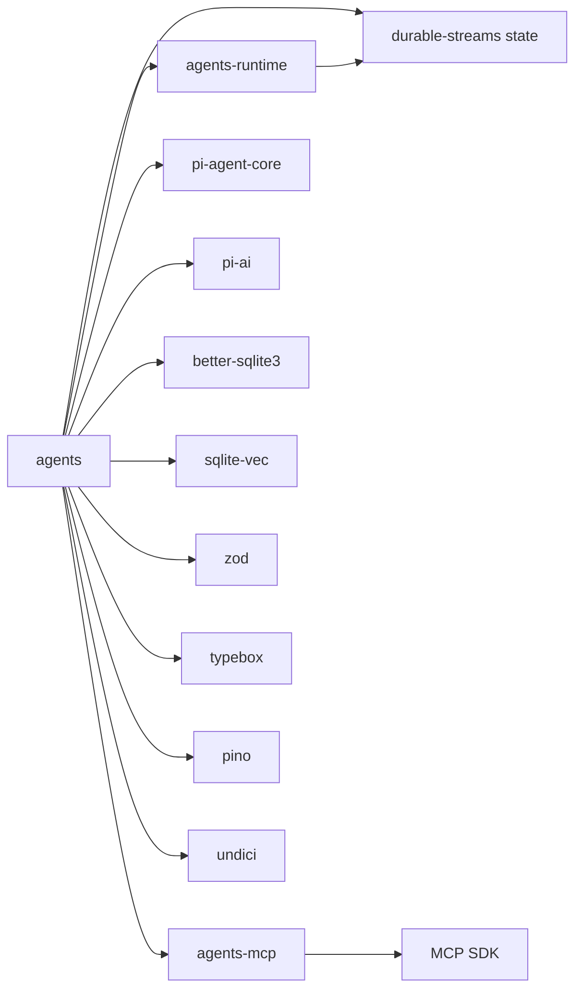
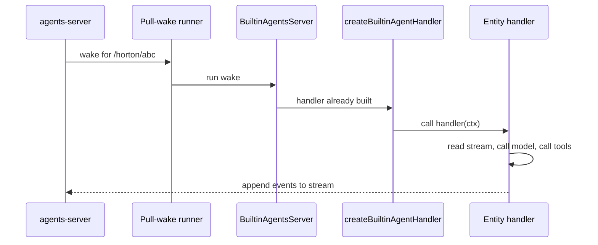

# Overview of the agents package

This document describes the shape of `packages/agents`: what it exports, what it depends on, and how its modules fit together.

An entity is one agent instance with an address and an append-only event stream. A handler is a function that runs one entity turn. A wake is a server request that asks the runtime to run that turn. A pull-wake runner is the process that claims pending wake work from the server and calls the handlers. The stream database gives read access to an entity event stream.

## What the package is

The package is a ready-made agent implementation for Electric Agents. It supplies:

- Two entity types: `horton` and `worker`.
- A model catalog that resolves the available model providers.
- A tool set that includes shell, file, web, spawn, fork, and database observation tools.
- Sandbox profiles for local execution, Docker execution, and optional E2B execution.
- A Model Context Protocol (MCP) tool provider that connects external servers through the MCP Software Development Kit (SDK).
- A SQLite documentation index with hybrid search. Hybrid search combines a vector search and a text search.
- A pull-wake server class and a process entrypoint.

The package does not include a user interface. It does not include the Hypertext Transfer Protocol (HTTP) server that owns entity routes. Those belong to `agents-server`. This package plugs into that server.

## Dependency graph



The runtime provides entity primitives. The MCP package provides server connections. The Pi packages (`pi-agent-core` and `pi-ai`) provide the model loop; `pi-ai` holds the provider adapters and `pi-agent-core` runs the agent step loop. The SQLite packages provide the documentation index. Pino provides logging. `zod` and `typebox` validate schemas, and `undici` supplies the HTTP client and dispatcher.

`BuiltinAgentsServer` is the runtime object inside this package. It starts the pull-wake runner and the MCP registry. The `agents-server` package is the separate control plane that owns the entity routes and dispatches wakes. This package plugs into that server.

## Module map

| Module | Responsibility |
|--------|----------------|
| `src/index.ts` | Public export surface |
| `src/bootstrap.ts` | Build a runtime handler and register the built-in types |
| `src/server.ts` | Own the pull-wake runner, MCP registry, and shutdown order |
| `src/entrypoint-lib.ts` | Read environment variables and run a server |
| `src/agents/horton.ts` | Define and run the Horton assistant |
| `src/agents/worker.ts` | Define and run worker subagents |
| `src/model-catalog.ts` | List models and resolve reasoning effort |
| `src/tools/` | Individual tool factories |
| `src/docs/knowledge-base.ts` | Index and search the documentation |
| `src/durable-streams-cache.ts` | Cache stream reads in memory or SQLite |
| `src/log.ts` | Create the pino logger |

## The export surface

The package exports seven groups. The names have a pattern. `createAgentHandler` is the generic handler builder, and `createBuiltinAgentHandler` is the built-in wrapper. `registerAgentTypes` is the generic registration function, and `registerBuiltinAgentTypes` registers the two built-in types. `createBuiltinElectricTools` builds the shared Electric tools. The first group is the bootstrap.

```ts
export {
  DEFAULT_BUILTIN_AGENT_HANDLER_PATH,
  createBuiltinAgentHandler,
  createBuiltinElectricTools,
  createAgentHandler,
  registerBuiltinAgentTypes,
  registerAgentTypes,
} from './bootstrap.js'
```

Source: `packages/agents/src/index.ts:1-8`.

The second group is the server.

```ts
export { BuiltinAgentsServer } from './server.js'
export type { BuiltinAgentsServerOptions } from './server.js'
```

Source: `packages/agents/src/index.ts:17-18`.

The third group is the Model Context Protocol (MCP) type re-exports. An embedder uses these types to subscribe to registry state changes.

```ts
export type {
  Registry as McpRegistry,
  RegistrySnapshot,
  RegistrySubscriber,
  ListedEntry as McpListedEntry,
  McpServerConfig,
  McpConfig,
} from '@electric-ax/agents-mcp'
```

Source: `packages/agents/src/index.ts:23-30`.

The fourth group is the entrypoint helper.

```ts
export {
  resolveBuiltinAgentsEntrypointOptions,
  runBuiltinAgentsEntrypoint,
} from './entrypoint-lib.js'
export type {
  BuiltinAgentsEntrypointOptions,
  BuiltinAgentsEntrypointServer,
  RunBuiltinAgentsEntrypointOptions,
} from './entrypoint-lib.js'
```

Source: `packages/agents/src/index.ts:32-40`.

The fifth group is the agent-specific pieces, including the Horton model constant and the Horton helper functions.

```ts
export {
  buildHortonSystemPrompt,
  createHortonTools,
  generateTitle,
  HORTON_MODEL,
  registerHorton,
} from './agents/horton.js'
```

Source: `packages/agents/src/index.ts:42-48`.

The sixth group is the worker type, the tool factories that Horton and a worker share, and the documentation support.

```ts
export { registerWorker } from './agents/worker.js'
export {
  WORKER_TOOL_NAMES,
  createSpawnWorkerTool,
} from './tools/spawn-worker.js'
export { createForkTool } from './tools/fork.js'
export { createHortonDocsSupport } from './docs/knowledge-base.js'
export { braveSearchTool } from '@electric-ax/agents-runtime/tools'
```

Source: `packages/agents/src/index.ts:61-69`.

The worker group also exports the `WorkerToolName` type. Source: `packages/agents/src/index.ts:66`.

The seventh group is the model catalog.

```ts
export {
  builtinModelProviderLabel,
  listBuiltinModelChoices,
  resolveBuiltinModelConfig,
} from './model-catalog.js'
```

Source: `packages/agents/src/index.ts:49-53`.

The package also re-exports the bootstrap option and result types (`AgentHandlerResult`, `BuiltinElectricToolsFactory`, `BuiltinAgentHandlerOptions`, `BuiltinDockerSandboxMount`, `BuiltinDockerSandboxOptions`) and the model catalog types (`BuiltinModelCatalogOptions`, `BuiltinModelChoice`, `BuiltinModelProvider`, `BuiltinAgentModelConfig`, `BuiltinModelCatalog`).

Source: `packages/agents/src/index.ts:9-15`, `54-60`.

## Two subpath exports

The package has a `./server-headers` subpath. Embedders use it to merge the `electric-principal` header into outgoing requests without importing the whole package. A principal is the caller identity that the server uses for permission checks. The header carries that identity.

```ts
export const ELECTRIC_PRINCIPAL_HEADER = 'electric-principal'
```

Source: `packages/agents/src/server-headers.ts:1`.

The `./package.json` subpath is also exported. This is a common convention that lets tools read the version.

## Aha: the handler is the unit of reuse

Most agent frameworks expose an agent class. This package exposes a handler function. A handler receives a context and returns a result. The context carries the entity address (Uniform Resource Locator, URL), the stream database, the sandbox, the tools, and the goal state.

Key insight: because the handler is a plain function, the same code runs in three places without change. It runs inside `BuiltinAgentsServer`. It runs inside the command-line quickstart. It runs inside the desktop application. The only difference is which process starts the pull-wake runner.

## How the parts meet at runtime



The server routes a wake to the runtime. The runtime calls the handler that bootstrap created. The handler writes back to the same stream. No component keeps private state about the conversation. The stream is the state of the conversation; the handler context still carries the sandbox, the tools, and the goal for the current turn.

`/horton/abc` is an entity address. `/${name}/*/main` is a subscription pattern that covers every entity of one type. The two are different forms: the first names one entity, and the second names a family of streams.

## Related documents

- [README.md](README.md) for the package introduction and reading order.
- [01-built-in-runtimes.md](01-built-in-runtimes.md) for bootstrap and server details.
- [04-tools-and-sandboxes.md](04-tools-and-sandboxes.md) for the tool and sandbox layer.
- [../../README.md](../README.md) for the full exploration index.
