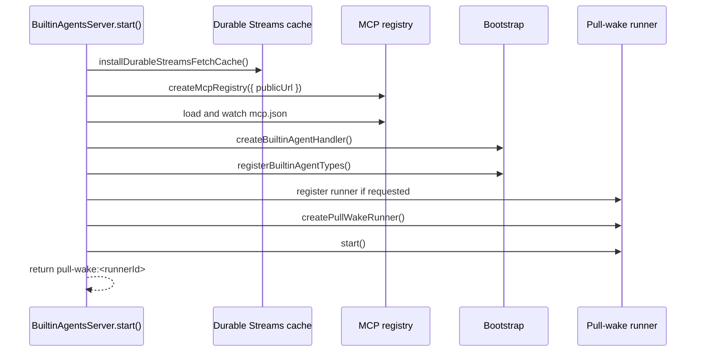
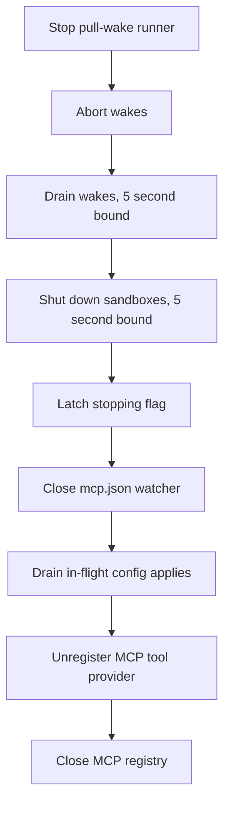

# Built-in runtimes

The package provides a complete runtime in two layers. The first layer is a bootstrap function that builds a handler. The second layer is a server class that runs the handler under a pull-wake runner. A third helper connects the two to environment variables for a standalone process.

A handler is a function that runs one entity turn. A pull-wake runner is the process that claims pending wake work from the server and calls the handler. Durable Streams is the append-only stream store that holds the event log.

## Layer 1: the bootstrap function

`createBuiltinAgentHandler` is an asynchronous function. It returns an `AgentHandlerResult` or `null`. An `AgentHandlerResult` holds the handler function and the metadata that the server needs. It returns `null` when no model provider key is available and no mock stream function is supplied. The mock stream function is `streamFn`; it supplies model output without a provider key for tests.

The function performs eight steps in order:

1. Build the model catalog.
2. Resolve the working directory.
3. Load the skills registry.
4. Create the entity registry.
5. Register Horton.
6. Register the worker type.
7. Build the sandbox profiles.
8. Create the runtime handler.

```ts
const modelCatalog = await createBuiltinModelCatalog({
  allowMockFallback: Boolean(streamFn),
  enabledModelValues,
})

if (!modelCatalog) {
  serverLog.warn(
    `[builtin-agents] no supported model provider API key found — set ANTHROPIC_API_KEY, OPENAI_API_KEY, DEEPSEEK_API_KEY, or MOONSHOT_API_KEY`
  )
  return null
}
```

Source: `packages/agents/src/bootstrap.ts:177-187`.

The model catalog is the first gate. If no model provider key is available, the bootstrap stops. This fail-fast behavior prevents a server that starts but cannot answer any message. `enabledModelValues` is the optional allowlist of model identifiers from the server options.

The skills registry is the second optional gate. A skills registry is a lookup of reusable skill definitions that the handler can load into a prompt. A failure is logged as a warning and does not stop the bootstrap.

```ts
const registry = createEntityRegistry()
const typeNames = registerHorton(registry, {
  workingDirectory: cwd,
  streamFn,
  skillsRegistry,
  modelCatalog,
})

registerWorker(registry, { workingDirectory: cwd, streamFn, modelCatalog })
typeNames.push(`worker`)
```

Source: `packages/agents/src/bootstrap.ts:213-222`.

The runtime handler receives a mapping from entity type to stream path.

```ts
const runtime = createRuntimeHandler({
  baseUrl: agentServerUrl,
  serveEndpoint,
  registry,
  subscriptionPathForType: (name) => `/${name}/*/main`,
  defaultDispatchPolicyForType,
  serverHeaders,
  idleTimeout: 5 * 60_000,
  createElectricTools: createBuiltinElectricTools(createElectricTools),
  publicUrl,
  name: runtimeName ?? `builtin-agents`,
  sandboxProfiles,
})
```

Source: `packages/agents/src/bootstrap.ts:227-239`.

`serveEndpoint` is the public address that the runtime advertises for serve-endpoint type registration. `defaultDispatchPolicyForType` selects the default wake rule for a type. `serverHeaders` adds headers to the runtime's own requests.

Three settings deserve attention.

- `subscriptionPathForType` maps a type name to a wildcard subscription path. The server creates one subscription per type, not one per entity. When a new entity of that type spawns, the subscription already covers it.
- `idleTimeout` is five minutes. After five minutes without a wake, the runtime can release idle resources.
- `createElectricTools` adds webhook-source tools and schedule tools to every entity. A webhook is an outbound Hypertext Transfer Protocol (HTTP) request that the server sends to a registered address.

## Layer 2: the server class

`BuiltinAgentsServer` owns three resources: the bootstrap result, the pull-wake runner, and the Model Context Protocol (MCP) registry. The `start` method creates all three. The `stop` method releases them in a strict order. The start method also installs the stream fetch cache; the cache is process-global and is not one of the three owned objects.



The server returns the `pull-wake:<runnerId>` status string to its caller. The entrypoint logs it.

### Start

The method rejects a second start. It also rejects a missing runner identifier.

```ts
if (this.bootstrap || this.pullWakeRunner) {
  throw new Error(`Builtin agents runtime already started`)
}

installDurableStreamsFetchCache(this.options.durableStreamsFetchCache)

const pullWake = this.options.pullWake
if (!pullWake?.runnerId) {
  throw new Error(`Builtin agents require a pull-wake runner id`)
}
```

Source: `packages/agents/src/server.ts:184-193`.

The stream cache is installed first. It installs a cache interceptor on the global fetch path. It allows a long stream read to be cached in memory or on disk. The default cache size is one hundred mebibytes.

The MCP registry is created next. The public address (Uniform Resource Locator, URL) is the base for Open Authorization (OAuth) callback addresses. The registry is created even when there is no `mcp.json`, because embedders can add servers through `extraMcpServers`. The registry is the component described in [../agents-mcp/01-mcp-registry.md](../agents-mcp/01-mcp-registry.md).

### The MCP merge rule

When `loadProjectMcpConfig` is true, the server reads `<workingDirectory>/mcp.json` and watches it for changes. The default is off; the server loads the file only when the option is true. It also accepts servers from `extraMcpServers`. On a name conflict, the `mcp.json` entry wins.

Key insight: this merge rule lets an application ship default servers while a project overrides them without code changes. The override is a file edit, and the watcher applies it without a restart.

### The MCP tool provider

The server registers one tool provider named `mcp`.

```ts
registerToolProvider({
  name: `mcp`,
  tools: () => {
    const tools: ReturnType<typeof bridgeMcpTool>[] = []
    for (const entry of mcpRegistry.list()) {
      if (entry.status !== `ready`) continue
      const live = mcpRegistry.get(entry.name)
      if (!live?.transport) continue
      for (const t of entry.tools) {
        tools.push(bridgeMcpTool({ server: entry.name, tool: t, client: live.transport.client as ..., timeoutMs: live.config.timeoutMs }))
      }
    }
    // ...
```

Source: `packages/agents/src/server.ts:249-275`.

The provider is a function, not a list. The runtime calls it on each wake. A server that connects after the process starts therefore becomes visible at the next wake.

### Stop

The stop order is deliberate.



The order has one purpose: no component acts on state that another component has already destroyed. The server asks the runner to stop, then aborts wakes. Sandboxes shut down after the wakes release their leases. The provider unregisters before the registry closes.

The two five-second bounds mean that a hung Docker daemon or a hung wake cannot block process exit forever.

## Layer 3: the entrypoint

`resolveBuiltinAgentsEntrypointOptions` reads environment variables and returns a server configuration. `runBuiltinAgentsEntrypoint` starts the server and handles signals.

```ts
const agentServerUrl = validateUrl(
  `agent server URL`,
  readRequiredEnv(
    env,
    [`ELECTRIC_AGENTS_SERVER_URL`, `ELECTRIC_AGENTS_BASE_URL`],
    `agent server base URL`
  )
)
```

Source: `packages/agents/src/entrypoint-lib.ts:111-118`.

The runner identifier comes from two possible variables.

```ts
const runnerId = readRequiredEnv(
  env,
  [`ELECTRIC_AGENTS_PULL_WAKE_RUNNER_ID`, `PULL_WAKE_RUNNER_ID`],
  `pull-wake runner id`
)
```

Source: `packages/agents/src/entrypoint-lib.ts:119-123`.

When an authorization header is present, the helper also sets the `electric-claim-token` header. This carries the caller's claim into the runner registration and into stream reads. The principal header identifies the caller. The claim token is the credential that proves the runner may act for that caller.

## Aha: the runtime is stateless between wakes

A wake can arrive at any time, in any process, for any entity. The runtime does not keep a map from entity to conversation. It reads the stream at the stored offset and rebuilds the state. The idle timeout only releases resources. It does not lose state.

Key insight: this is why two runners can serve the same entity type without coordination. The stream is the only shared state. The pull-wake protocol ensures that only one runner claims a given wake.

## Related documents

- [00-overview.md](00-overview.md) for the export surface.
- [02-horton.md](02-horton.md) for the type that this runtime registers.
- [04-tools-and-sandboxes.md](04-tools-and-sandboxes.md) for the sandbox profiles built here.
- [agents-server/README.md](../agents-server/README.md) for the control plane that dispatches wakes.
