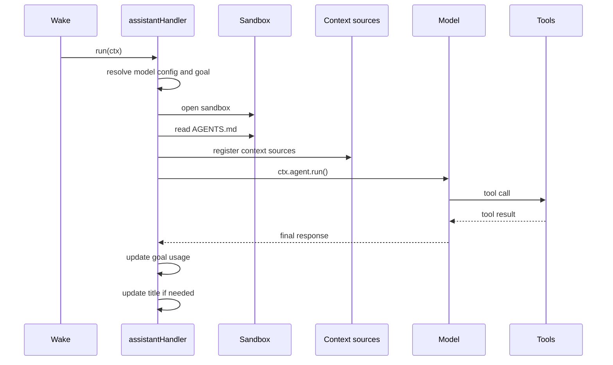
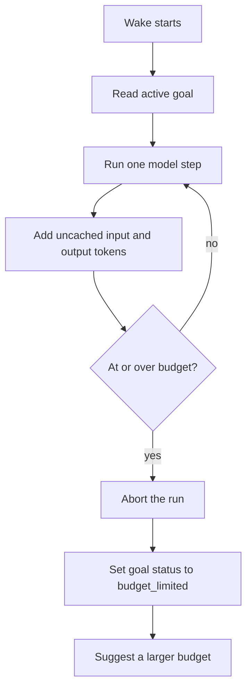

# Horton

Horton is the default assistant entity. It is a conversation partner that can read code, run shell commands, search the web, dispatch subagents, observe PostgreSQL tables, and manage its own title and goals. A subagent is a worker entity that Horton spawns.

The implementation lives in `packages/agents/src/agents/horton.ts`. The entity type name is `horton`.

## The entity definition

`registerHorton` calls `registry.define` with five parts: a creation schema, permission grants, a state collection, slash commands, and a handler.

A creation schema is the schema that validates the arguments for a new entity. A permission grant states which principals may spawn or manage the entity. A state collection is a named store inside the entity state where the handler writes small records. A slash command is a command that a user can type at the start of a message.

```ts
registry.define(`horton`, {
  // creation schema: model, reasoningEffort, workingDirectory
  // permissions: spawn and manage, for principal_kind user
  // state: { comments: commentsCollection }
  // slashCommands: [GOAL_SLASH_COMMAND, ...skillCommands]
  // handler: assistantHandler
})
```

Source: `packages/agents/src/agents/horton.ts:978-1004`.

The creation schema accepts three optional fields:

| Field | Values | Default |
|-------|--------|---------|
| `model` | An entry from the model catalog | The catalog default |
| `reasoningEffort` | `auto`, `minimal`, `low`, `medium`, `high` | `auto` |
| `workingDirectory` | A path | The bootstrap working directory |

The permission grants allow a user to spawn a Horton and to manage it. `principal_kind` is the principal category that a grant applies to, such as `user` or `agent`. The `comments` state collection gives Horton a place to write state that the user interface can render.

## The handler pipeline



Each wake rebuilds the tool list, the system prompt, and the context sources. The handler holds no conversation state between wakes. The stream holds that state, and the bootstrap-built model catalog and skills registry are process-level objects that the handler reuses.

## The system prompt

`buildHortonSystemPrompt` assembles a prompt from fixed text and optional sections. The optional sections appear only when the matching capability exists.

```ts
const docsTools = opts.hasDocsSupport
  ? `\n- search_electric_agents_docs: hybrid search over the built-in Electric Agents docs index`
  : ``
```

Hybrid search combines a vector search and a text search.

Source: `packages/agents/src/agents/horton.ts:228-230`.

The prompt always lists the base tools: `bash`, `read`, `write`, `edit`, `web_search`, `fetch_url`, `spawn_worker`, `fork`, `observe_pg_sync`, `unobserve_pg_sync`, `set_title`, and `send`.

The prompt also contains an onboarding section. The section tells Horton not to force a tutorial. It offers four paths: learn the concepts, take a guided tutorial, scaffold a project, or ask a direct question.

The prompt states the runtime model and provider. The runtime prompt section explains why.

```ts
# Runtime model
You are currently running via provider "${opts.modelProvider}" with model "${opts.modelId}". If the user asks what model or provider you are using, answer with these exact runtime values. Do not infer your model identity from training data or from the name of another coding tool.
```

Source: `packages/agents/src/agents/horton.ts:284-288`.

Key insight: the prompt cannot be trusted to know its own model. Models often believe they are a different product. Passing the exact provider and model identifier removes that ambiguity.

## Context sources

Horton registers named context sources with a token budget. A context source is a named block of prompt text with a token budget and a cache class. `sourceBudget` is the shared budget that the context system uses to allocate space across sources. Each source declares a cache class.

```ts
ctx.useContext({
  sourceBudget,
  sources: {
    docs_toc: {
      content: () => docsSupport.renderCompressedToc(),
      max: 3_000,
      cache: `stable`,
    },
    retrieved_docs: {
      content: () =>
        docsSupport.renderRetrievedDocsSource(
          wake,
          ctx.events,
          ctx.db.collections.inbox.toArray
        ),
      max: 6_000,
      cache: `volatile`,
    },
    conversation: {
      content: () => ctx.timelineMessages(),
      cache: `volatile`,
    },
    ...(agentsMd
      ? {
          agents_md: {
            content: () => agentsMd,
            max: 20_000,
            cache: `stable` as const,
          },
        }
      : {}),
  },
})
```

Source: `packages/agents/src/agents/horton.ts:735-771`.

The table shows the budget.

| Source | Maximum tokens | Cache class | Purpose |
|--------|----------------|-------------|---------|
| `docs_toc` | 3,000 | stable | Compressed table of contents |
| `retrieved_docs` | 6,000 | volatile | Documents fetched by the current wake |
| `conversation` | No explicit cap | volatile | Timeline messages |
| `agents_md` | 20,000 | stable | Project instructions from the sandbox |
| Skills | Per skill | Mixed | Loaded skill text |

`TOC` means table of contents. `AGENTS.md` is the project instruction file that the sandbox reads.
A stable source keeps its place in the prompt prefix. This makes provider prompt caching effective. A volatile source can change on every wake. The `Skills` row is mixed because a skill can be stable or volatile, depending on when it was loaded.

## Tools

`createHortonTools` returns the tool list for one wake.

```ts
return [
  createBashTool(sandbox),
  createReadFileTool(sandbox),
  createWriteTool(sandbox),
  createEditTool(sandbox),
  braveSearchTool,
  ...(opts.modelCatalog && opts.modelConfig
    ? [createFetchUrlTool(sandbox, { catalog: opts.modelCatalog, modelConfig: opts.modelConfig, ... })]
    : [createFetchUrlTool(sandbox)]),
  createSpawnWorkerTool(ctx, opts.modelConfig),
  createForkTool(ctx),
  createObservePgSyncTool(ctx),
  createUnobservePgSyncTool(ctx),
  createSetTitleTool(ctx),
  createSendTool(ctx.send, { selfEntityUrl: ctx.entityUrl }),
  ...(ctx.getGoal()?.status === `active`
    ? [createMarkGoalCompleteTool(ctx)]
    : []),
  ...(opts.docsSearchTool ? [opts.docsSearchTool] : []),
]
```

Source: `packages/agents/src/agents/horton.ts:392-422`.

`braveSearchTool` is the implementation behind the `web_search` tool. `observe_pg_sync` observes a PostgreSQL table and emits change events. `unobserve_pg_sync` removes that observation. `send` delivers a message to another entity.

Two details matter.

- The `mark_goal_complete` tool appears only when a goal is active. A tool that can only answer "no active goal" wastes a slot in the model context.
- The tools are rebuilt on every wake. The sandbox object and the goal state are read at that moment.

## Goals and the token budget

A goal is an objective with an optional token budget. Horton enforces the budget during the model loop.



The counter uses uncached input tokens plus output tokens. It does not count cached input tokens. The check runs after each step.

```ts
if (
  enforcedGoal.tokenBudget !== null &&
  runTokensUsed >= enforcedGoal.tokenBudget
) {
  budgetTripped = true
  serverLog.info(
    `[horton ${ctx.entityUrl}] goal budget exhausted (${runTokensUsed} tokens) — aborting run`
  )
  budgetAbort.abort()
}
```

Source: `packages/agents/src/agents/horton.ts:839-849`.

When the budget trips, the run aborts. The handler catches the abort, writes `budget_limited` as the goal status, and suggests a larger budget.

```ts
const suggestedNext = Math.max(budget * 2, budget + 10_000)
```

Source: `packages/agents/src/agents/horton.ts:892`.

The suggestion is the larger of double the budget and the budget plus ten thousand tokens. This gives a small goal a meaningful increase and a large goal a proportional one.

## Title generation

The first user message is the source for the conversation title. A low-cost model writes a short title from that message. A low-cost model is a small, inexpensive model from the catalog.

```ts
function createConfiguredTitleCall(
  catalog: BuiltinModelCatalog,
  modelConfig: BuiltinAgentModelConfig,
  logPrefix: string
): (prompt: string) => Promise<string> {
  return (prompt: string) =>
    completeWithLowCostModel({
      catalog,
      modelConfig,
      log: (message) => serverLog.info(message),
      logPrefix,
      purpose: `title generation`,
      systemPrompt: TITLE_SYSTEM_PROMPT,
      prompt,
      maxTokens: 64,
    })
}
```

Source: `packages/agents/src/agents/horton.ts:145-161`.

Three safeguards protect the title.

1. The call has an 8 second timeout (`TITLE_GENERATION_TIMEOUT_MS`).
2. A response with more than eight words is rejected.
3. A response that contains `!`, `?`, or `,` is rejected.

```ts
function looksLikeNonTitle(title: string): boolean {
  if (title.split(/\s+/).filter(Boolean).length > 8) return true
  return /[!?,]/.test(title)
}
```

Source: `packages/agents/src/agents/horton.ts:183-188`.

A rejected title falls back to a local derivation from the user message, cut to at most 80 characters. The user can rename the conversation at any time with `set_title`.

## Slash commands

Horton registers two kinds of slash command.

- `/goal` manages the active goal. It supports `set`, `show`, `clear`, and budget changes.
- Each loaded skill becomes a slash command. A user can type `/quickstart` to invoke a skill directly.

A goal slash command is answered by the runtime without calling the main model. This keeps goal handling fast and deterministic. A skill slash command loads the skill into the prompt, and the model then runs. Source: `packages/agents/src/agents/horton.ts:649-653`.

## Aha: the prompt is assembled, not stored

There is no single prompt string in the repository that you can read from start to finish. The prompt is a function of the available tools, the loaded skills, the documentation support, the active goal, and the model identity.

Key insight: this is why the prompt changes between deployments without a code change. Disable the documentation index and the prompt loses the documentation section. Load a skill and the prompt gains the skill instructions. The model sees only what the current process can actually do.

## Related documents

- [01-built-in-runtimes.md](01-built-in-runtimes.md) for the runtime that calls this handler.
- [03-worker-runtime.md](03-worker-runtime.md) for the subagent type that Horton can spawn.
- [04-tools-and-sandboxes.md](04-tools-and-sandboxes.md) for the tool factories used here.
- [README.md](README.md) for the package index.
