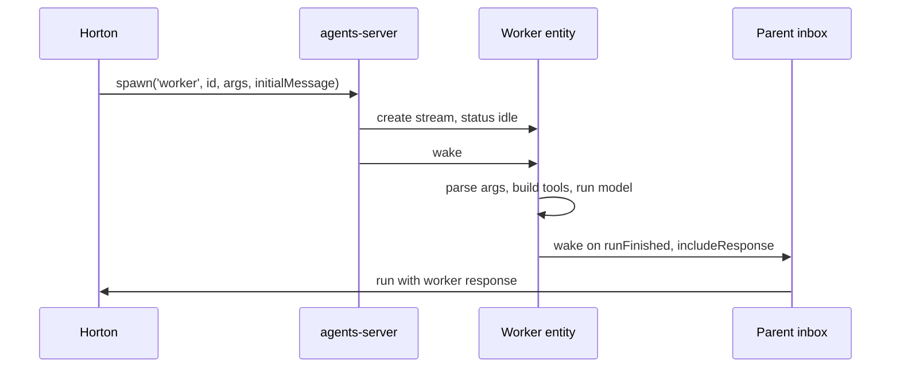
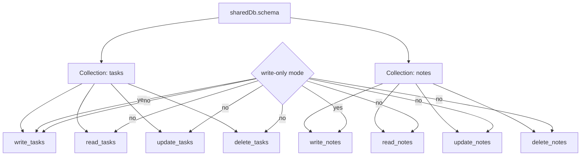

# The worker runtime

A worker is a short-lived subagent. Horton spawns a worker when a task is isolated enough to run in parallel or to run in a narrow context. The worker runs in the parent's sandbox, writes a report, and wakes the parent when it finishes. A sandbox is the environment where the worker's tools run.

The entity type name is `worker`. The implementation lives in `packages/agents/src/agents/worker.ts`.

## The worker lifecycle



The spawn tool sets the wake rule. A wake rule tells the server when to send a wake and what to include. The parent wakes only when the worker's run finishes, and the wake includes the worker's response. The parent inbox is the parent entity's input stream.

## The worker arguments

The worker has no fixed behavior. Its behavior comes from spawn arguments. A shared database is a state collection that the parent and the worker can both read.

```ts
interface WorkerArgs {
  systemPrompt: string
  tools: Array<WorkerToolName>
  sharedDb?: { id: string; schema: SharedStateSchemaMap }
  sharedDbToolMode?: `full` | `write-only`
  model?: string
  provider?: string
  reasoningEffort?: string
}
```

Source: `packages/agents/src/agents/worker.ts:30-38`.

The parser enforces four rules:

1. `systemPrompt` must be a non-empty string.
2. Every tool name must be in the allowed list.
3. `sharedDb.id` must be a non-empty string, and `sharedDb.schema` must be an object.
4. A worker must have at least one tool or a shared database.

```ts
if (tools.length === 0 && !args.sharedDb) {
  throw new Error(`[worker] must provide tools and/or sharedDb`)
}
```

Source: `packages/agents/src/agents/worker.ts:93-95`.

The allowed tools are a fixed set of eight.

```ts
export const WORKER_TOOL_NAMES = [
  `bash`,
  `read`,
  `write`,
  `edit`,
  `web_search`,
  `fetch_url`,
  `spawn_worker`,
  `send`,
] as const
```

Source: `packages/agents/src/tools/spawn-worker.ts:8-17`.

A worker cannot use `fork`, `observe_pg_sync`, or `set_title`. This limit keeps a worker narrow. A worker that needs those tools should be a Horton instead. `spawn_worker` is in the allowed set, so a worker can spawn another worker. The child follows the same rule.

## How Horton spawns a worker

`createSpawnWorkerTool` validates the slug and builds the entity identifier.

```ts
const id = `${normalizedSlug}-${randomBytes(3).toString(`hex`)}`
```

Source: `packages/agents/src/tools/spawn-worker.ts:104`.

The slug is trimmed, lowercased, and reduced to letters, numbers, dots, underscores, and hyphens. Runs of hyphens collapse to one. The slug is cut to 48 characters. Three random bytes add six hexadecimal characters. The result is readable and has a low collision risk. A collision is possible but unlikely.

The spawn call passes the sandbox option.

```ts
const handle = await ctx.spawn(
  `worker`,
  id,
  { systemPrompt, tools, ...workerModelArgs },
  {
    initialMessage,
    wake: { on: `runFinished`, includeResponse: true },
    sandbox: `inherit`,
  }
)
```

Source: `packages/agents/src/tools/spawn-worker.ts:115-126`.

Three options are important.

- `initialMessage` starts the worker immediately. Without it, the worker idles after spawn.
- `wake: { on: 'runFinished', includeResponse: true }` makes the parent wake with the worker's answer.
- `sandbox: 'inherit'` gives the worker the parent's filesystem. When the parent has no shareable sandbox, this option does nothing. The worker then uses the runtime's normal sandbox resolution.

The tool returns a message that tells Horton to end its turn.

```ts
text: `Worker dispatched at ${workerUrl}. End your turn — when you next wake, the wake message will tell you the worker has finished and include its response.`
```

Source: `packages/agents/src/tools/spawn-worker.ts:133`.

## The worker handler

The handler reads the arguments, resolves the model, builds the tools, and runs the model loop.

```ts
const args = parseWorkerArgs(ctx.args)
const modelConfig = resolveBuiltinModelConfig(
  modelCatalog,
  args as unknown as Readonly<Record<string, unknown>>
)
const builtinTools = buildToolsForWorker(args.tools, ctx.sandbox, ctx, {
  modelCatalog,
  modelConfig,
})
```

Source: `packages/agents/src/agents/worker.ts:320-331`.

The sandbox comes from `ctx.sandbox`. The runtime sandbox pool is the runtime's cache of live sandbox instances. It creates the sandbox and disposes it. Repeated wakes for the same worker reuse the same instance until the idle time-to-live evicts it. The idle time-to-live is the same value that the bootstrap calls `idleTimeout`.

The handler appends a fixed footer to the system prompt.

```ts
const WORKER_PROMPT_FOOTER = `

# Reporting back
When you finish, respond with a concise report covering what was done and any key findings. The caller will relay this to the user, so it only needs the essentials.`
```

Source: `packages/agents/src/agents/worker.ts:163-166`.

## Shared state

A set of workers can share one database. The parent passes `sharedDb` with an identifier and a schema map. The schema map is a record from collection name to collection schema.

```ts
const shared = (await ctx.observe(
  db(args.sharedDb.id, args.sharedDb.schema)
)) as SharedStateHandle<SharedStateSchemaMap>
sharedStateTools.push(
  ...buildSharedStateTools(
    shared,
    args.sharedDb.schema,
    args.sharedDbToolMode ?? `full`
  )
)
```

Source: `packages/agents/src/agents/worker.ts:334-345`.

Each collection in the schema produces up to four tools:

| Tool | Parameters | Operation |
|------|------------|-----------|
| `write_<collection>` | `data` | Insert one entry |
| `read_<collection>` | none | Read all entries |
| `update_<collection>` | `key`, `data` | Merge fields into one entry |
| `delete_<collection>` | `key` | Delete one entry |

The `key` identifies one entry in the collection.



When `sharedDbToolMode` is `write-only`, the builder adds only `write_<collection>`. This mode fits a map-reduce pattern: many workers write, and the parent reads.

Key insight: the shared database is not a message queue. It is an observed collection. An observed collection is a state collection that the runtime keeps in sync and exposes through `ctx.observe`. Every participant reads the same state through the runtime state layer. The tools are thin wrappers over insert, update, and delete.

## Worker versus Horton

| Property | Horton | Worker |
|----------|--------|--------|
| Purpose | Long conversation | One isolated task |
| System prompt | Assembled by the package | Supplied at spawn |
| Tool set | Fixed full set | At most eight tools, chosen from the fixed set |
| Goal support | Yes | No |
| Title generation | Yes | No |
| Slash commands | Yes | No |
| Context sources | Docs, skills, conversation, AGENTS.md | Conversation only |
| Sandbox | Its own | Inherits the parent when shareable |
| Wake the caller | On demand with `send` | On run finish |

The difference is not a permission level. It is a design choice. A worker has no memory of the larger conversation. It receives a brief and returns a report.

## Aha: the worker type is a lease on the parent's resources

The worker does not get a separate sandbox by default. The spawn path asks for the parent's sandbox. This means the worker sees the same files and the same working directory as Horton. A worker can edit a file that Horton then reads.

Key insight: this makes the worker a concurrency tool, not an isolation tool. If you need isolation, spawn a Horton with its own working directory. If you need parallel work on one codebase, spawn workers.

## Related documents

- [02-horton.md](02-horton.md) for the parent that spawns workers.
- [04-tools-and-sandboxes.md](04-tools-and-sandboxes.md) for sandbox inheritance.
- [01-built-in-runtimes.md](01-built-in-runtimes.md) for the runtime that registers this type.
- [README.md](README.md) for the package index.
