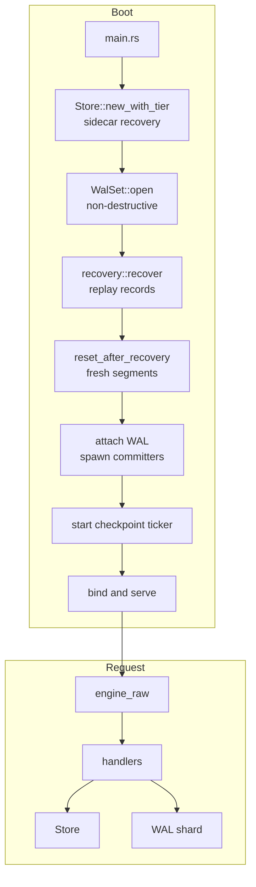
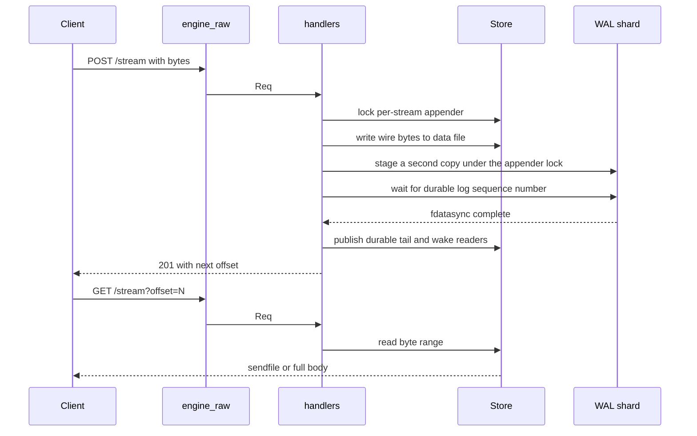

# Overview

`durable-streams-rust` is a single-binary server for the Durable Streams protocol. This study covers the server, not the protocol definition. The protocol study is [durable-streams](../durable-streams/README.md). It keeps each stream's own encoded bytes in one contiguous data file and one small metadata sidecar. That is the whole layout for a root stream with tiering off. A fork also reads its parent below its fork point, and the optional cold tier moves a sealed prefix into separate chunk files. The file holds the stream's encoded bytes: the posted bytes for a binary stream, and each JSON value plus a comma for a JavaScript Object Notation (JSON) stream. In the default `wal` mode, each append is written to the data file and also to a record in a sharded write-ahead log (WAL). The WAL `fdatasync` is the durability point, and the reader sees the bytes only after that point. The alternative `memory` mode has no WAL and no local crash guarantee.

The package has one central rule: **in `wal` mode, durability comes before visibility, and visibility comes before the acknowledgement.** The writer tail can run ahead of the durable tail. A reader observes only the durable tail (`src/store.rs:48-85`). The append handler waits for the WAL barrier before it publishes the new durable tail and returns a success status (`src/handlers.rs:1214-1225`). A crash cannot roll back a byte that a reader has already seen.

## Package facts

Sizes use binary units: one kibibyte (KiB) is 1,024 bytes, one mebibyte (MiB) is 1,048,576 bytes, and one gibibyte (GiB) is 1,073,741,824 bytes.

| Fact | Value | Citation |
|------|-------|----------|
| Rust crate name | `durable-streams` | `Cargo.toml:2` |
| Crate version | `0.1.0` | `Cargo.toml:3` |
| npm wrapper version | `0.1.5` | `package.json:3` |
| Binary name | `durable-streams-server` | `Cargo.toml:16-18` |
| Language edition | Rust 2021 | `Cargo.toml:4` |
| Minimum Rust version | 1.75 | `Cargo.toml:8` |
| Licence | Apache-2.0 | `Cargo.toml:6` |
| Default address | `127.0.0.1:4437` | `src/main.rs:116-117` |
| Default data directory | system temporary directory | `src/main.rs:118` |
| Default durability mode | `wal` | `src/handlers.rs:41-49` |
| Default WAL shard count | the `--worker-threads` value on the first boot, which defaults to available parallelism (normally the number of central processing unit (CPU) cores) | `src/main.rs:335-337` |
| WAL segment size | 128 MiB | `src/wal/segment.rs:20-22` |
| Cold-tier segment size | 8 MiB | `src/tier.rs:33-35` |
| Default long-poll timeout | 30,000 milliseconds | `src/handlers.rs:32` |
| Maximum request body | 1 GiB | `src/api.rs:65-67` |
| Maximum request head | 64 KiB | `src/http1.rs:11` |
| Maximum concurrent connections | 65,536 | `src/engine_raw.rs:79` |
| Default cold-tier mode | off | `src/main.rs:167-177` |

The 1 GiB body limit is a parser limit, not a WAL limit. A single WAL record must fit inside one 128 MiB segment, so a `wal`-mode append above roughly 128 MiB returns an error (`src/wal/shard.rs:639-646`).

The default build enables no optional feature. OpenTelemetry export and Amazon Simple Storage Service (S3)-compatible object storage are separate Cargo features (`Cargo.toml:57-71`). A default build does not compile their dependencies.

## The problem

A normal web application writes a message to a broker or a database. The broker stores the message in its own format. A reader asks the broker for the message, and the broker encodes it for the network. This design has three costs: a storage encode, a storage decode, and a network encode.

This server removes all three for a binary stream. It stores the network bytes and no per-message header (`src/store.rs:1-8`). For a binary stream, the file holds the posted bytes. For a JSON stream, the file holds each encoded JSON value followed by a comma. A single JSON value is stored without a second serialization. An array body is split into its element values, so an array is not stored as one value (`src/handlers.rs:639-670`). A read is then a byte range of the file. The response for a JSON range adds `[` and `]` around the range and drops the final comma (`src/handlers.rs:1331-1353`).

## The components

HTTP means Hypertext Transfer Protocol.

| Layer | Module | Role |
|-------|--------|------|
| Entry point | `src/main.rs` | Parses flags, opens the store, runs recovery, starts the server |
| HTTP engine | `src/engine_raw.rs` | Accepts connections, owns the socket, chooses the read strategy |
| HTTP wire logic | `src/http1.rs` | Parses the request head, writes the response head and chunk frames |
| Request types | `src/api.rs` | Defines `Req`, `Resp`, `Body`, methods, and status reasons |
| Protocol handlers | `src/handlers.rs` | Implements create, append, read, head, and delete |
| Stream store | `src/store.rs` | Holds stream state, data files, sidecars, and file recovery |
| Write-ahead log | `src/wal/` | Stages records, groups commits, checkpoints, and replays |
| Cold tier | `src/tier.rs`, `src/blobstore.rs` | Seals segments, uploads them, and resolves cold reads |
| Live fan-out | `src/sse_reactor.rs` | Serves many Server-Sent Events (SSE) subscribers on Linux |
| Observability | `src/telemetry.rs`, `src/srvstats.rs` | Exports traces and metrics, or prints a load line |



**Citation scope.** A citation such as `src/handlers.rs:248-282` or `ARCHITECTURE.md:122-128` points inside the source package at `/Users/darkvoid/GitSources/src.Electric/electric/packages/durable-streams-rust`. It does not point inside this exploration directory. A path that starts with `../` points to another study.

The boot order is load-bearing. The sidecar pass runs first because it owns stream identity. The WAL replay runs second because it needs the recovered streams. The WAL reset runs third because it must not erase records before replay. The committers start last because no append may run before the WAL is clean (`src/main.rs:371-396`).

## The two durability modes

| Mode | Acknowledgement point | WAL | Local crash safety |
|------|-----------------------|-----|--------------------|
| `wal` | after the shard `fdatasync` | yes | yes |
| `memory` | after the page-cache write | no | no |

`wal` is the default (`src/handlers.rs:41-49`). `memory` is for benchmarking or for a deployment where another system copies each acknowledged write to a second machine. Memory mode refuses to start over a data directory that holds a WAL from an earlier `wal` run. It would ignore those records and could lose data. The check does not parse a record. It reads the first 16 bytes of each segment, and any non-zero byte inside that window proves that the segment came from a `wal` run (`src/main.rs:38-82`, `src/main.rs:298-322`).

## Storage terms

These terms appear in all four documents. The line citations point to the defining code.

| Term | Meaning |
|------|---------|
| Stream | One append-only byte sequence with one data file and one sidecar. |
| Offset | A logical byte position in the stream. It is not always the physical file position. |
| `tail` | The writer end: the logical offset after the newest page-cache write (`src/store.rs:48-85`). |
| `durable_tail` | The reader end: the highest offset whose bytes are durable. Readers never pass it (`src/store.rs:48-85`). |
| `base_offset` | The logical offset where this stream's own history starts: 0 for a root stream, the fork point for a fork (`src/store.rs:280-282`). |
| `sealed_offset` | The end of the contiguous prefix that the cold tier owns. It never passes `durable_tail` (`src/tier.rs:80-83`, `src/tier.rs:522-533`). |
| `file_base` | The logical offset of the first byte in the live data file. Compaction can raise it (`src/store.rs:62-72`). |
| Page cache | Kernel memory that holds file writes until the kernel flushes them to disk. A write to it is not durable. |
| Compaction | A rewrite of the live data file that drops the sealed prefix and raises `file_base`. The cold tier keeps that prefix (`src/tier.rs:33-41`). |
| Sealed-segment manifest | The per-stream list of cold-tier segments and their locations, stored in the sidecar (`src/tier.rs:74-80`). |
| Resident tail cache | An optional in-memory copy of the newest append chunk (`StreamState.last_chunk`), sized by `--tail-cache-bytes`. It is not a cold-tier chunk file (`src/store.rs:315-325`, `src/store.rs:419-434`). |
| Committer | The dedicated thread, one per shard, that `fdatasync`s group commits (`src/wal/walset.rs:169-177`, `src/wal/shard.rs:1552-1560`). |
| WAL | Write-ahead log. A sharded, append-only log of records that carries the second copy of each append. |
| Log sequence number (LSN) | A number that orders records inside one WAL shard. |
| WAL segment | A file of up to 128 MiB in one shard's directory (`src/wal/segment.rs:20-22`). |
| Cold-tier segment | An 8 MiB sealed range of one stream, stored locally or in an object store (`src/tier.rs:33-35`). |
| Checkpoint | The pass that syncs data files, persists durable tails, and recycles WAL segments. |
| Recycle floor | The durable LSN at the start of a checkpoint. Segments fully below it can be unlinked. |
| Sidecar | The `.meta` JSON file that holds stream configuration, the sealed manifest, and a durable-tail proof. |
| Lane | One data-file directory. `--stream-lanes` sets the count. |
| Shard | One WAL log with one committer thread. `--wal-shards` sets the count. |
| Group commit | One `fdatasync` that covers many records staged by many streams on one shard. |
| Watermark | The highest LSN below which every record on a shard is durable. The committer publishes only a contiguous watermark (`src/wal/shard.rs:1445-1474`). |
| Torn record | A record whose header checksum fails, whose kind byte is unknown, or whose payload is incomplete or fails its checksum. An incomplete header or an all-zero header is the clean end of the log, not a torn record (`src/wal/codec.rs:81-102`, `src/wal/codec.rs:190-238`). |

## Request flow

A request passes through five stages:

1. The engine reads the head and body, and enforces the size limits (`src/http1.rs:11-14`, `src/api.rs:65-67`).
2. The dispatcher selects a handler by method (`src/handlers.rs:265-282`).
3. The handler resolves the stream in a concurrent hash map (`src/store.rs:476-477`, `src/store.rs:959`).
4. The store or the WAL performs the operation.
5. The engine writes a full body, a file range, or a chunked channel (`ARCHITECTURE.md:122-128`).



## Key insight

**Aha:** the durable tail is a separate number from the file length, and that separation is the crash-safety proof. The data file can contain bytes that no reader may see yet. The writer advances `Shared.tail` as soon as the bytes reach the page cache. The reader sees `Shared.durable_tail`, which advances only after the WAL `fdatasync` for the record (`src/store.rs:48-61`, `src/handlers.rs:749-770`, `src/handlers.rs:781-802`). The wait sits in its own function so it can run after the appender lock is released (`src/handlers.rs:733-741`):

```rust
/// Wait until `lsn` is durable (the WAL `fdatasync` has covered it). Runs OFF the
/// appender lock — only the LSN reservation (`stage_for_durability`) needs the
/// lock; the fsync wait must not serialize same-stream appenders.
async fn wait_durable_lsn(store: &Arc<Store>, st: &Arc<StreamState>, lsn: u64) {
    let wal = store.wal.get().expect("WAL must be attached before serving");
    let shard = wal.shard_for(st.id);
    shard.wait_durable(lsn).await;
}
```

Recovery takes the maximum of three proofs: the sidecar durable tail, the shard `tails` map, and the end of each replayed record. It then reconciles the file to that maximum: it truncates a longer file and accepts the replay extension of a shorter one (`src/wal/recovery.rs:162-173`, `src/wal/recovery.rs:235-294`). If the server published the file length instead, a reader could observe a byte that a crash would erase.

## Limits of this document

This overview names the components and the invariant. It does not prove the write path, the read path, or the recovery algorithm. Document [01-architecture.md](01-architecture.md) follows an append and a read through the code. Document [02-storage-wal-and-recovery.md](02-storage-wal-and-recovery.md) gives the on-disk format and the recovery proof. Document [03-conformance-benchmarks-and-operations.md](03-conformance-benchmarks-and-operations.md) gives the test and performance evidence.

## Related documents

- [README.md](README.md) is the package index.
- [01-architecture.md](01-architecture.md) covers the request paths and the HTTP engine.
- [02-storage-wal-and-recovery.md](02-storage-wal-and-recovery.md) covers storage, the WAL, and crash recovery.
- [03-conformance-benchmarks-and-operations.md](03-conformance-benchmarks-and-operations.md) covers tests, benchmarks, and operations.
- [../durable-streams/01-protocol-stream-model.md](../durable-streams/01-protocol-stream-model.md) defines the protocol stream model.
- [../durable-streams/08-server-implementations.md](../durable-streams/08-server-implementations.md) compares the server implementations.
