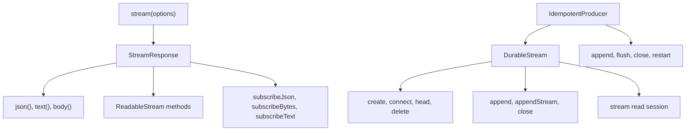
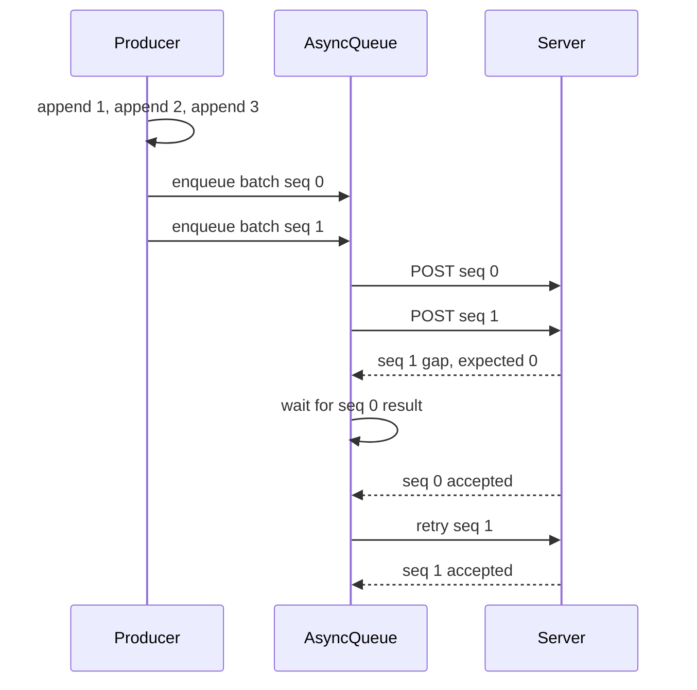

# TypeScript Client

This document studies `packages/client`. The package is the reference client. It defines the behavior that the other language clients copy.

The package gives three application programming interfaces (APIs):

1. `stream()` is a read-only function with a shape like `fetch`.
2. `DurableStream` is a handle for create, read, write, delete, and close.
3. `IdempotentProducer` is a writer with batching and idempotent retries. Within one producer epoch the server suppresses a duplicate sequence. Across a crash that loses producer state, the guarantee becomes at least once, not exactly once.

Document [09-language-clients.md](09-language-clients.md) compares this client with the nine other language clients.



## The three APIs

| API | Direction | Main use |
|-----|-----------|----------|
| `stream()` | Read | Consume a stream with catch-up and live modes |
| `DurableStream` | Read and write | Simple writes, metadata, stream control |
| `IdempotentProducer` | Write | High-throughput writes that survive a retry |

Aha: the package separates the read API from the handle. A read-only consumer imports `stream()` and never constructs a `DurableStream`. A writer constructs a handle. This split keeps the common consumer path small.

## `stream()`: the read API

The function takes one options object and returns a `StreamResponse`.

```ts
export async function stream<TJson = unknown>(
  options: StreamOptions
): Promise<StreamResponse<TJson>> {
  if (!options.url) {
    throw new DurableStreamError(
      `Invalid stream options: missing required url parameter`,
      `BAD_REQUEST`
    )
  }
```

This block is from `packages/client/src/stream-api.ts:60`.

The first network request is a normal catch-up `GET`. The client does not add `live` to the first request.

```ts
if (upToDate && !resumingFromPause) {
  if (live === true || live === `long-poll`) {
    nextUrl.searchParams.set(LIVE_QUERY_PARAM, `long-poll`)
  }
}
```

This block is from `packages/client/src/stream-api.ts:221`.

The rule has a performance reason. A catch-up request without `live` is cacheable by a browser or a Content Delivery Network (CDN). A live request is not. The client catches up from the cache first, then switches to live mode at the tail.

### Live mode selection

The `live` option has four values:

| Value | Behavior |
|-------|----------|
| `false` | Catch-up only; stop at the first `upToDate` |
| `true` | Auto-select; the default |
| `"long-poll"` | Use long-poll only |
| `"sse"` | Use Server-Sent Events (SSE) only |

The type comment says that auto-select uses SSE for JavaScript Object Notation (JSON) and long-poll for binary data (`packages/client/src/types.ts:65`). The comment gives the rule but not the reason. A text stream needs no base64 in SSE. A binary stream would pay the base64 size increase, so long-poll avoids that cost.

### Offsets

The starting offset comes from the `offset` option. The default is `-1`, the sentinel for the start of the stream. The `now` sentinel asks for the tail. Both sentinels go into the `offset` query parameter as text; the client does not convert them to a position.

Each response carries a new offset in the `Stream-Next-Offset` header. The response object exposes it:

```ts
get offset(): Offset {
  return this.#syncState.offset
}
```

This block is from `packages/client/src/response.ts:313`.

The client also exposes `cursor`, `upToDate`, `isLoading`, and `streamClosed`. These getters read one state object. The state machine updates the object after each response and each control event.

A reader must store the offset after it processes a batch. The stored offset is the resume point. The client cannot store it for the caller, because only the caller knows when processing is complete.

### Consumption methods

A `StreamResponse` has three families of methods.

| Family | Methods | Behavior |
|--------|---------|----------|
| Promise | `body()`, `json()`, `text()` | Accumulate until the first `upToDate` |
| Stream | `bodyStream()`, `jsonStream()`, `textStream()` | Return a `ReadableStream` |
| Subscriber | `subscribeJson()`, `subscribeBytes()`, `subscribeText()` | Call a function for each batch |

A response object has a single-use rule. Once a caller starts one consumption method, it must not start another. The method `#ensureNoConsumption` enforces the rule.

### `JsonBatch`

A JSON subscriber receives a `JsonBatch` object.

```ts
export interface JsonBatch<T = unknown> extends JsonBatchMeta {
  /**
   * The parsed JSON items in this batch.
   */
  items: ReadonlyArray<T>
}
```

This block is from `packages/client/src/types.ts:242`.

The metadata part has four fields:

| Field | Meaning |
|-------|---------|
| `offset` | Last `Stream-Next-Offset` in this batch |
| `upToDate` | The batch ends at the current tail |
| `cursor` | Last cursor value, when present |
| `streamClosed` | This batch holds the final data |

The type is at `packages/client/src/types.ts:216`.

The subscribe callback can be async. The reader waits for the promise before it reads the next batch. This gives backpressure: a slow consumer holds the read position and does not build an unlimited buffer.

```ts
await subscriber({
  items,
  offset,
  cursor,
  upToDate,
  streamClosed,
})
```

This block is from `packages/client/src/response.ts:1177`.

Aha: the batch metadata is the checkpoint. `items`, `offset`, and `upToDate` arrive in one object. A consumer can process the items and save the offset in one step. It cannot see items without the matching offset. This design removes a common class of resume bugs.

## `DurableStream`: the handle

The constructor does no network input or output (IO). It only validates the options and builds the fetch wrapper.

```ts
constructor(opts: DurableStreamOptions) {
  validateOptions(opts)
  const urlStr = opts.url instanceof URL ? opts.url.toString() : opts.url
  this.url = urlStr
  this.#options = { ...opts, url: urlStr }
```

This block is from `packages/client/src/stream.ts:159`.

A cold handle is a useful object. A caller can pass it through an application before the stream exists. The first network call happens on `create`, `connect`, `head`, `append`, or a read.

### Static helpers

| Method | Network call | Result |
|--------|--------------|--------|
| `DurableStream.create(opts)` | `PUT` | New handle; fails on `409` if the stream exists |
| `DurableStream.connect(opts)` | `HEAD` | Handle with metadata; fails on `404` |
| `DurableStream.head(opts)` | `HEAD` | `HeadResult` only |
| `DurableStream.delete(opts)` | `DELETE` | No handle |

`create` is create-only. A caller that wants "create or use" must handle the `CONFLICT_EXISTS` error code.

### Append

The simple append accepts text, bytes, or a promise of either.

```ts
async append(
  body: Uint8Array | string | Promise<Uint8Array | string>,
  opts?: AppendOptions
): Promise<void> {
  const resolvedBody = isPromiseLike(body) ? await body : body
  if (this.#batchingEnabled && this.#queue) {
    return this.#appendWithBatching(resolvedBody, opts)
  }
  return this.#appendDirect(resolvedBody, opts)
}
```

This block is from `packages/client/src/stream.ts:476`.

Batching is on by default. The handle buffers a message and sends it in a group. A caller can disable it with `batching: false`; each append then becomes one request, which costs more network round trips but makes the exact request timing visible. The producer below has a separate batching layer. It bypasses the handle queue and sends its own batch with producer headers (`packages/client/src/idempotent-producer.ts:745`). When a caller uses the producer, the producer owns batching.

For a JSON stream, the client wraps the body in an array:

```ts
const isJson = normalizeContentType(contentType) === `application/json`
let encodedBody: BodyInit
if (isJson) {
  const bodyStr =
    typeof body === `string` ? body : new TextDecoder().decode(body)
  encodedBody = `[${bodyStr}]`
}
```

This block is from `packages/client/src/stream.ts:510`.

The array matters. The client wraps every JSON append body in one array, and the server flattens exactly that outer level. An append of `{"a":1}` becomes `[{"a":1}]` on the network and one stored message. An append of `[{"a":1},{"b":2}]` becomes `[[{"a":1},{"b":2}]]` on the network. The server stores one message whose value is the inner array. To store two messages, append the two objects one at a time, or use the producer batch path. Document [01-protocol-stream-model.md](01-protocol-stream-model.md) gives the flattening table.

A caller must pre-serialize an object. The simple handle does not call `JSON.stringify` on an object. That job belongs to the caller or to the producer.

### Streaming append

`appendStream()` sends a `ReadableStream` or an async iterable. The client passes the stream as the request body with `duplex: "half"`; the fetch implementation adds `Transfer-Encoding: chunked` (`packages/client/src/stream.ts:767`). This path is for a large body that the caller cannot hold in memory.

### Close and delete

`close()` sends `POST` with `Stream-Closed: true`. It can also append a final body in the same call. `delete()` sends `DELETE`.

## `IdempotentProducer`

The producer is the recommended write path. It adds four features to the handle:

1. A producer identifier and epoch. The epoch is a generation number that a new writer increments; the server fences a writer that sends an older epoch.
2. A sequence number per batch.
3. Automatic batching.
4. Pipelining.

```ts
const epoch = opts?.epoch ?? 0
const maxBatchBytes = opts?.maxBatchBytes ?? 1024 * 1024 // 1MB
const maxInFlight = opts?.maxInFlight ?? 5
const lingerMs = opts?.lingerMs ?? 5
```

This block is from `packages/client/src/idempotent-producer.ts:183`.

| Option | Default | Meaning |
|--------|---------|---------|
| `epoch` | 0 | Producer generation |
| `maxBatchBytes` | 1,048,576 | Maximum batch size |
| `maxInFlight` | 5 | Concurrent batch limit |
| `lingerMs` | 5 | Wait time before a batch is sent |
| `autoClaim` | false | Recover from a stale epoch |
| `onError` | none | Error callback |
| `fetch` | global `fetch` | Custom transport |

### Fire-and-forget append

`append()` returns immediately. It adds the message to the pending batch.

```ts
this.#pendingBatch.push({ body: bytes })
this.#batchBytes += bytes.length
if (this.#batchBytes >= this.#maxBatchBytes) {
  this.#enqueuePendingBatch()
} else if (!this.#lingerTimeout) {
  this.#lingerTimeout = setTimeout(() => {
    this.#lingerTimeout = null
    if (this.#pendingBatch.length > 0) {
      this.#enqueuePendingBatch()
    }
  }, this.#lingerMs)
}
```

This block is from `packages/client/src/idempotent-producer.ts:294`.

The code has two send triggers. The size trigger fires when the batch reaches the limit. The time trigger fires after the linger time. The first message starts the timer. A later message does not restart it. This keeps the maximum delay bounded.

A caller must call `flush()` before shutdown. The producer does not hold the process open.

```ts
do {
  await this.#queue.drained()
  await Promise.all(this.#deferredEnqueues)
} while (this.#deferredEnqueues.size > 0 || this.inFlightCount > 0)
```

This block is from `packages/client/src/idempotent-producer.ts:330`.

The loop is necessary. A drained queue can become non-empty again when a deferred enqueue runs.

### Batch body

The producer builds one body for a batch.

```ts
if (isJson) {
  const jsonStrings = batch.map((e) => new TextDecoder().decode(e.body))
  batchedBody = `[${jsonStrings.join(`,`)}]`
} else {
  const totalSize = batch.reduce((sum, e) => sum + e.body.length, 0)
  const concatenated = new Uint8Array(totalSize)
```

This block is from `packages/client/src/idempotent-producer.ts:724-726`.

A JSON batch is one array. The server flattens it into N messages. A byte batch is one concatenated body. The server stores it as one message. This difference is important for a reader. JSON keeps message boundaries. A byte stream has none.

### Pipelining and sequence order

The producer can send up to five batches at the same time. This creates a new problem. The requests can arrive out of order. Batch 2 can reach the server before batch 1.

The server rejects the gap. The producer then coordinates the in-flight batches by sequence number. The `#seqState` map records which sequence numbers have finished. A failed gap waits for the lower sequence to complete, then retries.



The protocol requires the server to serialize validation and append per producer. The client must cooperate with that rule. A client that sends a high sequence first gets a gap, not data loss.

### Auto-claim

A producer with `autoClaim: true` can recover from a stale epoch. The server returns `403 Forbidden` with its current epoch.

```ts
if (response.status === 403) {
  const currentEpochStr = response.headers.get(PRODUCER_EPOCH_HEADER)
  const currentEpoch = currentEpochStr
    ? parseInt(currentEpochStr, 10)
    : this.#epoch
  if (this.#autoClaim) {
    const newEpoch = currentEpoch + 1
    this.#epoch = newEpoch
    this.#nextSeq = 0
    return this.#doClose(finalMessage)
  }
  throw new StaleEpochError(currentEpoch)
}
```

This block is from `packages/client/src/idempotent-producer.ts:465`. It is from the close path. The append path has the same 403 handling at `packages/client/src/idempotent-producer.ts:764`.

Without auto-claim, the producer throws `StaleEpochError`. The application must decide. A new process should use a new epoch. A restarted producer should call `restart()`, which flushes, increments the epoch, and resets the sequence.

Aha: auto-claim removes the operator step from a stale-epoch recovery. It does not guarantee one writer. Two producers with the same identifier and `autoClaim: true` can keep raising the epoch against each other. Each request from a stale epoch is fenced, but both writers can still append during their own current windows. Use auto-claim when one active producer is expected, and use an explicit epoch when the application needs a strict owner.

## Offset handling across the client

The client never parses an offset. It stores the string and sends it back. Three places use the value:

1. The `offset` option sets the first read position.
2. The `Stream-Next-Offset` header sets the next position.
3. The `JsonBatch.offset` field gives the caller a checkpoint.

A caller should persist the checkpoint only after the batch is processed. If the process crashes after the save but before the work, the work repeats. If it crashes after the work but before the save, the batch repeats. The protocol cannot decide this for the caller. The work must be idempotent, or the save and the work must share a transaction.

## Errors

The client uses `DurableStreamError` with a text code. The codes include:

| Code | Cause |
|------|-------|
| `BAD_REQUEST` | Invalid option or invalid body type |
| `CONFLICT_EXISTS` | Create found an existing stream |
| `PARSE_ERROR` | JSON parse failure |
| `ALREADY_CLOSED` | Append after close |
| `STALE_EPOCH` | Producer epoch is behind the server |
| `UNKNOWN` | Unclassified failure |

`FetchError` carries the Hypertext Transfer Protocol (HTTP) status and the body. The read path calls `handleErrorResponse` for every non-success response.

## What the client does not do

The read path retries a general network error, a server error (`5xx`), and a rate-limit (`429`) response with exponential backoff; `createFetchWithBackoff` wraps the first request (`packages/client/src/fetch.ts:92`). The producer path is different. It does not add a general retry or backoff for a network error or a `5xx` response (`packages/client/src/idempotent-producer.ts:702`). A caller must add its own retry loop for the producer path.

The client does not compress a request body.

The client does not store an offset on disk.

These limits are deliberate. The package gives the protocol mechanics and leaves the policy to the application.

## Related documents

- [02-protocol-operations.md](02-protocol-operations.md) gives the HTTP operations that the client calls.
- [03-live-reads-and-subscriptions.md](03-live-reads-and-subscriptions.md) explains the live modes and cursors.
- [07-state-protocol.md](07-state-protocol.md) builds a typed state layer on this client.
- [09-language-clients.md](09-language-clients.md) compares this client with other languages.
- [README.md](README.md) is the package index.
