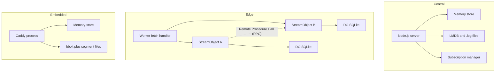
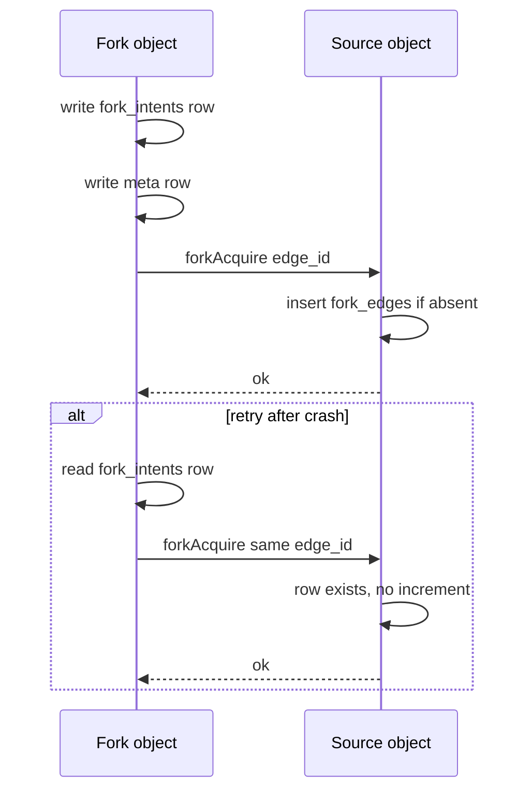
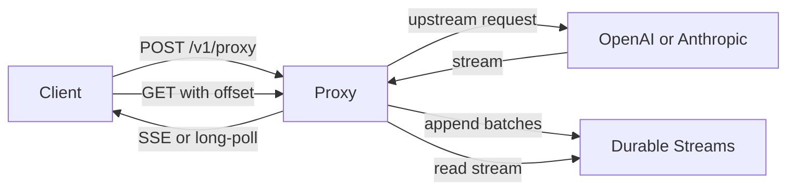

# Server Implementations

The repository has three server implementations. The reference Node.js server is in `packages/server`. This document covers the other two:

- `packages/server-cloudflare` runs on Cloudflare Workers and Durable Objects (DO).
- `packages/caddy-plugin` runs as a Caddy v2 plugin in Go.

The repository also has `packages/proxy`. It is not a general Durable Streams server. It is a durable relay for artificial intelligence (AI) streaming application programming interfaces (APIs).

This document also states a scope correction. The assignment list named a "Rust server". No Rust server exists in this repository. The only Rust package is `packages/client-rust`, a client library. Document [09-language-clients.md](09-language-clients.md) covers it.

## Comparison

| Property | Node.js reference | Cloudflare | Caddy plugin |
|----------|-------------------|------------|--------------|
| Language | TypeScript | TypeScript | Go |
| Process model | One Node.js process | One Durable Object per stream | One Caddy process |
| Metadata store | Memory or Lightning Memory-Mapped Database (LMDB) | Durable Object SQLite | Memory or bbolt (a B+tree key-value store) |
| Data store | Memory or `.log` file | Durable Object SQLite | Memory or segment file |
| Authentication | None | Bearer token or hook | Not stated; Caddy may enforce its own |
| Subscription API | Yes, the full subscription control plane | No; subscription requests return 404 | Partial; webhook routes under different paths |
| Port | 4437 | Worker route | 4437 in dev mode |
| Conformance | Reference | 326 passed | Not stated |

Aha: the offset arithmetic is not a protocol constant. An offset has two parts, `<readSeq>_<byteOffset>`. `readSeq` is a reserved read-sequence field. The Caddy plugin documents it as reserved for future log rotation, which would need a separate offset space. No server in the repository assigns a nonzero value, and none increments it. The reference server keeps it at zero, so the byte offset part is the part that moves.

Node.js and Cloudflare use a 5-byte frame overhead: a 4-byte length plus 1 newline. The Node.js file store names this cost `FRAME_OVERHEAD = 5` (`packages/server/src/file-store.ts:1325`). The Cloudflare store has no byte frames in SQLite, but it keeps the same arithmetic for offset compatibility (`packages/server-cloudflare/src/constants.ts:43` and `src/store.ts:123`). The Caddy plugin uses a 4-byte length prefix and no newline (`packages/caddy-plugin/store/segment.go:25`). The byte offset part therefore advances by different amounts on different servers. This is allowed because the offset is opaque to the client. A client must never compute an offset; it must store and return the string that the server gives it.



## Cloudflare Workers and Durable Objects

`packages/server-cloudflare` is a library. The user mounts it in a Worker. It is not a separate service.

### Mounting

The Worker exports two things: the Durable Object class and a fetch handler.

```ts
import { createStreamsHandler } from "@durable-streams/server-cloudflare"
export { StreamObject } from "@durable-streams/server-cloudflare"
export default {
  fetch: createStreamsHandler(),
}
```

The Wrangler configuration must name the binding `STREAMS`. Wrangler is the Cloudflare Workers command-line tool. A fork is a new stream that inherits the messages of a source stream up to a chosen offset. The fork code uses the `STREAMS` binding for object-to-object RPC. The migration must use `new_sqlite_classes`, the Durable Object migration that creates a SQLite-backed class.

### One object per stream

The handler routes each stream path to one Durable Object instance with `idFromName(streamPath)`.

This mapping is the core design choice. A Durable Object gives three properties that the protocol needs:

1. One event loop per stream, so validation and append cannot interleave.
2. An input gate. An input gate is a Durable Object feature that holds a new incoming event until the object has written earlier output to storage. This delays a new request until the prior output is durable.
3. A storage API with a transaction.

The code does not need a lock for a producer sequence. The object is the lock.

### Constants

The implementation has protocol limits as named constants. In the names below, `TTL` means Time To Live, and `SSE` means Server-Sent Events. In the offset pattern, `-1` is the start-of-stream sentinel and `now` is the tail sentinel.

```ts
const LONG_POLL_TIMEOUT_MS = 2000
const MAX_BODY_BYTES = 1_900_000
const VALID_OFFSET_PATTERN = /^(-1|now|\d+_\d+)$/
const TTL_PATTERN = /^(0|[1-9]\d*)$/
const MAX_READ_BATCH_BYTES: number = 4 * 1024 * 1024
const MAX_SSE_LIFETIME_MS = 60_000
```

This block is from `packages/server-cloudflare/src/stream-object.ts:59`.

| Constant | Value | Reason |
|----------|-------|--------|
| `LONG_POLL_TIMEOUT_MS` | 2,000 milliseconds (ms) | A Durable Object should not hold a request for the reference server default of 30 seconds |
| `MAX_BODY_BYTES` | 1,900,000 | Durable Object SQLite value limit is 2 megabytes (MB) |
| `MAX_READ_BATCH_BYTES` | 4,194,304 | Cap one read response |
| `MAX_SSE_LIFETIME_MS` | 60,000 | Protocol recommendation |

An append above the body cap gets `413 Payload Too Large`.

The 2-second long-poll is a significant difference from the reference server, whose default is 30 seconds. A client that expects the 30-second default reconnects 15 times more often. The protocol allows an implementation-defined timeout, so this is conformant.

### SQLite schema

The object keeps all state in Durable Object SQLite. Six tables hold the protocol state.

```sql
CREATE TABLE IF NOT EXISTS meta (
  id INTEGER PRIMARY KEY CHECK (id = 1),
  gen TEXT NOT NULL,
  content_type TEXT,
  ttl_seconds INTEGER,
  expires_at TEXT,
  closed INTEGER NOT NULL DEFAULT 0,
  closed_by TEXT,
  current_offset TEXT NOT NULL,
  last_seq TEXT,
  created_at INTEGER NOT NULL,
  last_accessed_at INTEGER NOT NULL,
  forked_from TEXT,
  fork_offset TEXT,
  fork_sub_offset INTEGER,
  fork_edge_id TEXT,
  fork_source_gen TEXT,
  soft_deleted INTEGER NOT NULL DEFAULT 0
);
```

This block is from `packages/server-cloudflare/src/store.ts:132`.

| Table | Purpose |
|-------|---------|
| `meta` | One row per stream: configuration, offset, closure, fork link |
| `messages` | Offset key, data blob, time stamp |
| `producers` | Producer epoch (the generation number that fences an older writer) and last sequence number |
| `fork_edges` | One row per fork that references this stream |
| `fork_intents` | Durable intent written before a remote fork call |
| `gc_releases` | Fork release requests that must not be lost |

The `gen` column is a stream generation. A fork records the generation it acquired. A release with an old generation is stale.

The `fork_edges` table uses the row as the reference. An insert-if-absent acquires. A delete-if-present releases. Both operations are retry-safe.

The `fork_intents` table solves a distributed problem. A fork create must increment the count in the source object. If the source call succeeds and the caller crashes before it records success, a retry must not increment again. The intent row gives the retry a stable edge identity.



### Time To Live

A Durable Object can set an alarm. The server uses an alarm to reclaim an expired stream. It also checks expiry on every access. The two paths give an exact result on access and a timely cleanup without a request.

### Subscriptions

The Cloudflare server does not implement the `__ds` subscription control plane. `__ds` is the reserved `/v1/stream/__ds` prefix that holds webhook and pull-wake subscriptions. A request to `__ds` returns `404 Not Found`.

This is a real gap. A client that uses webhook subscriptions cannot move from the Node.js server to the Cloudflare server without a change. The package README states the gap.

### Conformance

The package README reports 326 passed and 0 failed on the server conformance suite. It also states that the pass and fail counts match the reference server. This document cannot check that comparison: the reference server README gives no count. The six skips are the suite's own webhook tests, which are off by default. Because the suite skips them, the 326 figure does not cover subscriptions. The README gives no run date and no suite version.

### Authentication

Authentication is a hook.

```ts
auth?: (
  request: Request,
  env: E
) => Response | undefined | Promise<Response | undefined>
```

This signature is from `packages/server-cloudflare/src/handler.ts:36`.

The default hook checks an `AUTH_TOKEN` secret. If the secret is not set, the server is open. If the secret is set, every request needs `Authorization: Bearer <token>`.

A custom hook can return a `Response` to reject a request. It returns `undefined` to allow the request.

When an auth gate is active, the handler changes the `Cache-Control` header from `public, max-age=60, stale-while-revalidate=300` to `no-store` (`packages/server-cloudflare/src/handler.ts:161`). This rule prevents a shared cache from storing authenticated data.

## The proxy

`packages/proxy` is a different product. It sits between a client and an upstream artificial intelligence service. It stores the upstream response in a durable stream. A client reads the stream with Server-Sent Events or long-poll.



### Why it exists

An inference call is expensive. A dropped connection must not lose the tokens that the model already produced. A client reconnects to the proxy with its offset. The proxy reads the stored stream and continues. The upstream call is not repeated.

### Routes

Two authentication forms appear in the table. A service JWT is a JSON Web Token that a calling service signs for itself. A pre-signed URL carries its own signature in the query string.

| Method | Path | Authentication | Action |
|--------|------|----------------|--------|
| `POST` | `/v1/proxy` | Service JavaScript Object Notation (JSON) Web Token (JWT) | Create a proxy stream |
| `GET` | `/v1/proxy/:id` | Pre-signed Uniform Resource Locator (URL) or JWT | Read with offset and live mode |
| `HEAD` | `/v1/proxy/:id` | Service JWT | Read metadata |
| `PATCH` | `/v1/proxy/:id` | Pre-signed URL | Abort the upstream call |
| `DELETE` | `/v1/proxy/:id` | Service JWT | Delete the stream |
| `GET` | `/health` | None | Health check |

The health route returns `200` with `{"status":"ok"}`. The handler is at `packages/proxy/src/server/proxy-handler.ts:132`.

### Lifecycle signals

The proxy does not append a control message, a message that marks a boundary rather than data. It uses the stream closure as the completion signal. To close, the proxy sends a `POST` with `Stream-Closed: true` to the Durable Streams server:

1. Normal completion: flush the last batch and close the stream with `Stream-Closed: true`.
2. Abort: flush the last batch and leave the stream open. Data before the abort stays readable.
3. Piping error: flush the last batch. The protocol does not specify the closure state after an error.

The rules are in `packages/proxy/PROXY_PROTOCOL.md:441`. The implementation closes on completion and does not close on abort or error (`packages/proxy/src/server/upstream.ts:198`).

### Pre-signed URLs

The create response returns a capability URL.

```ts
const signature = base64urlEncode(
  createHmac(`sha256`, secret).update(`${streamId}:${expiresAt}`).digest()
)
return `${origin}/v1/proxy/${encodeURIComponent(streamId)}?expires=${expiresAt}&signature=${signature}`
```

This block is from `packages/proxy/src/server/tokens.ts:37`.

The signature is a Hash-based Message Authentication Code (HMAC) with Secure Hash Algorithm 256 (SHA-256). The signed text is `streamId:expiresAt`. `base64urlEncode` applies the URL-safe base64 alphabet. The URL grants read and abort access without a token.

A pre-signed URL is a bearer capability. Anyone with the URL can read the stream until it expires. The proxy does not bind the URL to a user.

### Allowlist

The proxy makes an outbound request to a URL from a request header. That is a Server-Side Request Forgery (SSRF) risk. The allowlist limits the targets.

An allowlist pattern uses glob syntax, for example `https://api.openai.com/**`. The validator parses each pattern into component matchers. It rejects a URL that does not match.

An empty allowlist blocks every URL. An allowlist that is not set also becomes an empty list (`packages/proxy/src/server/proxy-handler.ts:62`). This is a fail-closed default.

### Batching

The proxy does not append each upstream chunk. It batches.

```ts
batchSizeThreshold = 4096, // 4KB
batchTimeThreshold = 50, // 50ms
```

This block is from `packages/proxy/src/server/upstream.ts:116`.

A batch goes out when it reaches 4 kilobytes or when 50 milliseconds pass from the first chunk in the batch.

The inactivity timeout is 600,000 milliseconds, or 10 minutes. An upstream call that sends nothing for that period is closed. The upstream connect timeout is 60 seconds.

The 4-kilobyte threshold has a trade-off. A small token takes up to 50 milliseconds to become visible. A larger threshold reduces requests but increases delay. Document [03-live-reads-and-subscriptions.md](03-live-reads-and-subscriptions.md) explains why each append is a wake signal.

### Client adapters

The package has a `./transports` export (`packages/proxy/package.json:48`). It gives two client adapters:

| Adapter | Export | Purpose |
|---------|--------|---------|
| Vercel artificial intelligence (AI) Software Development Kit (SDK) | `createDurableChatTransport`, `wasResumed` | Reconnect a chat transport to the proxy stream |
| TanStack AI | `createDurableAdapter` | Reconnect a TanStack connection to the proxy stream |

The files are `packages/proxy/src/transports/vercel.ts:51` and `packages/proxy/src/transports/tanstack.ts:53`. The adapters hide the reconnect endpoint and the offset from the application.

## The Caddy plugin

`packages/caddy-plugin` is a Go package. It registers a Caddy v2 handler with the name `durable_streams`.

### Configuration

```caddyfile
:4437 {
	route /v1/stream/* {
		durable_streams {
			data_dir ./data
			max_file_handles 100
			long_poll_timeout 30s
			sse_reconnect_interval 60s
			webhook_callback_url https://example.com
		}
	}
}
```

The parser starts at `packages/caddy-plugin/module.go:139` and ends at `:187`. It accepts five subdirectives:

| Subdirective | Default | Effect |
|--------------|---------|--------|
| `data_dir` | empty | File store path; empty selects the memory store |
| `max_file_handles` | 100 | Open file handle cache limit |
| `long_poll_timeout` | 30 seconds | Maximum wait for one long-poll request |
| `sse_reconnect_interval` | 60 seconds | Suggested reconnect interval for SSE |
| `webhook_callback_url` | empty | Base URL that enables the webhook subscription system |

The line numbers for the last three cases are `module.go:157`, `:167`, and `:177`.

When `webhook_callback_url` is set, `Provision` builds a webhook manager and a route table (`module.go:98-108`). `ServeHTTP` checks those routes before it handles a stream request (`packages/caddy-plugin/handler.go:70`). The routes are:

| Route | Method | Action |
|-------|--------|--------|
| `/__ds/jwks.json` | `GET` | Serve the signing keys as a JSON Web Key Set (JWKS) |
| `/callback/{consumer_id}` | `POST` | Receive one webhook delivery for a consumer, an identified subscriber |
| `{stream-path}?subscription={id}` | `PUT` | Create or replace a subscription |
| `{stream-path}?subscription={id}` | `GET` | Read a subscription |
| `{stream-path}?subscription={id}` | `DELETE` | Delete a subscription |
| `{stream-path}?subscriptions` | `GET` | List subscriptions |

The dispatch is at `packages/caddy-plugin/webhook/routes.go:22`. This route shape is different from the Node.js `__ds/subscriptions/:id` API. The Caddy plugin is not a drop-in replacement for the full subscription plane.

The plugin has a zero-config development mode:

```bash
durable-streams-server dev
```

This mode binds to `localhost:4437`, uses the memory store, and needs no Caddyfile.

### Storage discrepancy

The package README says that the file-backed store uses LMDB. The code uses bbolt:

```text
go.etcd.io/bbolt v1.4.3
```

This line is from `packages/caddy-plugin/go.mod:7`.

The storage file is `store/bbolt.go`. The README has three places that say LMDB. This document states the code as the source of truth. The README is wrong.

The difference is not cosmetic. LMDB is a memory-mapped database with a copy-on-write design. bbolt is a B+tree with a single writer transaction. Their performance and crash behaviour differ.

### Crash atomicity limitation

The plugin README states a known limitation. The file store does not commit producer state with the data in one transaction.

1. The server writes the data to a segment file.
2. The server updates the producer state in bbolt.

A crash between step 1 and step 2 leaves stale producer state. The next start can reject a valid sequence with a false `409 Conflict`.

The README judges the impact as low. The likely result is a false gap, a `409 Conflict` that reports a missing sequence when the data is in fact present. Duplicate data is not likely. A client can recover by incrementing its producer epoch. The higher epoch fences the stale epoch, so the server starts a new sequence space and accepts the new sequence. The repository tracks the issue as issue 143.

This limitation is important for a correctness claim. The Node.js file store flushes the data with `fdatasync` before it commits metadata. It leaves a window where the data exists but the metadata is old. On recovery it rebuilds the metadata from the log files, so a message that the log holds is kept even when the old metadata does not name it. The Caddy store leaves a window in the producer state instead. Both are crash windows, but with different visible effects.

### Webhooks

The Go package has a `webhook` directory with a manager, routes, signing code, and a glob matcher. The README does not describe the subscription plane, and this document does not claim full feature parity with the Node.js implementation.

## Which server to choose

| Need | Choice |
|------|--------|
| Local development and tests | Node.js reference server |
| Full protocol with subscriptions | Node.js reference server |
| Global edge deployment | Cloudflare |
| Embedded in an existing Go service | Caddy plugin |
| Resumable artificial intelligence responses | Proxy in front of a Durable Streams server |

The Node.js server is the only one with the complete subscription plane. The Cloudflare server has the strongest isolation model of the three: one Durable Object per stream, with one event loop and one SQLite database per stream. The other two servers share one process and one store across streams. The Caddy plugin is the easiest to embed in a Go deployment, but its file store has a documented producer-state window.

## Related documents

- [04-node-server.md](04-node-server.md) gives the reference implementation.
- [05-storage-and-durability.md](05-storage-and-durability.md) gives the Node.js file format.
- [03-live-reads-and-subscriptions.md](03-live-reads-and-subscriptions.md) gives the subscription plane that only the Node.js server implements.
- [09-language-clients.md](09-language-clients.md) covers `client-rust` and the other clients.
- [README.md](README.md) is the package index.
