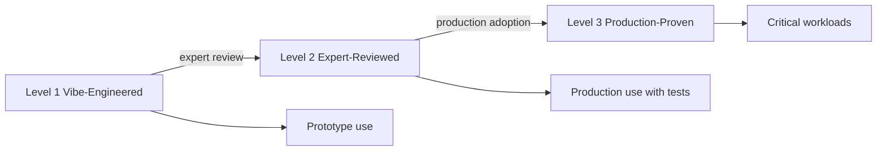
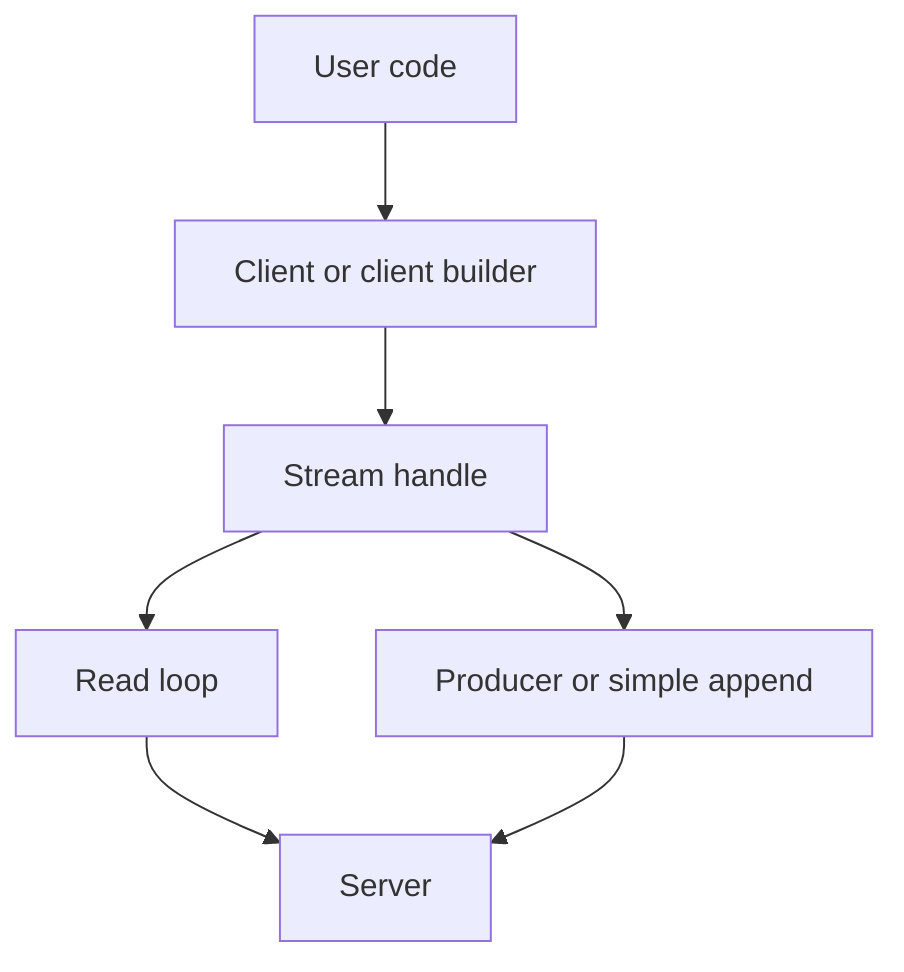

# Language Clients

The repository has ten language clients. The TypeScript client is the reference and gets its own document. This document covers the other nine and the maturity model.

All clients speak the same Hypertext Transfer Protocol (HTTP) protocol. They differ in three ways: the shape of the read loop, the concurrency model, and the maturity level. Every client also reads and writes JavaScript Object Notation (JSON) and offers an application programming interface (API) in its own language style.

## The maturity model

`CLIENT_MATURITY.md` defines three levels.

| Level | Name | Criteria |
|-------|------|----------|
| 1 | Vibe-Engineered | Core operations, conformance suite passes, basic README, published |
| 2 | Expert-Reviewed | Level 1 plus a language expert review, idiomatic API, ecosystem error handling |
| 3 | Production-Proven | Level 2 plus multiple organizations in production, stable versioning, maintenance |



The model is a guide, not a certification. The level measures review and adoption more than protocol breadth. Level 1 still requires a conformance pass, so a Level 1 client is not untested; the higher levels add review and production evidence.

## Status table

`CLIENT_MATURITY.md` lists four clients:

| Client | Level | Package | Conformance | Notes |
|--------|-------|---------|-------------|-------|
| TypeScript | 3 | `@durable-streams/client` | 110/110 | Reference; 1.5+ years at Electric |
| Python | 2 | `durable-streams` | 110/110 | Async and sync APIs |
| Go | 2 | `client-go` module | 110/110 | Google Cloud style; no external dependencies |
| Java | 1 | `durable-streams-java` | To Be Determined (TBD) | Community contribution; conformance not published |

The repository also has packages for C# (.NET), Swift, PHP, Elixir, Rust, and Ruby. `CLIENT_MATURITY.md` puts seven languages in a "Planned Clients" table: those six and Kotlin. That table contradicts the package directories. Section "A discrepancy in the status documents" below gives the details.

The status table has one contradiction. Level 1 requires that the conformance suite passes, but the Java row gives a TBD value. The document does not resolve this. TBD may mean that no run is published, but the source does not say that.

## Common shape

Every client has the same four parts, with local names.



| Part | Job |
|------|-----|
| Client or client builder | Holds the base Uniform Resource Locator (URL), headers, timeouts, and HTTP transport |
| Stream handle | Binds one path and offers create, append, read, close, delete, head |
| Read loop | Returns bytes, text, or JSON items; supports catch-up and live |
| Producer | Batches writes and sends the producer headers: `Producer-Id`, `Producer-Epoch`, and `Producer-Seq` |

The read loop is the largest difference. Some languages use an iterator. Some use an async sequence. Some use a callback.

## Python

- Package: `durable-streams` on the Python Package Index (PyPI), version 0.1.0 (`packages/client-py/pyproject.toml:3`). The workspace manifest `packages/client-py/package.json:4` gives 0.1.3. That file is a Node.js tooling bridge, and its own description says the real package is `pyproject.toml`.
- Module name: `durable_streams`.
- Level: 2, Expert-Reviewed. Conformance: 110/110.

The package has two handle classes: `DurableStream` and `AsyncDurableStream`. It also has a top-level `stream()` and `astream()` function.

```python
from durable_streams import astream

async with astream("https://streams.example.com/my-stream") as res:
    async for chunk in res:  # bytes
        process(chunk)

async with astream("https://streams.example.com/my-stream") as res:
    async for item in res.iter_json():
        print(item)
```

This block is from `packages/client-py/README.md:51`.

The design uses Python context managers. The connection closes when the block ends. The sync form uses a normal iterator. The async form uses `async for`.

The JSON iterator returns decoded objects. The byte iterator returns `bytes`. A caller can pass a decoder to `iter_json`, for example `MyModel.from_dict`, to get typed objects.

## Go

- Module: `github.com/durable-streams/durable-streams/packages/client-go`.
- Go version: 1.21 in `go.mod`.
- Level: 2, Expert-Reviewed. Conformance: 110/110.

The client has no external dependencies. It uses the Go standard library for HTTP and JSON.

The read loop has two forms. The classic form returns a chunk and an error. The second form uses a range iterator. The module declares Go 1.21, but the range form needs Go 1.23 or later to compile. A caller that uses it must build with Go 1.23 or later.

```go
for chunk, err := range stream.Chunks(ctx) {
    if err != nil {
        return err
    }
    process(chunk.Data)
}
```

This block is from `packages/client-go/README.md:74`.

The context is the cancellation mechanism. Every call takes a `context.Context`.

The API style follows the Google Cloud client libraries. The README states that `Client` and `IdempotentProducer` are safe for concurrent use.

## Java

- Group and version: `com.durablestreams`, version 0.1.0.
- Build: Gradle.
- Level: 1, Vibe-Engineered. Conformance: TBD.

The client has a synchronous API and an asynchronous API. The asynchronous methods return `CompletableFuture`, a Java future that completes at a later time.

The read loop uses `JsonIterator<T>`, which implements `AutoCloseable`. A caller can use a for-each loop, and a try-with-resources block closes the stream.

`CLIENT_MATURITY.md` calls the client a community contribution and says that it includes framework adapters. The package in this repository has no framework adapter module; its only extra module is `conformance-adapter`. This document cannot confirm the framework adapters from this repository. The source does not say why the conformance value is TBD.

## C# and .NET

- Package identifier: `DurableStreams`, version 0.0.1 (`packages/client-dotnet/src/DurableStreams/DurableStreams.csproj:11`).
- Workspace entry: `@durable-streams-internal/client-dotnet`, version 0.0.2 (`packages/client-dotnet/package.json:3`). This is a private Node Package Manager (npm) bridge entry, not the .NET package. The two files give different versions.
- Target framework: `net10.0` in the project file. The README states the requirement as .NET 8.0 or later.
- Level: not listed in `CLIENT_MATURITY.md`.
- Conformance claim: all 177 tests pass, per the package README.

The read API returns an async enumerable.

```csharp
await using var response = await stream.StreamAsync(new StreamOptions { ... });
await foreach (var batch in response.ReadJsonBatchesAsync<MyEvent>())
{
    // process batch
}
```

This block is from `packages/client-dotnet/README.md:58`.

The `await using` statement disposes the response. The `await foreach` loop reads batches. The method `ReadAllJsonAsync<T>()` reads the whole catch-up range into a list.

## Swift

- Package: `DurableStreams`, Swift Package Manager, Swift tools version 6.0.
- Level: not listed in `CLIENT_MATURITY.md`.
- Conformance claim: 179/179 tests in the package README.

The client uses Swift concurrency. A read returns an async sequence. A caller writes `for try await item in response.items`. The producer has a batched write path.

The package also builds a `conformance-adapter` target. The shared client conformance suite, written in TypeScript, calls that adapter over a standard protocol. This design lets a non-TypeScript client run the shared suite.

## PHP

- Package: `durable-streams/client` on Composer.
- Level: not listed in `CLIENT_MATURITY.md`.

The PHP client is synchronous. A read returns a generator. A `foreach` loop pulls one chunk or one JSON item at a time.

A generator is a good fit for PHP. It gives lazy reads without a new dependency. The client does not need an event loop.

## Elixir

- Application: `:durable_streams`, a Mix project.
- Level: not listed in `CLIENT_MATURITY.md`.

The client follows Open Telecom Platform (OTP) patterns. It has a supervised consumer and a supervised writer. A process can restart after a failure and continue from a saved offset.

The README avoids the module name `Stream` because Elixir already has a `Stream` module. It uses `DS` as an alias for `DurableStreams.Stream`.

The conformance support is an adapter. The README shows how to run the shared suite against the Elixir client.

## Rust

- Crate: `durable-streams`, version 0.1.0, edition 2021.
- Runtime: Tokio, a Rust asynchronous runtime. HTTP: `reqwest`, a Rust HTTP client.
- Level: not listed. The maturity table puts Rust in the "Planned Clients" list.

The crate has a `Client` and a `ClientBuilder`. Reads use `ReadBuilder` and `ChunkIterator`. Writes use `Producer` and `ProducerBuilder`.

```rust
for i in 0..1000 {
    producer.append_json(&serde_json::json!({
        "event": "user.action",
        "index": i
    }));
}
producer.flush().await?;
producer.close().await?;
```

This block is from `packages/client-rust/README.md:91`.

The producer is fire-and-forget. `flush().await` waits for the in-flight batches. `close().await` ends the producer.

Aha: the Rust package is a client, not a server. The assignment list named a "Rust server" for this document set. The repository has no such package. The crate name `durable-streams` can look like a server name in a package list, but its description says "Rust client for Durable Streams".

## Ruby

- Gem: `durable_streams`.
- Level: not listed in `CLIENT_MATURITY.md`.

The Ruby client is synchronous and enumerable. A read returns an enumerable sequence. The client also supports a "shovel" operator for appends, which matches Ruby's `<<` idiom.

The client accepts a `seq` value on an append. `seq` becomes the `Stream-Seq` header, a writer-provided ordering token. It is not the producer sequence number (`packages/client-rb/lib/durable_streams/types.rb:10`).

## The conformance counts

The repository states several counts:

| Source | Count |
|--------|-------|
| `CLIENT_MATURITY.md` for TypeScript, Python, Go | 110/110 |
| .NET README | 177 |
| Swift README | 179/179 |
| Cloudflare server README | 326 passed |

The counts are not directly comparable.

1. The suite changes over time. The sources give no run date and no suite version, so this document cannot place the counts in order. A count of 110 is not known to be older or newer than a count of 179.
2. A client suite and a server suite have different tests.
3. A client may skip a feature that its language cannot express.
4. A server suite includes fork and producer tests that a client suite does not.

A reader should compare a client with its own suite version, not with a different language.

## A discrepancy in the status documents

`CLIENT_MATURITY.md` has two sections that disagree with the package tree.

The status table lists four clients: TypeScript, Python, Go, and Java.

The "Planned Clients" table lists Rust, C#/.NET, Ruby, PHP, Elixir, Swift, and Kotlin. It gives a priority and a reason for each. It does not say that a package exists.

The repository has a full package for six of those seven languages. Kotlin has no package.

- `packages/client-dotnet`
- `packages/client-swift`
- `packages/client-php`
- `packages/client-elixir`
- `packages/client-rust`
- `packages/client-rb`

At least two of them (C# and Swift) publish a conformance count in their own README. This is strong evidence that they are real implementations, not plans.

This document does not resolve the contradiction. It states both facts. A reader should treat `CLIENT_MATURITY.md` as the review status and the package tree as the implementation status. The two are different questions.

## How to read a client

A new reader can compare any two clients with five questions:

1. Does the client expose a `stream()` function, a handle, or both?
2. Does the read loop return bytes, JSON items, or both?
3. How does the caller stop a read? A context, an abort signal, a disposal, or a close method?
4. Does the client have a producer with batching and epochs? An epoch is the producer generation number that fences an older writer.
5. Which conformance suite version does it pass?

The answers explain most of the source differences. The protocol underneath is the same.

## Related documents

- [06-typescript-client.md](06-typescript-client.md) gives the reference client in detail.
- [02-protocol-operations.md](02-protocol-operations.md) gives the operations that every client calls.
- [10-integrations-and-conformance.md](10-integrations-and-conformance.md) gives the shared test suites.
- [08-server-implementations.md](08-server-implementations.md) gives the servers that these clients talk to.
- [README.md](README.md) is the package index.
