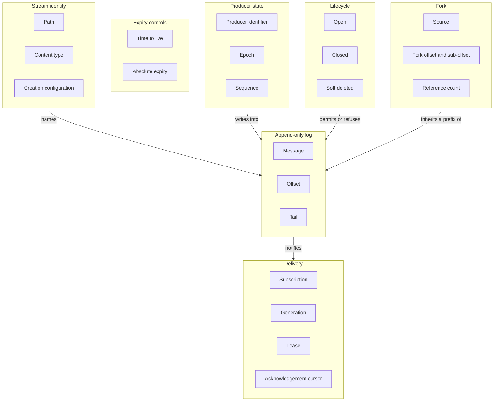
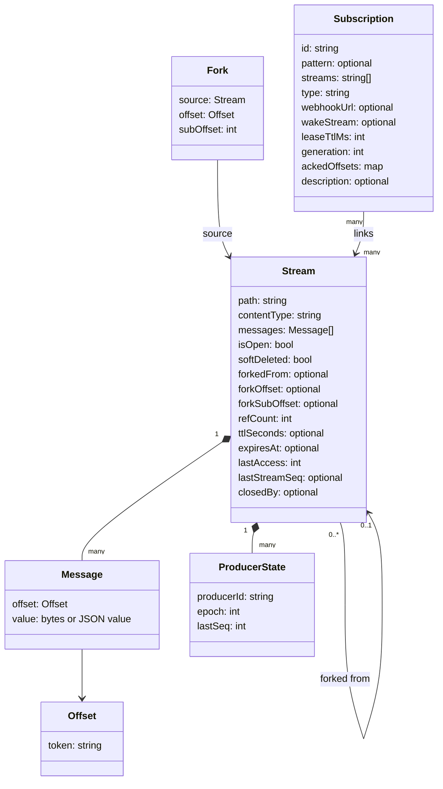
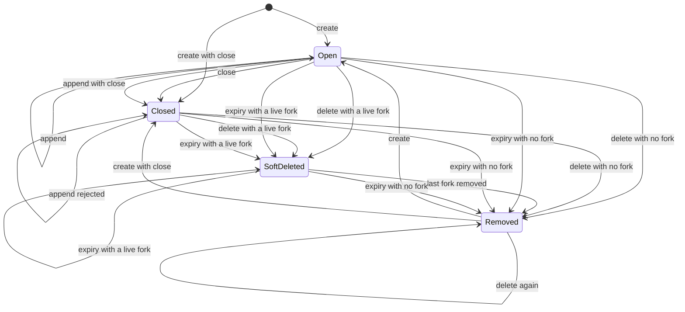
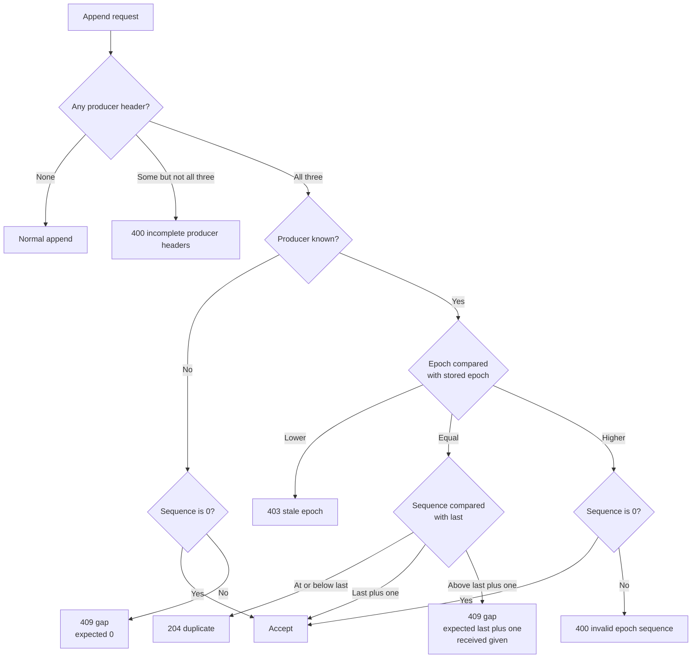
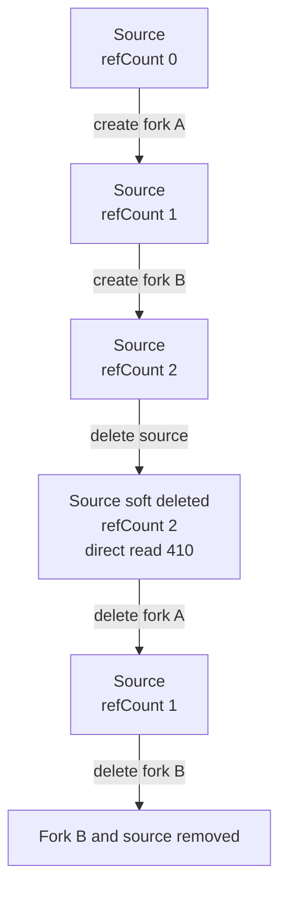
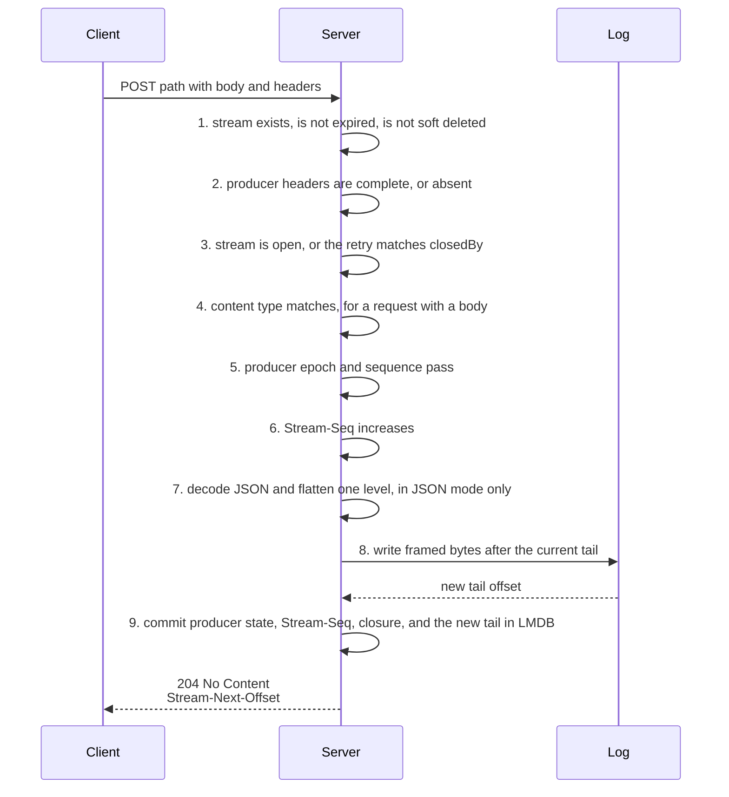
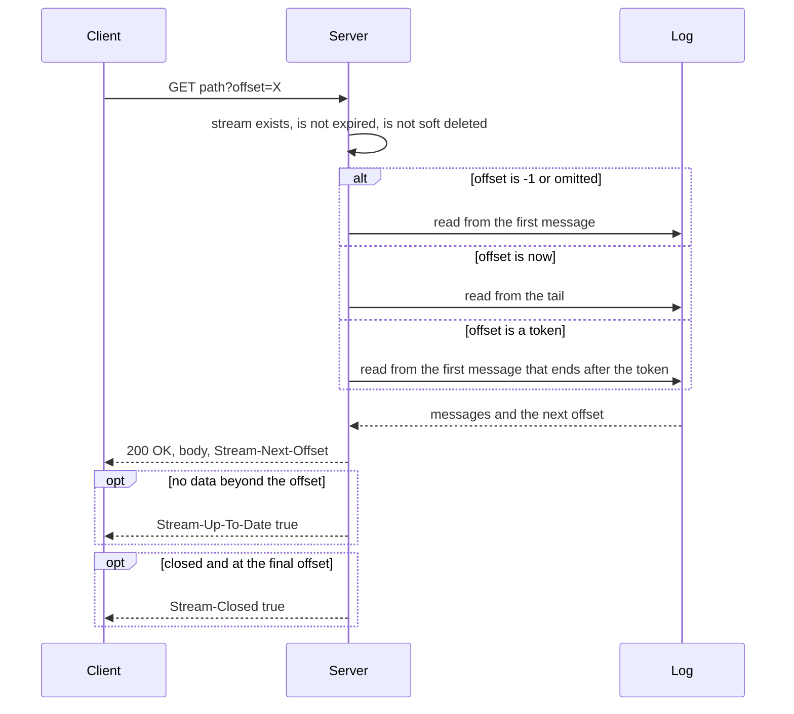

# Laws, entities, and models of durable streams

A durable stream is an append-only byte log with a name. The name is a path. The bytes never change after they arrive. A reader asks for bytes from a position, and the server answers with the bytes and a new position.

The protocol has few operations. The difficulty is in the edges: a retried append, a closed stream, a fork, a deleted source, an expired stream. This document states the laws that make every edge deterministic. It then shows the laws as executable tests.

## 1. The method

Four steps turn a protocol into a testable model.

1. **Bounded context.** Split the system into parts that own one meaning.
2. **Entity definition.** Name each thing, each field, and each error.
3. **Law.** Write one sentence that must stay true.
4. **Scenario.** Write the law as a Behavior-Driven Development (BDD) case.

The operations are: create (a `PUT` request), append (a `POST` request), close (a `POST` request with `Stream-Closed: true`), read (a `GET` request), head (a `HEAD` request), delete (a `DELETE` request), fork (a `PUT` request with the headers `Stream-Forked-From`, `Stream-Fork-Offset`, and `Stream-Fork-Sub-Offset`), subscription create (a `PUT` request under the `__ds` prefix), and the four subscription actions (callback, claim, acknowledgement, and release). For each operation, five questions apply: what changes, what must not change, what is the inverse, what happens twice, and what happens when the order changes. Append is the worked example.

| Question | Example for append |
|----------|--------------------|
| What changes? | The log grows by one or more messages. |
| What must not change? | Every byte already in the log. |
| What is the inverse? | No inverse exists. Append has no undo. |
| What happens twice? | An idempotent producer triple makes the second write a no-op. |
| What if the order changes? | An append after a close is refused. A close after an append keeps the bytes. |

The five questions fit append most directly. The table applies them to the two operations with the most surprising orders.

| Question | Delete | Fork |
|----------|--------|------|
| What changes? | The record leaves the registry, or it becomes soft deleted while a fork holds it. | A child record exists with a fixed inherited prefix and one reference on the source. |
| What must not change? | The bytes that a live fork inherits. A soft-deleted source still serves its forks. | The source bytes, the source offsets, and the fork's prefix. |
| What is the inverse? | No inverse. A create at the freed path makes a new stream, not the old one. | No inverse. Deleting the child releases the reference; it does not restore the source. |
| What happens twice? | A second delete reports status 404 after a removal, and status 410 after a soft delete. | A second create of the same fork returns the existing child with status 200 (DS-2). |
| What if the order changes? | Delete then fork reports status 404. Fork then delete soft-deletes the source; the source stays until the last child leaves. | A source append after the fork is invisible to the child. |

The delete row about status 410 needs one condition: the response is 410 only while the soft-deleted record still exists. The last child delete removes the record, and the next delete then reports 404.

## 2. The bounded contexts



An arrow runs from the part that acts to the part that receives the action. Identity names the log. The producer writes into the log. Lifecycle decides whether the log accepts more bytes. A fork inherits a prefix of the log. The log notifies delivery when bytes arrive.

| Context | Owns | Does not own |
|---------|------|--------------|
| Stream identity | The path, the content type, the closure state, the expiry controls | The bytes |
| Append-only log | The messages, the offsets, the tail | The producer identity |
| Producer state | The producer identifier, the epoch, and the sequence | The message content |
| Lifecycle | Open, closed, soft deleted | The message order |
| Expiry controls | The time to live and the absolute expiry time. These are rules that the access path evaluates, not stored states. | The message order |
| Fork | The source, the fork offset and sub-offset, the inherited prefix, the reference count | The source lifetime |
| Delivery | Subscriptions, generations, leases, acknowledgement | The log content |

`Removed` is not a state in this table. It means that no record exists at the path. The state machine in Section 5 shows the transitions into and out of that condition.

## 3. The entities and the terms



A filled diamond is composition: the messages and the producer records belong to the stream. An open arrow is association: a fork names a source, and a subscription names streams. Many forks can name one source.

`Fork` is a value object, not a second stored record. The child `Stream` holds the same facts in `forkedFrom`, `forkOffset`, and `forkSubOffset`, and both reference stores write them on the child record. The class exists to name the relationship, its offset, and its reference count.

| Entity or group | Meaning | Named errors and status |
|-----------------|---------|-------------------------|
| `Stream` | A named append-only log | `StreamNotFound` (404), `Gone` (410), `StreamIsClosed` (409), `StreamExists` (409) |
| `Message` | One value at one offset. It does not change. | None directly |
| `ProducerState` | The accepted epoch and the last accepted sequence for one producer | `IncompleteProducer` (400), `StaleEpoch` (403), `InvalidEpochSeq` (400), `SequenceGap` (409) |
| `Subscription` | A rule that wakes a worker when linked streams grow | `SubscriptionConflict` (409), `AlreadyClaimed` (409), `NoPendingWork` (409) |
| `Offset` | An opaque position token | `InvalidOffset` (400) for a malformed read offset |
| `Fork` | A new stream that inherits a prefix of a source | `ForkBeyondTail` (400), `SourceSoftDeleted` (409), `ContentTypeMismatch` (409) |
| Append operation | The checks that an append applies | `EmptyAppend` (400), `InvalidJson` (400), `SequenceRegression` (409), `ContentTypeMismatch` (409) |
| Create operation | The checks that a create applies | `ConflictingExpiry` (400) |
| Delivery operation | The checks that a callback, claim, acknowledgement, or release applies | `Fenced` (409), `InvalidAckOffset` (409, code `INVALID_OFFSET`) |

This table names the protocol errors. The model in Section 10 implements the errors for the operations that it covers. It does not implement the delivery operations, because it does not implement subscriptions.

The text `INVALID_OFFSET` names two results with different statuses. A malformed read offset reports status 400. An acknowledgement that is `-1`, that moves the cursor back, that exceeds the tail, or that names an unlinked stream reports status 409. A reader must use the status and the operation, not the code text alone.

The abbreviations are: BDD (Behavior-Driven Development), DS (Durable Stream), GC (Garbage Collection), HTTP (Hypertext Transfer Protocol), JSON (JavaScript Object Notation), LMDB (Lightning Memory-Mapped Database), SHA-256 (Secure Hash Algorithm 256-bit), TTL (Time To Live), and URL (Uniform Resource Locator).

### 3.1 The terms

These terms are used before their full explanation in the laws. A reader can return to this list.

- **Offset.** A token for one position in one stream. In the reference implementation it has two parts, `readSeq_byteOffset`. Each part is a zero-padded 16-digit decimal number, joined by one underscore. The first part is the **read sequence**, a reserved counter for an implementation with several logical readers. The reference server never increments it, so it is zero in every token that the server makes. The second part is the byte position of the end of the message, and it includes the frame bytes. A reader must not parse the token. For a single stream, the byte order of the token matches the message order. Two different streams may use the same token text; the token is unique inside one stream, not across streams. Section 10 uses the same shape, but its byte part is a message index, not a byte count.
- **Zero offset.** The token `0000000000000000_0000000000000000`. It is the tail of an empty stream and the position before the first message.
- **Tail.** Also called the **current offset**. The end position of the last message in the stream, which is the position after the last stored byte. It is the zero offset for an empty stream. A read from the tail returns no stored message. An accepted append writes a message whose offset is greater than the tail at the time of the append, and the tail then becomes that new offset.
- **Final offset.** The tail that a response reports. Closure adds no bytes, so the final offset of a closed stream is its tail. The reference server returns `currentOffset`, which is this value.
- **Producer.** A writer that sends the three headers `Producer-Id`, `Producer-Epoch`, and `Producer-Seq`. The three values together are the **producer triple**.
- **Epoch.** A counter that a producer chooses. A producer raises its epoch when it restarts. A lower epoch is stale. A higher epoch starts a new producer generation.
- **Sequence.** A counter for one producer in one epoch. It starts at zero and increases by one for each accepted batch.
- **`Stream-Seq`.** A separate, optional ordering token for multiple writers. It is an opaque string. It must increase under byte-wise lexicographic order.
- **JSON mode.** The mode that a stream uses when its content type is `application/json`.
- **Catch-up read.** A read that returns stored messages at once, without waiting for new messages. A live read waits for new messages.
- **Close.** The permanent end of appends. A close is a `POST` request with `Stream-Closed: true`. The request may carry a body. A close with no body carries no messages.
- **Fork offset.** The position in the source where the fork diverges. The fork inherits every source byte before this offset. Because a message's offset is its end position, the fork inherits every message whose end is at or before the fork offset. The default is the source tail. The value must be a concrete token that the server returned. The request sentinels `-1` and `now` are not valid fork offsets.
- **Fork sub-offset.** A non-negative integer that moves the divergence point past the fork offset, into the first message after it. For a JSON source it counts flattened messages, so the new point is between values. For any other source it counts decoded body bytes, so the new point can be inside the first message. It applies to that first message only, and a value past its end is status 400. It is not part of the offset token. Zero is the same as omitting it.
- **Live fork.** A fork whose record still exists. A live fork holds one reference on its source.
- **Collected.** Removed from the registry. Collection is a hard delete after the last reference is released.
- **Time to live (TTL).** A sliding inactivity window in seconds from `Stream-TTL`. A read or a write starts a new window. `HEAD` does not.
- **Absolute expiry.** A fixed instant from `Stream-Expires-At`. It does not move on access. A stream expires when the server clock reaches that instant.
- **Expiry.** The effect of either control. An expired stream is treated as absent. A delete or another access that finds a live fork marks the stream soft deleted instead. A create removes or replaces the stream and does not apply that mark (DS-8). Expiry is evaluated on access, not stored as a state.
- **Subscription.** A stored rule with an identifier, a path pattern or a stream list, a delivery type, and a lease time in milliseconds.
- **Wake.** One notification that a subscription sends to its worker after its linked streams grow. A wake is either a webhook call or a message on a wake stream.
- **Wake payload.** The webhook body or the pull-wake event. It holds the subscription identifier, the wake identifier, the generation, and one record per linked stream with the path, the link type, the acknowledged offset, the tail offset, and the pending flag.
- **Callback.** The webhook worker's report. It carries the wake identifier, the generation, an optional list of acknowledgements, and a `done` flag.
- **Claim.** The pull-wake worker's request for the lease. It names the worker, and the reply carries the wake identifier, the generation, a token, the linked streams, and the lease time.
- **Acknowledgement (ack).** A request that records a processed offset for one stream. An ack without `done` extends the lease.
- **Release.** A request that gives up the lease without an acknowledgement.
- **Generation.** A counter that increases on every wake of one subscription. A request with a generation that is not the current generation is fenced.
- **Lease.** A time-limited right to process one wake. An expired lease frees the wake for another worker.
- **Acknowledgement cursor.** The last offset that a subscription has processed for one stream. It is inclusive: an ack of offset `N` means the next read starts after `N`.

Two facts drive every later rule.

- **An offset is a name for a position, not an array index.** The client must not parse it. The server may change its form.
- **The offset is the record key.** In the file store, the offset is computed from the log bytes, so the log is the index. In the Cloudflare store, the `messages` table is keyed by the offset. Neither form keeps a second message identifier.

## 4. The laws

### 4.1 Identity and configuration

**DS-1.** A stream has one path and one content type. The content type is part of the identity and does not change.

**DS-2.** Create is idempotent. The configuration is: content type, closure state, time to live, absolute expiry time, fork source, fork offset, and fork sub-offset. The server resolves an omitted field to its default before it compares. An omitted content type resolves to `application/octet-stream`, or to the source type for a fork. An omitted expiry control on a fork resolves to the inherited control. The server compares the fork offset only when the request gives one, because it resolves a default from the source at creation, and the source may have grown. It treats an omitted sub-offset as zero. A create with the same resolved configuration returns the existing stream with status 200. A create with a different resolved configuration reports status 409. The initial body is not part of the configuration: a create retry returns the existing stream, keeps its bytes, and ignores the new body.

**DS-3.** Closure is part of the configuration. A create that asks for a closed stream and finds an open stream is a conflict. The same rule applies in the other direction.

**DS-4.** Create may carry initial bytes. The server commits the stream record, opens the log file, writes the initial bytes, and then applies the closure state. A fork that takes a sub-offset writes and flushes its prefix frame before the record commit, so the record never names bytes that are not on disk. Two crash windows are central. A crash after the record commit and before the file open leaves a record with no file, and recovery removes the record. A crash after the file open and before the initial write leaves an empty file, and recovery keeps an empty stream. A later create then returns that empty stream. A failed initial write, as opposed to a crash, rolls the record back. Two results are different for a sub-offset fork, because its file already holds the prefix frame: a crash after the record commit keeps a file that is not empty, and a crash after the file open does not leave an empty stream. Section 13.1 lists all five crash points and the sub-offset variant.

**DS-5.** A new stream starts open unless the create request closes it.

**DS-6.** A create of a JSON stream with the body `[]` is valid and makes an empty stream.

**DS-7.** A create on a soft-deleted path reports status 409. The path is not free until the last fork is removed.

**DS-8.** A create on an expired path replaces the expired stream. Expiry is checked before the soft-deleted check, so this rule also applies to an expired soft-deleted stream. The store applies its delete rule first: with no live fork it removes the stream; with a live fork it marks the record soft deleted. It then writes the new stream record over that path. The response is status 201, because `has` reports an expired path as absent (`packages/server/src/server.ts:709`, `packages/server/src/file-store.ts:806-810`, `:1122-1126`). The soft-deleted mark does not survive the replacement. The in-memory store has no reference count, so it removes the entry in both cases and then creates the new one. In the file store the new record gets a new log directory, so the old segment file is left behind. The live fork keeps its record, but its inherited range resolves the source path to the new record and returns no messages: the replacement silently removes the prefix that the fork inherited.

### 4.2 Offset and read

**DS-9.** An append has no position parameter. The server writes the new messages at the current tail of that stream, and a fork has its own tail. An append without a close must carry at least one message.

**DS-10.** A message is immutable. A reader never sees it change.

**DS-11.** Every accepted message gets an offset. The offset is unique in the stream and is strictly greater than every earlier offset under byte-wise order.

**DS-12.** An offset is opaque to the client. The reference implementation uses a zero-padded token, so lexical order equals message order.

**DS-13.** The offset `-1` means the start of the stream. It is equivalent to an omitted offset. The offset `now` means the current tail. Any other value must have the form that the server returns. A value with a different form is rejected with status 400.

**DS-14.** A catch-up read at the tail returns status 200, an empty body, `Stream-Next-Offset`, and `Stream-Up-To-Date: true`. In JSON mode the body is `[]`, not empty (`packages/server/src/server.ts:948-952`). It is not an error. If the request used `now`, the response carries the concrete tail in `Stream-Next-Offset`.

**DS-15.** `Stream-Up-To-Date: true` is not the end of the file. An open stream can be up to date and later receive messages.

**DS-16.** `Stream-Closed: true` is the end-of-file signal. It appears only when the stream is closed and the client has reached the final offset at the time of the response. A partial page from a closed stream does not carry it. The client reads the next offset to receive it.

**DS-17.** A `HEAD` request returns the content type, the tail offset, the TTL, the expiry time, and the closure state. It returns no body. It does not extend the TTL.

### 4.3 Append and JSON mode

**DS-18.** In JSON mode, an append of an array makes one message per element. The server flattens exactly one level. An array of arrays makes one message per inner array.

**DS-19.** In JSON mode, a scalar value or an object value makes one message.

**DS-20.** In JSON mode, invalid JSON and an empty array are rejected with status 400. The body `[]` is valid only at create.

**DS-21.** In a stream that is not JSON, one append is one message, even when the content is a JSON text.

**DS-22.** The `Stream-Seq` header must strictly increase under byte-wise lexicographic order. A value that is equal or lower is rejected with status 409.

**DS-23.** The server checks the producer rules before `Stream-Seq`. A retried batch with both header sets returns the duplicate result, not a sequence conflict.

### 4.4 Producer

**DS-24.** An idempotent append carries three headers: producer identifier, epoch, and sequence. All three are required together. A partial set is rejected with status 400.

**DS-25.** An epoch lower than the stored epoch is stale. The server rejects it with status 403 and reports the current epoch.

**DS-26.** An epoch higher than the stored epoch starts a new producer generation. The sequence must be zero. A nonzero sequence is rejected with status 400.

**DS-27.** A first append from an unknown producer is accepted when its sequence is zero, whatever its epoch. A nonzero sequence is rejected with status 409 and expected sequence zero.

**DS-28.** A sequence at or below the last accepted sequence is a duplicate. The server returns status 204 and writes nothing. The duplicate rule does not override the closed check: if another request closed the stream, the server applies DS-35 before it reaches the producer rule. A duplicate batch has no other effect: it does not apply a close flag or a `Stream-Seq` value that the first accepted batch did not apply.

**DS-29.** A sequence equal to the last accepted sequence plus one is the next message. The server accepts it.

**DS-30.** A sequence above the next value is a gap. The server rejects it with status 409 and reports the expected and received values.

**DS-31.** The server applies producer rules in order for each stream and producer pair. Two accepted batches from one producer cannot share a sequence.

**DS-32.** A fork inherits the source messages, not the producer state or the `Stream-Seq` state. The fork has no producer records at creation. A producer that writes to the fork is therefore a new producer in that stream, and the server applies DS-27 to it. The producer may declare any epoch at sequence zero, including the epoch that it used in the source.

### 4.5 Lifecycle and expiry

**DS-33.** Close is durable, monotonic, and idempotent. A closed stream never reopens.

**DS-34.** An append with a close is atomic. A reader sees the appended messages and the closed state together.

**DS-35.** An append to a closed stream is rejected with status 409, `Stream-Closed: true`, and the final offset. The one exception is a retry of the request that closed the stream: if the `(producer identifier, epoch, sequence)` triple equals the stored `closedBy` triple, the server returns status 204. The server checks the closed state before it applies the producer duplicate rule, so an old sequence from a producer that did not close the stream reports status 409, not status 204 under DS-28.

**DS-36.** Delete of a stream with no live fork removes it at once. A second delete then reports status 404.

**DS-37.** Delete of a stream with a live fork marks it soft deleted. A direct read then reports status 410. A second delete also reports status 410.

**DS-38.** Delete of the last live fork removes that fork and then its soft-deleted source. The cascade repeats while the reference count is zero.

**DS-39.** A time to live counts from the last access. The value is a sliding window in seconds. A read extends the deadline, including a long-poll wait and each pass of a Server-Sent Events stream. A close-only request extends it, except a producer close that the server refuses or answers as a duplicate: every one of those paths returns before the touch. An append that also closes the stream follows the append rule below: the server touches the stream after the store call returns, before it handles any duplicate or refusal result (`packages/server/src/server.ts:1539`). A `HEAD` request does not extend it. An append extends it when the store call returns a verdict. That covers an accepted append, a duplicate, a stale epoch, a sequence gap, and a refusal because another request closed the stream. It does not cover a refusal that the store raises as an error: a soft-deleted stream, a content-type mismatch, a `Stream-Seq` conflict, or invalid JSON. A create that finds an existing stream does not extend it.

**DS-39a.** An absolute expiry time is a fixed instant. The stream expires when the server clock reaches that instant, and no access moves it. A request that supplies both forms is rejected under DS-40. The two controls therefore do not interact: a stream uses one or the other.

**DS-40.** A request that gives both a time to live and an absolute expiry time is ambiguous. The protocol recommends rejection with status 400. An implementation may define a precedence rule instead, and it must then document that rule.

**DS-41.** Expiry is lazy. The first request that names an expired stream applies the expiry rule. An expired stream with a live fork is soft-deleted in place, and a direct request then reports status 410. An expired stream with no fork is removed, and a request reports status 404. A create is the exception: it applies DS-8, which replaces the record and reports status 201 even when a live fork holds the path.

**DS-42.** An append to a soft-deleted stream is refused. A direct read reports status 410.

### 4.6 Fork

**DS-43.** A fork inherits the source prefix before the fork offset. Because an offset is an end position, the prefix holds every source message whose end is at or before the fork offset. The default fork offset is the source tail, so the default inherits every message.

**DS-44.** A fork has its own lifetime, closure state, and time to live. A fork can outlive its source. When the fork request gives no expiry, the fork inherits the source control. A source time to live gives the fork the same duration as a fresh window that starts at fork creation, not the source's remaining time. A source absolute expiry gives the fork the same fixed instant. When the fork request gives an expiry, the fork uses its own value.

**DS-45.** A fork validates six conditions.

1. The source must exist (404). An expired source reports 404 as well, because the server treats an expired stream as absent.
2. The source must not be soft deleted (409).
3. The content type must match the source when the request gives one (409). An omitted content type inherits the source type.
4. The fork offset must have the form `<digits>_<digits>` when the request gives one (400). The protocol makes this check optional, and a server may accept a client-made offset without format validation.
5. The fork offset must be within the range from the zero offset to the source tail, inclusive (400). This bounds check is not optional. It also rejects `-1` and `now`, because neither text sorts inside the range.
6. The sub-offset must resolve inside the first message after the fork offset (400). A value past the end of that message is an error.

The protocol does not define which condition the server checks first. The reference server checks the offset form and the sub-offset form in the Hypertext Transfer Protocol (HTTP) layer before it calls the store, and it checks the source conditions and the bounds inside the store.

**DS-46.** A closed source is forkable. The source closure state does not carry over. The fork starts in the state that its own create request gives; with no close header, it starts open.

**DS-47.** An offset at or below the fork offset names the same message in the fork as in the source, or no message in either. A token above the fork offset can name different messages in the two streams, because each stream appends on its own. The fork's first own message has an offset above the fork offset, not the fork offset itself. A sub-offset does not move the fork offset token: it fills the fork's first own message with a prefix of the source message that ends after the fork offset. Offset identity is scoped to one stream.

**DS-48.** A live fork holds one reference on its source. The reference is acquired before the fork becomes visible, and it is idempotent by a stable edge identity, so a create retry acquires one reference, not two. Removing a fork releases the reference, and the release is durable and retried until it completes.

**DS-49.** A soft-deleted source is collected when its reference count reaches zero. A source with a live fork is never collected.

### 4.7 Delivery

**DS-50.** A subscription names either a path pattern or a list of streams. Its configuration is the type, the pattern, the sorted unique stream list, the delivery settings, the lease time in milliseconds, and the description. The delivery settings are the webhook address, or the wake stream, for the chosen type.

**DS-51.** A subscription is idempotent by the hash of its normalized configuration. The normalization is: the type, the pattern, the stream list with duplicates removed and sorted, the webhook address, the wake stream, the lease time, and the description, in that fixed order. The hash is SHA-256 (Secure Hash Algorithm 256-bit) over the JavaScript Object Notation (JSON) text of that object. A second create with the same hash returns the same subscription with status 200. A create with the same identifier and a different hash reports status 409.

**DS-52.** A subscription links an existing stream at its current tail. It does not replay history. A named stream that does not exist yet is linked at the zero offset, so its first message is pending. A stream that a pattern matches later is linked at `-1`, before its first matching append is delivered, so its whole history is pending. The difference is deliberate: a stream that existed at subscription creation is current, and a stream that arrives later is new.

**DS-53.** A generation number fences subscriptions. A callback, acknowledgement, or release with a generation, wake identifier, or token that is not current is rejected with status 409 and the body `FENCED`. A claim takes no token and fences differently: it reports status 409 `ALREADY_CLAIMED` when another holder is active.

**DS-54.** A lease bounds delivery. An expired lease clears the holder, and the server wakes the subscription again if pending work remains. Pending work means that the tail offset of a linked stream is greater than its acknowledgement cursor.

**DS-55.** The acknowledgement cursor is the last processed offset for one stream, and it is inclusive: an acknowledgement of offset `N` means that the next read starts after `N`. It is not the read cursor. Acknowledging does not move the reader position. Because the tail is the next offset, an acknowledgement of the last message sets the cursor to the tail, and the pending test becomes false. A subscription is idle when it holds no lease and no linked stream has pending work. The server keeps no separate idle flag.

**DS-56.** A subscription is a durable cursor. Its configuration, generation, lease state, and acknowledgement cursors survive a restart of the storage that holds them. The protocol requires this durability.

## 5. The stream state machine



Expiry is evaluated on access. It is not a stored state. The expiry edges are shown as solid edges for readability; a dotted edge would mark a lazy transition that happens only when a request touches the stream. A soft-deleted stream with a live fork can outlive its own expiry, and an access applies the expiry rule again without changing its state.

| From | Trigger | To | Result |
|------|---------|----|--------|
| None | Create | Open | New stream at the zero offset |
| None | Create with close | Closed | New stream at the zero offset |
| Open | Append | Open | New messages at the tail |
| Open | Append with close | Closed | The messages and the closure commit together |
| Open | Close | Closed | Final offset fixed |
| Closed | Close again | Closed | No change |
| Open | Delete, no fork | Removed | Path is free |
| Closed | Delete, no fork | Removed | Path is free |
| Open | Delete, live fork | Soft deleted | Direct read returns 410 |
| Closed | Delete, live fork | Soft deleted | Direct read returns 410 |
| Soft deleted | Delete again | Soft deleted | 410; the reference count does not change |
| Closed | Append | Closed | 409 with the final offset, unless the retry matches `closedBy` |
| Soft deleted | Last fork removed | Removed | Source is collected |
| Removed | Delete again | Removed | 404; there is no record |
| Removed | Create | Open | New stream, new offset space |
| Removed | Create with close | Closed | New stream, new offset space |
| Open or closed | Expiry, no fork | Removed | The next access removes it |
| Open or closed | Expiry, live fork | Soft deleted | The next access marks it |
| Soft deleted | Expiry, live fork | Soft deleted | No change; the fork still holds it |

The expiry rows apply only to an open or a closed stream. A removed stream has no record to expire. A soft-deleted stream with no fork cannot exist, because the cascade removes it. The diagram shows a Soft deleted → Removed edge for expiry without a fork, but a request never finds that state: the cascade removes the record as soon as its last reference goes. The edge is defensive only.

Two rows need a note.

**Removed is not terminal.** A removed path can be created again. The new stream has a new record and a new offset sequence. An old offset token can name a different message in the new stream. A client must not reuse an offset token after a delete and create.

**Expiry and delete share one rule.** Both test the reference count. A stream with a live fork is soft-deleted. A stream with no fork is removed.

## 6. The producer decision



The order matters. The epoch check comes before the sequence check. A stale worker cannot use a high sequence to pass.

The unknown-producer branch tests only the sequence. A new producer can declare epoch 5 and sequence 0. The epoch is the producer's own counter; the server does not require it to start at zero.

Source: `packages/server/src/file-store.ts:517-600`, `packages/server/src/server.ts:1605-1650`.

## 7. The fork reference count and the offset space



A delete never removes a source that a live fork still needs. The reference count is what keeps the source bytes alive after the source path is soft-deleted. A direct read of the source path reports 410; a fork reads the bytes through its own inherited prefix.

In the file store, the reference count is rebuilt at recovery from the surviving `forkedFrom` edges. A stored count that disagrees with the edges is replaced by the edge count.

The offset space needs one careful sentence. A fork inherits the source prefix as a fixed range. The source can keep appending beyond the fork point, but the fork does not see those messages. Every token up to and including the fork point names the same message in both streams; the fork's first own message receives a greater token. After that point, the same token text can name one message in the source and a different message in the fork, because the two streams append independently. Offset identity is scoped to one stream.

Source: `packages/server/src/file-store.ts:424-445`, `PROTOCOL.md:159-165`.

## 8. The append path



The diagram shows the success path. Each check has a failure outcome:

- Step 1 returns 404 after a removal, and 410 after a soft delete or an expiry.
- Step 2 returns 400 when one or two producer headers are present without the third. The reference server makes this check before the closure check.
- Step 3 returns 409 with `Stream-Closed: true` and the final offset, unless the retry matches `closedBy`. A close-only request without producer headers is idempotent and returns 204.
- Step 4 returns 409 for a content type mismatch, and 400 when a body append gives no content type. A bodyless close skips the check.
- Step 5 returns 400 for an invalid epoch and sequence pair, 403 for a stale epoch, 409 for a gap, and 204 for a duplicate.
- Step 6 returns 409 for a sequence regression.
- Step 7 returns 400 for invalid JSON or an empty array.

The protocol recommends the order in steps 3, 4, and 6; it is not mandatory. The recommendation puts the closed check before the content type check so that the client receives `Stream-Closed: true` when both conditions hold. The producer check comes before `Stream-Seq` so that a retry with both header sets is deduplicated. The header completeness check in step 2 is not in the protocol precedence list; the reference server applies it first because it cannot build a producer triple from a partial set.

A close-only request with producer headers uses the producer rules. It can be a duplicate, a stale epoch, or a gap. A close-only request without producer headers is a simple idempotent close.

A rejected append writes nothing. A duplicate append writes nothing and still reports success. The response alone does not tell a first write from a duplicate write. The client uses the producer triple as its transaction identifier. A duplicate body append still extends the time to live, because the request reaches the origin server. A duplicate close-only request with producer headers returns before the reference server updates the access time, so that one case does not extend it.

The commit in step 9 is one LMDB transaction. The bytes in step 8 are written and flushed before that commit, so the metadata never acknowledges bytes that are not on disk. The commit advances the recorded tail with the producer state, the `Stream-Seq`, and the closure flag. If the process stops between steps 8 and 9, recovery reads the file and raises the recorded offset to the bytes on disk. The producer state and `Stream-Seq` are not advanced, so a retry is accepted and writes the bytes a second time. If the crash is after every frame of the batch, the log holds the batch twice. If the crash is inside the batch, the log holds the complete frames before the crash and the retry adds the whole batch, so the early messages appear twice and the later messages appear once. This is the cost of not writing the producer state first; the protocol does not define a repair for it.

Source: `packages/server/src/file-store.ts:1221-1400`, `packages/server/src/server.ts:1355-1545`, `PROTOCOL.md:355-362`.

## 9. The read path



The failures are:

- A missing stream returns 404.
- A soft-deleted stream or an expired stream with a live fork returns 410.
- An expired stream with no fork returns 404, after the server removes it.
- A malformed offset returns 400. The accepted forms are `-1`, `now`, and the server token shape.
- An empty offset value, or more than one `offset` parameter, returns 400.

A read does not change the log. It advances `lastAccessedAt` when a TTL is set, except for `HEAD`. A read from `now` returns no data and the concrete tail, so the client learns the position without reading history.

Source: `PROTOCOL.md:575-625`, `packages/server/src/file-store.ts:660-700`, `packages/server/src/server.ts:850-900`, `:1036-1065`.

## 10. The working model

The model below runs with Python 3 and no third-party package. It implements the laws for identity, append, producer, lifecycle, expiry, fork, and read. It is a teaching model. It keeps the log in a list. The real server keeps the bytes in one file and the metadata in LMDB. Section 11 lists the laws that the model covers and the laws that it does not.

The model uses the same offset shape as the reference server: two zero-padded 16-digit decimal parts joined by one underscore. The byte part counts message ends, not bytes, because every model message has size one. An offset names the position at which a message ends, so a read starts after that position. This matches the reference server, where the read cursor is the end of the last message that the client saw.

A message holds the decoded value. In JSON mode that value is a dictionary, a list, or a scalar; in every other mode it is the raw bytes. The model never mutates a stored value, and a caller must not. The real server stores the original bytes.

The model has no HTTP layer, no byte framing, no recovery, no sub-offset, and no subscriptions. It commits the messages and the metadata together, because both live in memory. The real server writes the bytes first and commits the metadata after, which is the window that Section 8 describes. The model is also permissive in one place: it treats an omitted `Content-Type` on an append as the stream type, while the reference server requires the header on a body append.

```python
"""A small executable model of the Durable Streams laws.

This model teaches the rules. It is not the production server.
The production server keeps bytes in a log file and metadata in LMDB.
This model keeps messages in a list.
"""

from __future__ import annotations

import json
from dataclasses import dataclass, field
from typing import Any, Optional


JSON_TYPE = "application/json"
OCTET_TYPE = "application/octet-stream"


# ---------------------------------------------------------------------------
# Named errors. Each error maps to one protocol response code.
# ---------------------------------------------------------------------------

class StreamError(Exception):
    code = "STREAM_ERROR"
    status = 400


class StreamExists(StreamError):
    code = "STREAM_EXISTS"
    status = 409


class StreamNotFound(StreamError):
    code = "STREAM_NOT_FOUND"
    status = 404


class Gone(StreamError):
    code = "GONE"
    status = 410


class StreamIsClosed(StreamError):
    code = "STREAM_CLOSED"
    status = 409

    def __init__(self, tail: str) -> None:
        super().__init__("stream is closed")
        self.tail = tail


class ContentTypeMismatch(StreamError):
    code = "CONTENT_TYPE_MISMATCH"
    status = 409


class EmptyAppend(StreamError):
    code = "EMPTY_APPEND"
    status = 400


class SequenceRegression(StreamError):
    code = "CONFLICT_SEQ"
    status = 409


class StaleEpoch(StreamError):
    code = "STALE_EPOCH"
    status = 403

    def __init__(self, epoch: int) -> None:
        super().__init__("stale producer epoch")
        self.epoch = epoch


class InvalidEpochSeq(StreamError):
    code = "INVALID_EPOCH_SEQ"
    status = 400


class SequenceGap(StreamError):
    code = "SEQUENCE_GAP"
    status = 409

    def __init__(self, expected: int, received: int) -> None:
        super().__init__("producer sequence gap")
        self.expected = expected
        self.received = received


class ForkBeyondTail(StreamError):
    code = "FORK_BEYOND_TAIL"
    status = 400


class SourceSoftDeleted(StreamError):
    code = "SOURCE_SOFT_DELETED"
    status = 409


class InvalidOffset(StreamError):
    code = "INVALID_OFFSET"
    status = 400


class IncompleteProducer(StreamError):
    code = "INCOMPLETE_PRODUCER"
    status = 400


class InvalidJson(StreamError):
    code = "INVALID_JSON"
    status = 400


class ConflictingExpiry(StreamError):
    code = "CONFLICTING_EXPIRY"
    status = 400


# ---------------------------------------------------------------------------
# Values
# ---------------------------------------------------------------------------

def offset_token(end: int) -> str:
    """Return an opaque, lexicographically sortable offset token.

    The token has the same shape as the reference server: two zero-padded
    16-digit decimal parts, `readSeq_byteOffset`. In this model the byte
    part counts message ends, not bytes, because every message has size one.
    """
    return f"{0:016d}_{end:016d}"


def offset_value(token: str) -> int:
    """Return the numeric end position that a model token names."""
    return int(token.split("_")[1])


@dataclass(frozen=True)
class Message:
    offset: str
    value: Any


@dataclass(frozen=True)
class StreamHead:
    """The metadata that a HEAD request returns. It has no messages."""

    path: str
    content_type: str
    tail: str
    ttl_seconds: Optional[int]
    expires_at: Optional[int]
    is_open: bool


@dataclass
class ProducerState:
    epoch: int = 0
    last_seq: int = -1


# ---------------------------------------------------------------------------
# Entities
# ---------------------------------------------------------------------------

@dataclass
class Stream:
    path: str
    content_type: str
    messages: list[Message] = field(default_factory=list)
    is_open: bool = True
    soft_deleted: bool = False
    producers: dict[str, ProducerState] = field(default_factory=dict)
    forked_from: Optional[str] = None
    fork_offset: Optional[str] = None
    base_index: int = 0          # end position of the last inherited message
    inherited: int = 0           # number of inherited messages
    ref_count: int = 0
    last_stream_seq: Optional[str] = None
    ttl_seconds: Optional[int] = None
    expires_at: Optional[int] = None
    last_access: int = 0
    closed_by: Optional[tuple[str, int, int]] = None

    @property
    def tail(self) -> str:
        """The end position of the last message.

        In the reference server, `currentOffset` is the position at which the
        last message ends. A message appended now receives a greater offset.
        """
        own = len(self.messages) - self.inherited
        return offset_token(self.base_index + own)

    def is_expired(self, now: int) -> bool:
        # Law DS-39a: the absolute clock does not move.
        if self.expires_at is not None and now >= self.expires_at:
            return True
        # Law DS-39: the time to live is a sliding window from the last access.
        if self.ttl_seconds is not None and now >= self.last_access + self.ttl_seconds:
            return True
        return False


class StreamStore:
    """The stream registry and the append-only logs, in memory."""

    def __init__(self) -> None:
        self.streams: dict[str, Stream] = {}
        self.now: int = 0

    # -- create -------------------------------------------------------------

    def create(
        self,
        path: str,
        content_type: Optional[str] = None,
        body: Optional[bytes] = None,
        *,
        closed: bool = False,
        forked_from: Optional[str] = None,
        fork_offset: Optional[str] = None,
        ttl_seconds: Optional[int] = None,
        expires_at: Optional[int] = None,
    ) -> Stream:
        # Law DS-40: the protocol recommends rejection of two expiries.
        if ttl_seconds is not None and expires_at is not None:
            raise ConflictingExpiry(path)

        given_type = content_type

        existing = self.streams.get(path)
        if existing is not None and existing.is_expired(self.now):
            # Law DS-8: an expired path never blocks a create, even when a
            # live fork holds it. The store applies its delete rule first: a
            # live fork marks the old record soft deleted; otherwise the
            # record is removed. The new record then replaces the key, so
            # the soft-deleted mark does not survive.
            if existing.ref_count > 0:
                existing.soft_deleted = True
            else:
                self._remove(path)
            existing = None

        if existing is not None:
            # Law DS-7: a soft-deleted path is not free.
            if existing.soft_deleted:
                raise StreamExists(path)

            # Law DS-2: the server resolves each omitted field to its
            # default before it compares. A missing type is
            # application/octet-stream; a missing expiry on a fork is the
            # inherited control. The fork offset is compared only when the
            # request gives one, because the source may have grown.
            inherited = forked_from is not None
            compare_type = (
                content_type
                if content_type is not None
                else (existing.content_type if inherited else OCTET_TYPE)
            )
            compare_ttl = (
                ttl_seconds
                if ttl_seconds is not None
                else (existing.ttl_seconds if inherited else None)
            )
            compare_expiry = (
                expires_at
                if expires_at is not None
                else (existing.expires_at if inherited else None)
            )
            offset_matches = (
                fork_offset is None or fork_offset == existing.fork_offset
            )
            same_config = (
                existing.content_type == compare_type
                and (not existing.is_open) == closed
                and existing.ttl_seconds == compare_ttl
                and existing.expires_at == compare_expiry
                and existing.forked_from == forked_from
                and offset_matches
            )
            if same_config:
                return existing
            raise StreamExists(path)

        # A new stream. Validate the fork source now.
        source: Optional[Stream] = None
        if forked_from is not None:
            source = self._require_fork_source(forked_from)

        if content_type is None:
            content_type = source.content_type if source is not None else OCTET_TYPE

        # Law DS-44: a fork with no expiry of its own inherits the control.
        # A source time to live is inherited as a fresh window (DS-44).
        if source is not None and ttl_seconds is None and expires_at is None:
            ttl_seconds = source.ttl_seconds
            expires_at = source.expires_at

        if source is not None:
            if fork_offset is None:
                fork_offset = source.tail
            if not self._valid_offset(fork_offset):
                raise InvalidOffset(fork_offset)
            if offset_value(fork_offset) > offset_value(source.tail):
                raise ForkBeyondTail(fork_offset)
            if given_type is not None and content_type != source.content_type:
                raise ContentTypeMismatch(content_type)
            cut = self._index_of(source, fork_offset)
            messages = list(source.messages[:cut])
            base_index = cut
            inherited = cut
            source.ref_count += 1
        else:
            messages = []
            base_index = 0
            inherited = 0

        # Law DS-5: the stream starts open. The create closes it after the
        # initial bytes are in the log, exactly as the reference server does.
        stream = Stream(
            path=path,
            content_type=content_type,
            messages=messages,
            is_open=True,
            forked_from=forked_from,
            fork_offset=fork_offset,
            base_index=base_index,
            inherited=inherited,
            ttl_seconds=ttl_seconds,
            expires_at=expires_at,
            last_access=self.now,
        )
        self.streams[path] = stream

        try:
            if body:
                if content_type == JSON_TYPE:
                    try:
                        value = json.loads(body)
                    except json.JSONDecodeError as error:
                        raise InvalidJson(str(error))
                    if value == []:
                        body = None  # a PUT with [] creates an empty stream
                if body:
                    self.append(path, body, content_type=content_type)
            if closed:
                stream.is_open = False
        except Exception:
            # A failed create leaves no record and takes no reference.
            self._discard(path)
            raise
        return stream

    # -- append -------------------------------------------------------------

    def append(
        self,
        path: str,
        body: Optional[bytes] = None,
        *,
        close: bool = False,
        content_type: Optional[str] = None,
        producer_id: Optional[str] = None,
        epoch: Optional[int] = None,
        seq: Optional[int] = None,
        stream_seq: Optional[str] = None,
    ) -> Stream:
        stream = self._require(path)

        # Law DS-24: the three producer headers are all or none.
        given = [producer_id is not None, epoch is not None, seq is not None]
        if any(given) and not all(given):
            raise IncompleteProducer()

        # Law DS-35: a closed stream refuses every append, with two exceptions.
        # The header completeness check above runs first, as it does in the
        # reference server (server.ts:1355-1380).
        if not stream.is_open:
            # Exception one: a retry of the request that closed the stream.
            if (
                producer_id is not None
                and stream.closed_by == (producer_id, epoch, seq)
            ):
                return stream
            # Exception two: a close-only request without producer headers.
            if close and not body and producer_id is None:
                stream.last_access = self.now  # DS-39: a close is a write
                return stream
            raise StreamIsClosed(stream.tail)

        # Law DS-1: the content type must match.
        # The model treats an omitted type as the stream type. The reference
        # server requires the header on a body append and rejects its absence.
        if body and content_type is not None and content_type != stream.content_type:
            raise ContentTypeMismatch(content_type)

        # Law DS-9: an empty body is valid only for a close.
        if not body:
            if not close:
                raise EmptyAppend(path)
            # A close-only request with producer headers participates in
            # producer sequencing (PROTOCOL.md Section 5.2.1).
            if producer_id is not None:
                verdict = self._producer_verdict(stream, producer_id, epoch, seq)
                if verdict == "duplicate":
                    return stream
                state = stream.producers.setdefault(producer_id, ProducerState())
                state.epoch = epoch if epoch is not None else 0
                state.last_seq = seq if seq is not None else -1
            stream.is_open = False
            if producer_id is not None:
                stream.closed_by = (producer_id, epoch, seq)
            stream.last_access = self.now
            return stream

        # Laws DS-24 to DS-32: producer validation comes before Stream-Seq.
        if producer_id is not None:
            verdict = self._producer_verdict(stream, producer_id, epoch, seq)
            if verdict == "duplicate":
                # Law DS-39: a duplicate body append still extends the TTL.
                # Law DS-28: it applies no other effect, including a close.
                stream.last_access = self.now
                return stream

        # Law DS-22: Stream-Seq must strictly increase under byte order.
        if stream_seq is not None:
            if (
                stream.last_stream_seq is not None
                and stream_seq.encode() <= stream.last_stream_seq.encode()
            ):
                raise SequenceRegression()

        # Law DS-18 to DS-21: decode the body before any state changes.
        values = self._decode(body, stream.content_type)
        if not values:
            raise EmptyAppend(path)

        # The decode succeeded. The bytes and the metadata now commit together.
        if stream_seq is not None:
            stream.last_stream_seq = stream_seq
        end = offset_value(stream.tail)
        for value in values:
            end += 1
            stream.messages.append(Message(offset_token(end), value))

        if producer_id is not None:
            state = stream.producers.setdefault(producer_id, ProducerState())
            state.epoch = epoch if epoch is not None else 0
            state.last_seq = seq if seq is not None else -1

        if close:
            stream.is_open = False
            if producer_id is not None:
                stream.closed_by = (producer_id, epoch, seq)

        stream.last_access = self.now
        return stream

    def _producer_verdict(
        self,
        stream: Stream,
        producer_id: str,
        epoch: Optional[int],
        seq: Optional[int],
    ) -> str:
        # The completeness check in append ran first.
        assert epoch is not None and seq is not None
        state = stream.producers.get(producer_id)
        if state is None:
            # Law DS-27: only the sequence matters for a new producer.
            if seq != 0:
                raise SequenceGap(0, seq)
            return "accept"
        if epoch < state.epoch:
            raise StaleEpoch(state.epoch)
        if epoch > state.epoch:
            # Law DS-26: a new generation starts at sequence zero.
            if seq != 0:
                raise InvalidEpochSeq()
            return "accept"
        if seq <= state.last_seq:
            return "duplicate"
        if seq == state.last_seq + 1:
            return "accept"
        raise SequenceGap(state.last_seq + 1, seq)

    def _decode(self, body: bytes, content_type: str) -> list[Any]:
        if content_type == JSON_TYPE:
            try:
                value = json.loads(body)
            except json.JSONDecodeError as error:
                raise InvalidJson(str(error))
            # Law DS-18 and DS-19: flatten exactly one level.
            return value if isinstance(value, list) else [value]
        return [body]

    # -- close and delete ---------------------------------------------------

    def close(self, path: str) -> Stream:
        stream = self._require(path)
        stream.is_open = False
        stream.last_access = self.now  # DS-39: a close extends the TTL
        return stream

    def delete(self, path: str) -> None:
        stream = self._require(path)
        if stream.ref_count > 0:
            stream.soft_deleted = True
            return
        self._remove(path)

    def _remove(self, path: str) -> None:
        stream = self.streams.pop(path)
        parent_path = stream.forked_from
        if parent_path is None:
            return
        parent = self.streams.get(parent_path)
        if parent is None:
            return
        parent.ref_count -= 1
        if parent.ref_count == 0 and parent.soft_deleted:
            self._remove(parent_path)

    def _discard(self, path: str) -> None:
        """Remove a stream whose create failed, and release its reference."""
        stream = self.streams.pop(path, None)
        if stream is None:
            return
        parent_path = stream.forked_from
        if parent_path is None:
            return
        parent = self.streams.get(parent_path)
        if parent is None:
            return
        parent.ref_count -= 1
        if parent.ref_count == 0 and parent.soft_deleted:
            self._remove(parent_path)

    # -- read ---------------------------------------------------------------

    def read(
        self,
        path: str,
        offset: Optional[str] = None,
        limit: Optional[int] = None,
    ) -> tuple[list[Message], str, bool, bool]:
        stream = self._require(path)
        if offset is None or offset == "-1":
            start_value = 0
        elif offset == "now":
            start_value = offset_value(stream.tail)
        else:
            if not self._valid_offset(offset):
                raise InvalidOffset(offset)
            start_value = offset_value(offset)

        # Law DS-14: a read starts after the named position.
        start = 0
        while (
            start < len(stream.messages)
            and offset_value(stream.messages[start].offset) <= start_value
        ):
            start += 1

        # A limit of zero is a valid request for no messages.
        if limit is not None and limit <= 0:
            up_to_date = start >= len(stream.messages)
            next_offset = stream.tail if up_to_date else offset_token(start_value)
            stream.last_access = self.now
            closed = up_to_date and not stream.is_open
            return [], next_offset, up_to_date, closed

        end = len(stream.messages) if limit is None else start + limit
        end = min(end, len(stream.messages))
        messages = stream.messages[start:end]
        up_to_date = end >= len(stream.messages)
        next_offset = messages[-1].offset if messages else stream.tail
        stream.last_access = self.now
        # Law DS-16: the closed signal appears only at the final offset.
        closed = up_to_date and not stream.is_open
        return messages, next_offset, up_to_date, closed

    def head(self, path: str) -> StreamHead:
        """Law DS-17: HEAD returns metadata only and does not extend the TTL."""
        stream = self._require(path)
        return StreamHead(
            path=stream.path,
            content_type=stream.content_type,
            tail=stream.tail,
            ttl_seconds=stream.ttl_seconds,
            expires_at=stream.expires_at,
            is_open=stream.is_open,
        )

    def inspect(self, path: str) -> Stream:
        """Return the stored stream. The tests use this; HEAD does not."""
        return self._require(path)

    # -- helpers ------------------------------------------------------------

    def _require(self, path: str) -> Stream:
        stream = self.streams.get(path)
        if stream is None:
            raise StreamNotFound(path)
        # Law DS-41: expiry is evaluated on access.
        if stream.is_expired(self.now):
            if stream.ref_count > 0:
                stream.soft_deleted = True
                raise Gone(path)
            self._remove(path)
            raise StreamNotFound(path)
        if stream.soft_deleted:
            raise Gone(path)
        return stream

    def _require_fork_source(self, path: str) -> Stream:
        source = self.streams.get(path)
        if source is None:
            raise StreamNotFound(path)
        # Law DS-45: an expired source is absent for a fork create. The
        # request reports 404 and does not apply the expiry rule, because
        # it does not address the source path. A later direct access to the
        # source applies DS-41.
        if source.is_expired(self.now):
            raise StreamNotFound(path)
        if source.soft_deleted:
            raise SourceSoftDeleted(path)
        return source

    @staticmethod
    def _valid_offset(offset: str) -> bool:
        parts = offset.split("_")
        return (
            len(parts) == 2
            and all(len(part) == 16 and part.isdigit() for part in parts)
        )

    def _index_of(self, stream: Stream, offset: str) -> int:
        # Law DS-13: a malformed offset is a 400 error.
        if not self._valid_offset(offset):
            raise InvalidOffset(offset)
        value = offset_value(offset)
        for index, message in enumerate(stream.messages):
            if offset_value(message.offset) > value:
                return index
        return len(stream.messages)
```

The model simplifies the storage. It copies the inherited messages into the fork. The file store shares the bytes and keeps one reference on the source. The observable result is the same; the storage cost is not.

## 11. The BDD specification

The runner is small. A scenario names itself, receives a fresh store, and records a failure. It catches every exception, so an unexpected error is a failed scenario and not an aborted run.

```python
# ---------------------------------------------------------------------------
# A very small BDD runner.
# ---------------------------------------------------------------------------

SCENARIOS: list[tuple[str, Any]] = []


def scenario(name: str) -> Any:
    def register(fn: Any) -> Any:
        SCENARIOS.append((name, fn))
        return fn

    return register


def run() -> None:
    failures = 0
    for name, fn in SCENARIOS:
        store = StreamStore()
        try:
            fn(store)
            print(f"PASS  {name}")
        except Exception as error:  # noqa: BLE001 - a scenario must not abort the run
            failures += 1
            print(f"FAIL  {name}: {type(error).__name__}: {error}")
    print(f"\n{len(SCENARIOS) - failures} passed, {failures} failed")
```

These are the scenarios.

```python
@scenario("Create twice with the same configuration is idempotent")
def _create_idempotent(store: StreamStore) -> None:
    first = store.create("/events/a", JSON_TYPE)
    second = store.create("/events/a", JSON_TYPE)
    assert first is second


@scenario("Create twice with a different content type conflicts")
def _create_conflict(store: StreamStore) -> None:
    store.create("/events/a", JSON_TYPE)
    try:
        store.create("/events/a", "text/plain")
    except StreamExists as error:
        assert error.status == 409
    else:
        raise AssertionError("expected StreamExists")


@scenario("Append to a closed stream is rejected and reports the tail")
def _closed_append(store: StreamStore) -> None:
    store.create("/events/a", "text/plain", b"one")
    store.close("/events/a")
    try:
        store.append("/events/a", b"two")
    except StreamIsClosed as error:
        assert error.tail == offset_token(1)
    else:
        raise AssertionError("expected StreamIsClosed")


@scenario("A duplicate producer batch does not write twice")
def _duplicate_batch(store: StreamStore) -> None:
    store.create("/events/a", "text/plain")
    store.append("/events/a", b"one", producer_id="p", epoch=0, seq=0)
    store.append("/events/a", b"one", producer_id="p", epoch=0, seq=0)
    assert len(store.inspect("/events/a").messages) == 1


@scenario("A sequence gap is rejected with expected and received")
def _sequence_gap(store: StreamStore) -> None:
    store.create("/events/a", "text/plain")
    store.append("/events/a", b"one", producer_id="p", epoch=0, seq=0)
    try:
        store.append("/events/a", b"three", producer_id="p", epoch=0, seq=2)
    except SequenceGap as error:
        assert (error.expected, error.received) == (1, 2)
    else:
        raise AssertionError("expected SequenceGap")


@scenario("A stale producer epoch is fenced")
def _stale_epoch(store: StreamStore) -> None:
    store.create("/events/a", "text/plain")
    store.append("/events/a", b"old", producer_id="p", epoch=0, seq=0)
    store.append("/events/a", b"new", producer_id="p", epoch=1, seq=0)
    try:
        store.append("/events/a", b"zombie", producer_id="p", epoch=0, seq=1)
    except StaleEpoch as error:
        assert error.epoch == 1
    else:
        raise AssertionError("expected StaleEpoch")


@scenario("A new producer may declare any epoch at sequence zero")
def _new_producer_epoch(store: StreamStore) -> None:
    store.create("/events/a", "text/plain")
    store.append("/events/a", b"one", producer_id="p", epoch=5, seq=0)
    assert store.inspect("/events/a").producers["p"].epoch == 5


@scenario("A higher epoch must start at sequence zero")
def _new_epoch_zero(store: StreamStore) -> None:
    store.create("/events/a", "text/plain")
    store.append("/events/a", b"one", producer_id="p", epoch=0, seq=0)
    try:
        store.append("/events/a", b"two", producer_id="p", epoch=1, seq=5)
    except InvalidEpochSeq as error:
        assert error.status == 400
    else:
        raise AssertionError("expected InvalidEpochSeq")


@scenario("A retried append with a close is a duplicate")
def _retried_close_append(store: StreamStore) -> None:
    store.create("/events/a", "text/plain")
    store.append(
        "/events/a", b"last", close=True, producer_id="p", epoch=0, seq=0
    )
    store.append(
        "/events/a", b"last", close=True, producer_id="p", epoch=0, seq=0
    )
    stream = store.inspect("/events/a")
    assert len(stream.messages) == 1
    assert stream.is_open is False


@scenario("JSON mode flattens exactly one level")
def _json_flatten(store: StreamStore) -> None:
    store.create("/events/a", JSON_TYPE)
    store.append("/events/a", b'[{"a":1},{"b":2}]')
    assert [m.value for m in store.inspect("/events/a").messages] == [{"a": 1}, {"b": 2}]
    store.append("/events/a", b'[[1,2],[3,4]]')
    assert [m.value for m in store.inspect("/events/a").messages[2:]] == [[1, 2], [3, 4]]


@scenario("A JSON scalar or object is one message")
def _json_scalar(store: StreamStore) -> None:
    store.create("/events/a", JSON_TYPE)
    store.append("/events/a", b'42')
    store.append("/events/a", b'{"a":1}')
    assert [m.value for m in store.inspect("/events/a").messages] == [42, {"a": 1}]


@scenario("An empty JSON array append is rejected")
def _json_empty(store: StreamStore) -> None:
    store.create("/events/a", JSON_TYPE)
    try:
        store.append("/events/a", b"[]")
    except EmptyAppend as error:
        assert error.status == 400
    else:
        raise AssertionError("expected EmptyAppend")


@scenario("Stream-Seq must increase lexicographically")
def _stream_seq(store: StreamStore) -> None:
    store.create("/events/a", "text/plain")
    store.append("/events/a", b"one", stream_seq="b")
    try:
        store.append("/events/a", b"two", stream_seq="a")
    except SequenceRegression as error:
        assert error.status == 409
    else:
        raise AssertionError("expected SequenceRegression")


@scenario("Delete with a live fork is soft; the last fork delete removes the source")
def _fork_gc(store: StreamStore) -> None:
    store.create("/events/a", "text/plain", b"base")
    store.create("/events/b", "text/plain", b"", forked_from="/events/a")
    store.delete("/events/a")
    assert store.streams["/events/a"].soft_deleted is True
    try:
        store.read("/events/a")
    except Gone:
        pass
    else:
        raise AssertionError("expected Gone")
    store.delete("/events/b")
    assert "/events/a" not in store.streams


@scenario("A fork inherits every message that ends at or before the fork offset")
def _fork_prefix(store: StreamStore) -> None:
    store.create("/events/a", "text/plain", b"one")
    store.append("/events/a", b"two")
    store.create(
        "/events/b", "text/plain", b"", forked_from="/events/a",
        fork_offset=offset_token(1),
    )
    fork = store.inspect("/events/b")
    assert [m.value for m in fork.messages] == [b"one"]
    store.append("/events/b", b"fork")
    assert fork.messages[-1].offset == offset_token(2)
    assert [m.value for m in fork.messages] == [b"one", b"fork"]


@scenario("A read at the tail is empty and up to date, not an error")
def _read_tail(store: StreamStore) -> None:
    store.create("/events/a", "text/plain", b"one")
    messages, next_offset, up_to_date, closed = store.read(
        "/events/a", offset=offset_token(1)
    )
    assert messages == []
    assert next_offset == offset_token(1)
    assert up_to_date is True
    assert closed is False


@scenario("An expired stream is removed on access")
def _expiry_removed(store: StreamStore) -> None:
    store.create("/events/a", "text/plain", b"one", ttl_seconds=10)
    store.now = 11
    try:
        store.read("/events/a")
    except StreamNotFound:
        pass
    else:
        raise AssertionError("expected StreamNotFound")
    assert "/events/a" not in store.streams


@scenario("An expired source with a live fork is soft deleted")
def _expiry_soft(store: StreamStore) -> None:
    store.create("/events/a", "text/plain", b"one", ttl_seconds=10)
    store.create(
        "/events/b", "text/plain", b"", forked_from="/events/a",
        ttl_seconds=100,
    )
    store.now = 11
    try:
        store.read("/events/a")
    except Gone:
        pass
    else:
        raise AssertionError("expected Gone")
    assert store.streams["/events/a"].soft_deleted is True


@scenario("An append to a soft-deleted source is refused")
def _append_soft_deleted(store: StreamStore) -> None:
    store.create("/events/a", "text/plain", b"one")
    store.create("/events/b", "text/plain", b"", forked_from="/events/a")
    store.delete("/events/a")
    try:
        store.append("/events/a", b"two")
    except Gone:
        pass
    else:
        raise AssertionError("expected Gone")


@scenario("A create on an expired stream with a live fork replaces it")
def _expired_create_replaces(store: StreamStore) -> None:
    store.create("/events/a", "text/plain", b"one", ttl_seconds=10)
    store.create(
        "/events/b", "text/plain", b"", forked_from="/events/a", ttl_seconds=100
    )
    store.now = 11
    replacement = store.create("/events/a", "text/plain")
    assert store.streams["/events/a"] is replacement
    assert replacement.soft_deleted is False
    assert replacement.messages == []
    assert "/events/b" in store.streams


@scenario("An incomplete producer header set is rejected")
def _incomplete_producer(store: StreamStore) -> None:
    store.create("/events/a", "text/plain")
    try:
        store.append("/events/a", b"one", producer_id="p")
    except IncompleteProducer as error:
        assert error.status == 400
    else:
        raise AssertionError("expected IncompleteProducer")
    assert store.inspect("/events/a").messages == []


@scenario("Invalid JSON is rejected")
def _invalid_json(store: StreamStore) -> None:
    store.create("/events/a", JSON_TYPE)
    try:
        store.append("/events/a", b"{")
    except InvalidJson as error:
        assert error.status == 400
    else:
        raise AssertionError("expected InvalidJson")
    assert store.inspect("/events/a").messages == []


@scenario("A closed stream reports the end of file only at the final offset")
def _closed_partial(store: StreamStore) -> None:
    store.create("/events/a", "text/plain", b"one")
    store.append("/events/a", b"two")
    store.close("/events/a")
    first = store.read("/events/a", offset="-1", limit=1)
    assert first[0] and first[3] is False
    last = store.read("/events/a", offset=offset_token(1))
    assert last[0] and last[3] is True


@scenario("A create with two expiry forms is refused")
def _conflicting_expiry(store: StreamStore) -> None:
    try:
        store.create("/events/a", "text/plain", ttl_seconds=10, expires_at=100)
    except ConflictingExpiry as error:
        assert error.status == 400
    else:
        raise AssertionError("expected ConflictingExpiry")
    assert "/events/a" not in store.streams


@scenario("A fork from a soft-deleted source is refused")
def _fork_soft_source(store: StreamStore) -> None:
    store.create("/events/a", "text/plain", b"one")
    store.create("/events/b", "text/plain", b"", forked_from="/events/a")
    store.delete("/events/a")
    try:
        store.create("/events/c", "text/plain", b"", forked_from="/events/a")
    except SourceSoftDeleted as error:
        assert error.status == 409
    else:
        raise AssertionError("expected SourceSoftDeleted")


@scenario("A bodyless close is idempotent")
def _close_idempotent(store: StreamStore) -> None:
    store.create("/events/a", "text/plain", b"one")
    store.append("/events/a", close=True, producer_id="p", epoch=0, seq=0)
    store.append("/events/a", close=True, producer_id="p", epoch=0, seq=0)
    stream = store.inspect("/events/a")
    assert stream.is_open is False
    assert stream.closed_by == ("p", 0, 0)
    assert len(stream.messages) == 1


@scenario("A bodyless close without producer headers is idempotent")
def _bodyless_close_no_producer(store: StreamStore) -> None:
    store.create("/events/a", "text/plain", b"one")
    store.append("/events/a", close=True)
    store.append("/events/a", close=True)
    stream = store.inspect("/events/a")
    assert stream.is_open is False
    assert stream.closed_by is None
    assert len(stream.messages) == 1


@scenario("A create with a body and a close stores the body and closes")
def _create_closed_with_body(store: StreamStore) -> None:
    stream = store.create("/events/a", "text/plain", b"only", closed=True)
    assert [m.value for m in stream.messages] == [b"only"]
    assert stream.is_open is False
    assert stream.tail == offset_token(1)
    try:
        store.append("/events/a", b"later")
    except StreamIsClosed:
        pass
    else:
        raise AssertionError("expected StreamIsClosed")


@scenario("A create with an empty JSON array accepts it")
def _create_empty_json(store: StreamStore) -> None:
    stream = store.create("/events/a", JSON_TYPE, b"[]", closed=True)
    assert stream.messages == []
    assert stream.is_open is False


@scenario("A duplicate batch that asks for a close does not close the stream")
def _duplicate_close_batch(store: StreamStore) -> None:
    store.create("/events/a", "text/plain")
    store.append("/events/a", b"one", producer_id="p", epoch=0, seq=0)
    store.append(
        "/events/a", b"one", close=True, producer_id="p", epoch=0, seq=0
    )
    stream = store.inspect("/events/a")
    assert len(stream.messages) == 1
    assert stream.is_open is True


@scenario("A fork of a closed source starts open")
def _fork_closed_source(store: StreamStore) -> None:
    store.create("/events/a", "text/plain", b"one", closed=True)
    fork = store.create("/events/b", "text/plain", b"", forked_from="/events/a")
    assert fork.is_open is True
    assert [m.value for m in fork.messages] == [b"one"]


@scenario("A fork inherits the source TTL as a fresh window")
def _fork_ttl(store: StreamStore) -> None:
    store.create("/events/a", "text/plain", b"one", ttl_seconds=10)
    store.now = 6
    fork = store.create("/events/b", "text/plain", b"", forked_from="/events/a")
    assert fork.ttl_seconds == 10
    assert fork.last_access == 6  # the window restarts at the fork


@scenario("A default fork offset stays stable when the source appends")
def _fork_default_idempotent(store: StreamStore) -> None:
    store.create("/events/a", "text/plain", b"one")
    first = store.create("/events/b", "text/plain", b"", forked_from="/events/a")
    store.append("/events/a", b"two")
    second = store.create("/events/b", "text/plain", b"", forked_from="/events/a")
    assert first is second
    assert len(second.messages) == 1


@scenario("A repeat fork create succeeds after the source is soft deleted")
def _fork_repeat_soft_source(store: StreamStore) -> None:
    store.create("/events/a", "text/plain", b"one")
    first = store.create("/events/b", "text/plain", b"", forked_from="/events/a")
    store.delete("/events/a")
    second = store.create("/events/b", "text/plain", b"", forked_from="/events/a")
    assert first is second


@scenario("A zero limit read returns no messages and does not fail")
def _read_zero_limit(store: StreamStore) -> None:
    store.create("/events/a", "text/plain", b"one")
    messages, next_offset, up_to_date, closed = store.read(
        "/events/a", offset="-1", limit=0
    )
    assert messages == []
    assert next_offset == offset_token(0)
    assert up_to_date is False
    assert closed is False


@scenario("JSON text in a binary stream is one message")
def _binary_json_text(store: StreamStore) -> None:
    store.create("/events/a", "text/plain")
    store.append("/events/a", b'["a","b"]')
    assert [m.value for m in store.inspect("/events/a").messages] == [
        b'["a","b"]'
    ]


@scenario("A create with invalid JSON leaves no record")
def _invalid_create_rolls_back(store: StreamStore) -> None:
    try:
        store.create("/events/a", JSON_TYPE, b"{")
    except InvalidJson:
        pass
    else:
        raise AssertionError("expected InvalidJson")
    assert "/events/a" not in store.streams


@scenario("An incomplete producer header set is checked before the closure")
def _incomplete_before_closed(store: StreamStore) -> None:
    store.create("/events/a", "text/plain", b"one", closed=True)
    try:
        store.append("/events/a", b"two", producer_id="p")
    except IncompleteProducer:
        pass
    else:
        raise AssertionError("expected IncompleteProducer")


@scenario("A fork does not inherit producer state")
def _fork_fresh_producer(store: StreamStore) -> None:
    store.create("/events/a", "text/plain")
    store.append("/events/a", b"one", producer_id="p", epoch=3, seq=0)
    store.create("/events/b", "text/plain", b"", forked_from="/events/a")
    store.append("/events/b", b"two", producer_id="p", epoch=9, seq=0)
    assert store.inspect("/events/b").producers["p"].epoch == 9


@scenario("A create that asks for a closed stream conflicts with an open stream")
def _create_closed_conflict(store: StreamStore) -> None:
    store.create("/events/a", "text/plain")
    try:
        store.create("/events/a", "text/plain", closed=True)
    except StreamExists as error:
        assert error.status == 409
    else:
        raise AssertionError("expected StreamExists")


@scenario("A malformed offset is rejected")
def _invalid_offset(store: StreamStore) -> None:
    store.create("/events/a", "text/plain", b"one")
    try:
        store.read("/events/a", offset="nope")
    except InvalidOffset as error:
        assert error.status == 400
    else:
        raise AssertionError("expected InvalidOffset")


@scenario("HEAD returns metadata only and does not extend the TTL")
def _head_metadata(store: StreamStore) -> None:
    store.create("/events/a", "text/plain", b"one", ttl_seconds=10)
    store.now = 5
    head = store.head("/events/a")
    assert head.tail == offset_token(1)
    assert head.ttl_seconds == 10
    assert head.is_open is True
    assert not hasattr(head, "messages")
    assert store.inspect("/events/a").last_access == 0


@scenario("An absolute expiry removes the stream on access")
def _absolute_expiry(store: StreamStore) -> None:
    store.create("/events/a", "text/plain", b"one", expires_at=10)
    store.now = 10
    try:
        store.read("/events/a")
    except StreamNotFound:
        pass
    else:
        raise AssertionError("expected StreamNotFound")


@scenario("A fork offset beyond the tail is refused")
def _fork_beyond_tail(store: StreamStore) -> None:
    store.create("/events/a", "text/plain", b"one")
    try:
        store.create(
            "/events/b", "text/plain", b"", forked_from="/events/a",
            fork_offset=offset_token(9),
        )
    except ForkBeyondTail as error:
        assert error.status == 400
    else:
        raise AssertionError("expected ForkBeyondTail")


@scenario("A read from now returns no data and the concrete tail")
def _read_now(store: StreamStore) -> None:
    store.create("/events/a", "text/plain", b"one")
    messages, next_offset, up_to_date, closed = store.read(
        "/events/a", offset="now"
    )
    assert messages == []
    assert next_offset == offset_token(1)
    assert up_to_date is True
    assert closed is False


@scenario("The next producer sequence is accepted")
def _next_sequence(store: StreamStore) -> None:
    store.create("/events/a", "text/plain")
    store.append("/events/a", b"one", producer_id="p", epoch=0, seq=0)
    store.append("/events/a", b"two", producer_id="p", epoch=0, seq=1)
    assert len(store.inspect("/events/a").messages) == 2


@scenario("The second delete of a removed stream reports not found")
def _second_delete(store: StreamStore) -> None:
    store.create("/events/a", "text/plain", b"one")
    store.delete("/events/a")
    try:
        store.delete("/events/a")
    except StreamNotFound as error:
        assert error.status == 404
    else:
        raise AssertionError("expected StreamNotFound")


@scenario("A read, an append, and a close extend the TTL")
def _ttl_extends(store: StreamStore) -> None:
    store.create("/events/a", "text/plain", b"one", ttl_seconds=10)
    store.now = 9
    store.read("/events/a")
    assert store.inspect("/events/a").last_access == 9
    store.now = 15
    store.append("/events/a", b"two")
    assert store.inspect("/events/a").last_access == 15
    store.now = 20
    store.close("/events/a")
    assert store.inspect("/events/a").last_access == 20


@scenario("A duplicate producer close does not extend the TTL")
def _duplicate_close_ttl(store: StreamStore) -> None:
    store.create("/events/a", "text/plain", ttl_seconds=100)
    store.append("/events/a", b"", close=True, producer_id="p", epoch=0, seq=0)
    closed_at = store.inspect("/events/a").last_access
    store.now = 5
    store.append("/events/a", b"", close=True, producer_id="p", epoch=0, seq=0)
    assert store.inspect("/events/a").last_access == closed_at


@scenario("An omitted content type resolves to the default on a retry")
def _omitted_content_type(store: StreamStore) -> None:
    store.create("/events/a", JSON_TYPE)
    try:
        store.create("/events/a")
    except StreamExists as error:
        assert error.status == 409
    else:
        raise AssertionError("expected StreamExists")
    store.create("/events/b")
    store.create("/events/b")  # an omitted type matches the default type


@scenario("A duplicate append after another writer closes the stream conflicts")
def _duplicate_after_close(store: StreamStore) -> None:
    store.create("/events/a", "text/plain")
    store.append("/events/a", b"one", producer_id="p", epoch=0, seq=0)
    store.append("/events/a", b"", close=True, producer_id="q", epoch=0, seq=0)
    try:
        store.append("/events/a", b"one", producer_id="p", epoch=0, seq=0)
    except StreamIsClosed as error:
        assert error.status == 409
    else:
        raise AssertionError("expected StreamIsClosed")


@scenario("A fork of an expired source reports not found")
def _fork_expired_source(store: StreamStore) -> None:
    store.create("/events/a", "text/plain", b"one", ttl_seconds=10)
    store.now = 11
    try:
        store.create("/events/b", "text/plain", forked_from="/events/a")
    except StreamNotFound as error:
        assert error.status == 404
    else:
        raise AssertionError("expected StreamNotFound")


run()
```

Save the three blocks in one file, in this order, and run `python3 -I model.py`. The output is:

```text
PASS  Create twice with the same configuration is idempotent
PASS  Create twice with a different content type conflicts
PASS  Append to a closed stream is rejected and reports the tail
PASS  A duplicate producer batch does not write twice
PASS  A sequence gap is rejected with expected and received
PASS  A stale producer epoch is fenced
PASS  A new producer may declare any epoch at sequence zero
PASS  A higher epoch must start at sequence zero
PASS  A retried append with a close is a duplicate
PASS  JSON mode flattens exactly one level
PASS  A JSON scalar or object is one message
PASS  An empty JSON array append is rejected
PASS  Stream-Seq must increase lexicographically
PASS  Delete with a live fork is soft; the last fork delete removes the source
PASS  A fork inherits every message that ends at or before the fork offset
PASS  A read at the tail is empty and up to date, not an error
PASS  An expired stream is removed on access
PASS  An expired source with a live fork is soft deleted
PASS  An append to a soft-deleted source is refused
PASS  A create on an expired stream with a live fork replaces it
PASS  An incomplete producer header set is rejected
PASS  Invalid JSON is rejected
PASS  A closed stream reports the end of file only at the final offset
PASS  A create with two expiry forms is refused
PASS  A fork from a soft-deleted source is refused
PASS  A bodyless close is idempotent
PASS  A bodyless close without producer headers is idempotent
PASS  A create with a body and a close stores the body and closes
PASS  A create with an empty JSON array accepts it
PASS  A duplicate batch that asks for a close does not close the stream
PASS  A fork of a closed source starts open
PASS  A fork inherits the source TTL as a fresh window
PASS  A default fork offset stays stable when the source appends
PASS  A repeat fork create succeeds after the source is soft deleted
PASS  A zero limit read returns no messages and does not fail
PASS  JSON text in a binary stream is one message
PASS  A create with invalid JSON leaves no record
PASS  An incomplete producer header set is checked before the closure
PASS  A fork does not inherit producer state
PASS  A create that asks for a closed stream conflicts with an open stream
PASS  A malformed offset is rejected
PASS  HEAD returns metadata only and does not extend the TTL
PASS  An absolute expiry removes the stream on access
PASS  A fork offset beyond the tail is refused
PASS  A read from now returns no data and the concrete tail
PASS  The next producer sequence is accepted
PASS  The second delete of a removed stream reports not found
PASS  A read, an append, and a close extend the TTL
PASS  A duplicate producer close does not extend the TTL
PASS  An omitted content type resolves to the default on a retry
PASS  A duplicate append after another writer closes the stream conflicts
PASS  A fork of an expired source reports not found

52 passed, 0 failed
```

### 11.1 What the executable specification covers

| Law or law group | Coverage | Note |
|------------------|----------|------|
| DS-1 | Partial | The create conflict test shows the content type in the identity. No test sends a mismatching type on an append. |
| DS-2 | Covered | Same-configuration create, the stable default fork offset, and the resolved default for an omitted content type. |
| DS-3 | Covered | A closed create against an open stream conflicts. |
| DS-4 | Partial | A failed create rolls back. A process crash is not executable. |
| DS-5, DS-6 | Covered | Create with a close, with a body, and with `[]`. |
| DS-7, DS-8 | Covered | A soft-deleted path blocks a create; an expired path is replaced, even when a live fork holds it. |
| DS-9 | Partial | An empty JSON array is refused. No test sends an empty body without a close. |
| DS-10, DS-11, DS-12 | By construction | The model never mutates a message, and offsets rise with each message. Offset opacity is not testable inside the model. |
| DS-13, DS-14, DS-15 | Covered | `-1`, `now`, a malformed token, a tail read, a zero limit, and up-to-date without closure. |
| DS-16, DS-17 | Covered | A partial page omits the closed signal; `HEAD` returns metadata and does not touch the TTL. |
| DS-18 to DS-22 | Covered | Flattening, scalars, empty array, binary JSON text, and byte-wise `Stream-Seq`. |
| DS-23 | Not covered | No scenario sends producer headers together with `Stream-Seq`. The code path is present. |
| DS-24 to DS-30 | Covered | Completeness, stale epoch, new epoch, new producer, duplicate, next sequence, and gap. |
| DS-31 | Not covered | The model is single-threaded; it cannot show concurrent producers. |
| DS-32 | Covered | A fork has no producer state. |
| DS-33 to DS-35 | Covered | Close is idempotent, atomic with an append, and refuses later appends. A duplicate after another writer closes the stream conflicts. |
| DS-36 to DS-38 | Covered | Delete, a second delete, soft delete, and the cascade on the last fork. |
| DS-39, DS-39a, DS-40 | Covered | Sliding TTL, the extension by a read, an append, and a close, the exception for a duplicate producer close, absolute expiry, and the two-expiry rejection. |
| DS-41, DS-42 | Covered | Lazy expiry and the refusal of an append to a soft-deleted stream. |
| DS-43 to DS-49 | Covered, except sub-offset | Fork prefix, default offset, closed source, TTL inheritance, an expired source, fresh producer state, and reference collection. The sub-offset is not modelled. |
| DS-50 to DS-56 | Not covered | The model has no subscriptions or delivery. |

The claim is therefore exact: the model executes the laws for identity, append, producer, lifecycle, expiry, fork, and read, with the exceptions named in the table. It does not execute the delivery laws.

## 12. Edge cases and the answer

| Edge case | Law | What the protocol does |
|-----------|-----|-----------------------|
| Two clients create the same path with the same configuration | DS-2 | The second create returns status 200 and the first stream. |
| Two clients create the same path with different content types | DS-2 | The second create reports status 409. |
| A create asks for a closed stream, but the stream is open | DS-3 | The create reports status 409. |
| A create arrives for a soft-deleted path | DS-7 | The create reports status 409 until the last fork is removed. |
| A create arrives for an expired path | DS-8 | The server applies its delete rule and then replaces the record with a new stream. It reports status 201. A live fork does not block the create; in the file store the fork keeps its record but loses its inherited range. |
| A crash happens after the record commit and before the log file opens | DS-4 | Recovery finds no file and removes the record. No stream exists. |
| A crash happens after the log file opens and before the initial bytes | DS-4 | Recovery keeps the empty file. The path exists as an empty stream, and the initial bytes are lost. |
| An initial append fails without a crash | DS-4 | The server rolls the record back and releases any fork reference. |
| An append arrives after a close | DS-35 | The server reports status 409, the final offset, and `Stream-Closed: true`. |
| The retry of the closing append arrives after a lost response | DS-35 | The `closedBy` triple matches. The server reports status 204. |
| A close arrives twice | DS-33 | The second close is a no-op. |
| An append of an empty body without a close | DS-9 | The server rejects it with status 400. |
| An append of `[]` to a JSON stream | DS-20 | The server rejects it with status 400. But `PUT []` at create is valid. |
| An append of one object to a JSON stream | DS-19 | The server writes one message. |
| An append of an array of arrays to a JSON stream | DS-18 | The server writes one message per inner array. It does not flatten two levels. |
| A producer sends one or two of the three producer headers | DS-24 | The server rejects the request with status 400. |
| A producer sends the first message with epoch 5 and sequence 0 | DS-27 | The server accepts it. |
| A producer sends the first message with epoch 0 and sequence 3 | DS-27 | The server reports status 409 with expected 0. |
| A producer retries the same epoch and sequence | DS-28 | The server reports status 204 and writes nothing. |
| A producer sends a lower epoch | DS-25 | The server reports status 403 and the current epoch. |
| A producer sends a higher epoch with sequence 5 | DS-26 | The server reports status 400. |
| A worker restarts and reuses the producer identifier | DS-26 | The worker raises its epoch and starts at sequence 0. |
| A `Stream-Seq` value repeats | DS-22 | The server reports status 409. |
| A retried batch carries both producer headers and `Stream-Seq` | DS-23 | The producer check runs first. The server reports status 204. |
| A read starts at the tail | DS-14 | The server returns status 200, an empty body (`[]` in JSON mode), the same offset, and `Stream-Up-To-Date: true`. |
| A read starts at `now` | DS-14 | The server returns the concrete tail in `Stream-Next-Offset`. |
| A reader treats `Stream-Up-To-Date` as end of file | DS-15 | A reader that stops early misses later messages. The stream can grow. |
| A read wants a page from a closed stream before the final offset | DS-16 | The response omits `Stream-Closed`. The next read at the final offset carries it. |
| A reader wants the end-of-file signal | DS-16 | It reads again at `Stream-Next-Offset` and receives `Stream-Closed: true`. |
| A create gives both a time to live and an absolute expiry time | DS-40 | The reference server rejects it with status 400. The protocol recommends this result. |
| A `HEAD` request arrives on a stream with a TTL | DS-17, DS-39 | The server returns the metadata and does not extend the TTL. |
| A TTL passes while a fork is live | DS-41 | The source is soft-deleted, not removed. |
| A TTL passes with no fork | DS-41 | The next access removes the stream. |
| An append arrives on a soft-deleted stream | DS-42 | The server refuses it. |
| A delete arrives while a fork is live | DS-37 | The source is soft deleted. A direct read reports status 410. |
| The same delete arrives twice | DS-36, DS-37 | The second delete reports 404 after a removal, and 410 after a soft delete. |
| A fork is created twice with the same configuration | DS-2 | The second create returns the existing fork with status 200. A retry of a fork that inherited a content type or an expiry time must send the inherited values, or the file store reports status 409 (Section 13.1). |
| A fork is created twice and omits the fork offset | DS-2 | The omitted offset is not compared. The second create returns the existing fork, even after the source appends. |
| The last fork is deleted | DS-38 | The fork and the soft-deleted source are removed. The cascade repeats. |
| A fork is created at an offset beyond the source tail | DS-45 | The server reports status 400. |
| A fork is created with a malformed offset | DS-45 | The server reports status 400 when it validates the form. |
| A fork is created with a content type that differs from the source | DS-45 | The server reports status 409. |
| A fork is created from a soft-deleted source | DS-45 | The server reports status 409. |
| A fork is created from a closed source | DS-46 | The fork is valid. It starts in the state of its own create request, which is open by default. |
| A fork gives `-1` or `now` as the fork offset | DS-45 | The server reports status 400. The form check rejects the text, and the bounds check also rejects it. |
| A fork gives a sub-offset past the end of the first source message | DS-45 | The server reports status 400. |
| A fork names an expired source | DS-45 | The server reports status 404, because it treats the expired source as absent. |
| A producer close retries after a lost response | DS-39 | The server reports status 204 and does not extend the time to live. |
| A duplicate append arrives after another writer closed the stream | DS-28, DS-35 | The closed check runs first. The server reports status 409 unless the triple equals `closedBy`. |
| A source appends after a fork is created | DS-43 | The fork does not see the new messages. Its prefix is fixed. |
| A create asks for a closed stream and gives a body | DS-5, DS-34 | The body is written and then the stream closes. The two results are visible together. |
| A create gives invalid JSON | DS-20 | The server reports status 400 and leaves no stream at the path. |
| A subscription is created twice with the same rule | DS-51 | The second create returns status 200 and the same subscription. |
| A subscription names a stream that does not exist yet | DS-52 | The link records the zero offset. The first message makes the link pending. |
| A subscription is created after streams exist | DS-52 | The server links the existing streams at their current tails. No history is replayed. |
| A stream matches a pattern for the first time at an append | DS-52 | The server links it before the wake, with an acknowledgement cursor of `-1`. The whole history of that stream is pending. A stream that matched at subscription creation starts at the then-current tail instead. |
| A callback arrives with a generation that is not current | DS-53 | The server reports status 409 with the body `FENCED`. |
| A lease expires with work pending | DS-54 | The server clears the holder and wakes the subscription again. |
| A worker acknowledges the last message | DS-54, DS-55 | The cursor becomes the tail, so `tail > acked_offset` is false. The subscription is idle unless a new message arrives. |
| A worker acknowledges an offset | DS-55 | The cursor moves to that offset. The read position does not move. |

## 13. How the reference server realizes the laws

The model is a teaching tool. The real server must survive a crash, and it must store the log somewhere. Three implementations show the range.

### 13.1 The Node.js file store

| Model concept | Real storage |
|---------------|--------------|
| Stream registry | LMDB database `metadata.lmdb`, one record per stream under the key `stream:<path>` |
| Message log | One file per stream at `<dataDir>/streams/<directoryName>.log` |
| Offset | Two 16-digit decimal parts joined by one underscore, `readSeq_byteOffset`. The byte part is the end position of the message, and it includes the frame bytes. |
| Message framing | A 4-byte big-endian length, the payload, and a newline. The frame adds 5 bytes. |
| Stream metadata | The `StreamMetadata` interface at `file-store.ts:40-105` |
| Recovery | `recover()` at `file-store.ts:333-442` |
| Frame scan | `scanFileForTrueOffset()` at `file-store.ts:449-474` |

The metadata record holds the identity and the counters. It holds the path, the content type, the current offset, the last `Stream-Seq`, the time to live, the expiry time, the creation time, and the access time. It holds the storage counters: the segment count, the total bytes, and the directory name. It holds the producer map, the closure flag, and the closing producer triple. It holds the fork fields: the source, the fork offset, the sub-offset, and the reference count. It holds the soft-deleted flag. The producer map holds one epoch and one last sequence per producer. It is a map, not one record.

The reference store never increments the read sequence. The first part of every token stays zero. The second part carries all of the progress. Both parts have a fixed width, so a byte-wise comparison of two valid tokens gives the same order as a numeric comparison. A client must not make a token with a shorter field, because the server rejects that form (DS-13).

The create order matters. The server runs these steps:

1. It validates a fork. The source must exist, must not be soft-deleted, and must not be expired. The content type must match the source. The fork offset must be between the zero offset and the source tail. The server then resolves the sub-offset.
2. For a sub-offset fork, it writes the prefix frame into the new child file and forces the frame to disk.
3. It runs one LMDB transaction. The transaction increases the source reference count and writes the child record. It reads the source record again inside the transaction, so a source that vanished stops the create.
4. It opens the log file for writing.
5. It appends the initial body.
6. It sets the closed flag when the request asks for a closed stream.

The record is durable before the file is open. The order is deliberate. The record holds the offset, and a file cannot hold a record. The order creates five crash points.

| Crash point | State after the crash | Result of the next start |
|-------------|-----------------------|-------------------------|
| After step 2, before step 3 | A child file, and no record | Nothing changes. Recovery reads the records, not the directory. The file stays as storage that no record names. |
| After step 3, before step 4 | A record, and no file | Stage 1 removes the record. |
| After step 4, before step 5 | A record, and an empty file | The scan returns the zero offset. The stream stays empty. A fork keeps its inherited range. |
| During step 5 | A record, a file, and part of a frame | The scan stops before the partial frame. The retry writes the batch again. |
| After step 5, before step 6 | A record, all bytes, and an open flag | The stream stays open. A later close request sets the flag. |

Two rows differ for a sub-offset fork, because step 2 already wrote a file that holds the prefix frame. After step 3 and before step 4, the record has a file, so stage 1 keeps the record and reconciles the offset from the prefix frame. The stream is readable, and the prefix is its first message. After step 4, the file is not empty, so the stream is not an empty stream. A failed prefix write, as opposed to a crash, removes the file in the error path.

A failure without a crash has a different path. If step 4 or step 5 throws an error, the server calls `rollbackCreatedStream`. That call removes the record and decreases the parent reference count in one transaction. The server then deletes the file. No recovery step is necessary.

Recovery runs in three stages.

1. For each record: remove it if the log file is missing; otherwise scan the file and reconcile the offset.
2. Rebuild every reference count from the surviving fork records.
3. Cascade-delete each soft-deleted record with zero references.

The stage table lists the conditions that a stage handles.

| Condition | Stage | Action |
|-----------|-------|--------|
| The log file is missing | 1 | Remove the metadata record. |
| The file's computed offset differs from `currentOffset` | 1 | Set `currentOffset` from the file. |
| The last frame is incomplete | 1 | The scan stops at the last complete frame. The partial frame is not adopted. |
| The stream is a fork child | 1 | The logical byte position is the fork base byte count plus the frame bytes in the child file. The read sequence is written as zero. |
| `refCount` disagrees with the surviving fork edges | 2 | Rebuild the count from the `forkedFrom` edges. |
| A child names a source that has no record | 2 | No action. The child stays, and its inherited range reads as empty. |
| A file has no record | none | No action. Recovery reads the records, not the directory. |
| A soft-deleted record has no live child | 3 | Delete it and continue the cascade. |

The scan validates each frame: it reads the 4-byte length, checks that the frame end is inside the file, and moves to the next frame. A crash during an append can therefore leave a partial frame at the end. Recovery drops it and takes the offset of the last complete frame. The producer map and the last `Stream-Seq` are not changed, so the retry writes the batch again. The scan does not test the newline byte at the end of a frame. A frame with the correct length and a damaged last byte still counts as complete.

The child file holds only the bytes that the child wrote. It holds the prefix frame of a sub-offset fork and the later appends. The inherited range stays in the source file, and a read of that range reads the source record named by `forkedFrom`. When the source record is absent, the read function returns an empty list. The child therefore loses its inherited messages without an error. A server operator must treat a missing source as data loss, not as a condition that repair can resolve.

A create retry compares seven fields: the content type, the time to live, the expiry time, the closed flag, the fork source, the fork offset, and the fork sub-offset. Three rules hold.

- A field that the request leaves out compares as its default value. For a fork, the stored record holds the inherited content type and the inherited expiry values. A retry that leaves those fields out therefore differs from the record, and the retry gets status 409. DS-2 says that the same request is idempotent, so this result is a deviation from the law. A client that retries a fork create must send the inherited values explicitly to get status 200. The Cloudflare store removes the mismatch for the content type of a fork, and it keeps the mismatch for an inherited time to live and an inherited expiry time.
- The fork offset compares only when the request gives one. A retry that leaves it out matches, because the server resolves the same default from the unchanged source.
- An omitted fork sub-offset equals a sub-offset of zero.

One field is a leftover. `segmentCount` is set to `1` at `file-store.ts:958` and never changes. The active layout is one log file per stream. A reader must not infer a multi-segment layout from that field.

Source: `packages/server/src/file-store.ts:333-474`, `:798-860`, `:916-1060`, `:1660-1740`, `:1805-1845`.

### 13.2 The Cloudflare store

The Cloudflare Durable Object store uses six tables. A Durable Object is a Cloudflare unit of state: it has one identity, its own storage, and one-thread execution. It has no file system, so the log becomes rows. One Durable Object holds one stream. The offset is the primary key, so there is still no second message identifier.

| Table | Purpose | Key |
|-------|---------|-----|
| `meta` | Stream identity, configuration, and counters | One row, `id = 1` |
| `messages` | The message bytes and offsets | `msg_offset` |
| `producers` | The epoch and sequence per producer | `producer_id` |
| `fork_edges` | The source-to-child links | `edge_id` |
| `fork_intents` | Forks that are in progress | `edge_id` |
| `gc_releases` | Reference-count releases that are pending | `edge_id` |

Source: `packages/server-cloudflare/src/store.ts:132-200`.

The tables express the same laws with rows instead of one log file. `fork_edges` makes the reference count queryable: a row is a reference, and insert-if-absent and delete-if-present make both retry-safe.

The reference rule in DS-48 spans more than one local commit, because the source and the child are different Durable Objects. It is a protocol with three records and two kinds of remote call, acquire and release:

1. The child writes a `fork_intents` row. The row key is the edge identity. It is written before the remote call, so a crash leaves the identity where a retry can find it. The child also arms an alarm for five seconds later. If the child still has no record at that time, the alarm repeats the acquire and queues a release, so a lost create does not pin the source.
2. The child calls the source object to acquire the reference. The source inserts a `fork_edges` row with insert-if-absent. The insert returns the stored fork offset when the row already exists, so a second acquire cannot resolve a different offset.
3. The child commits its own record with that edge identity. Then it deletes the intent.
4. On failure or removal, the child writes a `gc_releases` row before the release call, and deletes the intent in the same step. The Durable Object alarm retries the queued release later. An alarm is a scheduled callback that the platform runs after a delay.

The source object is the only writer of its own `fork_edges` table. That single-writer rule is what makes the reference count correct without a distributed transaction. A purge of a stream keeps `fork_intents` and `gc_releases` on purpose: a queued release still must reach the source, and a create retry still must reuse its acquired edge identity.

The Node.js file store does not need this protocol, because one process holds both records and one LMDB transaction covers both. The invariant is the same in both stores: one visible fork has one reference, and no crash leaves zero or two.

Source: `packages/server-cloudflare/src/store.ts:155-200`, `:310-325`, `:390-500`.

### 13.3 Delivery in the Node.js server

The Node.js server keeps subscriptions in memory, in a map in `SubscriptionManager`. A subscription record holds the configuration, the generation, the lease timer, and one acknowledgement cursor per linked stream. The record also holds the current wake identifier, a snapshot of the linked tails, the holder name, and the callback token when a wake is active.

Six terms describe delivery. Each term names one operation or one record.

- A **wake** is one delivery attempt. The server creates a wake when a linked stream has pending work and no other wake is active. Each wake gets a new generation number and a new wake identifier.
- The **wake payload** is the JavaScript Object Notation (JSON) body that the server sends in the webhook POST to the subscriber URL. It holds `subscription_id`, `wake_id`, `generation`, `callback_url`, `callback_token`, and `streams`. Each entry in `streams` holds `path`, `link_type`, `acked_offset`, `tail_offset`, and `has_pending`. The payload does not hold messages. The subscriber reads the streams with its own cursors.
- A **callback** is the Hypertext Transfer Protocol (HTTP) POST to the `callback_url` that the payload names. Its body can hold an `acks` list and a `done` flag. An `acks` entry moves one cursor. A `done` flag ends the wake and starts a new wake when work remains. The subscriber can also answer the webhook POST with the body `{"done": true}`. The server then ends the wake and sets every acknowledgement cursor to the tail snapshot.
- A **claim** is the request from a worker of a pull-wake subscription. The response holds `wake_id`, `generation`, `token`, `streams`, and `lease_ttl_ms`. The server answers 409 `ALREADY_CLAIMED` when another holder is active, and 409 `NO_PENDING_WORK` when every cursor is at its tail.
- An **acknowledgement** is one cursor update in an `acks` list. Each entry names a stream and an offset. The list can arrive in a callback request or in a pull-wake acknowledgement request. The server rejects offset `-1`, a lower offset than the stored cursor, an offset past the tail, or a stream that is not linked, with status 409 `INVALID_OFFSET`.
- A **pull-wake release** ends the lease without an acknowledgement, and the server wakes the subscription again if work remains.

The server links a stream in two ways. An explicit stream list is linked at subscription creation at the current tail, even when the named stream does not exist yet. For a stream that does not exist, the tail is the zero offset, so the link has no pending work until the first message. A path pattern is matched against the existing streams at creation, and again when a stream is created or appended later. The server links a newly matched stream before it delivers the wake. A client can also add one stream to an existing subscription with `POST /v1/stream/__ds/subscriptions/{id}/streams`. The added stream starts at the current tail only when the subscription does not already link it. The add path calls `linkStream`, which keeps the existing cursor when the stream is already linked (`packages/server/src/subscription-manager.ts:786-804`). A stream that was already pattern-linked at `-1` therefore keeps `-1`.

| Link event | Initial acknowledgement cursor |
|------------|-------------------------------|
| An explicit stream at creation | The current tail, or the zero offset when the stream does not exist |
| A path pattern that matches at creation | The current tail |
| A path pattern that matches on a later append | `-1`, which is before the first message |
| An explicit stream that is added later and was not already linked | The current tail |

The third row is the reason for the difference. A stream that is linked at creation starts at its tail, and a stream that is linked later starts before its first message. A pattern subscription therefore does not replay the history of the streams that it saw at creation. It replays the whole history of a stream that arrives later.

Each wake increments the generation. A callback, acknowledgement, or release must present the current generation, the current wake identifier, and a token from the current generation, or the server returns status 409 with the body `FENCED`. A claim takes no token. It reports status 409 `ALREADY_CLAIMED` when another holder is active. A lease timer bounds the work. When the timer fires, the server clears the holder and wakes the subscription again if an acknowledgement cursor is behind a tail. The pending test is `tail > acked_offset`. The cursor is inclusive, so a cursor equal to the tail is not pending. A cursor of `-1` is always pending for a stream with data.

The protocol calls a subscription a durable cursor (DS-56). The Node.js reference server keeps the subscription map in memory, so a restart loses every subscription. The Cloudflare server implements no subscriptions at all: every `__ds` control request returns status 404 (`packages/server-cloudflare/src/handler.ts:115-120`). The Node.js server therefore does not meet DS-56 across a restart, and the Cloudflare server does not offer the feature. A server that must meet DS-56 needs persistent storage for the subscription records.

Source: `packages/server/src/subscription-manager.ts:161-330`, `:331-500`, `:534-700`, `:752-830`, `:845-861`, `packages/server/src/subscription-routes.ts:255-340`, `PROTOCOL.md:1006-1185`.

### 13.4 The embedded durable stream in Electric

The Electric agent runtime uses the reference server as an embedded server. The class is `DurableStreamTestServer`, and it is the production embedded server, despite the name. The runtime disables it when an external stream URL is configured.

The runtime creates one stream per tag-scoped source. The path is `/_entities/{sourceRef}`. The source reference is a 16-character hexadecimal hash of the normalized tags (`electric/packages/agents-runtime/src/tags.ts:64-73`). One stream carries the membership events of every entity that has the same tags. An *entity* is a named record in the runtime, and a *typed collection* is the runtime's in-memory table for one entity type. The runtime reads the stream from the beginning, because the client default offset is `-1`. It materializes every stored change event into its typed collections and then follows the stream live. The delivery subscription is separate: it links the stream at its current tail, so the wake signal covers new messages only. The runtime's own read covers the history.

A message can be both history and new. If an append lands after the subscription link but before the historical read reaches that position, the runtime sees it in both paths. The runtime applies change events by entity key, which is the record identifier inside the collection, so a second application of the same event does not change the result.

Source: `electric/packages/agents-runtime/src/tags.ts:64-73`, `electric/packages/agents-server/src/entity-bridge-manager.ts:620-628`, `electric/packages/agents-server/src/entity-projector.ts:427-435`, `electric/packages/agents-server/src/entrypoint-lib.ts:181-211`, `PROTOCOL.md:895`, `:965`.

## 14. Aha

**Aha:** a durable stream has no separate message identifiers. The offset is the message identifier and the read cursor. That one decision removes a class of protocol: no message lookup by identifier, no server-side cursor record for a plain reader, and no per-message bookkeeping. A reader stores one offset string for each stream that it follows.

The second insight is about retries. The producer does not ask "did my last write succeed?" It sends the same epoch and sequence again. The server answers 204 when it already has the batch, and it answers 204 for a retried closing append because the stream stores the closing triple. A client without producer headers has no transaction identifier; it must read the log to learn the outcome. The producer triple supplies the identifier for a producer that uses one.

The third insight is about what the offset does not solve. A fork shares a prefix, not an identity. The same token text can name one message in the source and another message in the fork. The client keeps its cursor per stream.

## Related documents

- [00-overview.md](00-overview.md) for the problem and the package map.
- [01-protocol-stream-model.md](01-protocol-stream-model.md) for the stream model.
- [02-protocol-operations.md](02-protocol-operations.md) for every operation and status code.
- [03-live-reads-and-subscriptions.md](03-live-reads-and-subscriptions.md) for delivery.
- [05-storage-and-durability.md](05-storage-and-durability.md) for the file store and recovery.
- [../../../src.resonate/markdown/18-laws-of-durable-promises.md](../../../src.resonate/markdown/18-laws-of-durable-promises.md) for the durable promise laws.
