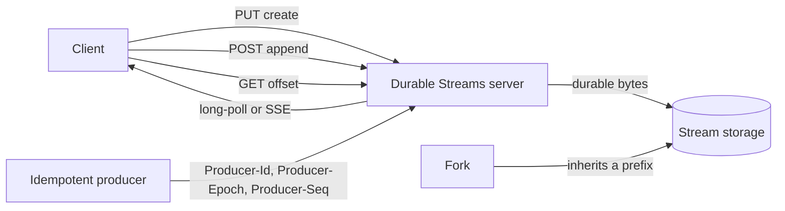
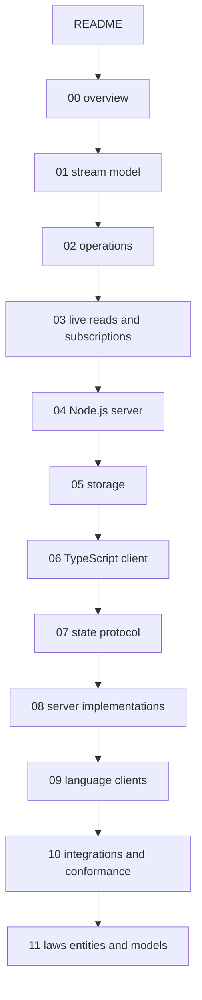

# Durable Streams Package

Durable Streams is an open Hypertext Transfer Protocol (HTTP) protocol for append-only byte streams. A client creates a stream at a Uniform Resource Locator (URL). The client appends data. Any client can read the stream again from any position. A client can also follow the stream live. The stream survives a refresh, a network failure, and a server restart.

This directory studies the Durable Streams repository at commit `461b4026`. The repository holds the protocol specification, a Node.js reference server, a TypeScript client, clients for nine other languages, a state layer, alternative servers, and test suites.

## The one-paragraph architecture

A stream is a URL path and an ordered sequence of bytes. The server gives every append a new offset, an opaque position string that a client must not parse. The client stores the offset and sends it back on the next read. An append is atomic and immutable. A stream can be closed, but it cannot be changed. A fork continues the source offset numbering at its fork point, but an offset is meaningful only within one stream. An idempotent producer, a writer that can retry without a duplicate append, uses three headers to make a retried append safe: `Producer-Id`, `Producer-Epoch`, and `Producer-Seq`. Live reads use long-poll or Server-Sent Events (SSE). The state layer turns a JavaScript Object Notation (JSON) stream into typed collections with a transaction identifier.



## Reading order

| Order | Document | What you learn |
|-------|----------|----------------|
| 1 | [00-overview.md](00-overview.md) | The problem, the core idea, and the package map |
| 2 | [01-protocol-stream-model.md](01-protocol-stream-model.md) | Streams, offsets, content types, JSON mode, closure, forking |
| 3 | [02-protocol-operations.md](02-protocol-operations.md) | Every HTTP operation, header, status code, and producer rule |
| 4 | [03-live-reads-and-subscriptions.md](03-live-reads-and-subscriptions.md) | Long-poll, SSE, caching, webhooks, pull wakes, fencing |
| 5 | [04-node-server.md](04-node-server.md) | The reference Node.js server and its in-memory store |
| 6 | [05-storage-and-durability.md](05-storage-and-durability.md) | The file-backed store, the log format, and recovery |
| 7 | [06-typescript-client.md](06-typescript-client.md) | The TypeScript read application programming interface (API), handle, and producer |
| 8 | [07-state-protocol.md](07-state-protocol.md) | Change events, control events, materialized state, StreamDB |
| 9 | [08-server-implementations.md](08-server-implementations.md) | Cloudflare, proxy, and Caddy server implementations |
| 10 | [09-language-clients.md](09-language-clients.md) | The ten language clients and the maturity model |
| 11 | [10-integrations-and-conformance.md](10-integrations-and-conformance.md) | Yjs, artificial intelligence transports, the Command-Line Interface (CLI), and conformance suites |
| 12 | [11-laws-entities-and-models.md](11-laws-entities-and-models.md) | Restate the design as 57 numbered laws (DS-1 to DS-56, plus DS-39a), define the entities and the terms, and run a 52-scenario Python model |

## The documents in one view



## Package map

| Package | Language | Purpose |
|---------|----------|---------|
| `packages/server` | TypeScript | Reference HTTP server with in-memory and file-backed stores |
| `packages/client` | TypeScript | Reference client, read API, stream handle (an object that represents one stream), idempotent producer |
| `packages/client-py` | Python | Synchronous and asynchronous client |
| `packages/client-go` | Go | Iterator-based client with no external dependencies |
| `packages/client-java` | Java | Java 11 client with synchronous and asynchronous APIs |
| `packages/client-dotnet` | C# | .NET 8 client with async enumerable reads |
| `packages/client-swift` | Swift | Swift 6 client with async sequence reads |
| `packages/client-php` | PHP | Synchronous client with generator-based reads |
| `packages/client-elixir` | Elixir | Open Telecom Platform (OTP) client with a supervised consumer and writer |
| `packages/client-rust` | Rust | Tokio (a Rust asynchronous runtime) client with a producer builder |
| `packages/client-rb` | Ruby | Ruby client with enumerable readers |
| `packages/state` | TypeScript | State protocol, materialized state, TanStack database (TanStack DB; a reactive client-side database) layer |
| `packages/server-cloudflare` | TypeScript | Cloudflare Workers and Durable Objects server |
| `packages/proxy` | TypeScript | Durable proxy for artificial intelligence (AI) streaming APIs |
| `packages/caddy-plugin` | Go | Caddy v2 server plugin |
| `packages/y-durable-streams` | TypeScript | Yjs (a Conflict-free Replicated Data Type, CRDT, library) provider and server |
| `packages/tanstack-ai-transport` | TypeScript | TanStack AI transport |
| `packages/aisdk-transport` | TypeScript | Vercel AI Software Development Kit (SDK) transport |
| `packages/cli` | TypeScript | Command-Line Interface (CLI) |
| `packages/server-conformance-tests` | TypeScript | Server conformance suite |
| `packages/client-conformance-tests` | TypeScript | Language-neutral client conformance suite |

## Core rules you will see again

1. One stream is one append-only log.
2. An offset is opaque. A client must not parse it.
3. An append is atomic. A reader sees all of the append or none of it.
4. A closed stream accepts no more appends. Closure is permanent.
5. A fork inherits the source prefix up to, but not including, the fork offset. The offset identity is scoped to one stream.
6. A producer sequence number makes a retry idempotent.
7. Live reads are reads with a collapsing cursor (a cache key that changes each interval) and a long timeout.

Aha: the protocol has no separate message queue, database, or notification service. The stream is the database, the queue, and the audit log. The only extra mechanism is a hint that new data exists.

## First request

The smallest useful exchange uses `PUT` to create the stream and `POST` to append. The server returns the new offset in `Stream-Next-Offset`.

```http
PUT /v1/stream/events HTTP/1.1
Content-Type: application/json

HTTP/1.1 201 Created
Location: /v1/stream/events
Stream-Next-Offset: 0000000000000000_0000000000000000
```

```http
POST /v1/stream/events HTTP/1.1
Content-Type: application/json

{"type":"order.created","id":1}

HTTP/1.1 204 No Content
Stream-Next-Offset: 0000000000000000_0000000000000037
```

The offset has two parts in the reference implementation. The first part is a reserved read sequence. It stays at zero. The second part is a byte position. Both parts use 16 digits. The body is 31 bytes; JSON mode adds one comma; the frame adds 5 bytes; the total is 37. See [05-storage-and-durability.md](05-storage-and-durability.md) for the frame format that produces the byte position.

## The same request in code

The TypeScript client exposes the read as one function. `StreamOptions` is the option object and `StreamResponse` is the response object:

```ts
export async function stream<TJson = unknown>(
  options: StreamOptions
): Promise<StreamResponse<TJson>> {
```

This block is from `packages/client/src/stream-api.ts:60`.

An idempotent append adds three headers:

```ts
[PRODUCER_ID_HEADER]: this.#producerId,
[PRODUCER_EPOCH_HEADER]: this.#epoch.toString(),
[PRODUCER_SEQ_HEADER]: seqForThisRequest.toString(),
```

This block is from `packages/client/src/idempotent-producer.ts:433`.

The reference server selects these defaults at startup. The block is an excerpt from a larger option object:

```ts
port: options.port ?? 4437,
host: options.host ?? `127.0.0.1`,
longPollTimeout: options.longPollTimeout ?? 30_000,
```

This block is from `packages/server/src/server.ts:191`.

## Source of truth

Every claim comes from the repository at commit `461b4026`:

- `PROTOCOL.md` is the protocol specification.
- `packages/server/src` is the reference server.
- `packages/client/src` is the reference client.
- `CLIENT_MATURITY.md` is the client status table.

Each document names the file and the line where useful. When the source contradicts a document, the document says so and gives both values.

## Related documents

- [../README.md](../README.md) is the parent Electric and Durable Streams index.
- [04-how-the-runtime-sets-up-a-stream.md](../04-how-the-runtime-sets-up-a-stream.md) shows how the Electric agent runtime uses this package.
- [00-overview.md](00-overview.md) starts the deep dive.
- [01-protocol-stream-model.md](01-protocol-stream-model.md) explains the stream model.
