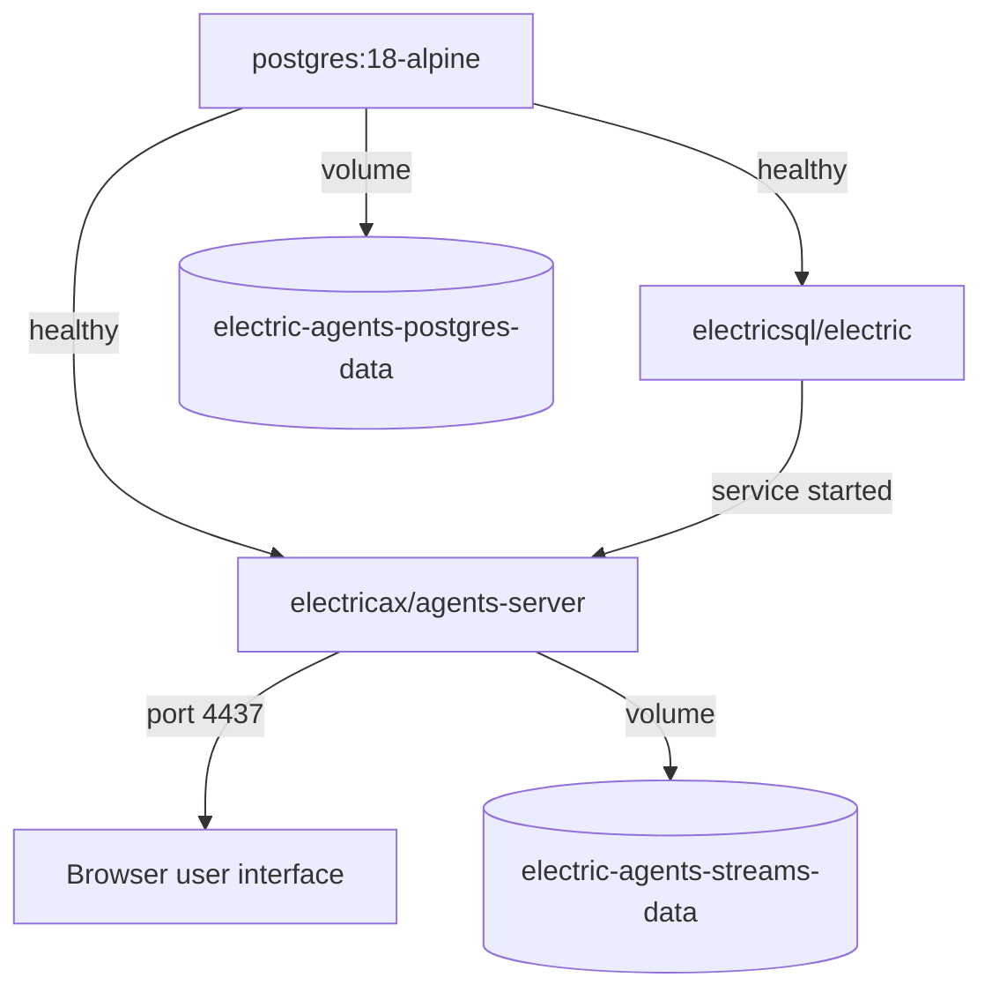
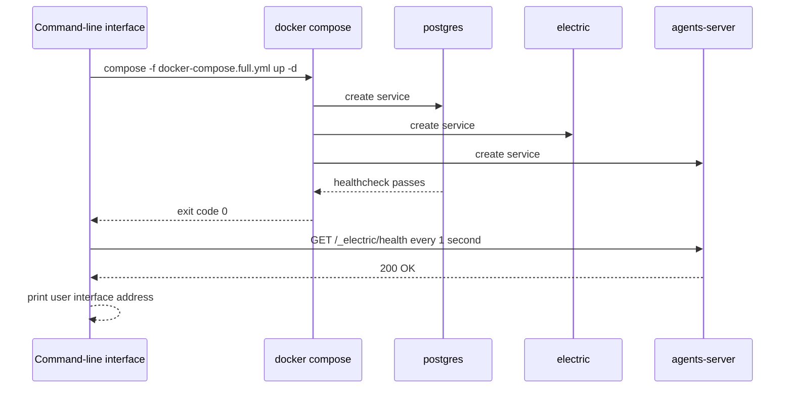

# Project templates and development workflow

This document describes the local development loop: scaffold a project, start the infrastructure, provide a model key, start the runtime, and open the user interface.

## The development environment

`agents start` runs Docker Compose with `docker-compose.full.yml`. The file defines three services. A shape is a filtered view of a PostgreSQL table that the Electric sync service sends to clients.



| Service | Image | Purpose |
|---------|-------|---------|
| `postgres` | `postgres:18-alpine` | Database with logical replication |
| `electric` | `electricsql/electric` | Shape sync engine |
| `electric-agents` | `electricax/agents-server` | Agents control plane and user interface |

### PostgreSQL settings

```yaml
command:
  - postgres
  - -c
  - wal_level=logical
  - -c
  - max_connections=300
  - -c
  - shared_buffers=256MB
```

Source: `packages/electric-ax/docker-compose.full.yml:5-12`.

Logical write-ahead logging is required for Electric shapes. The connection limit is 300. The shared buffer is 256 mebibytes.

### The agents server settings

```yaml
environment:
  ELECTRIC_AGENTS_LOG_LEVEL: ${ELECTRIC_AGENTS_LOG_LEVEL:-debug}
  ELECTRIC_AGENTS_BASE_URL: ${ELECTRIC_AGENTS_BASE_URL:-http://localhost:${ELECTRIC_AGENTS_PORT:-4437}}
  # ...
  ELECTRIC_AGENTS_HOST: 0.0.0.0
  ELECTRIC_AGENTS_PORT: 4437
  ELECTRIC_AGENTS_STREAMS_DATA_DIR: /var/lib/electric-agents/streams
  # ...
  ELECTRIC_AGENTS_ELECTRIC_URL: ${ELECTRIC_AGENTS_ELECTRIC_URL:-http://electric:3000}
  ELECTRIC_AGENTS_REWRITE_LOOPBACK_WEBHOOKS_TO: ${ELECTRIC_AGENTS_REWRITE_LOOPBACK_WEBHOOKS_TO:-host.docker.internal}
```

Source: `packages/electric-ax/docker-compose.full.yml:50-61`.

Three settings are specific to a container.

- The host binding is `0.0.0.0`, so the published port works.
- The streams data directory is a volume, so streams survive a container restart.
- Loopback webhook addresses are rewritten to `host.docker.internal`. A runtime on the host can therefore receive a webhook from the container. A webhook is an outbound Hypertext Transfer Protocol (HTTP) request that the server sends to a registered address.

The compose file also adds `host.docker.internal:host-gateway` through `extra_hosts`. This makes the host reachable from the container on Linux as well as on macOS.

## The start sequence



The health wait has a 60 second timeout and a 1 second interval.

```ts
const timeoutMs = options.timeoutMs ?? 60_000
const intervalMs = options.intervalMs ?? 1_000
const deadline = Date.now() + timeoutMs
const healthUrl = appendPathToUrl(baseUrl, `/_electric/health`)
```

Source: `packages/electric-ax/src/start.ts:291-294`.

Each health request has its own 5 second timeout. This prevents one hung request from consuming the whole wait window.

## Scaffolding a project

`agents init` runs `gitpick` against a template in the Electric repository.

```ts
const TEMPLATE_REPO = `electric-sql/electric/tree/main/examples/agents-chat-starter`
```

Source: `packages/electric-ax/src/init.ts:5`.

The command refuses an existing directory.

```ts
if (fs.existsSync(targetDir)) {
  console.error(`Error: directory "${name}" already exists`)
  process.exit(1)
}
```

Source: `packages/electric-ax/src/init.ts:11-14`.

The printed next steps are:

1. `cd <name>`
2. `pnpm install`
3. `cp .env.example .env`
4. Set `ANTHROPIC_API_KEY` in `.env`
5. Run `npx electric-ax agents quickstart` in one terminal
6. Run `pnpm dev` in the other terminal

Source: `packages/electric-ax/src/init.ts:29-42`.

The quickstart command provides the agents infrastructure and the built-in runtime. The `pnpm dev` command is defined by the starter template, not by this package. This exploration does not cover the template, so the exact process that `pnpm dev` starts is an open question here.

## Providing the model key

The built-in runtime needs an Anthropic key. The command-line interface (CLI) resolves it in this order:

1. The `--anthropic-api-key` flag.
2. `ANTHROPIC_API_KEY` in the process environment.
3. `ANTHROPIC_API_KEY` in `.env`.

If no key is found and the terminal is interactive, the CLI prompts for one.

```ts
export function parsePastedAnthropicApiKey(input: string): string {
  const trimmed = input.trim()
  const match = trimmed.match(
    /^(?:export\s+)?ANTHROPIC_API_KEY\s*[:=]\s*(.*)$/s
  )
  const value = (match?.[1] ?? trimmed).trim()

  if (
    (value.startsWith(`"`) && value.endsWith(`"`)) ||
    (value.startsWith(`'`) && value.endsWith(`'`))
  ) {
    return value.slice(1, -1).trim()
  }

  return value
}
```

Source: `packages/electric-ax/src/prompt-api-key.ts:37-52`.

The parser accepts a bare key, an `ANTHROPIC_API_KEY=...` line, or an `export ANTHROPIC_API_KEY=...` line. It removes matching quotes.

The key must start with `sk-ant-`. The CLI validates it against the Anthropic models endpoint with a 5 second timeout.

```ts
response = await fetchImpl(`https://api.anthropic.com/v1/models?limit=1`, {
  headers: {
    'anthropic-version': `2023-06-01`,
    'x-api-key': key,
  },
  signal: AbortSignal.timeout(5_000),
})
```

Source: `packages/electric-ax/src/prompt-api-key.ts:69-75`.

The prompt text states that the key stays on the local computer. It is used by the built-in agent entities and the example agents in the starter template.

## The `.env` parser

The CLI reads `.env` without a library.

```ts
function parseDotEnvValue(raw: string): string {
  const trimmed = raw.trim()
  if (
    (trimmed.startsWith(`"`) && trimmed.endsWith(`"`)) ||
    (trimmed.startsWith(`'`) && trimmed.endsWith(`'`))
  ) {
    return trimmed.slice(1, -1)
  }
  const hashIndex = trimmed.indexOf(`#`)
  return hashIndex === -1 ? trimmed : trimmed.slice(0, hashIndex).trim()
}
```

Source: `packages/electric-ax/src/env.ts:8-18`.

The parser supports matching quotes and trailing comments. It ignores blank lines and lines that start with `#`. It does not support multiline values, variable substitution, or escape sequences. This is a deliberate simplification for local development.

## The development wrapper

The `electric-dev` binary runs the TypeScript source directly with `tsx`. `tsx` is a TypeScript runner that executes TypeScript source without a separate build step.

```js
const child = spawn(tsxPath, [srcPath, ...process.argv.slice(2)], {
  stdio: `inherit`,
})
```

Source: `packages/electric-ax/bin/electric-dev.mjs:28-30`.

The wrapper looks for `tsx` in the package `node_modules` first, then in the repository root. It passes all arguments through unchanged.

## The daily loop

| Step | Command | Terminal |
|------|---------|----------|
| 1 | `npx electric-ax agents quickstart` | First |
| 2 | `pnpm dev` | Second |
| 3 | Edit code | Editor |
| 4 | Open `http://localhost:4437` | Browser |
| 5 | `npx electric-ax agents ps` | Third |
| 6 | `npx electric-ax agents send /horton/<id> "hello"` | Third |

The `horton` segment is the built-in agent entity type.

The quickstart process stays in the foreground. It stops the built-in runtime on the interrupt signal (`SIGINT`) or the termination signal (`SIGTERM`). The Docker environment stays up until `agents stop`.

## Aha: two servers, one address

The Docker environment runs three containers. The built-in runtime runs on the host. Only the containerized agents server listens on port 4437. The built-in runtime binds no port: it connects to the agents server at `agentServerUrl` and acts as a pull-wake client (`packages/agents/src/server.ts:184-339`, `packages/electric-ax/src/start.ts:431-437`). The runtime is not a container.

Key insight: this split makes the development loop fast. You restart the runtime with Control-C and a new command. You do not rebuild an image. The server and the database stay warm.

The pull-wake runner and webhooks are two delivery paths. The runner pulls pending work from the server. A webhook pushes an event to a registered address. The development environment supports both paths.

## Related documents

- [01-cli-commands.md](01-cli-commands.md) for the exact command flags.
- [00-overview.md](00-overview.md) for environment variables.
- [03-package-and-publish.md](03-package-and-publish.md) for the build that produces the binaries.
- [README.md](README.md) for the package index.
