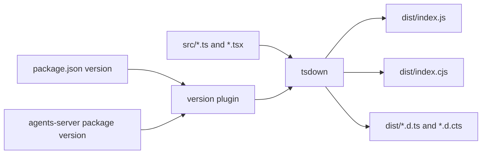
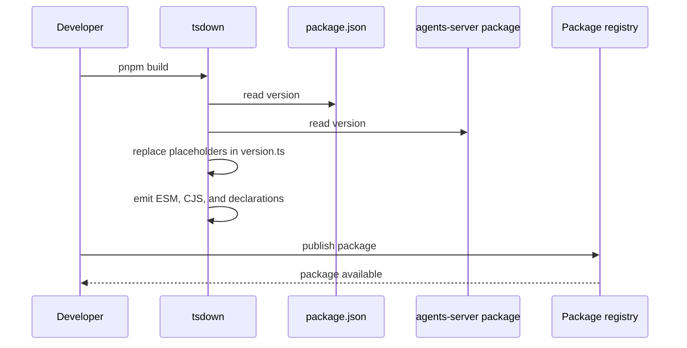

# Build and publish

This document describes how `electric-ax` becomes a runnable package: the build entries, the version injection, the two build targets, and the files that a published package contains.

The package builds two module formats: ECMAScript Module (ESM) and CommonJS (CJS).

## Package manifest

| Field | Value |
|-------|-------|
| Name | `electric-ax` |
| Version | `0.2.23` |
| Module type | `esm` |
| Main | `./dist/index.cjs` |
| Module | `./dist/index.js` |
| Types | `./dist/index.d.ts` |
| Node engine | `>=18.0.0` |
| License | `Apache-2.0` |

Source: `packages/electric-ax/package.json:2-10`, `83-85`.

`Main` is the CJS entry. `Module` is the ESM entry. A CJS consumer reads `Main`. A bundler that supports ESM reads `Module`.

Three binaries are declared.

```json
"bin": {
  "electric": "./dist/index.js",
  "electric-ax": "./dist/index.js",
  "electric-dev": "./bin/electric-dev.mjs"
}
```

Source: `packages/electric-ax/package.json:11-15`.

The first two names point to the same file. The CLI process reads the invoked file name to choose the command name in help text. The third name is the development wrapper that runs the TypeScript source.

In the build scripts, `tsdown` is the bundler, `vitest` runs the tests, `tsc` is the TypeScript compiler, and `eslint` is the linter. The `dts: true` setting emits type declarations.

## Build scripts

| Script | Command | Purpose |
|--------|---------|---------|
| `build` | `tsdown` | Standard dual-format build |
| `build:desktop` | `tsdown --config tsdown.desktop.config.ts` | Single-format bundle for the desktop app |
| `dev` | `tsdown --watch` | Rebuild on change |
| `test` | `vitest run` | Run tests |
| `coverage` | `pnpm exec vitest run --coverage` | Coverage report |
| `typecheck` | `tsc --noEmit` | Type check |
| `stylecheck` | `eslint . --quiet` | Lint |

Source: `packages/electric-ax/package.json:39-47`.

## The standard build



The entry list decides what becomes a separate output file.

```ts
const config: Options = {
  entry: [
    `src/index.ts`,
    `src/completions.ts`,
    `src/start.ts`,
    `src/observe-ui.tsx`,
    `src/types-table.tsx`,
    `src/entity-stream-db.ts`,
    `src/init.ts`,
  ],
  format: [`esm`, `cjs`],
  platform: `node`,
  dts: true,
  clean: true,
  plugins: [packageVersionPlugin(packageVersion, agentsServerPackageVersion)],
  external: [/^@durable-streams\//, /^@electric-ax\//, /^omelette$/],
}
```

Source: `packages/electric-ax/tsdown.config.ts:13-29`.

The build produces both ECMAScript Module (ESM) and CommonJS (CJS) output. It generates type declarations. It cleans the output directory before each build.

The `external` list keeps three dependency families out of the bundle. `@electric-ax/` is the scope that contains `agents-runtime`. A package that depends on `electric-ax` therefore loads the same `agents-runtime` instance, not a private copy.

## Version injection

The source file contains placeholder strings.

```ts
const injectedCliVersion: string = `__ELECTRIC_AX_CLI_VERSION__`
const injectedAgentsServerImageTag: string = `__ELECTRIC_AGENTS_SERVER_IMAGE_TAG__`
export const ELECTRIC_AX_CLI_VERSION = injectedCliVersion.startsWith(
  `__ELECTRIC_AX_`
)
  ? `0.0.0`
  : injectedCliVersion
```

Source: `packages/electric-ax/src/version.ts:9-15`.

A source run reports `0.0.0`. A built artifact reports the real version. The guard checks for the placeholder prefix, so an unbuilt run is obvious.

The build plugin replaces both placeholders.

```ts
function packageVersionPlugin(
  version: string,
  agentsServerImageTag: string
): VersionPlugin {
  return {
    name: `electric-ax-package-version`,
    transform(code: string, id: string) {
      if (!id.endsWith(`/src/version.ts`)) return null
      return code
        .replaceAll(`__ELECTRIC_AX_CLI_VERSION__`, version)
        .replaceAll(`__ELECTRIC_AGENTS_SERVER_IMAGE_TAG__`, agentsServerImageTag)
    },
  }
}
```

Source: `packages/electric-ax/tsdown.config.ts:42-58`.

The plugin reads the version from two manifests.

```ts
const packageVersion = readPackageVersion(`./package.json`)
const agentsServerPackageVersion = readPackageVersion(
  `../agents-server/package.json`
)
```

Source: `packages/electric-ax/tsdown.config.ts:4-7`.

The agents server image tag is the version of the `agents-server` workspace package. The command-line interface (CLI) and the server image therefore stay in step in a release build.

The source comment in `version.ts` states that the canary continuous integration process overwrites the tags to `canary` before the build. The comment does not state whether it overwrites the CLI version, the server image tag, or both. This is an open question.

## The desktop build

```ts
const config: Options = {
  entry: [
    `src/index.ts`,
    `src/completions.ts`,
    `src/start.ts`,
    `src/observe-ui.tsx`,
    `src/types-table.tsx`,
    `src/init.ts`,
  ],
  format: [`esm`],
  platform: `node`,
  dts: false,
  clean: true,
  outDir: `dist-desktop`,
  plugins: [packageVersionPlugin(packageVersion, agentsServerPackageVersion)],
  noExternal: [
    /^@durable-streams\//,
    /^@electric-ax\//,
    /^@electric-sql\//,
    /^@tanstack\//,
    /^commander$/,
    /^ink$/,
    /^omelette$/,
    /^react$/,
    /^react\//,
  ],
}
```

Source: `packages/electric-ax/tsdown.desktop.config.ts:13-39`.

The desktop build differs in four ways.

1. It emits only ESM.
2. It emits no type declarations.
3. It writes to `dist-desktop`.
4. It bundles dependencies instead of marking them external.

The last point is the important one. A desktop application needs one self-contained bundle. The `noExternal` list includes React, Ink, Commander, and the Electric packages.

The desktop entry list does not include `src/entity-stream-db.ts`, although the standard entry list does. In the standard build the module is a separate output file and an exported subpath. The desktop build omits that separate output and bundles the module into the entry that imports it.

## Published files

```json
"files": [
  "dist",
  "bin",
  "docker-compose.full.yml"
]
```

Source: `packages/electric-ax/package.json:72-76`.

A published package contains:

| Path | Contents |
|------|----------|
| `dist/` | Built JavaScript and type declarations |
| `bin/` | The development wrapper |
| `docker-compose.full.yml` | The development environment definition |

The `docker-compose.full.yml` file is essential. The `start` command resolves it relative to the built module.

```ts
const DOCKER_COMPOSE_FILE = fileURLToPath(
  new URL(`../docker-compose.full.yml`, import.meta.url)
)
```

Source: `packages/electric-ax/src/start.ts:25-27`.

If the compose file were omitted from the package, `agents start` would fail at runtime.

## Subpath exports

The package exposes a main export, one subpath, and the manifest.

| Subpath | Purpose |
|---------|---------|
| `.` | Main command-line interface |
| `./entity-stream-db` | Stream database helper for other tools |
| `./package.json` | Version metadata |

Source: `packages/electric-ax/package.json:16-38`.

The `entity-stream-db` subpath is separate so a consumer can read an entity stream without loading the whole command-line interface.

## The build and release flow



No publish script exists in `package.json`. Publishing uses the package manager's normal publish command. The repository pipeline is outside this package.

## Aha: the version is written into the artifact

The CLI cannot read the `package.json` version at runtime in every environment. A bundled desktop build may not ship the manifest. The build therefore writes the version into the code.

Key insight: the placeholder guard makes an unbuilt source run honest. It reports `0.0.0` instead of a stale or invented version. A bug report with version `0.0.0` immediately tells the maintainer that the user ran the source.

## Related documents

- [00-overview.md](00-overview.md) for the module map.
- [02-project-templates-and-dev-workflow.md](02-project-templates-and-dev-workflow.md) for the compose file used at runtime.
- [01-cli-commands.md](01-cli-commands.md) for the commands in the build entries.
- [README.md](README.md) for the package index.
