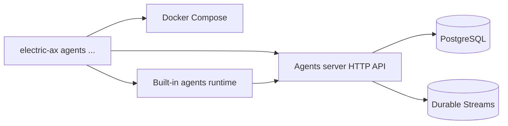
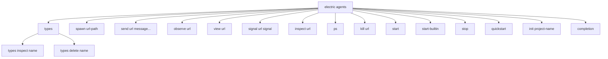

# The electric-ax package

`electric-ax` is the command-line interface (CLI) and project tooling for Electric Agents. It starts the local development environment, runs the built-in agent runtime, manages entities, and scaffolds new projects.

Electric Agents is the durable agent runtime in the Electric project. It stores each agent as an entity, and each entity has an append-only event stream. PostgreSQL holds the entity records. Durable Streams holds the event streams. The Electric sync service sends PostgreSQL data to clients as shapes. A shape is a filtered view of a database table.

Horton is the entity type of the built-in agent. The package bootstrap registers it as the default agent entity.

Package location: `packages/electric-ax`. Version: `0.2.23`. Binaries: `electric`, `electric-ax`, `electric-dev`.

## What the tool does

The tool has five jobs.

1. Start a local Docker Compose environment with PostgreSQL, the Electric sync service, and the agents server.
2. Start the built-in Horton runtime in the current terminal.
3. Send commands to the agents server over Hypertext Transfer Protocol (HTTP) to the server Application Programming Interface (API): spawn, send, inspect, list, and kill.
4. Observe an entity conversation in a terminal user interface.
5. Scaffold a new project from a starter template.



## Reading order

| Order | Document | What you learn |
|-------|----------|----------------|
| 1 | [00-overview.md](00-overview.md) | Exports, environment variables, and architecture |
| 2 | [01-cli-commands.md](01-cli-commands.md) | Every command and flag |
| 3 | [02-project-templates-and-dev-workflow.md](02-project-templates-and-dev-workflow.md) | Scaffolding, Docker, and the local workflow |
| 4 | [03-package-and-publish.md](03-package-and-publish.md) | Build, version injection, and release |

## The command tree

The `spawn`, `send`, `observe`, `view`, `signal`, `inspect`, and `kill` commands take an entity address as a Uniform Resource Locator (URL) path.



Both `electric` and `electric-ax` run the same file. The subcommand `agents` is required after the binary name. The two names differ only in the help text.

An entity address is a path with a type name and an instance identifier, such as `/horton/my-agent`. The `horton` segment is the built-in agent entity type.

## The default address

Every command that speaks to the agents server uses the same base address.

```ts
export const DEFAULT_ELECTRIC_AGENTS_URL = `http://localhost:4437`
```

Source: `packages/electric-ax/src/index.ts:21`.

The environment variable `ELECTRIC_AGENTS_URL` overrides the default. The development environment publishes the server on port 4437.

## The identity model

The CLI identifies the caller with one header. The `Electric-Principal` header carries the principal value. A principal is the caller identity that the server uses for permission checks.

| Variable | Default | Effect |
|----------|---------|--------|
| `ELECTRIC_AGENTS_IDENTITY` | `<username>@<hostname>` | Supplies the default identity, but is not sent as a header |
| `ELECTRIC_AGENTS_PRINCIPAL` | `user:<identity>` | Supplies the `Electric-Principal` header value |

The default identity comes from the operating system user and host. When `ELECTRIC_AGENTS_PRINCIPAL` is absent, the CLI builds the principal from that identity with the `user:` prefix. When the variable is present, its value is used directly.

```ts
const explicitIdentity = env.ELECTRIC_AGENTS_IDENTITY?.trim()
const explicitPrincipal = env.ELECTRIC_AGENTS_PRINCIPAL?.trim()
```

Source: `packages/electric-ax/src/index.ts:173-174`.

Additional headers can come from a JavaScript Object Notation (JSON) object in `ELECTRIC_AGENTS_SERVER_HEADERS`.

The development environment uses the same port as the default server address.

```ts
const DEFAULT_ELECTRIC_AGENTS_PORT = 4437
const DEFAULT_COMPOSE_PROJECT_NAME = `electric-agents`
```

Source: `packages/electric-ax/src/start.ts:20-21`.

## Aha: the CLI is a thin client over the public API

The command handlers do not read the database. They do not hold a WebSocket. They call the same HTTP endpoints that any client can call. The `view` command even reuses the runtime's timeline builder.

Key insight: you can replace the CLI with `curl` for most operations. The CLI adds convenience: argument parsing, a table renderer, a live terminal interface, and shell completion. Every request goes through the HTTP wrapper shown in [00-overview.md](00-overview.md), and that wrapper adds only the principal header and the configured extra headers. No private protocol exists between the CLI and the server.

## Related documents

- [00-overview.md](00-overview.md) for the module map and environment variables.
- [01-cli-commands.md](01-cli-commands.md) for the command reference.
- [02-project-templates-and-dev-workflow.md](02-project-templates-and-dev-workflow.md) for local setup.
- [../README.md](../README.md) for the full exploration index.
