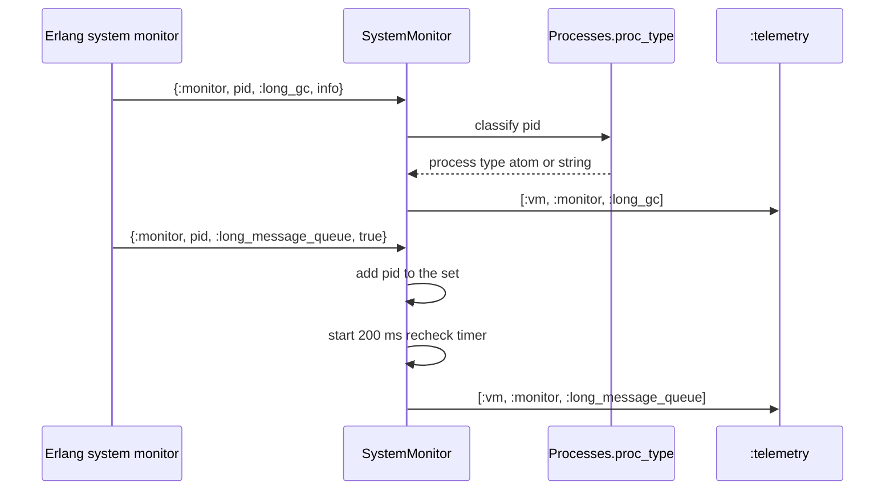
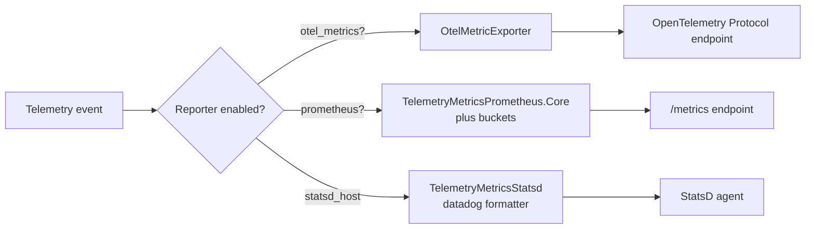

# Events and Handlers

This document is the complete reference for the events that `electric_telemetry` emits and the functions that produce and export them. It lists every event name, every measurement key, every metadata key, every metric definition, and every periodic function. Every claim cites a path relative to the package root.

The library uses the Erlang `:telemetry` convention. An event has three parts:

- A **name**, such as `[:vm, :memory]`.
- A **measurement map**, such as `%{atom: 123456}`.
- A **metadata map**, such as `%{process_type: "supervisor"}`.

A metric definition names an event and one measurement. The reporter then exports the value with tags built from the metadata.

## Event catalog: ApplicationTelemetry

`ApplicationTelemetry` emits these events. Each row gives the event name, the measurement keys, the metadata keys, the source line, and the meaning.

| Event | Measurements | Metadata | Source | Meaning |
|-------|--------------|----------|--------|---------|
| `[:process, :memory]` | `total` | `process_type` | `lib/electric/telemetry/application_telemetry.ex:180-188` | Total heap memory for one process type. |
| `[:process, :bin_memory]` | `total`, `max_bin_count`, `avg_bin_count`, `max_ref_count`, `avg_ref_count` | `process_type` | `lib/electric/telemetry/application_telemetry.ex:190-204` | Reference-counted binary memory for one process type. |
| `[:ets, :memory]` | `total` | `table_type` | `lib/electric/telemetry/application_telemetry.ex:206-211` | Total memory for one Erlang Term Storage (ETS) table type. |
| `[:system, :cpu, :utilization]` | `core_0` … `core_N`, `total` | none | `lib/electric/telemetry/application_telemetry.ex:213-231` | Busy fraction per logical processor and the mean. |
| `[:system, :cpu]` | `core_count` | none | `lib/electric/telemetry/application_telemetry.ex:232` | Number of logical processors. |
| `[:vm, :scheduler_utilization]` | `normal_1` … `normal_N`, `cpu_1` … `cpu_M`, `total`, `weighted` | none | `lib/electric/telemetry/application_telemetry.ex:240-268` | Scheduler use as a percentage. |
| `[:vm, :run_queue_lengths]` | `normal_1` … `normal_N`, `cpu`, `io`, `total`, `total_plus_io` | none | `lib/electric/telemetry/application_telemetry.ex:271-282` | Runnable process count per scheduler. |
| `[:vm, :garbage_collection]` | `total_runs`, `total_bytes_reclaimed` | none | `lib/electric/telemetry/application_telemetry.ex:285-292` | Cumulative garbage collection count and bytes. |
| `[:vm, :reductions]` | `total`, `delta` | none | `lib/electric/telemetry/application_telemetry.ex:295-301` | Total reductions and reductions since the last call. |
| `[:vm, :uptime]` | `total` | none | `lib/electric/telemetry/application_telemetry.ex:174-177` | Node uptime in native time units. |
| `[:system, :load_percent]` | `avg1`, `avg5`, `avg15` | none | `lib/electric/telemetry/application_telemetry.ex:304-355` | Load average as a percentage of core count. |
| `[:system, :memory]` | `total_memory`, `free_memory`, `used_memory`, `resident_memory`, plus optional keys | none | `lib/electric/telemetry/application_telemetry.ex:360-402` | Memory statistics in bytes. |
| `[:system, :memory_percent]` | Each memory key as a percentage | none | `lib/electric/telemetry/application_telemetry.ex:392-397` | The same values as percentages. |
| `[:system, :swap]` | `total_swap`, `free_swap`, `used_swap` | none | `lib/electric/telemetry/application_telemetry.ex:437-449` | Swap statistics in bytes. Not emitted on macOS. |
| `[:system, :swap_percent]` | `free_swap`, `used_swap` | none | `lib/electric/telemetry/application_telemetry.ex:442-450` | Swap values as percentages. |

The optional memory keys are `available_memory`, `buffered_memory`, and `cached_memory` (`lib/electric/telemetry/application_telemetry.ex:386-390`). The function includes each key only when the operating system reports it.

### Event catalog: built-in telemetry_poller measurements

Four measurements do not come from a function in this package. `ApplicationTelemetry.builtin_periodic_measurements/1` adds the `telemetry_poller` built-ins to its list (`lib/electric/telemetry/application_telemetry.ex:58-68`). The `telemetry_poller` library emits these events:

| Event | Measurements | Metadata | Meaning |
|-------|--------------|----------|---------|
| `[:vm, :memory]` | `total`, `processes`, `processes_used`, `system`, `atom`, `atom_used`, `binary`, `code`, `ets` | none | Memory in bytes for each virtual machine area. |
| `[:vm, :persistent_term]` | `count`, `memory` | none | Persistent term count and memory. |
| `[:vm, :system_counts]` | `process_count`, `atom_count`, `port_count` | none | Global object counts. |
| `[:vm, :total_run_queue_lengths]` | `total`, `cpu`, `io` | none | Total run queue lengths, split by scheduler class. |

These four events are the source of the first metrics in the metric table below. They are application-wide measurements, not per-stack measurements. Their metric definitions live in `ApplicationTelemetry.metrics/1`, and the stack supervisor does not define them (`lib/electric/telemetry/application_telemetry.ex:107-115`, `lib/electric/telemetry/stack_telemetry.ex:75-138`).

### Event catalog: SystemMonitor

`ElectricTelemetry.SystemMonitor` starts the Erlang system monitor and converts monitor messages into events.

| Event | Measurements | Metadata | Source | Meaning |
|-------|--------------|----------|--------|---------|
| `[:vm, :monitor, :long_gc]` | The monitor info map, including `timeout` | `process_type` | `lib/electric/telemetry/system_monitor.ex:46-58` | A process spent more than the threshold in garbage collection. |
| `[:vm, :monitor, :long_schedule]` | `timeout` for a process; the full map for a port | `process_type` (`"port"` for a port) | `lib/electric/telemetry/system_monitor.ex:60-70`, `72-100` | A process or port waited too long for a scheduler. |
| `[:vm, :monitor, :long_message_queue]` | `length` | `process_type` | `lib/electric/telemetry/system_monitor.ex:145-151` | A process message queue crossed the enable threshold. |

The monitor thresholds come from the configuration and are passed to `:erlang.system_monitor/2` in `init/1` (`lib/electric/telemetry/system_monitor.ex:29-35`). The long message queue uses a two-value threshold. The values need care because the schema lists them in one order and the call passes them in the other:

| Step | Order |
|------|-------|
| Schema names | `long_message_queue_enable_threshold` (default 20), then `long_message_queue_disable_threshold` (default 0) (`lib/electric/telemetry/opts.ex:49-50`). |
| `:erlang.system_monitor/2` call | `{disable, enable}`, so the defaults become `{0, 20}` (`lib/electric/telemetry/system_monitor.ex:33-34`). |

The monitor sends `true` when a process queue reaches the enable value and `false` when it falls back to the disable value. The `SystemMonitor` then emits `[:vm, :monitor, :long_message_queue]` with the current length for each process in the active set, once on entry and then every 200 milliseconds (`lib/electric/telemetry/system_monitor.ex:102-117`, `lib/electric/telemetry/system_monitor.ex:145-162`).



The `SystemMonitor` has two timers. The first is a one-hour garbage collection timer (`lib/electric/telemetry/system_monitor.ex:22`). It calls `:erlang.garbage_collect/0` on the monitor process. The second is a 200 millisecond recheck timer for active long queues (`lib/electric/telemetry/system_monitor.ex:159`). The recheck timer stops when the set becomes empty (`lib/electric/telemetry/system_monitor.ex:126-137`).

## Metric definitions

### Application metrics

`ApplicationTelemetry.metrics/1` returns a list of `Telemetry.Metrics` definitions (`lib/electric/telemetry/application_telemetry.ex:88-145`). A definition such as `last_value("vm.memory.atom", unit: :byte)` maps to the event `[:vm, :memory]` and the measurement `:atom`. The library uses this naming rule: the last part of the metric name is the measurement, and the other parts are the event name.

The rule has exceptions. A definition can set `event_name:` or `measurement:` directly. `electric.plug.serve_shape.requests.count` uses both: `event_name: [:electric, :plug, :serve_shape]` and `measurement: :count` (`lib/electric/telemetry/stack_telemetry.ex:88-92`). Without the explicit values, the name would map to the event `[:electric, :plug, :serve_shape, :requests]`, which does not exist. A metric can also set a `:measurement` function that transforms the value; `vm.uptime.total` does this to convert native time to seconds (`lib/electric/telemetry/application_telemetry.ex:136-139`). Read the definition, not only the name, when an event does not appear where the rule predicts.

| Group | Metric names | Type | Unit |
|-------|--------------|------|------|
| Process memory | `process.memory.total`, `process.bin_memory.total` | `last_value` | byte |
| Binary detail | `process.bin_memory.max_bin_count`, `avg_bin_count`, `max_ref_count`, `avg_ref_count` | `last_value` | none |
| ETS | `ets.memory.total` | `last_value` | byte |
| CPU | `system.cpu.core_count`, `system.cpu.utilization.total`, `system.cpu.utilization.core_N` | `last_value` | none |
| Load | `system.load_percent.avg1`, `avg5`, `avg15` | `last_value` | percent |
| Memory percent | `system.memory_percent.free_memory`, `available_memory`, `used_memory` | `last_value` | percent |
| Garbage collection | `vm.garbage_collection.total_runs`, `total_bytes_reclaimed` | `last_value` | count, byte |
| VM memory | `vm.memory.atom`, `atom_used`, `binary`, `code`, `ets`, `processes`, `processes_used`, `system`, `total` | `last_value` | byte |
| Monitor | `vm.monitor.long_message_queue.length` (sum), `long_schedule.timeout` (distribution), `long_gc.timeout` (distribution) | mixed | count, millisecond |
| Persistent term | `vm.persistent_term.count`, `memory` | `last_value` | count, byte |
| Reductions | `vm.reductions.total`, `delta` | `last_value` | count |
| Run queue | `vm.run_queue_lengths.total`, `total_plus_io`, `normal_N`, `cpu`, `io` | `last_value` | count |
| Scheduler | `vm.scheduler_utilization.total`, `weighted`, `normal_N`, `cpu_N` | `last_value` | percent |
| System counts | `vm.system_counts.atom_count`, `port_count`, `process_count` | `last_value` | count |
| Total run queue | `vm.total_run_queue_lengths.total`, `cpu`, `io` | `last_value` | count |
| Uptime | `vm.uptime.total` | `last_value` | second |

The uptime metric converts native time to seconds with a measurement function (`lib/electric/telemetry/application_telemetry.ex:136-139`).

The dynamic metrics have one entry per logical processor or scheduler:

- `cpu_utilization_metrics/0` creates one metric for each logical processor (`lib/electric/telemetry/application_telemetry.ex:147-150`).
- `scheduler_utilization_metrics/0` creates one metric for each normal scheduler and each dirty CPU scheduler (`lib/electric/telemetry/application_telemetry.ex:152-163`).
- `run_queue_lengths_metrics/0` creates one metric for each scheduler identifier from `ElectricTelemetry.scheduler_ids/0` (`lib/electric/telemetry/application_telemetry.ex:165-167`, `lib/electric/telemetry.ex:2-5`).

### Stack metrics

`StackTelemetry.metrics/1` returns 35 metric definitions (`lib/electric/telemetry/stack_telemetry.ex:75-138`). These metrics consume events that the Electric application emits. This module does not emit them.

| Metric | Type | Unit | Notes |
|--------|------|------|-------|
| `electric.plug.serve_shape.duration` | distribution | millisecond | Excludes live requests. |
| `electric.plug.serve_shape.count` | counter | count | Excludes live requests. |
| `electric.plug.serve_shape.bytes` | sum | byte | Excludes live requests. |
| `electric.plug.serve_shape.requests.count` | counter | count | Explicit event name `[:electric, :plug, :serve_shape]`, measurement `:count`, tags `status`, `known_error`, `live`, `empty`. |
| `electric.shape.response_size.bytes` | distribution | byte | Tags `root_table`, `is_live`, `stack_id`. |
| `electric.shape_snapshot.create_snapshot_task.stop.duration` | distribution | millisecond | Snapshot task time. |
| `electric.storage.make_new_snapshot.stop.duration` | distribution | millisecond | Snapshot write time. |
| `electric.postgres.replication.transaction_received.receive_lag` | distribution | millisecond | Replication receive lag. |
| `electric.postgres.replication.transaction_received.operations` | distribution | count | Operations per transaction. |
| `electric.storage.transaction_stored.replication_lag` | distribution | millisecond | Storage lag. |
| `electric.storage.used.bytes` | last value | byte | Current storage use. |
| `electric.storage.used.measurement_duration` | distribution | millisecond | Time to measure storage. |
| `electric.postgres.replication.transaction_received.count` | counter | count | Received transactions. |
| `electric.postgres.replication.transaction_received.bytes` | sum | byte | Received bytes. |
| `electric.storage.transaction_stored.bytes` | sum | byte | Stored bytes. |
| `electric.storage.transaction_stored.count` | sum | count | Stored transactions. |
| `electric.storage.transaction_stored.operations` | sum | count | Stored operations. |
| `electric.storage.snapshot_stored.bytes` | sum | byte | Stored snapshot bytes. |
| `electric.storage.snapshot_stored.count` | sum | count | Stored snapshots. |
| `electric.storage.snapshot_stored.operations` | sum | count | Stored snapshot operations. |
| `electric.subqueries.subset_result.bytes` | sum | byte | Subquery result bytes. |
| `electric.subqueries.subset_result.rows` | sum | count | Subquery result rows. |
| `electric.subqueries.subset_result.count` | sum | count | Subquery count. |
| `electric.subqueries.move_in_triggered.count` | sum | count | Move-in events. |
| `electric.postgres.info_looked_up.pg_version` | last value | none | PostgreSQL version. |
| `electric.shape_db.pool.checkout.queue_time_us` | distribution | microsecond | Pool queue time. |
| `electric.connection.consumers_ready.duration` | last value | millisecond | Consumer start time. |
| `electric.connection.consumers_ready.total` | last value | count | Ready consumer count. |
| `electric.admission_control.acquire.current` | last value | count | Current acquisitions, tag `kind`. |
| `electric.admission_control.acquire.limit` | last value | count | Acquisition limit, tag `kind`. |
| `electric.admission_control.reject.count` | sum | count | Rejections, tag `kind`. |
| `electric.admission_control.reject.limit` | last value | count | Rejection limit, tag `kind`. |
| `electric.shape_log_collector.transaction.affected_shape_count` | distribution | count | Shapes per transaction. |
| `electric.flush_tracker.writer_down.count` | counter | count | Writer failures, tag `reason_class`. |
| `electric.flush_tracker.stall_detected.count` | sum | count | Detected stalls. |

The function then applies `ElectricTelemetry.keep_for_stack/2` (`lib/electric/telemetry/stack_telemetry.ex:137`). That helper wraps the `:keep` function of each metric with a stack identifier test (`lib/electric/telemetry.ex:7-19`). A metric with no `:keep` gets one that tests `metadata[:stack_id] == stack_id`. A metric with a `:keep` gets a new function that applies both tests. This is how several stacks share one reporter without mixing their values.

**Aha:** the `keep_for_stack` wrapper composes with existing filters instead of replacing them. The distribution and counter metrics for `serve_shape` already have a `:keep` that excludes live requests (`lib/electric/telemetry/stack_telemetry.ex:77-87`). The helper keeps that rule and adds the stack rule. If the helper replaced `:keep`, live requests would leak into the non-live metrics.

## The periodic measurement engine

`ElectricTelemetry.Poller` is a thin wrapper around `telemetry_poller`. It has one callback:

```elixir
@callback builtin_periodic_measurements(map) :: list()
```

The citation is `lib/electric/telemetry/poller.ex:4`. A supervisor implements the callback. The callback returns the measurements that the module provides when the user writes `:builtin` in the `periodic_measurements` option.

`child_spec/2` has this logic (`lib/electric/telemetry/poller.ex:6-26`):

1. Take `:callback_module` out of the poller options.
2. Build the measurement list with `periodic_measurements/2`.
3. If the list is empty, return `nil`. The caller rejects `nil` children.
4. Otherwise start `:telemetry_poller` with the measurements, the poll interval, and a default `init_delay` of 5 seconds. The caller can override both values.

`periodic_measurements/2` accepts five forms (`lib/electric/telemetry/poller.ex:28-47`):

| Form | Meaning |
|------|---------|
| `:builtin` | Call `builtin_periodic_measurements/1` on the callback module. |
| `:memory`, `:persistent_term`, `:system_counts`, `:total_run_queue_lengths` | Use the measurement built into `telemetry_poller`. |
| A bare atom | Call `Module.function(telemetry_opts)` on the callback module. |
| A function of one argument | Call the function with `telemetry_opts`. |
| `{module, function, args}` | Call the module function with `args ++ [telemetry_opts]`. |

Every measurement is wrapped in `{Poller, :safe_invoke, [m, f, a]}` (`lib/electric/telemetry/poller.ex:55`). `safe_invoke/3` applies the function and returns `:ok`. It handles every failure path:

| Outcome | Action | Return |
|---------|--------|--------|
| Function returns a value | Ignore the value. | `:ok` |
| Raises `ArgumentError` | Ignore silently. This error is common when an ETS table disappears during a restart. | `:ok` |
| Raises another exception | Log a warning with the function name and message. | `:ok` |
| Exits with `{reason, _}` and `reason` in `[:noproc, :timeout, :shutdown, :normal]` | Ignore silently. | `:ok` |
| Exits with a bare `reason` in `[:noproc, :shutdown, :normal]` | Ignore silently. | `:ok` |
| Throws, or exits with any other value | Log a warning with the kind and the reason. | `:ok` |

The citations are `lib/electric/telemetry/poller.ex:69-98`. The callback contract is documented on `lib/electric/telemetry/poller.ex:60-68`.

The return value is discarded on purpose. A measurement function must publish its data with `:telemetry.execute/3`; a plain return value never reaches a reporter. The `:ok` return only tells `telemetry_poller` that the call completed, so the library keeps the measurement in its schedule.

## Application periodic measurements

`ApplicationTelemetry.builtin_periodic_measurements/1` returns the built-in list (`lib/electric/telemetry/application_telemetry.ex:56-86`). It starts with four measurements from `telemetry_poller`:

- `:memory`
- `:persistent_term`
- `:system_counts`
- `:total_run_queue_lengths`

It then adds these module functions:

| Function | Source | What it measures |
|----------|--------|------------------|
| `uptime_event/1` | `lib/electric/telemetry/application_telemetry.ex:174-178` | Node uptime. |
| `cpu_utilization/1` | `lib/electric/telemetry/application_telemetry.ex:213-234` | Per-core and mean CPU use. |
| `scheduler_utilization/1` | `lib/electric/telemetry/application_telemetry.ex:240-269` | Scheduler use. |
| `run_queue_lengths/1` | `lib/electric/telemetry/application_telemetry.ex:271-283` | Run queue depth. |
| `garbage_collection/1` | `lib/electric/telemetry/application_telemetry.ex:285-293` | Garbage collection totals. |
| `reductions/1` | `lib/electric/telemetry/application_telemetry.ex:295-302` | Reduction totals. |
| `process_memory/1` | `lib/electric/telemetry/application_telemetry.ex:180-188` | Top process groups by heap memory. |
| `process_bin_memory/1` | `lib/electric/telemetry/application_telemetry.ex:190-204` | Top process groups by binary memory. |
| `ets_memory/1` | `lib/electric/telemetry/application_telemetry.ex:206-211` | Top ETS table types by memory. |
| `get_system_load_average/1` | `lib/electric/telemetry/application_telemetry.ex:304-356` | Load average as a percentage. |
| `get_system_memory_usage/1` | `lib/electric/telemetry/application_telemetry.ex:360-403` | Memory and swap statistics. |

### Scheduler utilization

Scheduler utilization needs two samples. The function runs the sampling in a `Task` (`lib/electric/telemetry/application_telemetry.ex:243-250`):

```elixir
t =
  Task.async(fn ->
    :erlang.system_flag(:scheduler_wall_time, true)
    s1 = :scheduler.get_sample()
    Process.sleep(@scheduler_wall_time_measurement_duration)
    s2 = :scheduler.get_sample()
    {s1, s2}
  end)

{s1, s2} = Task.await(t)
```

The duration constant is `100` milliseconds (`lib/electric/telemetry/application_telemetry.ex:238`). The task isolates the system flag. If the task crashes, the flag does not stay enabled on the poller process. The function multiplies each utilization value by 100 to get a percentage (`lib/electric/telemetry/application_telemetry.ex:256-267`).

### Load average

The function reads `:cpu_sup.avg1/0`, `avg5/0`, and `avg15/0`. It divides each value by 256 and then by the number of logical processors (`lib/electric/telemetry/application_telemetry.ex:337-347`). The long comment on lines 304-336 explains why the function rejects the formula in the Erlang documentation. The Erlang formula gave about 92 percent on an idle 24-core machine. The code gives about 9 percent on the same machine.

### System memory

The function checks the required keys before it does arithmetic (`lib/electric/telemetry/application_telemetry.ex:358-379`). The required keys are `system_total_memory` and `free_memory`. If a key is missing, or if total memory is zero, the function logs a warning and returns an empty map. It computes resident memory in a different way on systems that report `available_memory` (`lib/electric/telemetry/application_telemetry.ex:405-407`) and on systems that report free, buffered, and cached memory (`lib/electric/telemetry/application_telemetry.ex:409-416`). It skips swap statistics on macOS (`lib/electric/telemetry/application_telemetry.ex:432-435`).

## Process sampling

`ElectricTelemetry.Processes` groups processes into low-cardinality types and reports the largest groups.

### Process type classification

`proc_type/1` calls `proc_type/2`, which selects a type in this order (`lib/electric/telemetry/processes.ex:157-164`):

1. The process label.
2. The initial module.
3. `:unknown` for a live process with no other information.
4. `:dead` for a dead process.

The function then refines the type (`lib/electric/telemetry/processes.ex:166-181`):

- For `:erlang` and `:supervisor`, it tries the registered name, then the first ancestor, then the initial call.
- For `:logger_olp`, it adds the handler name as `logger_olp:<name>`.

The binary label parser is more complex. It recognises request labels in the form `"Request <id> - <method> <path>"`. The fast path matches a 20-byte request identifier (`lib/electric/telemetry/processes.ex:289-293`). The slow path splits on `" - "` (`lib/electric/telemetry/processes.ex:295-302`). It then removes the query string from the path (`lib/electric/telemetry/processes.ex:309-322`). All request processes therefore collapse to one type per route. Other long labels are truncated to 20 bytes (`lib/electric/telemetry/processes.ex:324-328`).

**Aha:** the goal of `proc_type` is not accuracy. The goal is bounded metric cardinality. `Process.list/0` can return 100,000 processes. A metric with one series per process would overload the exporter. The classifier folds those processes into a few dozen stable types. The special cases for `:logger_olp` and request labels are there because those two groups would otherwise produce thousands of distinct types.

### Memory grouping

`top_memory_by_type/1` and `top_bin_memory_by_type/1` accept a limit in three forms (`lib/electric/telemetry/processes.ex:38-80`):

- `{:count, n}` takes the first `n` groups after a descending sort (`lib/electric/telemetry/processes.ex:53-58`).
- `{:mem_percent, p}` takes groups until their memory reaches `p` percent of `:erlang.memory(:processes_used)` (`lib/electric/telemetry/processes.ex:63-73`). It also stops at the first group below 1,048,576 bytes, and it includes that group as a marker (`lib/electric/telemetry/processes.ex:18-19`, `lib/electric/telemetry/processes.ex:95-110`).
- `{:at_least_bytes, b}` takes groups until a group is below `b` bytes, and it includes that last group as a marker (`lib/electric/telemetry/processes.ex:75-80`, `lib/electric/telemetry/processes.ex:104-107`). With `b = 0`, no group is below the cutoff, so it returns every group.

The `:mem_percent` form works only for process heap memory. Binary memory uses reference counts, and several processes can share one binary, so a percentage of the total would count the same bytes more than once. The source comment states this reason, and the code has a `:mem_percent` clause only for `:proc_mem` (`lib/electric/telemetry/processes.ex:60-73`). For binary memory, use `{:at_least_bytes, b}` or `{:count, n}`.

The included group below the cutoff is deliberate. It shows the caller that the cutoff stopped the list before the target was reached, so a short list is not confused with a complete one (`lib/electric/telemetry/processes.ex:104-107`).

The grouping function filters dead processes, groups by type, and computes these statistics for each group (`lib/electric/telemetry/processes.ex:82-93`, `lib/electric/telemetry/processes.ex:116-142`):

| Statistic | Meaning |
|-----------|---------|
| `proc_mem` | Sum of process heap memory. |
| `binary_mem` | Sum of reference-counted binary memory. |
| `max_bin_count` | Largest number of binaries in one process. |
| `avg_bin_count` | Mean number of binaries per process. |
| `max_ref_count` | Largest reference count on one binary. |
| `avg_ref_count` | Mean reference count, or zero when there are no binaries. |

## ETS sampling

`ElectricTelemetry.EtsTables` reports memory by table and by table type. It reads every table with `:ets.all/0` and `:ets.info/2` (`lib/electric/telemetry/ets_tables.ex:42-58`). It multiplies the word count by the machine word size to get bytes (`lib/electric/telemetry/ets_tables.ex:171-186`, `lib/electric/telemetry/ets_tables.ex:286`).

The type extraction is the non-obvious part (`lib/electric/telemetry/ets_tables.ex:239-284`). It uses this rule:

1. If the name contains a colon, split on the colon and remove the parts from the first Universally Unique Identifier (UUID)-like part onward. For example, `Electric.StatusMonitor:6dd7c00b` becomes `Electric.StatusMonitor`.
2. If the name contains an underscore, apply the same rule with the underscore as the separator. For example, `stack_otel_telemetry_6dd7c00b` becomes `stack_otel_telemetry`.
3. If neither rule applies, use the full name.

The UUID pattern is at `lib/electric/telemetry/ets_tables.ex:237`. The result is one group per table family. A per-stack table family does not create one series per stack.

`top_tables/1` sorts individual tables by memory (`lib/electric/telemetry/ets_tables.ex:40-59`). `top_by_type/1` sorts type groups (`lib/electric/telemetry/ets_tables.ex:85-103`). `top_memory_stats/2` computes both in one pass (`lib/electric/telemetry/ets_tables.ex:125-167`). The default count for both is 10 (`lib/electric/telemetry/ets_tables.ex:16-17`).

## Disk usage

`ElectricTelemetry.DiskUsage` is a `GenServer` per stack (`lib/electric/telemetry/disk_usage.ex:1-11`). It measures the size of the storage directory and keeps the result in an ETS table.

### Lifecycle

1. `init/1` reads `stack_id` and `storage_dir`. It reads an optional `update_period`, with a default of 60,000 milliseconds (`lib/electric/telemetry/disk_usage.ex:29-54`).
2. It creates a named protected ETS table named `ElectricTelemetry.DiskUsage:<stack_id>` (`lib/electric/telemetry/disk_usage.ex:35-40`, `lib/electric/telemetry/disk_usage.ex:109-111`).
3. It loads the cache file. If the cache is missing or invalid, it schedules an immediate measurement (`lib/electric/telemetry/disk_usage.ex:42`, `57-61`).
4. `read_disk_usage/1` times a recursive directory walk with `:timer.tc/2` (`lib/electric/telemetry/disk_usage.ex:79-95`).
5. It writes the result to ETS and to the cache file, cancels the old timer, and schedules the next update (`lib/electric/telemetry/disk_usage.ex:90-94`).

`current/1` reads the ETS table without a call to the server (`lib/electric/telemetry/disk_usage.ex:17-27`). It returns `:pending` when the table does not exist or when no value is present. It returns `{:ok, bytes, duration}` when a value is present. This is why an exporter can read the size at any time without blocking.

The walk itself is in `ElectricTelemetry.DiskUsage.Disk` (`lib/electric/telemetry/disk_usage/disk.ex:6-34`). It uses `:prim_file.read_file_info/1` and `:prim_file.list_dir/1` directly, not the `File` module. It sums regular files and recurses into directories. It skips the cache file (`lib/electric/telemetry/disk_usage.ex:83`).

The cache file format is `version|bytes|iso8601_time` (`lib/electric/telemetry/disk_usage.ex:113-140`). The file is named `.disk-usage` (`lib/electric/telemetry/disk_usage.ex:148-150`).

**Aha:** disk measurement is the one expensive operation in the library. A full walk of a large storage directory can take seconds. The design hides that cost in three ways. The measurement runs in a separate process, not in the poller. The result is published through ETS, so a reader never waits. The cache file removes the first walk after a restart.

## Reporters

### OpenTelemetry

`Reporters.Otel.child_spec/2` starts `OtelMetricExporter` only when `reporters.otel_metrics?` is true (`lib/electric/telemetry/reporters/otel.ex:2-8`). It merges the `otel_opts` keyword list with the reporter options, which contain the metrics list. The `otel_opts` are a keyword list because `OtelMetricExporter` expects one.

### Prometheus

`Reporters.Prometheus.child_spec/2` starts `TelemetryMetricsPrometheus.Core` when `reporters.prometheus?` is true (`lib/electric/telemetry/reporters/prometheus.ex:2-6`). Before it starts, it adds explicit histogram buckets to every distribution metric (`lib/electric/telemetry/reporters/prometheus.ex:8-26`). The bucket sets are:

- Latency buckets in seconds: `0.01`, `0.025`, `0.05`, `0.1`, `0.2`, `0.5`, `1` (`lib/electric/telemetry/reporters/prometheus.ex:17`).
- Byte buckets: `1_000`, `10_000`, `100_000`, `1_000_000`, `10_000_000`, `100_000_000` (`lib/electric/telemetry/reporters/prometheus.ex:18`).

The bucket choice is by unit. A distribution with `unit: :byte` gets the byte buckets. Every other distribution gets the latency buckets (`lib/electric/telemetry/reporters/prometheus.ex:20-26`). Without this step, the Prometheus reporter would use its own default buckets, which do not fit either milliseconds or bytes well.

### StatsD

**StatsD** is a plain-text metric protocol. The library sends each metric to a local agent, and the agent forwards it to the monitoring system.

`Reporters.Statsd.child_spec/2` starts `TelemetryMetricsStatsd` when `reporters.statsd_host` is a non-nil value (`lib/electric/telemetry/reporters/statsd.ex:4-18`). It sets these options:

| Option | Value |
|--------|-------|
| `host` | The configured StatsD host. |
| `formatter` | `:datadog` |
| `global_tags` | `[instance_id: telemetry_opts.instance_id]` |
| `metrics` | Every metric with `:instance_id` added to its tag list. |

`router_dispatch_metrics/0` returns two extra distributions for `plug.router_dispatch.stop.duration` and `plug.router_dispatch.exception.duration` (`lib/electric/telemetry/reporters/statsd.ex:24-44`). The stack supervisor adds these metrics only to StatsD (`lib/electric/telemetry/stack_telemetry.ex:58-60`).



## Additional metrics

The option `additional_metrics` appends custom metric definitions to both supervisors (`lib/electric/telemetry/application_telemetry.ex:169-170`, `lib/electric/telemetry/stack_telemetry.ex:140-141`). The schema accepts five metric types: `Counter`, `LastValue`, `Sum`, `Summary`, and `Distribution` (`lib/electric/telemetry/opts.ex:65-76`).

The option `additional_prometheus_metrics` adds definitions only to the Prometheus reporter (`lib/electric/telemetry/application_telemetry.ex:42-53`). The schema defaults it to an empty list (`lib/electric/telemetry/opts.ex:77-92`). This option exists because the stack supervisor exports its metrics through OpenTelemetry and StatsD, so adding the same metrics to those reporters from ApplicationTelemetry would double-report them. The test at `test/electric/telemetry/application_telemetry_test.exs:20-23` proves the positive half: the custom metric appears in Prometheus. The negative half is at `:25-35`: the same metric does not appear in OpenTelemetry or StatsD.

## Test coverage

| Test file | Lines | What it covers |
|-----------|-------|----------------|
| `test/electric/telemetry/opts_test.exs` | 49 | Schema validation and defaults. |
| `test/electric/telemetry/processes_test.exs` | 403 | Process classification, memory grouping, limits, request labels. |
| `test/electric/telemetry/ets_tables_test.exs` | 280 | Table types, UUID splitting, top lists. |
| `test/electric/telemetry/disk_usage_test.exs` | 112 | Recursive size, cache, manual refresh, update period. |
| `test/electric/telemetry/poller_test.exs` | 115 | Measurement forms, safe invocation, error absorption. |
| `test/electric/telemetry/system_monitor_test.exs` | 30 | Monitor thresholds and event emission. |
| `test/electric/telemetry/application_telemetry_test.exs` | 75 | Prometheus-only metrics, memory statistics. |

## Related documents

- [00-overview.md](00-overview.md) explains the supervisors and the complete option schema.
- [README.md](README.md) is the package index.
- [../sync-service/06-telemetry-and-observability.md](../sync-service/06-telemetry-and-observability.md) shows how the stack metrics are used in the sync service.
- [../agents-server/README.md](../agents-server/README.md) is another server that uses the same platform conventions.
