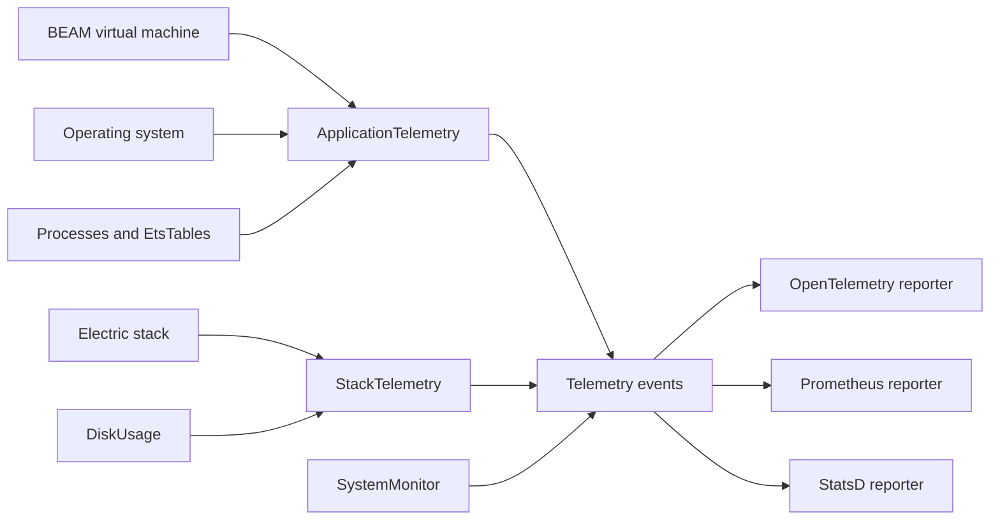
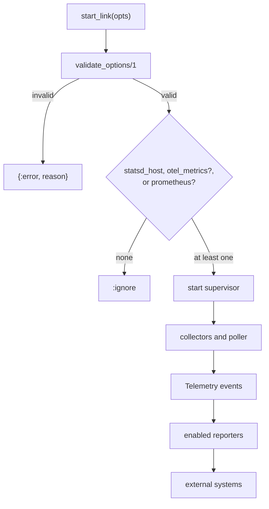

# electric-telemetry

This directory explains the `electric_telemetry` Elixir library. The library collects measurements from the Bogdan/Björn's Erlang Abstract Machine (BEAM) virtual machine and from an Electric stack. It sends those measurements to one or more exporters.

These terms are used throughout:

- A **measurement** is one data point with a name, a value, and optional metadata. A collection function produces it.
- An **event** is a Telemetry event. It has an event name, a measurements map, and a metadata map.
- A **metric** is a rule that selects events and one measurement, adds tags from the metadata, and produces one exported time series.
- A **reporter** is a process that owns a list of metrics, subscribes to their events, and exports the series to an external system. This document also calls it an **exporter**.
- **StatsD** is a plain-text metric protocol. An **agent** is the local StatsD process that receives the text and forwards it.
- **OpenTelemetry** is a vendor-neutral observability standard. **OTLP** is the OpenTelemetry Protocol that carries the data to a collector.

The source is at `/Users/darkvoid/GitSources/src.Electric/electric/packages/electric-telemetry`. The library version is `0.4.0`, taken from `package.json:1-5`. The licence is Apache-2.0. The library requires Elixir `~> 1.17` (`mix.exs:8`).

The parent study is [Electric and Durable Streams](../README.md). The package index is in the [parent repository map](../01-repository-map.md).

## What the library does

1. **Option validation.** `ElectricTelemetry.validate_options/1` checks a keyword list against a NimbleOptions schema (`lib/electric/telemetry.ex:21-33`).
2. **Application collection.** `ElectricTelemetry.ApplicationTelemetry` collects machine-level and BEAM-level measurements. It runs a system monitor and a poller (`lib/electric/telemetry/application_telemetry.ex:17-40`).
3. **Stack collection.** `ElectricTelemetry.StackTelemetry` defines Electric-specific metrics. It also measures the storage directory size (`lib/electric/telemetry/stack_telemetry.ex:17-48`).
4. **Measurement helpers.** `Processes`, `EtsTables`, `DiskUsage`, and `SystemMonitor` produce the measurements (`lib/electric/telemetry/processes.ex:1-329`, `lib/electric/telemetry/ets_tables.ex:1-287`, `lib/electric/telemetry/disk_usage.ex:1-171`, `lib/electric/telemetry/system_monitor.ex:1-173`).
5. **Export.** The `Reporters.Otel`, `Reporters.Prometheus`, and `Reporters.Statsd` modules start the chosen exporter (`lib/electric/telemetry/reporters/otel.ex:2-8`, `lib/electric/telemetry/reporters/prometheus.ex:2-6`, `lib/electric/telemetry/reporters/statsd.ex:4-18`).

## Documents

| Document | What you learn |
|----------|----------------|
| [00-overview.md](00-overview.md) | The purpose, the layers, the supervision trees, and the options |
| [01-events-and-handlers.md](01-events-and-handlers.md) | Every emitted event, every metric, every periodic measurement, and the reporters |



## Key insight

**Key insight:** the library separates *collection* from *export*. Each supervisor pairs its collectors with the exporters that are enabled. Export is optional and independent for each destination. If no destination is configured, both `ApplicationTelemetry.start_link/1` and `StackTelemetry.start_link/1` return `:ignore`, and no poller, monitor, or collector starts (`lib/electric/telemetry/application_telemetry.ex:19-26`, `lib/electric/telemetry/stack_telemetry.ex:19-25`). This keeps a development node free of telemetry overhead without a code change.

The cost is that collection does not exist without at least one exporter. A caller cannot use this library only to emit events for a separate Telemetry handler. The caller must enable one reporter, or call the collection functions directly.

**Aha:** the `:ignore` return is the whole configuration mechanism for "off". There is no `enabled: false` flag and no separate development branch. An empty reporter set stops the supervisor before any child starts.



An arrow means "the left box leads to the right box". The gate is before the supervisor starts. A disabled destination produces no collector, so no event is emitted for it.

## Reading order

| Stage | Read | Why |
|-------|------|-----|
| 1 | [00-overview.md](00-overview.md) | The problem, the package facts, the two supervisors, and every configuration option |
| 2 | [01-events-and-handlers.md](01-events-and-handlers.md) | Every event name, measurement, and metadata key; each periodic function and each reporter |

## Related studies

- [sync-service](../sync-service/README.md) is the main consumer. Document [06-telemetry-and-observability.md](../sync-service/06-telemetry-and-observability.md) shows how the stack metrics are used.
- [durable-streams](../durable-streams/README.md) has a separate telemetry design for the TypeScript server.
- [agents-runtime](../agents-runtime/README.md) is another component in the same platform.

## Package map

All paths are relative to `/Users/darkvoid/GitSources/src.Electric/electric/packages/electric-telemetry`.

| Area | File |
|------|------|
| Top-level helpers | `lib/electric/telemetry.ex` |
| Option schema | `lib/electric/telemetry/opts.ex` |
| Application metrics | `lib/electric/telemetry/application_telemetry.ex` |
| Stack metrics | `lib/electric/telemetry/stack_telemetry.ex` |
| Poller wrapper | `lib/electric/telemetry/poller.ex` |
| System monitor | `lib/electric/telemetry/system_monitor.ex` |
| Process sampling | `lib/electric/telemetry/processes.ex` |
| ETS table sampling | `lib/electric/telemetry/ets_tables.ex` |
| Disk sampling | `lib/electric/telemetry/disk_usage.ex` |
| Disk walk | `lib/electric/telemetry/disk_usage/disk.ex` |
| Exporters | `lib/electric/telemetry/reporters/` |

## Build and test

The package is a Mix project. `mix.exs:19-31` lists the dependencies. The runtime dependencies are `otel_metric_exporter`, `telemetry`, `telemetry_metrics`, `telemetry_metrics_prometheus_core`, `telemetry_metrics_statsd`, and `telemetry_poller`. The list also contains `jason`, with no `only:` restriction, so Mix installs it in every environment; no module in the package refers to it (`mix.exs:33-41`).

```bash
mix deps.get
mix test
```

The test suite uses `junit_formatter` and `ExUnit` (`test/test_helper.exs:1-2`). It covers the option schema, process sampling, ETS sampling, disk usage, the poller, the system monitor, and the application supervisor.
