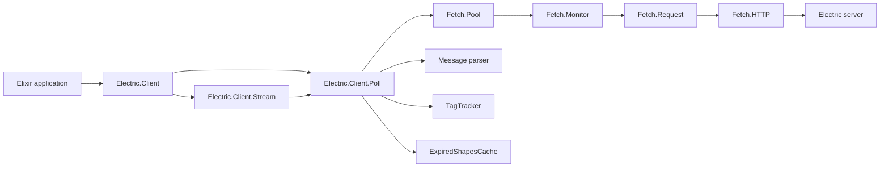
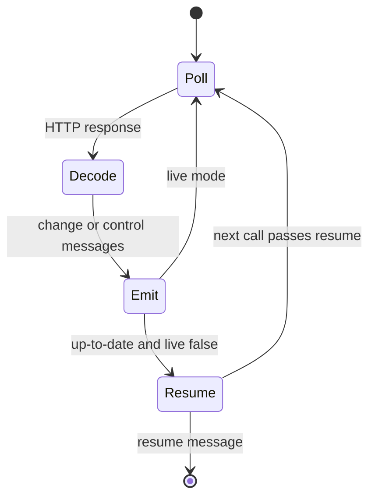

# elixir-client

`electric_client` is the official Elixir client for Electric. **Electric** is a sync engine. It streams a filtered subset of a PostgreSQL database to clients over the Hypertext Transfer Protocol (HTTP). This client turns one Electric shape into an Elixir `Enumerable` of change messages. It also offers a request-response polling interface for callers that control their own loop. The client speaks the Electric shape protocol, decodes the wire messages into Elixir structs, and applies the same cache and move-out rules as the TypeScript client.

A **shape** is a filtered subset of one PostgreSQL table. A **shape stream** is the sequence of messages that follows one shape. A **shape handle** is the server-side identifier for one running shape. An **offset** is a position inside the shape stream. The client sends the offset to resume.

The protocol delivers three message groups. A **change message** describes one insert, update, or delete of one row. A **control message** describes protocol state, such as `up-to-date` or `must-refetch`. A **move-out message** names row tags that left the shape filter; the client turns those tags into synthetic delete messages. A **resume message** is a client-side checkpoint that a finite stream adds at its end.

A minimal use looks like this:

```elixir
{:ok, client} = Electric.Client.new(base_url: "http://localhost:3000")
stream = Electric.Client.stream(client, "issues", live: false)

for %{headers: %{operation: operation}, value: value} <- stream do
  IO.inspect({operation, value})
end
```

`live: false` stops at the first `up-to-date` message. The final element is a `%Electric.Client.Message.ResumeMessage{}` that a later call can pass as `resume:`. The default `live: true` follows changes until the caller halts.

The source is at `/Users/darkvoid/GitSources/src.Electric/electric/packages/elixir-client`. The version is `0.10.3`, taken from `package.json:4`. The licence is Apache-2.0 (`mix.exs:86-95`). The library requires Elixir `~> 1.17` (`mix.exs:10`).

The parent study is [Electric and Durable Streams](../README.md). The package index is in the [parent repository map](../01-repository-map.md).

## What the package does

1. **Configuration and validation.** `Electric.Client.new/1` validates options against a NimbleOptions schema and resolves the endpoint (`lib/electric/client.ex:166-219`, `lib/electric/client.ex:279-290`).
2. **Shape definition.** `Electric.Client.ShapeDefinition` holds a table, a filter, a column list, parameters, and a replica mode. It serialises itself into query parameters (`lib/electric/client/shape_definition.ex:20-66`, `lib/electric/client/shape_definition.ex:208-223`).
3. **Streaming.** `Electric.Client.Stream` implements `Enumerable` over repeated polls. **Live mode** (`live: true`, the default) follows changes until the caller halts. **Finite mode** (`live: false`) stops at the first `up-to-date` message and appends a resume message. **Resume** restarts a finite stream from a previous resume message (`lib/electric/client/stream.ex:99-121`, `lib/electric/client/stream.ex:279-306`).
4. **Polling.** `Electric.Client.Poll` makes one request and returns messages plus a new state (`lib/electric/client/poll.ex:78-99`).
5. **Transport.** `Electric.Client.Fetch` defines a behaviour. The default implementation uses Req, an HTTP client, and Finch, a connection pool. A pool coalesces identical concurrent requests, so two callers that ask for the same shape share one request (`lib/electric/client/fetch.ex:5-16`, `lib/electric/client/fetch/http.ex:79-84`, `lib/electric/client/fetch/pool.ex:18-40`).
6. **Message decoding.** `Electric.Client.Message` parses change messages, control messages, move-out messages, and move-in messages. The stream also creates a resume message at the end of a finite stream (`lib/electric/client/message.ex:318-373`, `lib/electric/client/stream.ex:222-223`).
7. **Tag tracking.** `Electric.Client.TagTracker` turns move-out patterns into synthetic delete messages (`lib/electric/client/tag_tracker.ex:49-135`, `lib/electric/client/tag_tracker.ex:155-245`).
8. **Optional integrations.** An Ecto adapter converts a query or changeset into a shape definition. Embedded mode calls the Electric application programming interface (API) in the same virtual machine. A mock backend scripts responses for tests (`lib/electric/client/ecto_adapter.ex:10-17`, `lib/electric/client/embedded.ex:31-44`, `lib/electric/client/mock.ex:107-125`).

## Documents

| Document | What you learn |
|----------|----------------|
| [00-overview.md](00-overview.md) | The purpose, the package facts, the layers, and the runtime processes |
| [01-shape-stream-consumer.md](01-shape-stream-consumer.md) | How a shape becomes an `Enumerable`: polling, message parsing, offsets, tags, resume, and recovery |
| [02-http-and-configuration.md](02-http-and-configuration.md) | Every client and stream option, the HTTP transport, retries, authentication, Ecto, embedded mode, and the mock backend |



An arrow means "the left box calls or uses the right box". The stream and the poll interface both call the same poll engine. The engine uses the request pool, the message parser, the tag tracker, and the expired-shape cache. The pool creates one monitor and one request process per request key; the diagram shows one of each, not one global pair. The shape definition and the poll state are data, not processes, and the diagram leaves them out.

## Package map

```text
elixir-client/
├── lib/electric/client.ex                 client configuration and public API
├── lib/electric/client/
│   ├── stream.ex                          Enumerable stream engine
│   ├── poll.ex                            one-request polling engine
│   ├── shape_state.ex                     state between polls
│   ├── message.ex                         wire message structs and parser
│   ├── shape_definition.ex                shape struct and query parameters
│   ├── tag_tracker.ex                     move-out and move-in tracking
│   ├── shape_key.ex                       canonical cache key
│   ├── expired_shapes_cache.ex            ETS cache of expired handles
│   ├── fetch.ex                           fetch behaviour
│   ├── fetch/
│   │   ├── request.ex                     request struct and URL builder
│   │   ├── response.ex                    response struct and header decoder
│   │   ├── http.ex                        Req transport with retries
│   │   ├── pool.ex                        request coalescing
│   │   └── monitor.ex                     subscriber broker
│   ├── ecto_adapter.ex                    Ecto to shape conversion
│   ├── ecto_adapter/
│   │   ├── postgres.ex                    WHERE clause rendering
│   │   └── array_decoder.ex               PostgreSQL array parsing
│   ├── embedded.ex                        in-process Electric API
│   ├── mock.ex                            scripted test backend
│   ├── authenticator.ex                   authentication behaviour
│   ├── authenticator/                     default and mock implementations
│   ├── value_mapper.ex                    value mapping behaviour
│   ├── application.ex                     Registry, Finch, supervisors
│   ├── offset.ex                          offset string helpers
│   └── util.ex                            identifier and map helpers
├── config/                                test harness configuration
└── test/                                  integration and unit tests
```

## Key insight

A finite stream has this message flow:



An arrow means "the left state leads to the right state". The resume edge returns to the same poll state with a stored offset. The stream does not keep a process alive between calls.

**Key insight:** the stream is a data structure, but each request is an isolated supervised process. `%Electric.Client.Stream{}` is a plain struct with no process of its own (`lib/electric/client/stream.ex:9-18`). Every poll runs through a short-lived `Fetch.Request` GenServer and a per-request `Fetch.Monitor` (`lib/electric/client/fetch/request.ex:119-132`, `lib/electric/client/fetch/monitor.ex:22-35`). The pool keys those processes by a four-part request key: the fetch module, the endpoint string, the request headers, and the request parameters (`lib/electric/client/fetch/pool.ex:54-61`, `lib/electric/client/fetch/request.ex:113`). Many consumers of the same shape with the same headers share one long-poll. A caller can stop iterating at any time without leaving a subscription behind.

**Aha:** the resume message is both an output and an input. It is not a row change and it carries no row data. A finite stream appends it after `up-to-date`, and a later call passes it back as `resume:` to recover the offset chain and the tag state. This is why a finite stream can end without losing its place, and why the resume value must be returned to a caller even when the caller asked only for changes (`lib/electric/client/shape_state.ex:130-140`, `lib/electric/client/stream.ex:222-223`).

## Reading order

| Stage | Read | Why |
|-------|------|-----|
| 1 | [00-overview.md](00-overview.md) | The problem, the package facts, the layers, and the runtime processes |
| 2 | [01-shape-stream-consumer.md](01-shape-stream-consumer.md) | One shape from definition to message list, including the offset chain, the move-out algorithm, and every recovery path |
| 3 | [02-http-and-configuration.md](02-http-and-configuration.md) | Every option, the retry policy, the authentication hooks, the Ecto adapter, and the optional backends |

## Related studies

- [typescript-client](../typescript-client/README.md) is the reference client for the same protocol.
- [sync-service](../sync-service/README.md) documents the server that serves shapes.
- [electric-telemetry](../electric-telemetry/README.md) is the telemetry library used by the server.
- [agents-runtime](../agents-runtime/README.md) is another component in the same platform.

## Source map

All paths are relative to `/Users/darkvoid/GitSources/src.Electric/electric/packages/elixir-client`.

| Area | File |
|------|------|
| Public client application programming interface | `lib/electric/client.ex` |
| Stream engine | `lib/electric/client/stream.ex` |
| Poll engine | `lib/electric/client/poll.ex` |
| Polling state | `lib/electric/client/shape_state.ex` |
| Message parsing | `lib/electric/client/message.ex` |
| Shape definition | `lib/electric/client/shape_definition.ex` |
| Tag tracking | `lib/electric/client/tag_tracker.ex` |
| HTTP transport | `lib/electric/client/fetch/` |
| Ecto integration | `lib/electric/client/ecto_adapter.ex` |
| Embedded mode | `lib/electric/client/embedded.ex` |
| Mock backend | `lib/electric/client/mock.ex` |
| Application children | `lib/electric/client/application.ex` |

## Build and test

The package is a Mix project. **Mix** is the build tool for Elixir. `mix.exs:53-71` lists the dependencies. The required runtime dependencies are `jason`, `nimble_options`, and `req`. The optional dependencies are `electric`, `ecto_sql`, and `gen_stage` (`mix.exs:55-58`). The first two switch on extra modules. `gen_stage` is declared but no module in `lib/` refers to it.

```bash
mix deps.get
mix test
```

The integration tests need a running Electric server and PostgreSQL. Start both from the Electric installation guide, then set `DATABASE_URL` and `ELECTRIC_URL` in the environment. The defaults are in `config/runtime.exs:5-17`. `ELECTRIC_URL` is the server root, for example `http://localhost:3000`; the client adds `/v1/shape`. The package README gives the same steps (`README.md:24-34`). The test support directory is added to the compile path only in the test environment (`mix.exs:29-30`).
