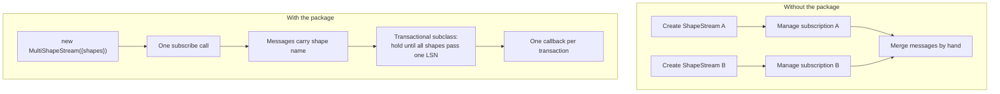
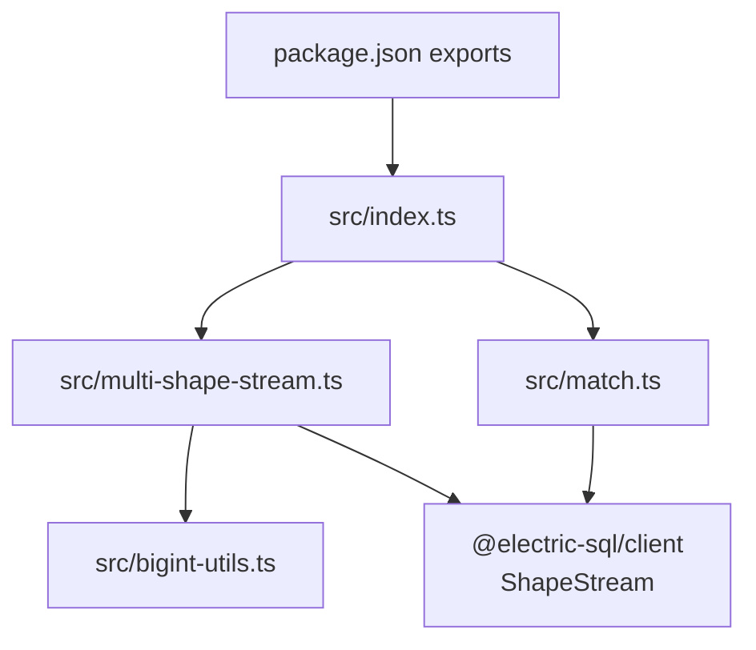

# Overview

`@electric-sql/experimental` is a small TypeScript package for client-side patterns that the main `@electric-sql/client` package does not provide. The first pattern is one subscription over several shapes, in arrival order or in transaction order. The second pattern is a Promise that settles on one matching change message. The package is published at version `6.0.28` under the Apache-2.0 licence (`package.json:1-84`).

**Electric** is a sync engine. It streams a filtered subset of a PostgreSQL database to clients over the Hypertext Transfer Protocol (HTTP). A **shape** is one filtered subset of one PostgreSQL table. A **shape stream** (`ShapeStream`) is the client object that follows one shape. It catches up to the current state and then follows live changes. This package does not replace that object. It composes it.

A shape stream delivers two message kinds. A **change message** describes one insert, update, or delete of one row. A **control message** describes protocol state; the important control value here is `up-to-date`, which says that the stream has caught up. A **batch** is the array of messages that one child stream delivers in one callback. A **transaction boundary** is the point at which every shape has reported an `up-to-date` position at or above one PostgreSQL transaction's Log Sequence Number (LSN). An **LSN** is PostgreSQL's position in its write-ahead log; a higher value is a later database state. An **offset** is the position inside one shape stream that a client sends to resume. Each child stream keeps its own offset.

## Package facts

| Fact | Value |
|------|-------|
| Package name | `@electric-sql/experimental` |
| Version | `6.0.28` |
| Licence | Apache-2.0 |
| Module type | ECMAScript Module (ESM), with a CommonJS (CJS) build |
| Build tool | `tsup` |
| Test runner | `vitest` |
| Peer dependency | `@electric-sql/client` (required) |
| Source language | TypeScript |

The package has one export path, `.`. `package.json:37-49` maps that path to two artifacts. An `import` statement gets `dist/index.mjs` with types `dist/index.d.ts`. A `require` call gets `dist/cjs/index.cjs` with types `dist/cjs/index.d.cts`. The build tool `tsup` also writes two files that the export map does not name: `dist/index.legacy-esm.js` for old bundlers and a minified browser build (`tsup.config.ts:39-60`). A caller loads the package through the export map and does not choose a build by hand. `package.json:29-36` marks `@electric-sql/client` as a required peer dependency. The package is not a full client. It needs the main client at run time.

## The three behaviors it provides

### Behavior 1: several shapes, one callback

An application often needs data from more than one shape at the same time. For example, one shape can hold low-priority issues and a second shape can hold high-priority issues. A caller can create two `ShapeStream` objects, but then the caller must manage two subscriptions, two error paths, and two sets of messages.

`MultiShapeStream` creates and starts all child streams as one unit. It adds a `shape` name to every message. It sends all messages to one subscriber callback. `src/multi-shape-stream.ts:114-340` contains the class.

### Behavior 2: one callback per database transaction

A caller can need the changes from several shapes in database order. For example, an issue row and its comment row can change in one PostgreSQL transaction. If the caller receives the issue change before the comment change, an intermediate state appears. `TransactionalMultiShapeStream` holds change messages until every shape has reached the same transaction boundary. It then publishes the held messages in Log Sequence Number (LSN) order, and within one LSN in `op_position` order. `src/multi-shape-stream.ts:379-468` contains the class.

The transaction boundary is conservative. The class cannot see a PostgreSQL transaction identifier. It infers a boundary from two values that Electric adds to each message: the message LSN and the `up-to-date` control message's `global_last_seen_lsn`. The exact rule is in [01-experimental-modules.md](01-experimental-modules.md).

### Behavior 3: wait for one message

A test or a workflow often needs to wait until a known change arrives. For example, a test inserts a row and must wait for the insert message. `matchStream` subscribes to a stream, checks each change message against an operation list and a predicate, and resolves a Promise on the first match. `src/match.ts:12-53` contains the function.



An arrow means "the left box leads to the right box". In the left pane, each child stream needs its own subscription and manual merge. In the right pane, one object owns all child streams and one subscriber receives every batch. The transactional subclass adds a second stage after the merge. The child streams still exist. The package hides their separate lifecycles behind one object.

## Public surface

`src/index.ts:1-2` is the complete export list:

```ts
export * from './match'
export * from './multi-shape-stream'
```

The public names are these:

| Name | Kind | Source |
|------|------|--------|
| `MultiShapeStream` | Class | `src/multi-shape-stream.ts:114` |
| `TransactionalMultiShapeStream` | Class | `src/multi-shape-stream.ts:379` |
| `MultiShapeStreamInterface` | Interface | `src/multi-shape-stream.ts:56-78` |
| `MultiShapeMessages` | Exported union type | `src/multi-shape-stream.ts:48-54` |
| `matchStream` | Function | `src/match.ts:12-17` |
| `matchBy` | Function | `src/match.ts:55-60` |

Two names are easy to confuse. `MultiShapeMessage` (singular, `src/multi-shape-stream.ts:44-46`) is an internal union of one shape's change message and that shape's control message. It is not exported. `MultiShapeMessages` (plural, `src/multi-shape-stream.ts:48-54`) is the exported union across every configured shape. It maps each shape name to `MultiShapeMessage<row type, shape name>` and then takes the union of those mapped types. A subscriber therefore gets messages from all shapes, and each message's `shape` field is narrowed to the shape that produced it.

`MultiShapeStreamInterface` is the shape of the public object. It describes the `shapes` property, the `subscribe` and `unsubscribeAll` methods, the three status methods, and the `isUpToDate` property. The class implements this interface (`src/multi-shape-stream.ts:114-118`). A caller can use the interface as a type for a variable without naming the class.

The `MultiShapeChangeMessage` and `MultiShapeControlMessage` interfaces at `src/multi-shape-stream.ts:32-42` are not exported by name. They appear inside the two exported unions.

The `bigint` helpers in `src/bigint-utils.ts:1-11` are not exported by `src/index.ts`. They support the two stream classes, and the test file imports them by their direct path. A caller must not rely on them as a public interface.

## How the parts fit



`src/multi-shape-stream.ts:1-14` imports `ShapeStream`, `isChangeMessage`, and `isControlMessage` from the client package. It also imports three `bigint` helpers from the local module. The match module imports the message guards and the types `ShapeStreamInterface`, `ChangeMessage`, `Operation`, `Row`, and `Value` (`src/match.ts:1-10`).

## What a message looks like

A normal change message from Electric carries `headers` and `value`. A multi-shape change message adds one field:

```ts
interface MultiShapeChangeMessage<
  T extends Row<unknown>,
  ShapeNames extends string,
> extends ChangeMessage<T> {
  shape: ShapeNames
}
```

The citation is `src/multi-shape-stream.ts:32-37`. The type parameter `ShapeNames` is the union of the keys in the `shapes` option. TypeScript therefore knows that `message.shape` is one of the configured names.

A concrete batch from a stream with two shapes can look like this. The comments describe the fields; the values are illustrative.

```jsonc
[
  {
    "shape": "issues",                       // added by MultiShapeStream
    "headers": {
      "operation": "insert",                // "insert", "update", or "delete"
      "lsn": "2745",                        // PostgreSQL LSN of the change
      "op_position": 1,                     // position inside one transaction
      "last": true                          // last change at this LSN
    },
    "value": { "id": 1, "priority": "high" }
  },
  {
    "shape": "comments",
    "headers": {
      "operation": "insert",
      "lsn": "2745",
      "op_position": 2,
      "last": true
    },
    "value": { "id": 10, "issue_id": 1, "body": "first" }
  },
  {
    "shape": "comments",
    "headers": {
      "control": "up-to-date",
      "global_last_seen_lsn": "2745"
    }
  }
]
```

The package reads six header fields.

| Header | Type | Meaning | Read at |
|--------|------|---------|---------|
| `operation` | string | `insert`, `update`, or `delete` | passed through; read by `matchStream` (`src/match.ts:26`) |
| `lsn` | string of digits | PostgreSQL LSN of the change | `src/multi-shape-stream.ts:197`, `440` |
| `global_last_seen_lsn` | string of digits | Highest LSN that Electric had seen when it sent `up-to-date` | `src/multi-shape-stream.ts:182`, `462` |
| `control` | string | Control value; the package acts on `up-to-date` | `src/multi-shape-stream.ts:456` |
| `last` | boolean | True on the last change at one LSN | `src/multi-shape-stream.ts:447-448` |
| `op_position` | number | Position of the change inside one transaction | `src/multi-shape-stream.ts:415-420` |

A batch can hold change messages, control messages, or both. A **batch** is not a transaction. The child stream decides its size. The package forwards each batch and adds the `shape` field to every item (`src/multi-shape-stream.ts:210-218`).

The exported `MultiShapeMessages` type maps each shape name to its own message type and then takes the union of those types (`src/multi-shape-stream.ts:48-54`). This is why the type test in `test/multi-shape-stream.test-d.ts:16-50` can prove that `stream.shapes.users` is `ShapeStream<UserRow>` and `stream.shapes.posts` is `ShapeStream<PostRow>`.

## Key insight

**Key insight:** the package merges message batches, not rows. Each child shape stream keeps its own offsets, retry logic, and up-to-date control messages. `MultiShapeStream` adds a `shape` name and forwards the batch. This is why the package needs no database and no global offset. It also means that "all shapes are up to date" is a derived property, not a stored one.

The class computes that property in `isUpToDate` by checking every child (`src/multi-shape-stream.ts:337-339`). `isUpToDate` is a getter, so a caller reads `stream.isUpToDate` and does not call it. The value is true only when each child's own `isUpToDate` property is true, which means that each child has delivered an `up-to-date` control message at least once and has no pending catch-up work. The transactional subclass uses the same idea to decide when a transaction is complete.

**Aha:** the package never needs a global offset, because it never merges the children into one log. Each child stays at its own position. "All shapes are current" is computed on demand from the children. This is why the class can start with already-created `ShapeStream` objects and why a slow child does not move the position of a fast child.

## Limits of this document

This overview names the three behaviors and the message model. It does not explain the transaction merge algorithm, the refresh heuristic, or each option. Document [01-experimental-modules.md](01-experimental-modules.md) gives those details with source citations, a worked transaction, and the build and test notes.

## Related documents

- [README.md](README.md) is the package index.
- [01-experimental-modules.md](01-experimental-modules.md) is the full module reference.
- [../typescript-client/README.md](../typescript-client/README.md) documents the `ShapeStream` class that this package wraps.
- [../sync-service/README.md](../sync-service/README.md) documents the server side of a shape.
