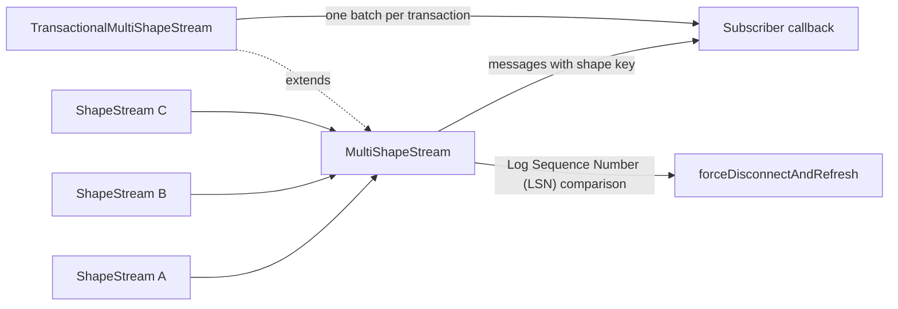
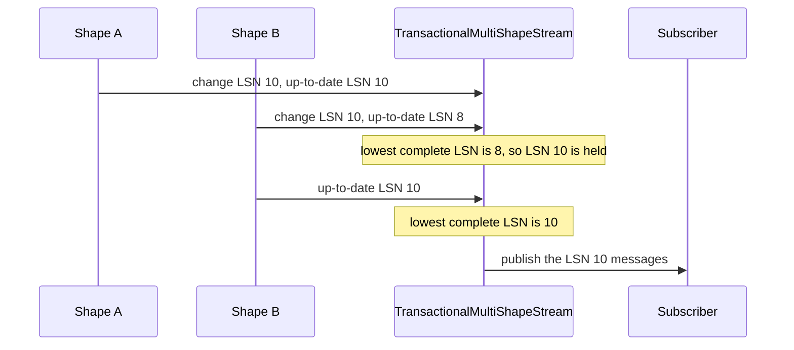

# experimental

This directory explains the `@electric-sql/experimental` package. The package holds TypeScript features for Electric that are useful but not yet stable enough for the main Electric client. "Experimental" means the public interface can change without a major-version release.

The package assumes four terms from Electric:

- **Electric** is a sync engine. It streams a filtered subset of a PostgreSQL database to clients over the Hypertext Transfer Protocol (HTTP).
- A **shape** is a filtered subset of one PostgreSQL table.
- A **shape stream** (`ShapeStream`) is the client object that follows one shape. It first catches up to the current rows, then follows live changes.
- A **message** is one item in a batch that a shape stream delivers. A change message describes one insert, update, or delete. A control message describes protocol state, such as `up-to-date`.

The package has three behaviors:

1. **One subscription over several shapes.** `MultiShapeStream` subscribes to many Electric shapes at the same time and publishes their messages through one callback. Each message gains a `shape` field that names its child shape.
2. **One callback per transaction.** `TransactionalMultiShapeStream` extends the first class. It holds messages until every child shape has passed the same transaction boundary, then publishes them together.
3. **Wait for one matching message.** `matchStream` resolves a Promise when a chosen shape emits a change message that matches an operation list and a predicate.

The source is at `/Users/darkvoid/GitSources/src.Electric/electric/packages/experimental`. The package version is `6.0.28`. The licence is Apache-2.0 (`package.json:1-84`).

**Conventions.** Source citations such as `src/match.ts:12` are relative to the package root above. Links to other documents are relative to this directory.

The parent study is [Electric and Durable Streams](../README.md). The package index is in the [parent repository map](../01-repository-map.md).

## What the package contains

| Module | Exported names | Purpose |
|--------|----------------|---------|
| `src/multi-shape-stream.ts` | `MultiShapeStream`, `TransactionalMultiShapeStream`, `MultiShapeStreamInterface`, `MultiShapeMessages` | Subscribe to many shapes through one callback |
| `src/match.ts` | `matchStream`, `matchBy` | Resolve when a matching change message arrives |
| `src/bigint-utils.ts` | `bigIntMax`, `bigIntMin`, `bigIntCompare` | Find the maximum and minimum, and compare, `bigint` values without argument spread |

`src/index.ts:1-2` re-exports the two modules `./match` and `./multi-shape-stream`. It does not export objects named `match` and `multi-shape-stream`. The public names are the classes, functions, interface, and types in those modules. The three functions in `src/bigint-utils.ts:1-11` are internal helpers. They are not part of the public package surface.

A **batch** is the array of messages that one child shape stream passes to its subscriber in one callback. The array can hold change messages, control messages, or both. It is one unit of delivery, not one database transaction. The package forwards a batch and never merges rows from different shapes into one row set.

## Documents

| Document | What you learn |
|----------|----------------|
| [00-overview.md](00-overview.md) | The purpose, package facts, the definitions of shape, message, batch, and offset, and the three public behaviors |
| [01-experimental-modules.md](01-experimental-modules.md) | Every exported type and function, the message headers, the transaction merge rule with a worked example, and the tests |



Each box is a child `ShapeStream` object. `MultiShapeStream` subscribes to all of them. When one child delivers a batch, the class compares the newest data `LSN` with each child's last `up-to-date` `LSN`. A **Log Sequence Number (LSN)** is PostgreSQL's position in its write-ahead log; a higher value is a later database state. If a child has not reached the newest data `LSN`, the class calls `forceDisconnectAndRefresh()` on that child. That method, inherited from `ShapeStream`, drops the child's HTTP connection and re-fetches from its current offset. The transactional subclass holds the messages and publishes one batch per transaction.

The transaction gate waits for the slowest child shape:



## Key insight

**Key insight:** a multi-shape stream is not a merge of data. It is a merge of message batches. The class maps each message to a new object with the same fields plus a `shape` field, then publishes the new array. It does not mutate the child message. The transactional subclass then delays publication until every child stream has passed the same **transaction boundary**. A transaction boundary is the point at which every shape has reported an `up-to-date` position at or above the transaction's LSN. This design keeps each child stream in charge of its own offsets and retry logic.

**Aha:** the transaction gate uses the lowest complete LSN, not the highest. Each child reports its own complete LSN, and `#getLowestCompleteLsn` takes the minimum across the children (`src/multi-shape-stream.ts:395-407`). A change at LSN 10 is held while any child has reported only LSN 8. The slowest shape sets the clock. A maximum would publish a transaction before one shape had delivered its part, so the subscriber would see a partial transaction.

## A minimal example

The constructor accepts either shape options or existing `ShapeStream` objects (`src/multi-shape-stream.ts:140-165`). The callback receives one array per child batch.

```ts
import { ShapeStream } from '@electric-sql/client'
import { MultiShapeStream, matchStream, matchBy } from '@electric-sql/experimental'

const users = new ShapeStream({ url: 'http://localhost:3000/v1/shape/users' })

const multi = new MultiShapeStream({
  shapes: {
    users,
    posts: { url: 'http://localhost:3000/v1/shape/posts' },
  },
})

const unsubscribe = multi.subscribe(
  (messages) => {
    for (const message of messages) {
      console.log(message.shape, message.headers.operation, message.value)
    }
  },
  (error) => console.error(error)
)

// Resolve with the first inserted row whose id is 1.
const watched = new ShapeStream({ url: 'http://localhost:3000/v1/shape/users' })
const inserted = await matchStream(watched, ['insert'], matchBy('id', 1), 5000)

unsubscribe()
```

The `operations` array holds Electric operation names: `'insert'`, `'update'`, or `'delete'`. The predicate receives a change message. The `matchStream` call takes four arguments (`src/match.ts:12-17`).

## Reading order

| Stage | Read | Why |
|-------|------|-----|
| 1 | [00-overview.md](00-overview.md) | The message and header terms, the problem, and the package map |
| 2 | [01-experimental-modules.md](01-experimental-modules.md) | `MultiShapeStream`, `TransactionalMultiShapeStream`, `matchStream`, `matchBy`, the internal `bigint` helpers, and every option and default |

## Related studies

- [typescript-client](../typescript-client/README.md) is the main Electric client. It defines `ShapeStream`, `ChangeMessage`, `ControlMessage`, the operation names, and the header fields that this package reads.
- [sync-service](../sync-service/README.md) is the server that produces shapes and the `lsn` and `op_position` headers.
- [durable-streams](../durable-streams/README.md) defines the protocol model of offsets and append-only logs under every shape.
- [agents-runtime](../agents-runtime/README.md) is another consumer of streamed state.

The [parent study](../README.md) is the index for the whole Electric repository. The [durable-streams study](../durable-streams/README.md) is a separate protocol study, not the parent of this package.

## Package map

All paths are relative to `/Users/darkvoid/GitSources/src.Electric/electric/packages/experimental`.

| Area | File |
|------|------|
| Public exports | `src/index.ts` |
| Multi-shape stream | `src/multi-shape-stream.ts` |
| Match helpers | `src/match.ts` |
| Internal `bigint` helpers | `src/bigint-utils.ts` |
| Build configuration | `tsup.config.ts` |
| Package metadata | `package.json` |

## Build and test

The peer dependency `@electric-sql/client` is required at run time (`package.json:29-36`). Install both packages:

```bash
pnpm add @electric-sql/experimental @electric-sql/client
```

The package uses `tsup` for the build and `vitest` for the tests. `package.json:65-73` defines the scripts:

```json
"build": "shx rm -rf dist && tsup && tsc -p tsconfig.build.json",
"test": "pnpm exec vitest",
"typecheck": "tsc -p tsconfig.json"
```

The test files are not all the same kind. `test/bigint-utils.test.ts` and `test/multi-shape-stream.test-d.ts` do not contact a server. The integration tests in `test/multi-shape-stream.test.ts` and `test/match.test.ts` need a running Electric sync service. `test/support/global-setup.ts:3-5` reads `ELECTRIC_URL` with the default `http://localhost:3000`, waits for `/v1/health` to report `active` (`test/support/global-setup.ts:30-55`), and creates a dedicated `electric_test` schema (`test/support/global-setup.ts:57-69`). The fixtures in `test/support/test-context.ts` create the `issues` table in that schema and give the tests shape helpers.

Start the service from the package README instructions (`README.md:26-34`), then run `pnpm test` in this package.
