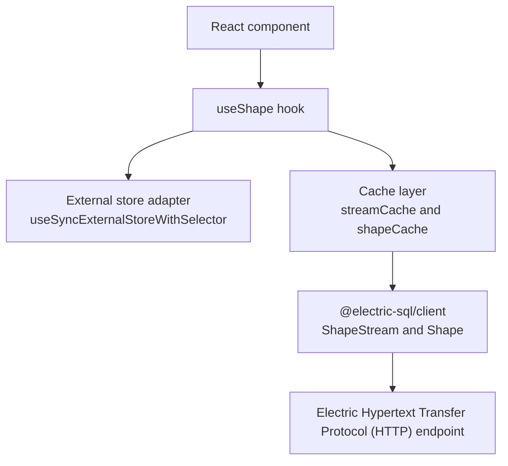
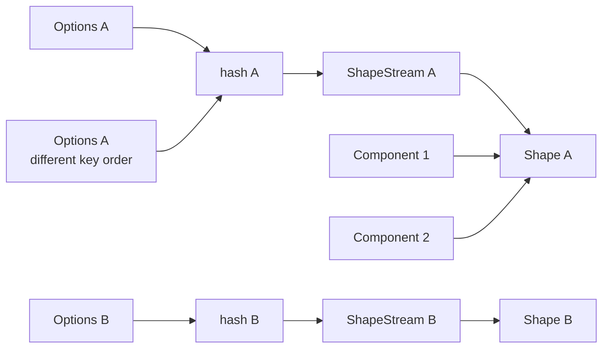
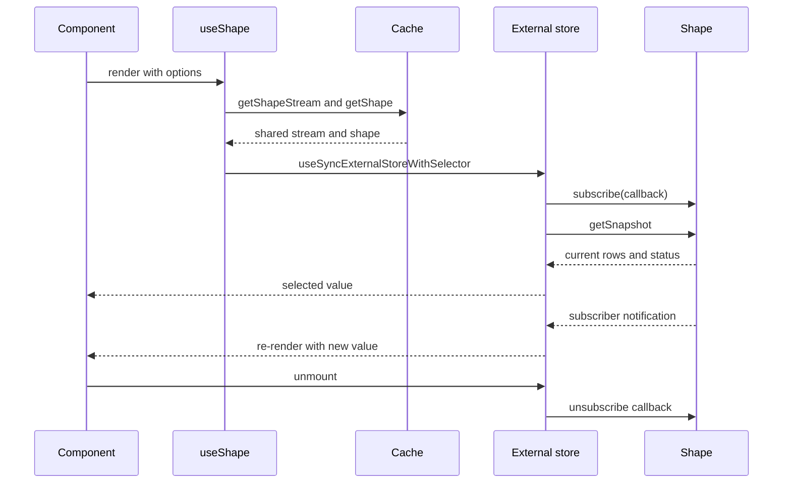

# Overview

`@electric-sql/react` is the React binding for the Electric TypeScript client. An Electric shape is a filtered, column-projected view of one PostgreSQL table. A `ShapeStream` is the live Hypertext Transfer Protocol (HTTP) connection to that shape. A `Shape` is the in-memory row map that the stream feeds. The map key is the row's Electric key, a string. The value is the row object. `shape.currentRows` returns the map values as an array. The citation is `../typescript-client/src/shape.ts:113-115`. The package exports `useShape`, `getShapeStream`, `getShape`, `preloadShape`, `sortedOptionsHash`, and the `UseShapeResult` type. The package is small. All behavior is in one file, `src/react-hooks.tsx`.

The package is published as `@electric-sql/react` at version `1.0.57`. The license is Apache-2.0. It declares React as an optional peer dependency in the range `>=18.3.1 <20.0.0`. The citation is `package.json:2-11` and `package.json:56-64`.

## Package facts

| Fact | Value | Source |
|------|-------|--------|
| Package name | `@electric-sql/react` | `package.json:2` |
| Version | `1.0.57` | `package.json:4` |
| License | Apache-2.0 | `package.json:56` |
| Module type | ECMAScript module (ESM) | `package.json:81` |
| Main dependency | `@electric-sql/client` | `package.json:10` |
| Store dependency | `use-sync-external-store` | `package.json:11` |
| React peer range | `>=18.3.1 <20.0.0` | `package.json:59-60` |
| Build tool | `tsup` | `package.json:33` |
| Test tools | `vitest`, Testing Library, jsdom | `package.json:14`, `package.json:27`, `package.json:36` |

The package has no network code of its own. It uses `ShapeStream` and `Shape` from the client package. The citation is `src/react-hooks.tsx:1-9`.

## The layers

The component layer calls the hook. The hook returns a selected value. The store adapter tells React when the value changed. The cache layer shares streams and shapes between components. The client layer performs synchronization over long polling or Server-Sent Events (SSE).

## The public surface

| Symbol | Kind | Behavior | Source |
|--------|------|----------|--------|
| `useShape(options)` | Hook | Subscribe a component to a shape | `src/react-hooks.tsx:164-211` |
| `preloadShape(options)` | Function | Create or reuse a shape and wait for rows; the promise rejects if the shape reports an error | `src/react-hooks.tsx:17-24` |
| `getShapeStream(options)` | Function | Get or create a cached stream | `src/react-hooks.tsx:47-69` |
| `getShape(stream)` | Function | Get or create a cached shape | `src/react-hooks.tsx:71-90` |
| `sortedOptionsHash(options)` | Function | Stable hash of the options object | `src/react-hooks.tsx:43-45` |
| `UseShapeResult<T>` | Type | Default hook result | `src/react-hooks.tsx:92-114` |

The hook and the helpers are exported through `src/index.ts:1`. The package export map points `.` to `dist/index.mjs` and `dist/cjs/index.cjs`. The citation is `package.json:38-52`.

## The cache model

The stream cache is a `Map<string, ShapeStream>`. The shape cache is a `Map<ShapeStream, Shape>`. The citation is `src/react-hooks.tsx:14-15`.

The shape cache uses the stream object as its key, not the option hash. A shape belongs to one stream object. When a caller asks for the shape of a stream that is not in the cache, the helper creates a new shape. When a later lookup sees an aborted stream, that lookup removes the stream's shape. The stream map entry may be removed in the same step. That second delete is best effort, because the recomputed hash can differ from the stored key. A later lookup with the original key removes the stale stream entry. The removal is lazy: no background task cleans the cache.

The key is the output of `sortedOptionsHash`. That function sorts object keys at every level. It converts an array by mapping the sort over each element. It converts a function to its source text. The citation is `src/react-hooks.tsx:26-45`.

The cache checks the cached stream's abort signal before it returns that stream. If the signal is aborted, the cache removes the stream and its shape. It then creates a new stream. The citation is `src/react-hooks.tsx:53-62`.

The signal belongs to the call that created the cached stream. The constructor stores it in `stream.options`; later callers whose options produce the same hash receive that same stream and do not replace its signal. A component that shares an existing stream does not own that stream's signal and must not abort it.

**Aha:** the cache treats an aborted stream as a dead cache entry, not as an error. When the owner aborts the signal, the next lookup removes the entry and creates a fresh stream automatically. The cache does not need a separate cleanup registry. The cost is that a shared stream lives as long as its creating signal: unmounting a component that shares it does not close it.

## One render cycle

The store adapter is `useSyncExternalStoreWithSelector`. It takes a subscribe function, a client snapshot function, a server snapshot function, and a selector. The citation is `src/react-hooks.tsx:200-207`.

## What the package does not do

The package does not manage authentication. It does not build the shape uniform resource locator (URL). It does not persist rows. It does not create a React context provider. The word "provider" in this directory means the cache helpers, not a React context component. All configuration is passed to each `useShape` call.

Read [01-use-shape-and-provider.md](01-use-shape-and-provider.md) for the hook and cache details. Read [02-lifecycle-and-state.md](02-lifecycle-and-state.md) for the render and subscription details.
