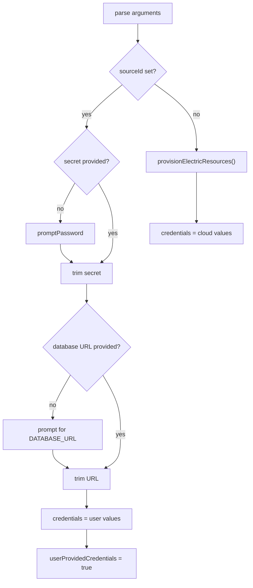
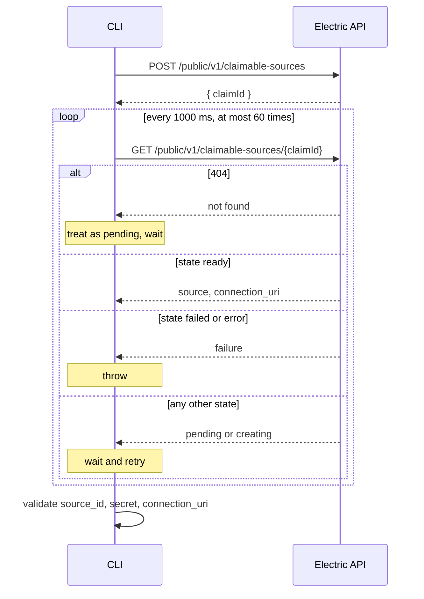
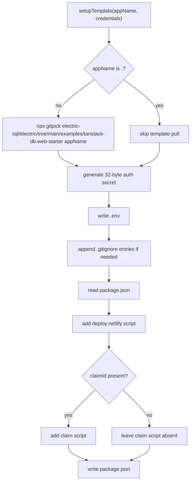

# The Quickstart Command

`@electric-sql/start` is a sequential command. It parses arguments, obtains credentials, writes a project, installs packages, optionally runs migrations, and prints next steps. Each step depends on the result of the previous step. The command has no rollback.

The entry point is `src/bin.ts:1-6`. The command logic is `src/cli.ts:169-281`.

## Entry and argument parsing

`bin.ts` calls `main()` and catches any error that escapes it. It prints the error and exits with code 1. `main` catches every error inside its own run, so a provisioning or template failure reaches the `Setup failed:` handler in `main`. `bin.ts` handles only a failure before or outside `main`, such as a startup error. The citation is `src/bin.ts:1-6` and `src/cli.ts:274-280`.

`parseArgs` reads the argument array from left to right. It recognizes three flags and one positional value. The citation is `src/cli.ts:16-70`.

| Argument | Field | Validation | Source |
|----------|-------|------------|--------|
| `--source` | `sourceId` | Must have a value that does not start with `-` | `src/cli.ts:23-29` |
| `--secret` | `secret` | Must have a value that does not start with `-` | `src/cli.ts:30-36` |
| `--database-url` | `databaseUrl` | Must have a value that does not start with `-` | `src/cli.ts:37-43` |
| other value | `appName` | Must not start with `-` | `src/cli.ts:44-46` |

A flag consumes the next array element and skips it. The citation is `src/cli.ts:24-29`.

An unknown flag that starts with `-` is ignored. The parser has no branch for it. For example, `start --sorce my-app` ignores `--sorce` and treats `my-app` as the application name. The command then runs in the default provisioned mode. The citation is `src/cli.ts:44-46`.

The parser exits with code 1 in three cases:

1. A flag has no value.
2. There is no application name.
3. There is more than one application name.

The citation is `src/cli.ts:25-28`, `src/cli.ts:49-57`, and `src/cli.ts:59-67`.

The usage text names the three flags and the `.` shortcut. The citation is `src/cli.ts:50-55`.

## Application name validation

`main` accepts `.` as a special name for the current directory. Every other name must match `^[a-zA-Z0-9-_]+$`. The citation is `src/cli.ts:173-180`.

The pattern permits letters, digits, hyphens, and underscores. It does not permit spaces, dots, or path separators. A name with a path separator would let the command write outside the current directory.

The command prints `Creating app: <name>` for a new directory. It prints `Configuring current directory...` for `.`. The citation is `src/cli.ts:182-186`.

## Credential branch



### The user-provided path

When `--source` is present, the command does not call the cloud interface. It resolves the two other values:

- A missing secret comes from `promptPassword`.
- A missing database uniform resource locator (URL) comes from `prompt`.
- An empty or whitespace-only value stops the command with exit code 1.

The citation is `src/cli.ts:197-225`.

The secret is trimmed before storage. The database URL is trimmed before storage. The citation is `src/cli.ts:219-223`.

The command sets `userProvidedCredentials` to true. The citation is `src/cli.ts:224`.

### The provisioning path

When `--source` is absent, the command calls `provisionElectricResources`. The citation is `src/cli.ts:226-228`.

The Electric Cloud application programming interface (API) performs three steps. The citation is `src/electric-api.ts:93-151`.



The create request sends an empty JavaScript Object Notation (JSON) body. The citation is `src/electric-api.ts:99-109`.

A missing `claimId` in the response is an error. The citation is `src/electric-api.ts:117-121`.

The poll interval is 1000 milliseconds. The maximum attempt count is 60. The citation is `src/electric-api.ts:41-42`.

The poll request sends the user agent `@electric-sql/start`. The citation is `src/electric-api.ts:53-56`.

A 404 response continues the loop without an error. The citation is `src/electric-api.ts:59-63`.

A non-2xx response other than 404 throws. The citation is `src/electric-api.ts:65-70`.

A `ready` response returns the status object. A `failed` response, or any response with an error field, throws. The citation is `src/electric-api.ts:74-82`.

When the attempts run out, the interface throws a timeout error. The citation is `src/electric-api.ts:88-90`.

The interface validates three fields before it returns: `source_id`, `secret`, and `connection_uri`. The citation is `src/electric-api.ts:127-135`.

The function returns this object:

```ts
{
  source_id: string,
  secret: string,
  DATABASE_URL: string, // from connection_uri
  claimId: string,
}
```

The citation is `src/electric-api.ts:137-142`.

Any error is wrapped with the prefix `Failed to provision Electric resources:`. The citation is `src/electric-api.ts:143-150`.

## The password prompt

`promptPassword` uses raw terminal mode when the input is a teletype (TTY). The citation is `src/cli.ts:86-133`.

| Key | Behavior | Source |
|-----|----------|--------|
| Enter | Restore terminal mode, stop reading, resolve the password | `src/cli.ts:107-113` |
| Backspace or delete | Remove one character and erase one asterisk | `src/cli.ts:114-119` |
| Control-C | Write a newline and exit with code 1 | `src/cli.ts:120-123` |
| Any printable character | Append the character and write `*` | `src/cli.ts:124-128` |

The function saves `stdin.isRaw` and restores it on Enter. It does not restore raw mode on Control-C; it writes a newline and calls `process.exit(1)`. A terminal that stays in raw mode after cancel is possible. The citation is `src/cli.ts:97-98`, `src/cli.ts:107-113`, and `src/cli.ts:120-123`.

When the input is not a TTY, the function falls back to a plain question. The citation is `src/cli.ts:89-92`.

**Aha:** the non-TTY fallback is what makes the command automatable. A piped run cannot use raw mode, so the function uses `readline` and the secret appears in the input stream. The same code path serves an interactive user and a continuous integration (CI) job, without a separate non-interactive flag.

The command uses `promptPassword` only for the secret in the user-provided path. The database URL uses the visible `prompt`. The citation is `src/cli.ts:201-213`.

`prompt` creates a `readline` interface, asks one question, closes the interface, and resolves the answer. The citation is `src/cli.ts:72-84`.

## Template setup

`setupTemplate` receives the application name and credentials. It computes the target path. A name of `.` uses the current working directory. Any other name is joined to the current working directory. The citation is `src/template-setup.ts:24-28`.



### Template retrieval

For a new directory, the command runs:

```text
npx gitpick electric-sql/electric/tree/main/examples/tanstack-db-web-starter <app-name>
```

The citation is `src/template-setup.ts:32-37`.

`gitpick` copies a subdirectory from a Git repository. It runs with `stdio: inherit`, so its output appears in the terminal. The citation is `src/template-setup.ts:34-37`.

For `.`, the command does not pull a template. It configures the files that already exist. The function always writes `.env`, so the directory must be writable. It creates `.gitignore` when absent, or appends the environment entries when the existing text does not contain `.env`. It patches `package.json` only when that file exists; when `package.json` is absent, it skips the script patch without an error. The citation is `src/template-setup.ts:63-74` for `.gitignore` and `src/template-setup.ts:76-97` for `package.json`.

The command does not check whether the target directory exists or is empty. It passes the name to `gitpick`; the behavior for an existing directory is the behavior of that tool, not of this package. The citation is `src/template-setup.ts:32-37`.

### Environment file

The command generates a Better Auth secret with 32 random bytes. The result is a 64-character hexadecimal string. The citation is `src/template-setup.ts:20-22` and `src/template-setup.ts:42`.

The `.env` content has five assignments and a warning header. The citation is `src/template-setup.ts:44-58`.

```dotenv
# Electric SQL Configuration
# Generated by @electric-sql/start
# DO NOT COMMIT THIS FILE

DATABASE_URL=<value>

ELECTRIC_URL=<value>
ELECTRIC_SOURCE_ID=<value>
ELECTRIC_SECRET=<value>

BETTER_AUTH_SECRET=<value>
```

The file is written with `writeFileSync`. An existing `.env` is replaced. The citation is `src/template-setup.ts:60`.

### Git ignore

The command reads an existing `.gitignore` when the file exists. It starts with empty content when the file is absent, so the appended block creates the file. It checks whether the content contains the substring `.env`. If not, it appends this block:

```text
# Environment variables
.env
.env.local
.env.*.local
```

The block has three patterns. The citation is `src/template-setup.ts:63-74`.

The check is a substring check, not a line check. A file that mentions `.env.example` also satisfies the check.

### Package scripts

The command reads `package.json` when the file exists. When the file is absent, it skips this section and leaves the project without the added scripts. It preserves every existing script and adds or replaces the `deploy:netlify` script:

```json
"deploy:netlify": "NODE_ENV=production NITRO_PRESET=netlify pnpm build && NODE_ENV=production npx netlify deploy --no-build --prod --dir=dist --functions=.netlify/functions-internal && npx netlify env:import .env"
```

The citation is `src/template-setup.ts:76-86`.

When the credentials contain a `claimId`, the command also adds:

```json
"claim": "npx open-cli \"<dashboard>/claim?uuid=<claimId>\""
```

The `<dashboard>` value is `getElectricDashboardUrl()`. It reads `ELECTRIC_DASHBOARD_URL` at the time of template setup, with the default `https://dashboard.electric-sql.cloud`. The citation is `src/template-setup.ts:88-91` and `src/electric-api.ts:37-39`.

The `claim` script opens a browser. It does not call the `claimResources` function in the package. The citation is `src/template-setup.ts:90` and `src/electric-api.ts:153-189`.

The package file is written with two-space indentation. The citation is `src/template-setup.ts:93-95`.

Any error in this function is wrapped with the prefix `Template setup failed:`. The citation is `src/template-setup.ts:99-103`.

## Install and migrate

After template setup, the command prints `Installing dependencies...` and runs `pnpm install`. The command requires the `pnpm` program and network access to the package registry. The citation is `src/cli.ts:234-239`.

The working directory is the target application directory. For `.`, it is the current directory. The citation is `src/cli.ts:238`.

A failed install does not stop silently. The command prints the failure, prints next steps with `showInstall` and `showMigrate` enabled, and exits with code 1. The citation is `src/cli.ts:240-248`.

In the provisioned mode, the command then runs `pnpm migrate`. This runs the `migrate` script from the generated template `package.json`; that script applies the application schema to the database. The command does not define the script itself. The citation is `src/cli.ts:250-257` and `src/template-setup.ts:76-86`.

A failed migration prints next steps with `showMigrate` enabled and exits with code 1. The citation is `src/cli.ts:258-265`.

The migrate step is skipped when the caller provided credentials. The citation is `src/cli.ts:251`.

## Next steps

`printNextSteps` prints a fixed set of commands with three optional lines. The citation is `src/cli.ts:141-167`.

| Option | Default | Line |
|--------|---------|------|
| `showInstall` | false | `pnpm install` |
| `showMigrate` | false | `pnpm migrate` |
| `showClaim` | true | `pnpm claim` |

The function always prints `pnpm dev`, `pnpm psql`, and `pnpm deploy:netlify`. It omits `cd <app>` when the name is `.`. The `dev`, `psql`, and `migrate` scripts come from the template. The tool adds or replaces `deploy:netlify`, and it adds `claim` in the provisioned mode. The citation is `src/cli.ts:144-165` and `src/template-setup.ts:83-91`.

The final tutorial line points to the Electric documentation site. The citation is `src/cli.ts:166`.

The success call sets `showMigrate` to the user-provided flag. A provisioned run has already migrated, so the printed command would be redundant. The user-provided run may still need to migrate. The citation is `src/cli.ts:270-273`.

The success call sets `showClaim` to the inverse of the user-provided flag. A provisioned run has a claim identifier and a claim script. A user-provided run does not. The citation is `src/cli.ts:270-273`.

## Error behavior

`main` wraps the full run in one `try` block. The citation is `src/cli.ts:188-280`.

The catch block prints `Setup failed:` and the error message. It exits with code 1. The citation is `src/cli.ts:274-280`.

The command performs no cleanup. A failure after template retrieval leaves the generated files in place. A failure after install leaves `node_modules` in place. The citation is `src/cli.ts:240-248`.

The command has two recovery paths and one generic path:

| Failure | Behavior |
|---------|----------|
| Install | Print next steps with `showInstall` and `showMigrate`; exit 1 |
| Migrate | Print next steps with `showMigrate`; exit 1 |
| Provision, template, or any other error | Print `Setup failed:`; exit 1; no next steps |

The citations are `src/cli.ts:240-248`, `src/cli.ts:258-265`, and `src/cli.ts:274-280`.

**Aha:** the command is a transaction with no rollback and no journal. For the two package-command failures, the recovery mechanism is the next-steps message. Each of those paths prints the exact commands that remain. Provisioning and template failures do not print recovery commands; the user must read the error and retry. The design assumes that a failed scaffold is easier to finish than to delete and repeat, but only for the install and migrate stages.

## Related documents

- [00-overview.md](00-overview.md) for the package surface and the two credential modes.
- [TypeScript client](../typescript-client/README.md) for the client in the generated application.
- [React hooks](../react-hooks/README.md) for the shape hook in the generated user interface.
- [Electric and Durable Streams](../README.md) for the parent study.
