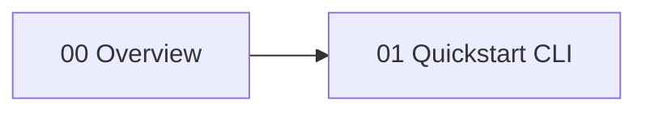
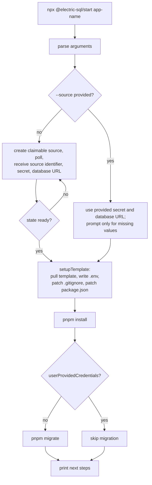

# Start

`@electric-sql/start` is the command-line quickstart for Electric. Electric is a sync engine that serves live queries, called shapes, from PostgreSQL. An Electric source is a named connection between Electric and one PostgreSQL database. An application uses the source identifier and secret to read shapes. The command creates a TanStack Start application, which is a full-stack React framework. In the default mode it also provisions an Electric Cloud source and a Neon PostgreSQL database. It writes the environment file, installs dependencies, and runs migrations. It can also configure an existing database through a supplied database uniform resource locator (URL).

The package is published as `@electric-sql/start` at version `1.0.3`. The license is Apache-2.0. It declares no runtime dependencies. The citation is `package.json:2-9`, `package.json:29`, and `package.json:58`.

The package installs one command:

```bash
npx @electric-sql/start my-app
```

The citation is `package.json:7-9` and `src/cli.ts:51`.

## Reading order

| Order | Document | What you learn |
|-------|----------|----------------|
| 1 | [00-overview.md](00-overview.md) | The purpose, the public surface, the two credential modes, and the limits |
| 2 | [01-quickstart-cli.md](01-quickstart-cli.md) | Argument parsing, provisioning, polling, template setup, and next steps |



## Package map

All paths are relative to `packages/start`.

| Area | File | Lines | Purpose |
|------|------|-------|---------|
| Command entry | `src/bin.ts` | 1-6 | Call `main` and report an unexpected error |
| Command logic | `src/cli.ts` | 1-283 | Arguments, prompts, orchestration, messages |
| Cloud interface | `src/electric-api.ts` | 1-189 | Provision, poll, and claim resources |
| Template setup | `src/template-setup.ts` | 1-104 | Pull the template, write `.env`, patch files |
| Public exports | `src/index.ts` | 1-2 | Export the cloud interface and template setup |
| Tests | `test/` | full tree | Command, cloud interface, and template tests |

## The pipeline



The ownership flag is `userProvidedCredentials`. The command sets it to true after it collects the source credentials, and it reuses the same boolean after install. The citations are `src/cli.ts:219-224` and `src/cli.ts:250-251`.

The branch at the top is the main design choice of the package. If the caller supplies a source identifier, the package trusts the caller's database and skips provisioning and migration. If not, the package creates a complete local stack. The citation is `src/cli.ts:195-266`.

**Aha:** this package has no npm runtime dependencies. It does not ship a Hypertext Transfer Protocol (HTTP) library, a template engine, a prompt library, or a database driver. It uses `fetch` for the Electric Cloud interface, `readline` for prompts, `child_process` for template retrieval and package commands, and `fs` for file writes. The citation is `package.json:29`, `src/cli.ts:3-7`, and `src/electric-api.ts:49-57`. The whole quickstart is a thin orchestrator over tools that Node.js already provides.

"No npm dependencies" does not mean "no prerequisites". The command also needs:
- Node.js with the global `fetch` function, which Node.js 18 and later provide.
- The `npx` command, to run the package and `gitpick`.
- The `pnpm` command, for `pnpm install` and `pnpm migrate`.
- Network access to the Electric Cloud application programming interface (API), the template repository, and the package registry.
- A Neon PostgreSQL database in the provisioned mode, or a reachable database in the supplied mode.

The citation is `src/cli.ts:234-257` and `src/template-setup.ts:32-37`.

## The exported surface and the command entry

`main` is the command entry, but the package does not export it. The package exports the cloud interface and the template setup.

| Symbol | Kind | Behavior | Source |
|--------|------|----------|--------|
| `main` | Function (internal) | Run the full quickstart; reached through `src/bin.ts` | `src/cli.ts:169-281` |
| `provisionElectricResources` | Function | Create and poll a claimable source | `src/electric-api.ts:93-151` |
| `claimResources` | Function | Create a claim URL for a source | `src/electric-api.ts:153-189` |
| `setupTemplate` | Function | Pull and configure the template | `src/template-setup.ts:24-104` |
| `getElectricApiBase` | Function | Read the dashboard application programming interface (API) base | `src/electric-api.ts:29-31` |
| `getElectricUrl` | Function | Read the Electric service URL | `src/electric-api.ts:33-35` |
| `getElectricDashboardUrl` | Function | Read the dashboard URL | `src/electric-api.ts:37-39` |
| `ElectricCredentials` | Type | Source identifier, secret, and database URL | `src/electric-api.ts:3-7` |
| `ClaimableSourceResponse` | Type | The `claimId` response | `src/electric-api.ts:9-11` |

The package entry point exports the cloud interface and the template setup. It does not export `main`. The citation is `src/index.ts:1-2`. The `start` command reaches `main` through `src/bin.ts:1-6`.

## Environment overrides

Three environment variables replace the default service addresses. The citation is `src/electric-api.ts:25-39`.

| Variable | Default value | Consumer |
|----------|---------------|----------|
| `ELECTRIC_API_BASE_URL` | `https://dashboard.electric-sql.cloud/api` | Provisioning and claim requests |
| `ELECTRIC_URL` | `https://api.electric-sql.cloud` | The `ELECTRIC_URL` value in the generated `.env` |
| `ELECTRIC_DASHBOARD_URL` | `https://dashboard.electric-sql.cloud` | The `claim` script URL |

The citation is `src/electric-api.ts:25-39`, `src/template-setup.ts:42-52`, and `src/template-setup.ts:88-91`.

## Related studies

- [TypeScript client](../typescript-client/README.md) explains the client that the generated application uses.
- [React hooks](../react-hooks/README.md) explains the shape hook that the generated user interface uses.
- [Y-Electric](../y-electric/README.md) is the shared-editing option for the same stack.
- [Electric and Durable Streams](../README.md) is the parent study.

## Source of truth

Every claim in this directory comes from the source files under `packages/start`. A citation has the form `src/cli.ts:120-145`. The line range is inclusive.

Return to the platform index: [../README.md](../README.md).
