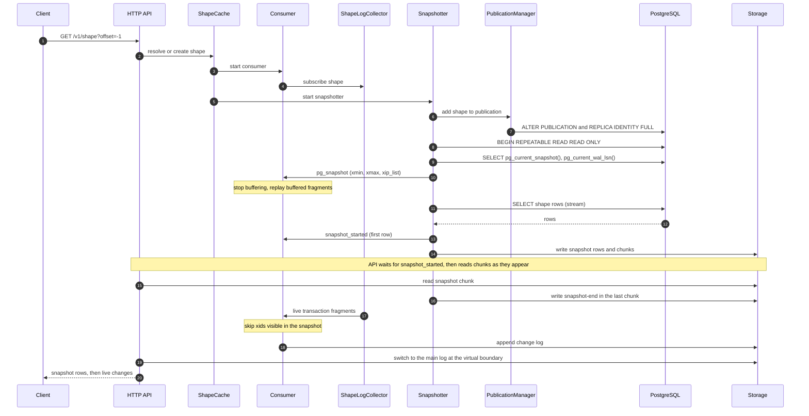

# Electric: How PostgreSQL Changes Become a Live Shape

Electric turns a PostgreSQL table into a live, partial copy on a client. The copy is a **shape**. A shape is a table name, a filter, and a column list. The server does not copy a table. It copies the rows that match the filter into a per-shape log, and then it appends every change to those rows. A client reads that log from an offset.

This document answers one question. How does the Electric sync engine turn PostgreSQL changes into a live, column-projected shape? Every claim comes from the source trees listed in [Scope and sources](#scope-and-sources). The document marks each inference with the word **inference**.

> **Aha.** After the initial snapshot, the engine does not run the shape query again. It keeps an index of filter predicates. For each row change, it evaluates the filter expression on the old row and the new row. For an ordinary shape, the log is the state. The server does not keep a shadow copy of the table for the shape. A subquery shape is the exception. Its materializer keeps the inner result set. See [Question 4](#question-4-how-does-the-server-match-a-change-to-a-shape).

## Scope and sources

The documents in this directory read these source trees:

| Tree | Path | What it is |
|------|------|------------|
| Sync service | `/Users/darkvoid/GitSources/src.Electric/electric/packages/sync-service` | The Elixir application. It reads PostgreSQL and serves shapes. |
| TypeScript client | `/Users/darkvoid/GitSources/src.Electric/electric/packages/typescript-client` | The browser and Node.js client. It reads a shape stream. |
| PGlite sync plugin | `/Users/darkvoid/GitSources/src.Electric/pglite/packages/pglite-sync` | A client plugin. It writes a shape into PGlite. |
| PGlite engine | `/Users/darkvoid/GitSources/src.Electric/pglite` | PostgreSQL compiled to WebAssembly (WASM). |
| Patched PostgreSQL | `/Users/darkvoid/GitSources/src.Electric/postgres-pglite` | The upstream PostgreSQL source with `__PGLITE__` patches. |

This document read these revisions:

| Tree | Revision |
|------|----------|
| Sync service | `3f9809fb0bd8` (2026-10-06) |
| PGlite | `e752dbe0a550` (2026-10-23) |
| Patched PostgreSQL | `29b6424aa312` (2026-10-20) |

The path convention has two roots. A path that starts with `packages/sync-service` is relative to `/Users/darkvoid/GitSources/src.Electric/electric`. A path that starts with `pglite`, `postgres-pglite`, or `electric` is relative to `/Users/darkvoid/GitSources/src.Electric`. The document uses a full path on first use in a section. It may then use the file basename in the same section. A bare basename such as `shape.ex` refers to the file named in full earlier in that section or in the Source index.

The repository also has a `LIMITATIONS.md` file at `/Users/darkvoid/GitSources/src.Electric/electric/LIMITATIONS.md`. It has two bullets only. Both bullets matter to this document. See [Question 8](#question-8-what-are-the-limits).

## Vocabulary

| Term | Meaning |
|------|---------|
| Shape | A named, filtered, column-projected view of one PostgreSQL table. It is a definition, not a table of rows. |
| Shape log | The ordered stream for one shape. It has a snapshot part and a change part. |
| Shape handle | A string that identifies one stored shape. It has the form `<hash>-<microseconds>`. |
| Offset | A position in one shape log. It has a transaction part and an operation part, written `<transaction>_<operation>`. |
| Virtual offset | An offset in the snapshot part of the log. Its transaction part is `0`. The value `0_<n>` names snapshot chunk `n`. The value `0_infinity` is the last virtual offset, immediately before the first change. |
| Comparable form | The tuple that the server compares to decide whether two shape definitions are the same. It contains the root table object identifier (OID) and name, the primary key, the filter, the selected columns, the explicit columns, the true flags, the replica mode, and the log mode (`packages/sync-service/lib/electric/shapes/shape.ex:107-120`). |
| Log sequence number (LSN) | The PostgreSQL position of a write-ahead log (WAL) record. |
| Write-ahead log (WAL) | The PostgreSQL durable record of every change. |
| Logical replication | The PostgreSQL stream of row changes in a logical format. |
| Replication slot | A named PostgreSQL position. The server keeps WAL until the consumer confirms it. |
| `pgoutput` | The built-in PostgreSQL logical decoding output plugin. |
| Relation message | A `pgoutput` message that describes a table and its columns. |
| Replica identity | The PostgreSQL setting that controls which old-row data goes to the WAL. |
| `REPLICA IDENTITY FULL` | A setting that puts every old column value in the WAL for an update or a delete. |
| TOAST | The Oversized-Attribute Storage Technique. PostgreSQL stores large values outside the main row. |
| Erlang Term Storage (ETS) | An in-memory key-value store in the Erlang virtual machine. |
| Generated column | A column whose value PostgreSQL computes from other columns. |
| Data definition language (DDL) | Statements such as `CREATE TABLE` and `ALTER TABLE`. |
| Stack | One isolated Electric configuration. It has its own storage, replication slot, and shape set (`stack_id`). |
| Transaction fragment | A part of one transaction. The converter splits a large transaction into fragments at the maximum batch size. |
| Change or event | One row operation after decoding. The types are insert, update, delete, relation, and truncate. |
| Tag | A label on a row in a materializer. It records which alternative of the filter plan includes the row. |
| Active condition | A filter condition that currently includes a row in a materializer. |
| Dependency layer | An ordering group for consumers. Inner subquery shapes update before the outer shapes that use them. |
| xmin, xmax, xip list | The snapshot horizon, the first unassigned transaction identifier, and the list of transaction identifiers that were in progress at snapshot time. |
| Subscription offset | The log offset at which a reader starts. A materializer reads the inner shape up to this offset. |
| Move-in | A row that enters a subquery shape because the inner shape changed. The consumer splices it into the outer shape log. |
| Filtering flag | The `filtering?` field on the initial snapshot state. While it is true, the consumer tests each transaction identifier against the snapshot triple. |
| `up-to-date` control message | A control line with `headers.control = "up-to-date"`. It marks the end of the available log and carries `global_last_seen_lsn`. |
| `global_last_seen_lsn` | The highest log sequence number that the service has seen for the stack. It includes transactions that produced no line for a particular shape. |
| Qualified name | A table name with its schema, such as `public.todos`. |
| `last` header | The field `"last": true` on the final change of a transaction. |
| Log mode | `full` (snapshot plus changes) or `changes_only` (changes only). |
| Shape kind | The column mode of a shape: explicit columns, queryable columns only, or no column restriction. |
| Write unit | The amount that a consumer writes at one time: one transaction or one transaction fragment. |
| Compaction | An optional rewrite of older log records into a smaller compacted file. |
| Shadow copy | A server-side table that holds the current rows of a shape. Electric does not keep one for an ordinary shape. |
| Proxy | An intermediary server that forwards requests and can restrict the queryable columns. |
| Transaction offset mapping | A consumer map from a transaction offset to the transaction boundary (`txn_offset_mapping`). |

The source spellings are `REPLICA IDENTITY FULL`, `TOAST`, `WAL`, `LSN`, and `ETS`. This document spells each one out at first use.

## The end-to-end path

The diagram has twelve stages. The list below groups them into ten steps. The letters in the decoder stage are the `pgoutput` message types. [Question 3](#question-3-how-does-electric-capture-changes-and-what-can-it-see) defines them.

```mermaid
flowchart LR
  A["PostgreSQL table<br/>INSERT / UPDATE / DELETE"] --> B["WAL record"]
  B --> C["Logical replication slot<br/>pgoutput, protocol 1"]
  C --> D["Decoder<br/>B, M, C, O, R, I, U, D, T, Y"]
  D --> E["MessageConverter<br/>TransactionFragment"]
  E --> F["ShapeLogCollector<br/>one GenServer per stack"]
  F --> G["EventRouter and Filter<br/>ETS predicate indexes"]
  G --> H["Shape Consumer<br/>one GenServer per shape"]
  H --> I["Shape.convert_change<br/>filter and project"]
  I --> J["Shape log<br/>disk chunks plus ETS tail"]
  J --> K["HTTP API<br/>long poll or server-sent events"]
  K --> L["TypeScript client<br/>ShapeStream"]
```



Each edge in the diagram works as follows.

1. PostgreSQL writes a row change to the WAL. The change is durable before the transaction commits.
2. The replication slot sends the WAL record to Electric as `pgoutput` messages. Electric creates the slot with `LOGICAL pgoutput NOEXPORT_SNAPSHOT` (`packages/sync-service/lib/electric/postgres/replication_client/connection_setup.ex:250-262`).
3. The decoder turns each `pgoutput` message into an Elixir struct. The structs are `Begin`, `Message`, `Commit`, `Origin`, `Relation`, `Insert`, `Update`, `Delete`, `Truncate`, and `Type` (`packages/sync-service/lib/electric/postgres/logical_replication/decoder.ex:67-222`).
4. The message converter turns the structs into transaction fragments. A fragment holds changes, a transaction identifier (xid), an LSN, and a log offset (`packages/sync-service/lib/electric/postgres/replication_client/message_converter.ex:93-178`).
5. The shape log collector receives one event at a time. It uses a synchronous `GenServer.call` (`packages/sync-service/lib/electric/replication/shape_log_collector.ex:90-107`).
6. The event router asks the filter which shapes can see the change. The filter stores its indexes in ETS (`packages/sync-service/lib/electric/shapes/filter.ex:30-68`).
7. The router returns the affected shape identifiers. The collector publishes the change to each affected consumer. The publish is synchronous for each dependency layer (`packages/sync-service/lib/electric/replication/shape_log_collector.ex:861-900`).
8. The consumer applies the shape filter and the column projection (`packages/sync-service/lib/electric/shapes/consumer/transaction_converter.ex:42-68`).
9. The consumer writes log lines to storage. The storage is `PureFileStorage` by default (`packages/sync-service/lib/electric/config.ex:10-12`; the `ELECTRIC_STORAGE` value `fast_file` selects it at `config/runtime.exs:135-136`).
10. The Hypertext Transfer Protocol (HTTP) application programming interface (API) reads the log. It returns rows and changes to the client. The TypeScript client tracks the offset (`packages/typescript-client/src/client.ts:725-733`).

The rest of this document examines each station.

## Question 1: What does a client subscribe to, and where is the shape stored?

A client subscribes to a shape with an HTTP GET request. The request has these parameters:

| Parameter | Meaning | Source |
|-----------|---------|--------|
| `table` | The root table name. | `packages/sync-service/lib/electric/shapes/api/params.ex:149` |
| `where` | A Structured Query Language (SQL) expression that selects rows. | `params.ex:153` |
| `columns` | The columns to return. The list must contain the primary key. | `params.ex:154` |
| `queryable_columns` | The columns that the filter and the `columns` list may use. | `params.ex:155` |
| `offset` | The position in the shape log. | `params.ex:150` |
| `handle` | The stored shape handle. | `params.ex:151` |
| `replica` | `default` or `full`. It controls how much of each row the shape log keeps. It is not the table setting `REPLICA IDENTITY FULL`. | `params.ex:157` |
| `log` | `full` or `changes_only`. `changes_only` returns no snapshot rows. | `params.ex:161`; `querying.ex:120-122` |
| `live` | `false` returns the available snapshot and log, then closes. `true` keeps the request open for new changes. | `params.ex:152` |
| `live_sse` | `true` uses server-sent events instead of a long poll. It is used with `live=true`. | `params.ex:160` |
| `subset` | Extra columns from related tables. This document does not trace the subset path. | `params.ex:163` |

The transport choice is separate from the data. A `live=false` request returns the available log and closes. A `live=true` request first returns the available log. If the log is empty, the API holds the request until a change arrives or the long-poll timeout expires (`packages/sync-service/lib/electric/shapes/api.ex:604-760,792-802`). A `live_sse=true` request sends the same data as server-sent events (`api.ex:792-794,1218-1240`). The embedded Ecto schema is at `packages/sync-service/lib/electric/shapes/api/params.ex:148-164`. Ecto is an Elixir library for data validation. The `validate/2` function runs the changeset steps in order (`params.ex:172-185`).

The offset step is important. `cast_offset/1` calls `LogOffset.from_string/1` (`params.ex:241-253`). The parser accepts `-1`, `now`, a number, or a pair such as `11_4` (`packages/sync-service/lib/electric/replication/log_offset.ex:368-391`). The value `-1` means "before all data". The value `now` means "start at the current end".

A request with offset `-1` or `now` does not need a handle. The validator deletes the handle in that case (`params.ex:255-268`). A request with any other offset must have a handle. The handle is the key to a stored shape.

The server then builds a `Shape` struct. `Shape.new/1` validates the options with NimbleOptions. NimbleOptions is an Elixir option-schema library. The function then loads the table relation, the column information, the supported features, the queryable columns, the selected columns, and the filter expression (`packages/sync-service/lib/electric/shapes/shape.ex:218-281`).

The result is one struct. The struct holds the table and the table OID. It also holds the primary key, the filter expression, and the selected columns. It also holds the replica mode, the storage options, and the log mode (`shape.ex:32-49`). The important fields for this document are `selected_columns`, `explicitly_selected_columns`, `queryable_columns`, `where`, and `flags`.

The server compiles a disjunctive normal form (DNF) plan for the filter (`params.ex:341-347`). The plan is a list of alternatives. Each alternative is a list of conditions. The plan is used for tags and for subquery membership. It is not a database query plan.

The shape handle comes from a hash of the comparable form and the current time in microseconds (`shape.ex:138-145`). The hash is `:erlang.phash2(comparable)` (`shape.ex:133-136`). The hash is stable for the same definition. The time part prevents a collision when two different shapes have the same hash. The time part also means that the handle string changes if the service creates the shape again.

The service does not use the handle string to find an existing shape for a new definition. It compares the stored comparable form of the definition (`shape.ex:107-120`). The lookup is an exact match on the serialized comparable value (`packages/sync-service/lib/electric/shape_cache/shape_status/shape_db/query.ex:150-155`). The hash is a compact summary for the in-memory tables. The shape cache first calls `fetch_handle_by_shape/2` (`packages/sync-service/lib/electric/shape_cache.ex:66-79`). It creates a new handle only when no stored row matches (`shape_cache.ex:369-400`). A client that sends the same definition with offset `-1` therefore receives the stored handle, not a new one. The API returns the handle in the `electric-handle` response header (`packages/sync-service/lib/electric/shapes/api/response.ex:9-13,273`). It returns the next offset in the `electric-offset` header (`response.ex:11,417-418`).

The service stores the shape as one row in a SQLite database. The table is `shapes`. The columns are:

| Column | Contents |
|--------|----------|
| `handle` | The handle string. It is the key. |
| `shape` | The serialized `Shape` struct. |
| `comparable` | The serialized comparable form. The lookup matches this value. |
| `hash` | The integer `phash2` value. |
| `snapshot_complete` | `0` or `1`. It records whether the snapshot is complete. |

The source is `packages/sync-service/lib/electric/shape_cache/shape_status/shape_db/connection.ex:15-25`. The `ShapeStatus.add_shape/2` function generates the handle and calls `ShapeDb.add_shape/3` (`packages/sync-service/lib/electric/shape_cache/shape_status.ex:116-139`). SQLite is an embedded relational database.

The row data is not in SQLite. It is in a per-shape directory under the configured storage root. The default root is `./persistent`. `PureFileStorage` uses `<root>/shapes/<stack_id>/<first two handle characters>/<next two handle characters>/<shape_handle>/`, with the subdirectories `log`, `metadata`, and `snapshot` (`packages/sync-service/lib/electric/shape_cache/pure_file_storage.ex:99-105,148-166`). The two nesting levels limit the number of files in one directory. The SQLite database lives under `<root>/state` (`packages/sync-service/lib/electric/config.ex:17-25,40`).

```elixir
# packages/sync-service/lib/electric/shapes/api/params.ex:328-347
case Shape.new(
       table,
       where: where,
       params: params,
       columns: columns,
       queryable_columns: queryable_columns,
       replica: replica,
       inspector: api.inspector,
       feature_flags: api.feature_flags,
       storage: %{compaction: if(compaction_enabled?, do: :enabled, else: :disabled)},
       log_mode: fetch_field!(changeset, :log)
     ) do
  {:ok, shape} ->
    case DnfPlan.compile(shape) do
      {:error, reason} -> add_error(changeset, :where, reason)
      _ok -> put_change(changeset, :shape_definition, shape)
    end
  ...
end
```

The shape is a definition. It is not a table. The data lives in a per-shape log. The log has a snapshot part and a change part. The next section explains how the server fills that log.

### Where the shape becomes a stream

The API resolves the shape to a handle. If the shape is new, the shape cache creates the handle and starts a consumer (`packages/sync-service/lib/electric/shape_cache.ex:66-79`). The cache calls `ShapeStatus.add_shape/2` and then `start_shape/3` (`shape_cache.ex:381-396`). The consumer starts before the snapshotter (`shape_cache.ex:454-459`). The consumer subscribes to the shape log collector in its setup effects (`packages/sync-service/lib/electric/shapes/consumer/setup_effects.ex:32-44`). The snapshotter starts later, in `finish_initialization/3` (`packages/sync-service/lib/electric/shapes/consumer.ex:1270-1302`).

This order matters for [Question 6](#question-6-how-do-the-snapshot-and-the-stream-combine-without-a-gap-or-a-duplicate). The consumer must see live changes before the snapshot query starts.

## Question 2: How does the server learn the columns and avoid sending the others?

The server learns the columns in two places. The first place is the shape request. The second place is the PostgreSQL system catalog. `Shape.new/1` calls `load_column_info/2`, which asks the inspector for the table columns (`packages/sync-service/lib/electric/shapes/shape.ex:233-235`). The inspector reads the PostgreSQL system catalog.

### The selected set and the queryable set

`validate_selected_columns/4` handles an explicit `columns` list (`packages/sync-service/lib/electric/shapes/shape.ex:446-499`). The rules are:

1. The list must contain every primary-key column.
2. Every named column must exist.
3. A generated column is not allowed unless PostgreSQL can replicate it.
4. The list must not be empty.

The primary-key rule applies to a client request. The option `autofill_pk_select?` is false by default (`shape.ex:171`). The API does not set it (`packages/sync-service/lib/electric/shapes/api/params.ex:328-347`). So the API rejects a `columns` list that omits the primary key (`shape.ex:464-476`). The server sets the option to true only for a subquery dependency shape (`shape.ex:334-340`). In that internal case the function adds the primary key. It then takes the union as a defensive step: `all_columns = Enum.uniq(columns_to_select ++ pk_cols)` (`shape.ex:492`). The result has two forms. `selected_columns` is the sorted union. `explicitly_selected_columns` is the sorted request. The first list controls the log. The second list records the user intent.

If the request has no `columns` list, the selected set is the queryable set or all table columns (`shape.ex:501-524`). The queryable set defaults to all columns. A proxy can restrict it with `queryable_columns`. The validator requires the primary key in the queryable set too (`shape.ex:526-562`).

The `flags` map records that the request placed no column restriction. The flag `selects_all_columns` is set when the request has neither `columns` nor `queryable_columns` (`shape.ex:248-261`). The flag does not mean that the selected set necessarily contains every column. A queryable set can contain every column and still leave the flag false. This flag controls the response to a schema change. See [Adding a column after the shape starts](#adding-a-column-after-the-shape-starts).

### The snapshot query sends only the selected columns

For a `log=full` shape, the initial snapshot is one SQL `SELECT`. The select list is built by `json_like_select/5`. That function uses `shape.selected_columns` (`packages/sync-service/lib/electric/shapes/querying.ex:189-219`). The query text is a JavaScript Object Notation (JSON) object per row. The object has `key`, `value`, and `headers`. The `value` object has only the selected columns.

```elixir
# packages/sync-service/lib/electric/shapes/querying.ex:189-216
defp json_like_select(
       %Shape{
         root_table: root_table,
         selected_columns: columns
       } = shape,
       additional_headers,
       _stack_id,
       _shape_handle,
       metadata
     ) do
  key_part = build_key_part(shape)
  value_part = build_value_part(columns)
  headers_part = build_headers_part(root_table, additional_headers, metadata)

  query =
    ~s['{' || #{key_part} || ',' || #{value_part} || ',' || #{headers_part} || '}']
  ...
end
```

The `WHERE` clause is appended in `stream_initial_data/5` (`querying.ex:134-141`). The query streams rows to the storage layer. It does not load the full result set into memory. The storage layer splits the stream into chunks (`querying.ex:145-158`).

### Every change is projected to the selected set

The shape consumer does not write the raw PostgreSQL row. It calls `Shape.convert_change/3` for each change (`packages/sync-service/lib/electric/shapes/consumer/transaction_converter.ex:42-68`). The conversion has two steps:

1. Evaluate the filter on the row. The full row is available here, including columns that are not selected.
2. Project the row to `selected_columns` with `Changes.filter_columns/2` (`shape.ex:792-796`; `packages/sync-service/lib/electric/replication/changes.ex:472-492`).

The order is important. The filter may use a column that the client does not receive. For example, a shape can filter on `owner_id` and return only `id, title, done`.

`filter_columns/2` uses `Map.take/2`. For an `UpdatedRecord`, it also removes the non-selected names from `changed_columns` (`changes.ex:477-486`). This keeps the change metadata consistent with the row.

### The log line holds the final projection

The log line is the final projection. There is no second projection in the HTTP layer. The shape log stores the exact value that the client receives. In the default replica mode, an update line has only the primary key plus the changed columns. The code is `Map.take(record, Enum.concat(pk_cols, changed_columns))` (`packages/sync-service/lib/electric/log_items.ex:175-177`). In `replica=full`, the line has the whole row and an `old_value` object with the changed columns (`log_items.ex:179-185`).

An insert line has the whole projected row. A delete line has only the primary key in the default mode. In `replica=full` a delete line has the whole old row. The helper is `take_pks_or_all/3` (`log_items.ex:171-173`). The delete branches are at `log_items.ex:61-84`.

```elixir
# packages/sync-service/lib/electric/log_items.ex:171-185
defp take_pks_or_all(record, _pks, :full), do: record
defp take_pks_or_all(record, [], :default), do: record
defp take_pks_or_all(record, pks, :default), do: Map.take(record, pks)

defp put_update_values(%{record: record, changed_columns: changed_columns}, pk_cols, :default) do
  %{value: Map.take(record, Enum.concat(pk_cols, changed_columns))}
end

defp put_update_values(
       %{record: record, old_record: old_record, changed_columns: changed_columns},
       _pk_cols,
       :full
     ) do
  %{value: record, old_value: Map.take(old_record, MapSet.to_list(changed_columns))}
end
```

The trimming is a bandwidth optimisation inside the log writer. The stored line and the wire line are the same JSON object. **Inference:** a client merges an update into its local row, so the omitted columns keep their old values. The protocol does not state this merge rule; each client library implements it.

### Adding a column after the shape starts

PostgreSQL sends a `Relation` message when the table definition changes. The message has the table OID, the schema name, the table name, and the column list (`packages/sync-service/lib/electric/postgres/logical_replication/decoder.ex:104-126`).

Electric tracks the last relation message per table. `AffectedColumns.transform_relation/2` compares the old and new column lists (`packages/sync-service/lib/electric/replication/shape_log_collector/affected_columns.ex:12-52`). `find_differing_columns/2` returns every added, removed, or type-changed column name (`affected_columns.ex:69-86`).

The router then asks each shape whether the change affects it. The rule is in `Shape.is_affected_by_relation_change?/2` (`packages/sync-service/lib/electric/shapes/shape.ex:979-1017`):

- A different table OID and a different qualified name means "not affected".
- The same OID with a different qualified name means "affected".
- The same qualified name with a different OID means "affected".
- A shape that selects all columns is affected when the column count changes.
- Any other shape is affected when one of its selected columns is in the changed set.

The result depends on the shape kind:

| Shape kind | Change | Result |
|------------|--------|--------|
| Explicit `columns` list | A new column is added | The shape continues. The new column is not in `selected_columns`, so it is never sent. |
| Explicit `columns` list | A selected column changes type or is removed | The shape is affected. It terminates. |
| Explicit `columns` list | A column that is neither selected nor used by the filter changes type | The shape continues. The column is not in `selected_columns`. |
| `queryable_columns` only, no `columns` list | A new column is added | The shape continues. The new column is not in the stored queryable set (`shape.ex:501-524`). |
| `queryable_columns` only, no `columns` list | A queryable column changes type or is removed | The shape is affected. It terminates. The queryable set is also the selected set. |
| No `columns` list and no `queryable_columns` | A column is added or removed | The shape is affected. It terminates. This is the `selects_all_columns` flag case (`shape.ex:248-261,1000-1006`). |
| Any shape | A column in `selected_columns` changes type | The shape is affected. It terminates (`shape.ex:1008-1017`). |
| Any shape | The table is renamed or its OID changes | The shape is affected. It terminates (`shape.ex:979-998`). |
| Explicit `columns` list only | A column that is used only by the filter changes type | The rule does not check this case. The shape continues. **Inference:** if the new type makes the filter expression fail to evaluate, the outcome depends on the path. The non-format-normal-form path treats the row as not included (`packages/sync-service/lib/electric/shapes/where_clause.ex:27-33`). The disjunctive-normal-form path has no error clause (`shape.ex:771-777`), so an evaluation error raises. |

A filter-only column is possible only when the request has an explicit `columns` list. A queryable-only shape selects every queryable column, so it has no filter-only column.

The consumer handles an affected relation by stopping. It logs "Schema for the table ... changed - terminating shape" and calls `mark_for_removal/1` (`packages/sync-service/lib/electric/shapes/consumer.ex:530-548`). The shape's stored handle stops working. A request that still uses that handle and a real offset gets HTTP status 409 with the `must-refetch` control message (`packages/sync-service/lib/electric/shapes.ex:46-56`; `packages/sync-service/lib/electric/shapes/api.ex:742-745`). The client then starts again at offset `-1` with no handle. The repeated definition creates a new shape and a new snapshot. The client does not repair the old log in place. If the schema changes while the snapshot is being created, the API itself returns the same 409 (`api.ex:747-754`).

> **Inference.** A client that keeps a local cache must handle `must-refetch` as a full reset. The protocol supplies the control message, but each client library decides how to apply it. The TypeScript client clears its stored rows and schedules a new snapshot (`packages/typescript-client/src/shape.ts:260-267`). The PGlite plugin marks the table for truncation (`pglite/packages/pglite-sync/src/index.ts:398-409`), and the next commit deletes its rows (`index.ts:214-224`).

## Question 3: How does Electric capture changes, and what can it see?

The sync-service replication path uses PostgreSQL logical replication (`packages/sync-service/lib/electric/postgres/replication_client/connection_setup.ex:112-121,250-262`). This document found no trigger, polling loop, or change-data-capture extension in that path. The statement covers the sync-service source. It does not cover every Electric component.

### The replication connection

The replication client connects with the PostgreSQL replication protocol. It takes an advisory lock to prevent two Electric instances from using the same slot (`packages/sync-service/lib/electric/postgres/replication_client/connection_setup.ex:112-121`). It creates an empty publication (`connection_setup.ex:149-162`). It creates a logical replication slot with the `pgoutput` plugin (`connection_setup.ex:250-262`).

The slot has `NOEXPORT_SNAPSHOT`. This detail matters. Electric does not use the snapshot that PostgreSQL can export at slot creation. It takes its own snapshot later. See [Question 6](#question-6-how-do-the-snapshot-and-the-stream-combine-without-a-gap-or-a-duplicate).

The stream starts with protocol version 1:

```text
START_REPLICATION SLOT <slot> LOGICAL 0/0 (proto_version '1', publication_names '<publication>')
```

The source is `packages/sync-service/lib/electric/postgres/replication_client/connection_setup.ex:351-358`. The publication starts empty. The snapshotter calls `PublicationManager.add_shape/3` when a shape starts (`packages/sync-service/lib/electric/shapes/consumer/snapshotter.ex:68-72`). The publication manager delegates to its `Configurator` (`packages/sync-service/lib/electric/replication/publication_manager/configurator.ex:125-203`). The configurator adds the table with `Configuration.add_table_to_publication/3` (`packages/sync-service/lib/electric/postgres/configuration.ex:78-84`) and sets `REPLICA IDENTITY FULL` with `Configuration.set_table_replica_identity_full/3` when the table needs it (`configurator.ex:288-299`; `packages/sync-service/lib/electric/postgres/configuration.ex:149-156`).

### The messages that the decoder reads

| Message | Letter | What Electric reads | Source |
|---------|--------|---------------------|--------|
| Begin | `B` | Final LSN, commit timestamp, xid | `decoder.ex:67-73` |
| Message | `M` | Transactional flag, LSN, prefix, content | `decoder.ex:75-84` |
| Commit | `C` | LSN, end LSN, commit timestamp | `decoder.ex:86-95` |
| Origin | `O` | Origin commit LSN, name | `decoder.ex:97-102` |
| Relation | `R` | OID, schema, table, replica identity, columns | `decoder.ex:104-126` |
| Insert | `I` | Relation OID, new tuple | `decoder.ex:128-138` |
| Update | `U` | Relation OID, new tuple, optional key or old tuple | `decoder.ex:140-174` |
| Delete | `D` | Relation OID, optional key or old tuple | `decoder.ex:176-192` |
| Truncate | `T` | Relation OIDs, options | `decoder.ex:194-208` |
| Type | `Y` | Type OID, namespace, name | `decoder.ex:210-220` |
| Anything else | none | `Unsupported` struct | `decoder.ex:222` |

The decoder reads three tuple value kinds. The byte `n` is a null value. The byte `u` is an unchanged TOAST value. The byte `t` is a text value with a length prefix (`decoder.ex:224-249`). A tuple is a list of column values in table-column order.

The relation message carries the replica identity. The single-byte codes map as follows: `d` is `:default`, `n` is `:nothing`, `f` is `:all_columns`, and `i` is `:index` (`decoder.ex:104-126`). Electric needs `:all_columns`. That is `REPLICA IDENTITY FULL`.

### Why Electric requires REPLICA IDENTITY FULL

Electric needs the old row values for two jobs:

1. It must test the filter against the old row and the new row.
2. It must replace unchanged TOAST values in the new row.

The requirement is about the decoded message, not only the table setting. Under `REPLICA IDENTITY DEFAULT`, PostgreSQL sends no old tuple for an ordinary update. It sends old data only when a replica-identity column changes. Under `REPLICA IDENTITY NOTHING`, it sends none. Under `REPLICA IDENTITY FULL`, it sends every old column. A key-change update can carry a separate key tuple (`K`) instead of an old tuple. The decoder stores that tuple as `changed_key_tuple_data` (`packages/sync-service/lib/electric/postgres/logical_replication/decoder.ex:140-174`).

The message converter does not inspect the relation's identity code. It checks the decoded update. An update with `old_tuple_data: nil` is rejected with `{:replica_not_full, message}` and an `ALTER TABLE ... REPLICA IDENTITY FULL` instruction (`packages/sync-service/lib/electric/postgres/replication_client/message_converter.ex:136-148`). A key-only update that carries a key tuple (`K`) and no old tuple has `old_tuple_data: nil`, so the converter rejects it. This is the path that PostgreSQL takes under `REPLICA IDENTITY DEFAULT` or `REPLICA IDENTITY INDEX` when a primary-key column changes. Under `REPLICA IDENTITY FULL`, PostgreSQL sends the full old tuple (`O`) instead. The converter accepts that update. `Changes.fill_key/2` then produces a different `old_key` and `key` (`packages/sync-service/lib/electric/replication/changes.ex:381-394`). `LogItems` splits the update into a delete at the old key and an insert at the new key (`packages/sync-service/lib/electric/log_items.ex:113-163`). So the log layer does support a primary-key change when the old row is available. The `Changes` module documentation says "PK modification is not supported" (`changes.ex:5-10`). That statement is an assumption in the module comment, not a runtime rejection under `REPLICA IDENTITY FULL`. The source does not reconcile the two.

Electric also sets the replica identity itself. The publication configurator calls `Configuration.set_table_replica_identity_full/3` for each published table (`packages/sync-service/lib/electric/replication/publication_manager/configurator.ex:288-299`; `packages/sync-service/lib/electric/postgres/configuration.ex:149-156`). The failure mode is a clear `:misconfigured_replica_identity` error (`configurator.ex:377-384`).

```elixir
# packages/sync-service/lib/electric/postgres/replication_client/message_converter.ex:136-163
def convert(%LR.Update{old_tuple_data: nil} = msg, %__MODULE__{} = state) do
  relation = Map.get(state.relations, msg.relation_id)

  {:error,
   {:replica_not_full,
    """
    Received an update from PG for #{relation.namespace}.#{relation.table} that did not have old data included in the message.
    This means the table #{relation.namespace}.#{relation.table} doesn't have the correct replica identity mode. Electric cannot
    function with replica identity mode set to something other than FULL.

    Try executing `ALTER TABLE #{relation.namespace}.#{relation.table} REPLICA IDENTITY FULL` on Postgres.
    """}}
end
```

The consequence is simple. Every table in an Electric shape must have `REPLICA IDENTITY FULL`. This is not an optional performance setting. It is a correctness requirement.

Do not confuse this table setting with the `replica` request parameter. `replica=full` tells the shape log to keep the whole row and the old values. For an update, `replica=default` keeps only the primary key and the changed columns (`packages/sync-service/lib/electric/log_items.ex:171-185`). For an insert, it keeps the whole selected row. Both modes still need the table setting. The converter must see the old row to evaluate the filter and to fill unchanged TOAST values.

### What the WAL tuple contains for an update

The raw tuple comes from `pgoutput`. The converter changes it before the filter or the log sees it. The description below names each stage.

- Raw new tuple: the full new row. The one exception is an unchanged TOAST value. PostgreSQL writes the byte `u` in that position.
- Raw old tuple: every old column value, because the replica identity is `FULL`.
- After conversion: the new map is complete. The converter uses the old tuple to replace each `:unchanged_toast` placeholder (`message_converter.ex:150-163`). The old map is already complete. The code comment cites the original issue number.

```elixir
# packages/sync-service/lib/electric/postgres/replication_client/message_converter.ex:150-171
def convert(%LR.Update{} = msg, %__MODULE__{} = state) do
  relation = Map.get(state.relations, msg.relation_id)
  old_data = data_tuple_to_map(relation.columns, msg.old_tuple_data)

  data =
    data_tuple_to_map(relation.columns, msg.tuple_data, fn
      column_name, :unchanged_toast -> Map.fetch!(old_data, column_name)
      _, value -> value
    end)

  change =
    UpdatedRecord.new(
      relation: {relation.namespace, relation.name},
      old_record: old_data,
      record: data,
      log_offset: current_offset(state)
    )
  ...
end
```

The old record and the new record are both complete maps. This is what makes exact filter evaluation possible.

### What the change record holds

The intermediate records are `NewRecord`, `UpdatedRecord`, and `DeletedRecord` (`packages/sync-service/lib/electric/replication/changes.ex:186-300`). An `UpdatedRecord` stores `old_record`, `record`, `changed_columns`, `key`, `old_key`, and the log offset.

`changed_columns` is a `MapSet`. The code compares every column in the new row with the same column in the old row (`changes.ex:243-266`). A column is changed when the value differs. This set drives the default update projection.

The key is a string. It has the form `"schema"."table"/"pk1"/"pk2"` with escaping (`changes.ex:396-409`). The key is built after the transaction, when the collector has the primary-key columns from the inspector (`packages/sync-service/lib/electric/replication/shape_log_collector.ex:1102-1142`). The inspector has a fallback. If the table has no primary key, `Inspector.get_pk_cols/1` returns every column (`packages/sync-service/lib/electric/postgres/inspector.ex:126-137`). The collector then uses every column as the key (`shape_log_collector.ex:1126-1142`). So a client can create a shape on a table with no primary key. The key is the whole row, and a change to any column changes the key. The `Changes` module documentation says that a primary key is required (`changes.ex:5-10`). That statement is an assumption in the module comment, not an enforcement point in shape creation. The source does not reconcile the two.

The log offset has two parts. The transaction part is the commit LSN as an integer. The operation part counts changes inside the transaction. The counter advances by 2 for each change. The code comment says the gap leaves room to split one change into two stored records (`message_converter.ex:267-279`). This is why offsets can have gaps such as `11_0`, `11_2`, `11_4`.

The offset and the headers are two views of the same value. The `lsn` header is the transaction part as a decimal string. The `op_position` header is the operation part (`packages/sync-service/lib/electric/log_items.ex:30-111`). Every line from one transaction has the same `lsn`, because every fragment of that transaction carries the same commit LSN (`packages/sync-service/lib/electric/postgres/replication_client/message_converter.ex:93-178`). The `last` header is set only on the last relevant change in the commit fragment (`packages/sync-service/lib/electric/shapes/consumer.ex:863-872`). A client can therefore group lines by `lsn` and apply the group when it sees `last`. If a transaction has no relevant change for a shape, the shape writes no line, and no `last` arrives. The `up-to-date` control message covers that case.

A snapshot line is different. The snapshot rows carry no offset of their own. A snapshot response is one storage chunk, and the response header `electric-offset` names the chunk boundary, such as `0_1`. The transaction part `0` marks a virtual offset. A real offset has a transaction part of 1 or more.

### The exact limits of visibility

Electric can see only these things:

1. Committed row changes on tables in its publication. An uncommitted change is not in the stream.
2. The raw new tuple, except unchanged TOAST values. After conversion, the new row is complete. The raw old row is complete only with `REPLICA IDENTITY FULL`, and the converter requires it.
3. Row changes, not DDL. A DDL statement produces a `Relation` message, not data rows.
4. Generated columns only on PostgreSQL 18 and later. Electric creates the publication with `publish_generated_columns = stored` on version 18 or later (`connection_setup.ex:149-162`). On older versions, a generated column cannot be in a shape (`shape.ex:481-483`).
5. A `TRUNCATE` message. Electric reads it, but it does not replay it. It invalidates the affected shapes. See [Question 8](#question-8-what-are-the-limits).
6. Only committed transactions. Logical decoding does not emit an aborted transaction, so an aborted transaction identifier never reaches the consumer.

Electric cannot see these things:

1. A change to a table that is not in the publication.
2. A change that happened before the replication slot existed.
3. The old value of a column under a replica identity other than `FULL`. Electric stops with an error in that case. A key-only old tuple is not sufficient for the filter.

The filter also has a visibility limit. The filter evaluates a row that Electric can see. A row that does not match the filter is not sent to the client. If the filter later becomes true for that row, the update that makes it true must reach the shape. The filter handles this because it tests both the old and the new row. See [Question 4](#question-4-how-does-the-server-match-a-change-to-a-shape).

## Question 4: How does the server match a change to a shape?

The answer has two layers. The first layer finds candidate shapes. The second layer applies the exact filter.

### Layer one: the filter finds candidates

The filter is an ETS-backed data structure. It has one table for shapes, one for root tables, one for filter trees, and one index per optimisable predicate kind (`packages/sync-service/lib/electric/shapes/filter.ex:30-68`). The index kinds are equality, inclusion, and subquery.

The filter does not store row data. It stores the predicate shape:

- An equality index maps `{condition_id, field, value}` to the next condition in the tree (`packages/sync-service/lib/electric/shapes/filter/indexes/equality_index.ex:89-115`).
- An inclusion index handles array containment such as `tags @> ARRAY['a']`.
- A subquery index handles `x IN (SELECT ...)` and `NOT IN`.

`WhereCondition.optimise_where/1` builds the index entries. It recognises `=`, `@>`, `<@`, `= ANY(array)`, a positive subquery check, a negated subquery check, `or`, and `and` (`packages/sync-service/lib/electric/shapes/filter/where_condition.ex:88-169`).

A compound predicate becomes a chain. Each indexed condition creates a child condition. The child holds the remaining conjuncts in `and_where` (`packages/sync-service/lib/electric/shapes/filter/where_condition.ex:43-63`; `equality_index.ex:30-48`). The final child stores the shape in `other_shapes`, where the exact evaluator checks any residual expression. The `condition_id` identifies the condition tree for one root table. The `branch_key` records the path through an `or`, such as `[:left]` or `[:right]` (`where_condition.ex:52-80`).

Here is how four filters are placed:

| Filter | Index entries | Exact evaluation |
|--------|---------------|------------------|
| `owner_id = 1 AND done = false` | Two chained equality conditions, one per column. | None, unless a further residual exists. |
| `owner_id = 1 OR done = false` | The shape is added under both `or` branches. Either branch can nominate it. | None, unless a branch has a residual. |
| `owner_id = 1 AND title LIKE 'a%'` | One equality condition on `owner_id`. | The `LIKE` residual is checked for the candidate. |
| `owner_id = 1 OR title LIKE 'a%'` | None. The `or` needs both sides to be optimisable, and `LIKE` is not. | The whole clause is checked for every change. |

Walk through the first filter, `owner_id = 1 AND done = false`. `WhereCondition.optimise_where/1` sees an `and`. The left side is an equality, so it returns an equality optimisation for `owner_id = 1` and puts `done = false` in `and_where` (`where_condition.ex:100-108`). `EqualityIndex.add_shape/5` looks up `{condition_id, "owner_id", 1}` (`equality_index.ex:30-48`). On the first shape it creates a child condition and stores the mapping. It then calls `WhereCondition.add_shape/5` on the child with `and_where = done = false`. That call optimises the remaining conjunct and chains a second equality condition for `done = false`. Both keys must match a change for the shape to be a candidate. If a change has `owner_id = 1` but `done = true`, the second lookup misses and the shape is not returned. The chain ends with no residual, so the exact evaluator has nothing to add.

Any expression that is not optimisable becomes an `other_shapes` entry. That entry is evaluated exactly for each change (`where_condition.ex:43-55,341-370`).

`Filter.affected_shapes/2` is the entry point (`packages/sync-service/lib/electric/shapes/filter.ex:178-240`). The rules are:

| Change | Candidate rule | Source |
|--------|----------------|--------|
| Insert | Test the new record against the table's filter tree. | `filter.ex:204-209` |
| Delete | Test the old record. | `filter.ex:211-216` |
| Update | Union of the new-record result and the old-record result. | `filter.ex:218-223` |
| Relation | Every shape that passes `is_affected_by_relation_change?/2`. | `filter.ex:199-202` |
| Truncate | Every shape on the table. | `filter.ex:225-227` |

The update rule is the key to moving rows. Suppose a row moves out of the shape. The new record does not match the filter. The old record does match. The union still contains the shape, so the consumer sees the update and can convert it to a delete. Suppose a row moves into the shape. The new record matches and the old record does not. The union again contains the shape, so the consumer can convert it to an insert.

If the filter code raises an error, it returns every shape (`filter.ex:184-195`). This fail-safe avoids a missed change. The consumer then applies the exact filter, so a false positive costs work but not correctness.

For a shape with no optimisable predicate, the `other_shapes` path runs the expression. `WhereClause.includes_record_result/3` converts the record to typed values and runs the expression with `Electric.Replication.Eval.Runner` (`packages/sync-service/lib/electric/shapes/where_clause.ex:6-23`). The runner is a small expression interpreter. It is not a database query. A subquery reference is answered by a membership function. The function queries the materialized `SubqueryIndex` (`where_clause.ex:47-59`; called from `where_condition.ex:362-366`).

### Layer two: the consumer applies the exact filter

The consumer calls `Shape.convert_change/3` (`packages/sync-service/lib/electric/shapes/shape.ex:668-763`). The function first rejects a change from another table (`shape.ex:673-675`). It then branches on the change type.

- For an insert, it evaluates the filter on `record`. If the result is false, it drops the change. If true, it projects the row (`shape.ex:693-707`).
- For a delete, it evaluates the filter on `old_record`. If false, it drops the change. If true, it projects the row (`shape.ex:709-723`).
- For an update, it evaluates the filter twice. It gets `old_included?` and `new_included?` (`shape.ex:725-763`).

The update branch is the shape-membership decision:

| Old row in shape | New row in shape | Output |
|------------------|------------------|--------|
| Yes | Yes | Keep the update. |
| Yes | No | Convert the update to a `DeletedRecord`. |
| No | Yes | Convert the update to a `NewRecord`. |
| No | No | Drop the change. |

The conversion functions are `Changes.convert_update/2` with `to: :deleted_record` or `to: :new_record` (`packages/sync-service/lib/electric/replication/changes.ex:431-453`).

```elixir
# packages/sync-service/lib/electric/shapes/shape.ex:735-758
converted_changes =
  case {old_included?, new_included?} do
    {true, true} ->
      [put_updated_metadata(change, new_metadata, ...)]

    {true, false} ->
      [Changes.convert_update(change, to: :deleted_record)
       |> put_row_metadata(old_metadata)]

    {false, true} ->
      [Changes.convert_update(change, to: :new_record)
       |> put_row_metadata(new_metadata)]

    {false, false} ->
      []
  end
```

After conversion, the function projects the selected columns and removes no-op updates (`shape.ex:760-762`). A no-op update has the same old and new record. The function `should_keep_change?/1` drops it (`shape.ex:964-977`). A selects-all shape also drops an update with an empty changed-column set (`shape.ex:677-688`).

> **Aha.** The server has no per-shape row table for an ordinary shape. It does not ask "does this row exist in the shape?". It asks "did the filter include the old row?" and "did the filter include the new row?". The shape log records the answer. The client rebuilds the table from the log.

A subquery shape is the exception. It needs the inner result set to answer `IN (SELECT ...)`. The materializer keeps an index of the inner shape rows in memory. The index maps a key to `%{value, tags, active_conditions, included?}` (`packages/sync-service/lib/electric/shapes/consumer/materializer.ex:553-559`). The consumer starts one materializer per inner shape (`packages/sync-service/lib/electric/shape_cache.ex:440-452`). The materializer reads the inner shape log up to the subscription offset (`materializer.ex:149-259`). This is the one place where the server holds a result set per shape.

## Question 5: What lives in memory, what lives on disk, and how is each bounded?

A shape has three kinds of state: the snapshot, the change log, and the consumer process.

### The snapshot is streamed and chunked to disk

The snapshot query runs in a read-only, repeatable-read transaction (`packages/sync-service/lib/electric/postgres/snapshot_query.ex:67-69`). The rows stream from PostgreSQL to the storage layer. The storage writes one file per chunk.

The chunk threshold is 10 mebibytes (MiB) by default (`packages/sync-service/lib/electric/shape_cache/log_chunker.ex:4`; `packages/sync-service/lib/electric/config.ex:76`). The environment variable `ELECTRIC_SHAPE_CHUNK_BYTES_THRESHOLD` overrides it (`packages/sync-service/config/runtime.exs:91`). Each snapshot chunk ends with the byte `0x04`, the End Of Transmission marker (`packages/sync-service/lib/electric/shape_cache/pure_file_storage/snapshot.ex:27-73`). The marker tells a reader that this chunk is complete. The `snapshot-end` control line tells a reader that the whole snapshot is complete.

The snapshot writer uses a 64 kibibyte (KiB) buffer (`snapshot.ex:9`). The snapshot rows are JSON Lines with a trailing comma on every line. The trailing comma is a private variant. A standard JSON Lines parser will reject it.

### The change log is append-only on disk

`PureFileStorage` has two formats: one for snapshots and one for the main log (`packages/sync-service/lib/electric/shape_cache/pure_file_storage.ex:1-28`). The main log record is a binary tuple:

```elixir
<<tx_offset::64, op_offset::64,
  key_size::32, key::binary(key_size),
  op_type::8, flag::8,
  json_size::64, json::binary(json_size)>>
```

The chunk index record holds the first and last offsets and the file positions (`pure_file_storage.ex:16-22`). The log has three directories: `log`, `metadata`, and `snapshot` (`pure_file_storage.ex:135-137`).

The `json` field holds the JSON text of one log line. The other fields are the envelope that the storage uses to find and order the line. The reader parses the envelope and returns the `json` bytes to the API encoder. The encoder does not build a new object (`packages/sync-service/lib/electric/shapes/api/encoder.ex:34-36`).

The `op_type` byte is `i` for insert, `u` for update, or `d` for delete (`pure_file_storage.ex:1335-1337`). The source does not give the `flag` byte a name. This document does not interpret it.

Writes are buffered at 64 KiB or 1 second (`pure_file_storage.ex:107-118`; `packages/sync-service/lib/electric/shape_cache/pure_file_storage/write_loop.ex:301-305`). Unflushed writes are also available in ETS. A reader can therefore read the live tail without waiting for the disk flush (`pure_file_storage.ex:23-27`). The "last persisted full transaction offset" is the durable read bound. It is the largest transaction offset whose log records reached disk. A disk read stops at that offset. The ETS tail covers offsets after it until they are flushed. Bytes after the bound are volatile.

### What the consumer holds in memory

The consumer state has these memory fields (`packages/sync-service/lib/electric/shapes/consumer/state.ex:15-61`):

- `buffer`: transaction fragments that arrived before the snapshot information.
- `buffering?`: true while the snapshot information is missing. It is the gate that sends fragments to `buffer`.
- `txn_offset_mapping`: a map from a relevant offset to the transaction boundary.
- `pending_txn`: one in-progress transaction.
- `write_unit`: `:txn` or `:txn_fragment`.
- `initial_snapshot_state`: the xmin, xmax, xip list, snapshot-started flag, and filtering flag.

The consumer does not hold the shape result set. It holds one transaction or one fragment at a time. An ordinary shape with `PureFileStorage` uses `:txn_fragment` mode. It streams transaction fragments to storage as they arrive (`packages/sync-service/lib/electric/shapes/consumer/state.ex:128-140`). A shape with subquery dependencies, or an inner shape used by a subquery shape, uses `:txn` mode and holds the whole transaction. A materializer subscription also promotes the consumer to `:txn` mode (`state.ex:151-161`). With a backend that cannot stream fragments, the consumer also falls back to whole-transaction buffering (`state.ex:185-205`).

The pre-snapshot buffer has no size limit in the code. It holds every fragment that arrives between subscription and the moment the snapshot information is known (`packages/sync-service/lib/electric/shapes/consumer.ex:619-630`). Its memory cost is the change rate multiplied by the time from subscription to the snapshot triple. That time covers publication setup and the start of the read-only snapshot transaction. It does not cover the snapshot row streaming. A slow publication and a high change rate make the buffer large.

### What is on disk per shape

| Item | Location | Size control |
|------|----------|--------------|
| Snapshot chunks | `snapshot/` | 10 MiB per chunk. The number of chunks is not bounded. |
| Log chunks | `log/` | 10 MiB per chunk. Compaction is optional. It rewrites old history and does not impose a size quota. |
| Metadata | `metadata/` | Small. It holds pointers and offsets: the last snapshot chunk number, the last persisted offsets, the snapshot information, and the compaction boundary. It does not hold row data (`packages/sync-service/lib/electric/shape_cache/pure_file_storage.ex:66-92`). |

Compaction is disabled by default. The shape request sets `storage: %{compaction: :disabled}` unless the experimental flag is on (`packages/sync-service/lib/electric/shapes/api/params.ex:337`). The flag is `experimental_compaction` (`params.ex:11,159`). When compaction is on, it runs every 10 minutes and keeps the last 2 complete chunks uncompacted (`pure_file_storage.ex:114-117,256-277`).

The compactor groups records by key. It writes an action file that marks each record as keep, skip, or compact (`packages/sync-service/lib/electric/shape_cache/pure_file_storage/action_file.ex:50-110`). It then merges the older log files with those actions (`pure_file_storage.ex:297-362`). It sets a compaction boundary at the offset it reached (`pure_file_storage.ex:370-380,432-442`). A read from an offset below the boundary uses the compacted file (`pure_file_storage.ex:861-869`).

> **Inference.** Compaction is a history rewrite, not a disk quota. A client that resumes below the boundary reads the rewritten history and can miss intermediate changes. The current source does not return `must-refetch` for that case. A client that needs every historical change must not use compaction.

A shape does not expire on a timer. It is removed in four cases. First, an explicit `DELETE /v1/shape` request (`packages/sync-service/lib/electric/plug/router.ex:42`). Second, eviction when `max_shapes` is set and the count exceeds it (`packages/sync-service/lib/electric/shape_cache/expiry_manager.ex:56-77`). Third, termination after a `TRUNCATE`, an affected schema change, or a subquery buffer overflow. Fourth, stack deletion. The expiry manager starts its timer only when `max_shapes` is not nil (`expiry_manager.ex:33-48`). The default is nil (`config.ex:82`). The consumer hibernates after `shape_hibernate_after` (`config.ex:103`, 30 seconds of inactivity). If `shape_enable_suspend?` is true (`config.ex:106`, default false), it terminates after a further `shape_suspend_after` (`config.ex:109`, 10 minutes). Neither action deletes the log. With the default settings, disk use grows until a client or an operator deletes the shape.

### The configured limits

| Limit | Default | What happens at the limit | Source |
|-------|---------|--------------------------|--------|
| Maximum transaction size | 250 MiB | The replication stream returns an error. | `config.ex:56`; `message_converter.ex:96-102` |
| Maximum batch size | 100 changes | The converter flushes a transaction fragment. | `config.ex:57`; `message_converter.ex:303-338` |
| Subquery buffer | 1000 transactions for one move | The shape terminates with `:buffer_overflow`. | `config.ex:159`; `consumer.ex:1041-1045` |
| Maximum shapes | `nil` (no limit) | When set, the least-recently-used shapes are removed. | `config.ex:82`; `packages/sync-service/lib/electric/shape_cache/expiry_manager.ex:44-94` |
| Maximum shape size | none | No code sets a byte limit per shape. | No limit found. |
| Storage flush period | 1 second | Buffered writes become durable. | `pure_file_storage.ex:113` |
| Flush stall grace period | 1 minute | A pending flush with no progress invalidates its shape. | `config.ex:113` |

The subquery buffer limit is not a limit on the materializer index. It counts transactions buffered while one move-in from an inner shape waits to be spliced into the outer shape (`packages/sync-service/lib/electric/shapes/consumer/event_handler/subqueries/buffering.ex:64-73`). The materializer index is a separate structure and has no byte limit in the source. An overflow terminates the shape (`consumer.ex:1041-1045`).

The maximum transaction size is a hard limit. The limit compares the running sum of the raw `pgoutput` message byte sizes, `msg.bytes`, against 250 MiB (`packages/sync-service/lib/electric/postgres/replication_client/message_converter.ex:96-102`). It does not measure the expanded Elixir maps or the stored JSON. The source comment admits the problem. It says "we run the risk of running out of memory" and adds a TODO to "stream out transactions and collect on disk" (`packages/sync-service/lib/electric/postgres/replication_client.ex:103-107`). So a transaction larger than 250 MiB does not spill. It fails.

What happens when a shape is larger than memory? The real strategy is this:

1. The snapshot streams from a PostgreSQL cursor to disk. It does not load into memory.
2. The change log appends to disk. It does not load into memory.
3. The consumer holds one transaction at a time.
4. The one exception is a subquery materializer. It holds the inner shape result set in memory.
5. The PGlite destination is a separate case. It aggregates the initial sync in memory. See [Question 7](#question-7-how-does-electric-use-pglite).

> **Inference.** A very large ordinary shape is disk-bound, not memory-bound. The disk has no per-shape quota in the source. The operator must monitor disk usage. The source does not provide a shape-size limit.

## Question 6: How do the snapshot and the stream combine without a gap or a duplicate?

This is the consistency core of the engine. The answer is a strict order plus a visibility test.

### The order



Each arrow works as follows.

1. The client sends a request for a shape at offset `-1` to the HTTP API. The shape cache creates the handle and starts the consumer (`packages/sync-service/lib/electric/shape_cache.ex:66-79`).
2. The consumer subscribes to the shape log collector (`packages/sync-service/lib/electric/shapes/consumer/setup_effects.ex:32-44`). From this point, the collector sends it every change for the shape.
3. The shape cache starts the snapshotter after the consumer is initialized (`packages/sync-service/lib/electric/shapes/consumer.ex:1270-1302`).
4. The snapshotter calls `PublicationManager.add_shape/3` (`packages/sync-service/lib/electric/shapes/consumer/snapshotter.ex:68-72`). The publication manager delegates to its `Configurator`, which adds the table and sets `REPLICA IDENTITY FULL` (`configurator.ex:125-203,288-299`). The publication manager is the only component that changes the publication. This call can block until PostgreSQL accepts the change.
5. The snapshotter starts a read-only, repeatable-read transaction (`packages/sync-service/lib/electric/postgres/snapshot_query.ex:67-69`).
6. The snapshotter reads `pg_current_snapshot()` and `pg_current_wal_lsn()` in the same transaction (`snapshot_query.ex:71-76`). The snapshot is a triple: xmin, xmax, and the list of in-progress xids. The current code does not use the LSN value. The snapshotter passes `_lsn` to the snapshot information function and ignores it (`snapshotter.ex:230-234`). The visibility test uses only the triple.
7. The snapshotter sends the triple to the consumer as `{:pg_snapshot_known, ...}` (`snapshotter.ex:230-234`). The consumer stores it and sets `buffering?` to false (`consumer.ex:249-258`; `packages/sync-service/lib/electric/shapes/consumer/state.ex:243-260`). It schedules the drain as a continuation.
8. The consumer drains the buffer in arrival order through the same `handle_txn_fragment` path (`consumer.ex:167-175,934-948`). The snapshot state is now set, so each buffered transaction goes through the visibility test. A visible transaction is marked flushed and skipped. A transaction that is not visible is written to the shape log (`consumer.ex:650-667`). Fragments that arrive after the drain take the non-buffering path and are tested in the same way.
9. The snapshotter streams the shape rows to the storage layer. The rows do not go through the consumer (`snapshotter.ex:249-281`). On the first row, the snapshotter sends `snapshot_started` (`snapshotter.ex:249-268`). The consumer marks the snapshot started and replies to the API waiters (`consumer.ex:260-263`). Storage records `snapshot_started?`, so a read of a virtual offset no longer raises "Snapshot not started" (`packages/sync-service/lib/electric/shapes.ex:162-168`; `pure_file_storage.ex:1000-1005`).
10. The snapshot rows are written as chunks. Each chunk ends with `0x04`, which marks that chunk as complete (`packages/sync-service/lib/electric/shape_cache/pure_file_storage/snapshot.ex:27-73`). The stream ends with a `snapshot-end` control line inside the last chunk (`snapshotter.ex:238-247`).
11. The collector continues to deliver live transactions. The consumer compares each xid with the stored snapshot (`packages/sync-service/lib/electric/shapes/consumer/initial_snapshot.ex:97-108`). The consumer appends the accepted changes to the log.
12. The API reads the snapshot chunks from the requested offset. When the offset reaches the last chunk, the same read switches to the main log (`packages/sync-service/lib/electric/shape_cache/pure_file_storage.ex:987-1023`). Each response names one chunk boundary in the `electric-offset` header.

### How the snapshot and the log become one stream

The merge is an offset switch, not a concatenation of two independent files. The unit of progress is one snapshot chunk. The `electric-offset` header of a snapshot response names the chunk boundary. The rows inside the chunk carry no offset of their own.

The sequence for a new shape is:

1. The request has offset `-1`. `get_chunk_end_log_offset/2` maps that value to `0_0` (`packages/sync-service/lib/electric/shape_cache/pure_file_storage.ex:837-838`). The API serves snapshot chunk 0 and returns `electric-offset: 0_0`.
2. The next request has offset `0_0`. The storage compares it with the last known snapshot chunk. If a later chunk exists, the storage serves chunk `0_0 + 1` and returns `0_1` (`pure_file_storage.ex:840-851`).
3. If chunk 1 is not written yet, the storage waits for the chunk file or for the snapshot end, up to 60 seconds (`pure_file_storage.ex:1014-1021,1090-1121`). This is how a live request follows a snapshot that is still being written.
4. When the requested offset is at or after the last snapshot chunk, the storage maps the virtual offset to `0_infinity` and reads the main log (`pure_file_storage.ex:842-850,987-995`). `0_infinity` sorts before every real offset, so the first change line is included and no change line is skipped.
5. The main log read continues from the first real offset. A change line and a snapshot line can never describe the same row, because the visibility test excludes one side.

A client can stop after any chunk and resume at the returned offset. It does not re-read the earlier chunks. A client that starts again at `-1` reads from chunk 0. The `snapshot-end` line is inside the last chunk, so a client that has read every chunk has also read the end marker. The API does not need a second file to signal the switch.

### The visibility test

`Changes.visible_in_snapshot?/2` implements the PostgreSQL visibility rule (`packages/sync-service/lib/electric/replication/changes.ex:169-184`). The rule is:

1. `xid < xmin`: visible. The transaction committed before the snapshot.
2. `xid >= xmax`: not visible. The transaction had not started when the snapshot was taken.
3. `xmin <= xid < xmax` and the in-progress list is empty: visible.
4. `xmin <= xid < xmax` and the in-progress list is not empty: visible when the xid is not in the list.

The function does not check commit status. Logical decoding sends only committed transactions. An aborted transaction never reaches the consumer.

The consumer uses the result as a complement:

- If the transaction is visible, the snapshot already contains its rows. The consumer skips it.
- If the transaction is not visible, the snapshot does not contain its rows. The consumer applies it to the shape log.

For every transaction that the shape receives, this gives two properties. The no-duplicate property holds because a visible transaction is in the snapshot and is skipped. The no-gap property holds for a transaction that was in progress at snapshot time: the snapshot does not contain it, and the consumer applies it when it commits. A visible transaction may also arrive from the collector. The consumer skips it, so the row appears once.

The filtering flag is an optimisation. After the first transaction whose xid is after the snapshot, `maybe_stop_initial_filtering/3` sets `filtering?` to false (`packages/sync-service/lib/electric/shapes/consumer/initial_snapshot.ex:46-63`). Every later transaction is after the snapshot, so the test is no longer needed. The flag does not change the complement.

The complement has one condition. The shape must receive every transaction that the snapshot does not contain. The subscription starts before the snapshot, so later transactions arrive. The remaining case is a transaction that was already open when the shape was added.

**Open question.** Suppose transaction T starts, the service adds the shape while T is open, and the snapshot transaction starts before T commits. The event router puts the shape in `shapes_added_mid_txn` and does not send T's changes to it (`packages/sync-service/lib/electric/shapes/event_router.ex:40-45,148-155`). The snapshot triple lists T as in progress, so the snapshot does not contain T's rows (`changes.ex:169-184`). T commits after the snapshot. The shape has T in neither the snapshot nor its log. The source contains no test or comment that closes this window. This document therefore does not claim a gap-free handoff for a shape created in the middle of a transaction. The guarantee is established only for a shape added at a transaction boundary. A test with a concurrent writer would settle the case.

> **Aha.** Electric does not use the replication slot's exported snapshot. The slot is created with `NOEXPORT_SNAPSHOT` (`connection_setup.ex:250-262`). Electric takes its own snapshot and uses xmin, xmax, and xip_list to decide which streamed transactions are already inside it. This decouples the snapshot from the slot and allows a shape to start at any time.

### Ordering guarantees

The order has three levels:

1. PostgreSQL sends committed transactions in commit order. The logical replication protocol preserves that order.
2. The shape log collector processes one event at a time with a synchronous call (`packages/sync-service/lib/electric/replication/shape_log_collector.ex:90-107`). It publishes per shape synchronously for each dependency layer (`shape_log_collector.ex:885-900`).
3. Each consumer is a `GenServer`. It handles one message at a time (`packages/sync-service/lib/electric/shapes/consumer.ex:2`). The consumer writes the log line before it replies.

There is one more rule. A shape that is created in the middle of a transaction does not receive that transaction. The event router keeps a set of shapes added mid-transaction and subtracts it from the affected set (`packages/sync-service/lib/electric/shapes/event_router.ex:148-155`). The effect is that the shape does not see half a transaction. The cost is the open question above: if the same transaction commits after the snapshot, the shape can miss it. A shape added at a transaction boundary does not have this problem.

The source admits one limitation in the log format. The shape log has no transaction boundaries (`electric/LIMITATIONS.md`). This is a format limitation, not a gap in the snapshot handoff. A client sees a `last` header on the last change of a transaction (`packages/sync-service/lib/electric/shapes/consumer.ex:863-872`; `packages/sync-service/lib/electric/log_items.ex:50`). The log itself does not store a commit record per shape. A reader cannot group lines into transactions from the log alone. The `last` header is the only boundary signal. A client groups lines with the same `lsn` and applies the group when it sees `"last": true`. The PGlite plugin uses this rule (`pglite/packages/pglite-sync/src/index.ts:347-376,413-425`).

## Question 7: How does Electric use PGlite?

The short answer is: in these sources, PGlite is a destination, not a source. Electric does not read changes from PGlite. PGlite reads changes from Electric.

### PGlite as a destination

The `pglite-sync` plugin adds an `electricSync` extension to a PGlite instance. The plugin exposes `syncShapeToTable` and `syncShapesToTables` (`pglite/packages/pglite-sync/src/index.ts:61,460-487,496-500`). It uses `MultiShapeStream` from the `@electric-sql/experimental` package to read one or more shapes over HTTP (`index.ts:8,152-173`). `MultiShapeStream` is a client helper. It opens one shape stream per entry and merges their messages into one callback. It does not add a server-side transaction or a shared snapshot.

The plugin groups changes by log sequence number (LSN). Each message has `headers.lsn`. The final change of a transaction has `headers.last: true` (`packages/sync-service/lib/electric/log_items.ex:50`). For each shape, the plugin keeps a map from LSN to change messages and a set of complete LSNs (`pglite/packages/pglite-sync/src/index.ts:117-134`). A message with `last: true` completes its LSN for that shape (`index.ts:347-376`). A shape that has no change for a transaction still needs to advance. It learns the end of the transaction from the `up-to-date` control message, which carries `global_last_seen_lsn` (`packages/sync-service/lib/electric/shapes/api.ex:1198-1200`). The plugin stores that value as complete (`index.ts:379-395`). The plugin commits up to the lowest complete LSN across all shapes (`index.ts:413-425`), so one slow shape holds back the group. The commit is one PGlite transaction (`index.ts:199-328`). The plugin applies messages for every shape in that transaction. It also writes the subscription offset, the shape handle, and the last LSN to metadata tables (`index.ts:307-323`). This is how the multi-table API keeps a PostgreSQL transaction consistent across several PGlite tables.

**Inference:** the grouping assumes that every shape comes from the same Electric stack and the same PostgreSQL database. The plugin does not check this. If the shapes come from different stacks, their LSN values are unrelated, and the lowest-complete-LSN rule does not describe a common transaction. The source documentation does not state the requirement.

The apply function handles three operations (`pglite/packages/pglite-sync/src/apply.ts:15-104`):

- Insert: an `INSERT` with the message columns. A move-in message adds `ON CONFLICT ... DO UPDATE` (`apply.ts:31-61`).
- Update: an `UPDATE` that excludes the primary-key columns from the `SET` list (`apply.ts:64-89`).
- Delete: a `DELETE` by primary key (`apply.ts:91-102`).

```typescript
// pglite/packages/pglite-sync/src/apply.ts:66-70
const columns = Object.keys(data).filter(
  // we don't update the primary key, they are used to identify the row
  (column) => !primaryKey.includes(column),
)
if (columns.length === 0) return // nothing to update
```

The initial sync has three paths. The default is batched `INSERT` statements. The batch limit is 32,000 parameters or 50 MiB (`apply.ts:205-206,254-255`). Two optional paths use `json_to_recordset` or `COPY FROM` (`apply.ts:285-390`). The plugin chooses one with the `initialInsertMethod` option: the default is at `index.ts:65`, the selection is at `index.ts:101-112`, and the dispatch is at `index.ts:175,252`.

The plugin has two documented limits. It cannot sync two shapes into the same table (`pglite/docs/docs/sync.md:238-241`). It aggregates the initial sync in memory to keep transactional consistency (`sync.md:242-243`). The second limit is the one that matters for a very large initial shape.

### Is there a PGlite source adapter?

There is no PGlite source adapter in the sync service. A search of `packages/sync-service/lib`, `packages/sync-service/config`, and the TypeScript client source found no PGlite code. The only PGlite reference in the client is a comment about an array parser (`packages/typescript-client/src/parser.ts:43`).

The sync-service README describes the direction. It says the service "consumes the logical replication stream" from a PostgreSQL database and "exposes an HTTP API" (`packages/sync-service/README.md:8,14`). It lists PGlite as a development environment that receives data (`README.md:8`).

The PGlite engine is a PostgreSQL compiled to WASM. Its build changes the server to a single-user loop (`postgres-pglite/README-PGLITE-DEV.md:19-44`). Its default `wal_level` is `replica` (`postgres-pglite/src/backend/utils/misc/guc_tables.c:5250-5255`). Logical replication requires `wal_level = logical`. The PGlite sync tests set `wal_level=logical` on the **upstream** PostgreSQL container, not on PGlite (`pglite/packages/pglite-sync/test-e2e/docker_compose.yaml:20`; `pglite/packages/pglite-sync/example/docker-compose.yaml:22`).

The `pglite-socket` package can expose PGlite as a Transmission Control Protocol (TCP) PostgreSQL server. Its README warns that PGlite is a single-connection database. The server multiplexes connections, and "not all use cases are guaranteed to work" (`pglite/packages/pglite-socket/README.md:12`).

> **Inference.** In this codebase, PGlite cannot act as a logical replication source for Electric. The build defaults to `wal_level=replica`. The server is a single-user WASM loop, not a multi-process PostgreSQL with a walsender. No adapter connects Electric to a PGlite replication stream. This is an inference from the build configuration and the absent adapter. It is not a statement in a design document.

So the PGlite answer is clear. In these sources, PGlite is a client-side destination. The source side is a PostgreSQL server with a logical replication slot.

## Worked example: one table, one shape, five operations

This example uses one table and one shape. It shows the exact log operation for each change. Each statement is its own transaction, so each log line has `"last": true`. The shape has an empty snapshot. The change lines start at offset `11_0`; the LSN values are illustrative and do not come from a real database. The `txids` header is omitted to keep the lines short.

### The table and the shape

```sql
CREATE TABLE todos (
  id       integer PRIMARY KEY,
  owner_id integer NOT NULL,
  title    text    NOT NULL,
  done     boolean NOT NULL DEFAULT false,
  notes    text
);
```

The shape request is:

```text
GET /v1/shape?table=todos&where=owner_id%20%3D%201&columns=id,title,done&offset=-1
```

The filter is `owner_id = 1`. The requested columns are `id`, `title`, and `done`. The primary key is `id`, so the selected set is `[done, id, title]`. The filter may use `owner_id` even though the client does not receive it. The filter runs before the projection.

A raw HTTP request must send `offset`. The API validator requires the field (`packages/sync-service/lib/electric/shapes/api/params.ex:175`). The TypeScript client supplies `-1` as the default (`packages/typescript-client/src/client.ts:733`). The request has no handle, and offset `-1` does not need one (`params.ex:255-268`). So the service creates the shape. If a shape with the same comparable form already exists, the service reuses its handle. This example assumes that no such shape exists. The handle string contains its creation time (`shape.ex:138-145`). The shape log has a snapshot part and a change part.

### Operation 1: an INSERT that matches the shape

```sql
INSERT INTO todos (id, owner_id, title, done, notes)
VALUES (1, 1, 'Buy milk', false, 'from the corner shop');
```

The decoder produces an `Insert` with the full new tuple. The converter produces a `NewRecord`. The filter is `owner_id = 1`, and the new row has `owner_id = 1`. The result is true.

The shape projects the row to the same three columns. The log line is:

```json
{
  "key": "\"public\".\"todos\"/\"1\"",
  "value": {"id": 1, "title": "Buy milk", "done": false},
  "headers": {
    "operation": "insert",
    "relation": ["public", "todos"],
    "lsn": "11",
    "op_position": 0,
    "last": true
  }
}
```

The client receives an `insert` operation. The `last` field marks the end of the transaction.

### Operation 2: an UPDATE that keeps the row in the shape

```sql
UPDATE todos SET done = true, notes = 'bought' WHERE id = 1;
```

The new row still has `owner_id = 1`. The filter is true for the old row and true for the new row. The output is an `UpdatedRecord`.

`changed_columns` contains `done` and `notes`. The projection removes `notes`, because it is not a selected column. The default replica mode keeps the primary key and the changed columns. The log line is:

```json
{
  "key": "\"public\".\"todos\"/\"1\"",
  "value": {"id": 1, "done": true},
  "headers": {
    "operation": "update",
    "relation": ["public", "todos"],
    "lsn": "12",
    "op_position": 0,
    "last": true
  }
}
```

The client receives an `update` operation. **Inference:** the client library merges `done: true` into its local row. The `title` value is unchanged. The `notes` column is not in this shape, so the client never had it.

### Operation 3: an UPDATE that moves the row out of the shape

```sql
UPDATE todos SET owner_id = 2 WHERE id = 1;
```

The old row has `owner_id = 1`. The new row has `owner_id = 2`. The filter is true for the old row and false for the new row. The output is a `DeletedRecord`, built by `Changes.convert_update(change, to: :deleted_record)`.

The projection uses the old record. The default mode keeps only the primary key for a delete. The log line is:

```json
{
  "key": "\"public\".\"todos\"/\"1\"",
  "value": {"id": 1},
  "headers": {
    "operation": "delete",
    "relation": ["public", "todos"],
    "lsn": "13",
    "op_position": 0,
    "last": true
  }
}
```

The client receives a `delete` operation. It removes the row. The row is now outside the shape.

### Operation 4: an UPDATE that moves the row back in

```sql
UPDATE todos SET owner_id = 1 WHERE id = 1;
```

The filter is false for the old row and true for the new row. The output is a `NewRecord`, built by `Changes.convert_update(change, to: :new_record)`.

The projection uses the new record. The log line is an `insert` with the full selected row:

```json
{
  "key": "\"public\".\"todos\"/\"1\"",
  "value": {"id": 1, "title": "Buy milk", "done": true},
  "headers": {
    "operation": "insert",
    "relation": ["public", "todos"],
    "lsn": "14",
    "op_position": 0,
    "last": true
  }
}
```

The client receives an `insert` operation. The row returns to the local table. This is a real insert in the log, even though PostgreSQL performed an update. The conversion happened before the log writer saw the change.

### Operation 5: a DELETE that matches the shape

```sql
DELETE FROM todos WHERE id = 1;
```

The old row has `owner_id = 1`. The filter is true. The output is a `DeletedRecord`. The log line is a `delete` with the primary key:

```json
{
  "key": "\"public\".\"todos\"/\"1\"",
  "value": {"id": 1},
  "headers": {
    "operation": "delete",
    "relation": ["public", "todos"],
    "lsn": "15",
    "op_position": 0,
    "last": true
  }
}
```

The client receives a `delete` operation.

### Operations that produce no log line

| Change | Why there is no line |
|--------|----------------------|
| An insert with `owner_id = 2` | The filter is false on the new row. |
| A delete with `owner_id = 2` | The filter is false on the old row. |
| An update while the row is outside the shape and stays outside | The filter is false on both the old and the new row. |
| An update that changes only `notes` | The filter is unchanged. After projection, the old and new rows are equal, because `notes` is not selected. The projected change has no changed columns. `should_keep_change?/1` drops a true no-op (`shape.ex:964-977`). No line is written. |
| A `TRUNCATE todos` | Electric does not replay it. The shape is invalidated. |

### The sequence of client operations

| PostgreSQL statement | Shape membership before | Shape membership after | Client operation |
|----------------------|-------------------------|------------------------|------------------|
| INSERT id 1, owner 1 | out | in | `insert` |
| UPDATE id 1, done true | in | in | `update` |
| UPDATE id 1, owner 2 | in | out | `delete` |
| UPDATE id 1, owner 1 | out | in | `insert` |
| DELETE id 1 | in | out | `delete` |

The moving-row cases are the reason the filter tests both records. Without the old-record test, the server would not know that the shape must receive a delete. Without the new-record test, it would not know that the shape must receive an insert.

## Question 8: What are the limits?

The source states some limits directly. Other limits follow from the code.

### Limits that the source states

| Limit | Source | Effect |
|-------|--------|--------|
| `TRUNCATE` is not handled. | `electric/LIMITATIONS.md` | Electric invalidates every shape that may be affected. The consumer calls `mark_for_removal/1` (`consumer.ex:1047-1056`). The code comment calls this "a very naive way". |
| Shape logs have no transaction boundaries. | `electric/LIMITATIONS.md` | A reader cannot group log lines into transactions from the log alone. The `last` header is the only boundary signal. |
| A transaction over the size limit fails. | `replication_client.ex:103-107` | The stream returns `{:exceeded_max_tx_size, ...}`. The comment has a TODO to spill to disk. |
| Primary-key modification is not supported. | `changes.ex:5-10` | This is the module assumption. Under `REPLICA IDENTITY FULL`, the log layer can split a key change into a delete and an insert (`log_items.ex:113-163`). The source does not reconcile the two. Do not rely on either statement alone. |
| PGlite cannot sync two shapes into one table. | `pglite/docs/docs/sync.md:238-241`; `pglite/packages/pglite-sync/src/index.ts:72-79` | The plugin throws an error. |
| PGlite aggregates the initial sync in memory. | `pglite/docs/docs/sync.md:242-243` | A very large initial shape can use a lot of memory. |

### Limits that follow from the code

| Limit | Source | Effect |
|-------|--------|--------|
| `REPLICA IDENTITY FULL` is required. | `message_converter.ex:136-148` | Every published table must have it. Electric tries to set it. A manual publication can fail with `:misconfigured_replica_identity`. |
| A change to a selected column terminates the shape. | `consumer.ex:530-548` | A request with the old handle and a real offset gets HTTP 409 and `must-refetch`. A request from offset `-1` creates a new shape. |
| Generated columns need PostgreSQL 18 or later. | `connection_setup.ex:149-162`; `shape.ex:481-483` | On older versions, a generated column cannot be in a shape. |
| A table with no primary key uses every column as the key. | `inspector.ex:126-137`; `shape_log_collector.ex:1126-1142` | The key is the whole row. The `Changes` module comment says a primary key is required (`changes.ex:5-10`). The code does not enforce it. |
| Compaction is off by default. | `params.ex:337` | The log grows on disk until the shape is removed. Removal is an explicit `DELETE`, least-recently-used eviction when `max_shapes` is set, or shape termination. There is no time-to-live. |
| No per-shape size limit exists. | No limit found. | Disk usage is unbounded from the engine's point of view. |
| The pre-snapshot buffer has no size limit. | `consumer.ex:619-630` | The buffer grows from subscription to the snapshot triple. Publication setup can make that time long. The buffer stops growing before the snapshot rows stream. |
| The subquery materializer holds the inner result set. | `materializer.ex:134-144` | Memory grows with the inner shape size. There is no byte limit in the source. |
| The subquery move buffer holds 1000 transactions. | `config.ex:159`; `consumer.ex:1041-1045` | An overflow terminates the shape. This is not the materializer index. |
| The publication starts empty. | `connection_setup.ex:149-162` | A table must be added before its changes can flow. |
| Only committed transactions are visible. | `changes.ex:169-184` | Uncommitted data never enters the log. |

### What the source does not claim

The source does not claim that Electric supports every PostgreSQL type. The decoder passes text values through. The TypeScript client parses a small set of types by default: integers, booleans, floats, `json`, and `jsonb` (`packages/typescript-client/src/parser.ts:32-41`). Other types remain strings. A custom parser can extend this set (`parser.ts:99-111`).

The source does not claim that a shape is a consistent relational view across tables. A single shape has one root table. The `subset` parameter adds columns from related tables. A subquery shape has an inner shape. The multi-table consistency guarantee in PGlite is a client-side transaction over several shape streams (`pglite/packages/pglite-sync/src/index.ts:199-328`). It is not a server-side snapshot across shapes.

The source does not claim that the filter index is complete. Any expression that is not optimisable goes to the exact `other_shapes` path (`where_condition.ex:341-370`). A very large number of such shapes makes each change more expensive.

## Critical assessment

Electric's design has four strong points.

1. **The log is the state.** There is no shadow table per shape. A shape is cheap to define. Its log is not cheap to store: the log grows without a per-shape quota. The same change stream feeds every shape.
2. **The filter is exact at the second layer.** The index narrows the candidate set. The evaluator makes the final decision on the real row. A false positive costs work. It does not corrupt the log.
3. **The snapshot handoff is precise.** The xmin, xmax, and xip list give an exact complement for every transaction that reaches the shape. The source does not need the slot's exported snapshot. One mid-transaction window is unproven; see the open question in [Question 6](#question-6-how-do-the-snapshot-and-the-stream-combine-without-a-gap-or-a-duplicate).
4. **The disk format is streaming.** A snapshot and a log can be larger than memory. The reader can follow a live writer through ETS.

The design also has four weak points.

1. **`REPLICA IDENTITY FULL` can roughly double the WAL volume for updates.** PostgreSQL writes every old column value. **Inference:** an update that changes one column of a wide row can produce a WAL record about twice as large. The exact ratio depends on the row width and the change. Electric accepts this cost to get exact old-row filtering and TOAST backfill.
2. **A very large transaction fails.** The 250 MiB limit is a hard stop. The code comment admits the missing spill path.
3. **Schema changes are destructive.** A selected column type change or any column-count change for a selects-all shape terminates the shape. The client must refetch from zero.
4. **The subquery path is memory-heavy.** The materializer holds the inner result set. The buffer limit protects the consumer but not the materializer.

The weakest part of the evidence is the client-facing last hop. The document shows `get_merged_log_stream/3` and the `live` and `live_sse` branches (`packages/sync-service/lib/electric/shapes.ex:32-58`; `packages/sync-service/lib/electric/shapes/api.ex:604-760,792-802`). It does not trace every timeout, buffer, and transport path in the API process. A trace of one live request would close that gap.

A second gap is the frequency of the filter fallback. The filter can return extra shapes. The consumer then applies the exact filter. The source describes this as a safety choice (`filter.ex:185-195`). The document states the behaviour, but it does not measure how often the fallback fires. A production trace would be needed for that number.

A third gap is the mid-transaction case in [Question 6](#question-6-how-do-the-snapshot-and-the-stream-combine-without-a-gap-or-a-duplicate). The source does not prove that the snapshot and the exclusion rule cannot miss a row. This document marks that case as an open question.

## Where to read more

- [Electric Sync Service: Shape Log and Storage](../sync-service/03-shape-log-and-storage.md) explains the log format, offsets, chunks, and the storage backends.
- [Electric Sync Service: Replication and Consumers](../sync-service/04-replication-and-consumers.md) explains the replication client and the consumer lifecycle.
- [Electric Sync Service: HTTP API and Shapes](../sync-service/02-http-api-and-shapes.md) explains the request parameters and the response format.
- [Electric Sync Service: Testing and Limitations](../sync-service/07-testing-and-limitations.md) lists the operational limits.
- [TypeScript Client: Shape Protocol and Offsets](../typescript-client/02-shape-protocol-and-offsets.md) explains the client side of the offset protocol.
- [Electric: Overview](../00-overview.md) gives the repository map.

## Source index

| Topic | File and lines |
|-------|----------------|
| Shape parameters | `packages/sync-service/lib/electric/shapes/api/params.ex:148-185,241-268,319-368` |
| Shape construction | `packages/sync-service/lib/electric/shapes/shape.ex:218-281,446-562` |
| Shape identity | `packages/sync-service/lib/electric/shapes/shape.ex:139-145` |
| Shape storage | `packages/sync-service/lib/electric/shape_cache/shape_status.ex:116-139` |
| Shape database schema | `packages/sync-service/lib/electric/shape_cache/shape_status/shape_db/connection.ex:15-25` |
| Change conversion | `packages/sync-service/lib/electric/shapes/shape.ex:668-763,964-1017` |
| Column filtering | `packages/sync-service/lib/electric/replication/changes.ex:472-492` |
| Log line projection | `packages/sync-service/lib/electric/log_items.ex:30-185` |
| Filter indexes | `packages/sync-service/lib/electric/shapes/filter.ex:30-240` |
| Filter optimisation | `packages/sync-service/lib/electric/shapes/filter/where_condition.ex:88-169,324-370` |
| Exact filter evaluation | `packages/sync-service/lib/electric/shapes/where_clause.ex:6-45` |
| Event routing | `packages/sync-service/lib/electric/shapes/event_router.ex:99-251` |
| Decoder | `packages/sync-service/lib/electric/postgres/logical_replication/decoder.ex:67-249` |
| Replication connection | `packages/sync-service/lib/electric/postgres/replication_client/connection_setup.ex:112-121,149-162,250-262,351-358` |
| Update conversion and TOAST | `packages/sync-service/lib/electric/postgres/replication_client/message_converter.ex:96-178,267-279,303-338` |
| Replica identity configuration | `packages/sync-service/lib/electric/replication/publication_manager/configurator.ex:125-203,288-299`; `packages/sync-service/lib/electric/postgres/configuration.ex:149-156` |
| Snapshot SQL | `packages/sync-service/lib/electric/postgres/snapshot_query.ex:42-105` |
| Snapshot streaming | `packages/sync-service/lib/electric/shapes/consumer/snapshotter.ex:221-283` |
| Snapshot handoff | `packages/sync-service/lib/electric/shapes/consumer.ex:249-258,619-630,1270-1302` |
| Last hop | `packages/sync-service/lib/electric/shapes.ex:32-58`; `packages/sync-service/lib/electric/shapes/api.ex:604-760,792-802,1189-1191`; `packages/sync-service/lib/electric/shapes/api/response.ex:9-13,273,406-418` |
| Log encoding | `packages/sync-service/lib/electric/shapes/api/encoder.ex:34-100` |
| Shape deletion | `packages/sync-service/lib/electric/plug/router.ex:42`; `packages/sync-service/lib/electric/plug/delete_shape_plug.ex:1-35` |
| Client must-refetch | `packages/typescript-client/src/shape.ts:260-267` |
| Subquery buffering | `packages/sync-service/lib/electric/shapes/consumer/event_handler/subqueries/buffering.ex:64-73` |
| Snapshot visibility | `packages/sync-service/lib/electric/shapes/consumer/initial_snapshot.ex:97-108`; `packages/sync-service/lib/electric/replication/changes.ex:169-184` |
| Consumer state | `packages/sync-service/lib/electric/shapes/consumer/state.ex:15-61,168-223` |
| Storage format | `packages/sync-service/lib/electric/shape_cache/pure_file_storage.ex:1-28,97-137,256-277` |
| Compaction | `packages/sync-service/lib/electric/shape_cache/pure_file_storage.ex:256-442`; `packages/sync-service/lib/electric/shape_cache/pure_file_storage/action_file.ex:50-110` |
| Snapshot file format | `packages/sync-service/lib/electric/shape_cache/pure_file_storage/snapshot.ex:27-73` |
| Limits | `packages/sync-service/lib/electric/config.ex:56-57,76,82,113,159`; `electric/LIMITATIONS.md` |
| Consumer expiry | `packages/sync-service/lib/electric/shape_cache/expiry_manager.ex:44-94` |
| HTTP errors | `packages/sync-service/lib/electric/shapes/api.ex:738-768`; `packages/sync-service/lib/electric/shapes/api/error.ex:1-8` |
| PGlite sync plugin | `pglite/packages/pglite-sync/src/index.ts:35-41,117-134,152-173,182-338` |
| PGlite apply | `pglite/packages/pglite-sync/src/apply.ts:15-104,205-206,285-390` |
| PGlite limitations | `pglite/docs/docs/sync.md:238-243` |
| PGlite engine | `postgres-pglite/README-PGLITE-DEV.md:19-44`; `postgres-pglite/src/backend/utils/misc/guc_tables.c:5250-5255` |

## Next

Read [02: SQLite, libSQL, and Turso](./02-sqlite-and-turso.md). It uses this engine as the baseline and asks which parts of the design each SQLite-family source can support.
