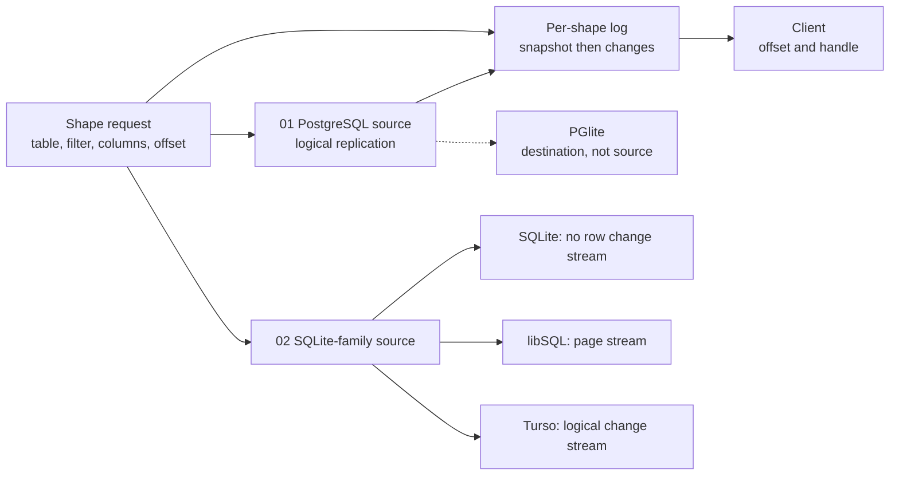

# Sync Engines: PostgreSQL and the SQLite Family

This directory has two documents. Both study one design. The design is the Electric shape engine. A shape is a filtered, column-projected view of one table. The server keeps a log per shape and sends the log to a client.

The two documents ask the same question of two source families. Can the design run there, and what must be built to make it run?

| Document | Question | Short answer |
|----------|----------|--------------|
| [01: Electric, PostgreSQL, and PGlite](./01-electric-postgres-pglite.md) | How does the Electric sync engine turn PostgreSQL changes into a live, column-projected shape? | A logical replication slot sends row changes. An in-memory filter index finds affected shapes. Each shape evaluates the filter on the old and new row, projects the selected columns, and appends to a disk-backed log. PGlite is a destination in these sources, not a source. |
| [02: SQLite, libSQL, and Turso](./02-sqlite-and-turso.md) | Can the same design run on SQLite-family databases, and what must be built? | Plain SQLite has no committed row-change stream. libSQL has a physical page stream. Turso has a logical change stream. The document proposes the capture and shape layers that each source needs. |

## How to read the two documents

Read [01](./01-electric-postgres-pglite.md) first. It gives the reference design. It traces one PostgreSQL transaction from the write-ahead log to the client update. It also covers shape definitions, column projection, filter matching, memory and disk use, the snapshot handoff, PGlite, and the limits.

Read [02](./02-sqlite-and-turso.md) second. It treats the Electric design as a baseline. It tests the baseline against SQLite, libSQL, and Turso. It separates what exists in the source from what the document proposes.

The two documents share one vocabulary. A shape has a table, a filter, a column list, and a log offset. A shape log has a snapshot part and a change part. A change is an insert, an update, or a delete. A replication slot is a durable position in the source change stream.

## Where the details live

The reference sections in this repository give more depth:

- [Electric Sync Service: Shape Log and Storage](../sync-service/03-shape-log-and-storage.md)
- [Electric Sync Service: Replication and Consumers](../sync-service/04-replication-and-consumers.md)
- [Electric Sync Service: Hypertext Transfer Protocol (HTTP) API and Shapes](../sync-service/02-http-api-and-shapes.md)
- [TypeScript Client: Shape Protocol and Offsets](../typescript-client/02-shape-protocol-and-offsets.md)
- [Electric: Overview](../00-overview.md)
