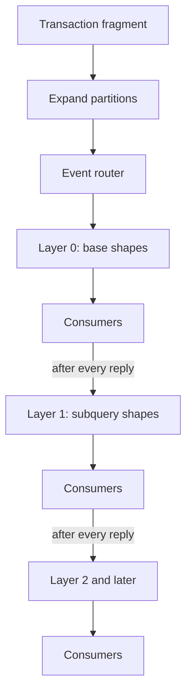
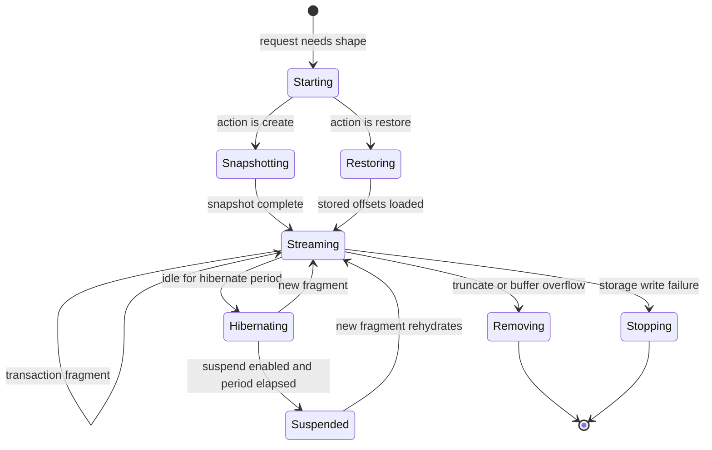

# Replication and Consumers

The replication subsystem turns PostgreSQL write-ahead log (WAL) records into per-shape change streams. It has four main parts: the replication client, the shape log collector, the event router, and the shape consumers. This document follows a transaction from the database to the disk. The collector also owns the flush tracker and the consumer registry. `Electric.ShapeCache` owns shape handles and the stored shape metadata.

## Terms and the offset model

The rest of this document uses these terms:

- A **shape** is a read-only, ordered stream of rows from one PostgreSQL table. It has an optional `where` clause, a column list, and a primary key. A **base shape** reads one table. A **filter shape** adds a `where` clause. A **subquery shape** has a `where` clause that contains a subquery, such as `id IN (SELECT ...)`. A subquery shape reads the stored result of a **dependency shape**, which is the shape for the inner query. The source calls the inner shape a "parent" in some comments and a "dependency" in others. This document uses "dependency" for the inner shape and "dependent" for the outer shape. [02-http-api-and-shapes.md](02-http-api-and-shapes.md) uses parent and child for the same pair and gives a table that maps the names used in each document to the two roles; [03-shape-log-and-storage.md](03-shape-log-and-storage.md) uses source consumer and dependent.
- A **shape handle** is the identifier of a stored shape. A client does not send it on the first request. That request names the `table` and uses offset `-1`. A later request names the same `table` again and adds the handle; the handle selects the stored log directly. An unknown or removed handle produces one of two responses. If the request can also supply a shape definition, the service returns status 409 with `control: must-refetch`. A request can supply the definition in two ways: it sends the `table` parameter, or the service is configured with one fixed shape and needs no table. If the request cannot supply a definition, validation fails with 400, because the service has nothing to look up. The client then drops local state and requests the shape again with the new handle and offset `-1`.
- A **shape log** is the stored change stream of one shape. It has a **snapshot** part, which is the query result at one point in time, and a **change** part, which holds the rows that changed later.
- A **stack** is one PostgreSQL connection set with its pools, replication client, shape cache, and consumers. `Electric.StackSupervisor` starts it. The **connection manager** is `Electric.Connection.Manager`. It owns the pools and starts the shape subtree (the shape cache, the consumers, and their supervisors) when the replication client is ready (`packages/sync-service/lib/electric/connection/manager.ex:50-66`).
- A **publication** is the named set of tables whose changes PostgreSQL sends. A **replication slot** is a named position in the WAL that PostgreSQL keeps for one replication stream. The slot belongs to the stack, not to a shape: one replication client reads the slot and routes each change to the consumer of every shape that needs it. A slot survives a disconnect, so PostgreSQL can replay the changes after the position. This document uses "consumer" only for a shape process; [01-architecture.md](01-architecture.md) states the same distinction.
- A **replication stream** is one publication and one slot pair. One stack uses one stream. The stream identifier is a name suffix, so two stacks on one database keep separate streams only when they use different identifiers. The advisory lock uses the slot name, so the same identifier in two stacks also creates a lock conflict. The identifiers are used at `packages/sync-service/lib/electric/application.ex:98-117`, and the lock is at `packages/sync-service/lib/electric/postgres/replication_client/connection_setup.ex:112-116`.
- A **consumer** is the process that owns one shape. It filters changes, writes the shape log, and tells the collector when the write is flushed. The source also calls it the **writer** in the flush protocol. A **cast** is an asynchronous Erlang message (`GenServer.cast`); a **call** waits for a reply (`GenServer.call`).
- To **store** or **append** a change means that the change is in the shape storage. It may still be only in the Erlang Term Storage (ETS) buffer. To **flush** means that the change is on disk. The flush tracker and the acknowledgement to PostgreSQL use the second meaning.
- **Expire**, **remove**, and **prune** all mean that the stored shape is deleted. An old handle then returns 409. The **expiry manager** is `Electric.ShapeCache.ExpiryManager`. It enforces `max_shapes` and removes the least recently used shape. A use is a shape request that confirms the snapshot start or starts a consumer. Those are the two places that write the `last_read_time` field of the shape status, and both follow a request (`packages/sync-service/lib/electric/shape_cache/shape_status.ex:379-394`; `packages/sync-service/lib/electric/shape_cache.ex:137-145`, `:459-466`). The manager checks every 60 seconds (`packages/sync-service/lib/electric/shape_cache/expiry_manager.ex:12`).

### Offsets and log sequence numbers

A PostgreSQL **log sequence number (LSN)** is a byte position in the WAL. Electric stores it as an integer. A shape **offset** is a pair:

```elixir
# packages/sync-service/lib/electric/replication/log_offset.ex:12-18
defstruct tx_offset: 0, op_offset: 0

@type int64 :: 0..0xFFFFFFFFFFFFFFFF
@type t :: %LogOffset{
        tx_offset: int64() | -1,
        op_offset: non_neg_integer() | :infinity
      }
```

- `tx_offset` is the LSN of the transaction commit. It orders transactions.
- `op_offset` counts operations inside the transaction. It starts at 0 and grows by 2. The step of 2 leaves room to split one operation into two stored records. The split is used today: an update that changes the primary key writes a delete at offset N and an insert at offset N+1 (`packages/sync-service/lib/electric/log_items.ex:113-163`).
- The string form is `<tx_offset>_<op_offset>`, for example `1234_4`. The exception is the start offset, which prints as `-1`.
- `-1` means "before all data". Each snapshot chunk ends at a virtual offset `0_<n>`, where `n` is the zero-based chunk number: `0_0` is the end of the first chunk, `0_1` the second, and so on. The chunk number grows by 1, not by the step of 2 that real operation offsets use. The virtual offsets reuse the operation field but not its counting rule. The numbering is at `packages/sync-service/lib/electric/shape_cache/pure_file_storage/snapshot.ex:27-38`, and the final chunk offset is stored at `packages/sync-service/lib/electric/shape_cache/pure_file_storage.ex:892`. `0_inf` is the end of the snapshot and the position before the first real change. A virtual offset has `tx_offset` 0; it addresses snapshot data, not WAL (`packages/sync-service/lib/electric/replication/log_offset.ex:229-236`, `packages/sync-service/lib/electric/replication/log_offset.ex:320-322`).
- A live request at or above the latest offset waits for new data. A request with offset `-1` starts with the snapshot.

## The replication client

`Electric.Postgres.ReplicationClient` is a state machine. It connects to PostgreSQL in logical replication mode. It does not start streaming until the connection manager asks it to.

The state machine has these steps:

```elixir
# packages/sync-service/lib/electric/postgres/replication_client.ex:20
@type step ::
        :disconnected
        | :connected
        | :identify_system
        | :query_pg_info
        | :acquire_lock
        | :create_publication
        | :check_if_publication_exists
        | :drop_slot
        | :create_slot
        | :query_slot_flushed_lsn
        | :set_display_setting
        | :ready_to_stream
        | :start_streaming
        | :streaming
```

The steps do the following:

1. **Connect.** Open the replication connection.
2. **Identify the system.** Read the PostgreSQL system identifier.
3. **Query database information.** Read the server version and settings.
4. **Acquire the advisory lock.** Only one Electric instance can own a slot at a time.
5. **Create or check the publication.** The publication lists the tables that Electric needs.
6. **Drop an old slot if requested.** This is used for a temporary slot.
7. **Create the slot.** The slot starts at the current position.
8. **Query the slot flushed LSN.** This gives the restart point. Here LSN means log sequence number. After a restart, the slot reports the position up to which the service already confirmed a flush. PostgreSQL replays from that position, so the service does not lose or repeat acknowledged changes.
9. **Set display settings.** These are session settings for the replication connection.
10. **Mark ready to stream.** The connection manager can now start the shape subtree.
11. **Start streaming.** Send `START_REPLICATION`.
12. **Stream.** Read and decode WAL messages.

The type has 14 states and the list has 12 steps. The two pairs that share a step are `:disconnected` and `:connected`, which are the two sides of the connect step, and `:create_publication` and `:check_if_publication_exists`, which are two outcomes of the publication step.

`wal_sender_timeout` is a PostgreSQL server setting. The walsender process on the server closes a replication connection that sends nothing for that period. The client reads the setting during the connection setup. It then sends a standby status update before the timeout can expire. A **standby status update** is a replication-protocol message that reports the last received write-ahead log (WAL) position and keeps the server-side sender process alive (`packages/sync-service/lib/electric/postgres/replication_client.ex:329-334`, `:627-650`). The default in the client state is 60 seconds. The keepalive interval is one third of the server value, capped at 15 seconds:

```elixir
# packages/sync-service/lib/electric/postgres/replication_client.ex:152
@max_keepalive_interval 15_000
```

The cap keeps the client responsive even if the database sets a very large sender timeout.

## Publications and slots

The service uses one publication and one slot per replication stream. The names are derived at boot:

- Publication: `electric_publication_<replication_stream_id>`
- Slot: `electric_slot_<replication_stream_id>`

The default stream identifier is `default`. The names are built in `packages/sync-service/lib/electric/application.ex:100-117`.

A temporary slot is possible. The setting `replication_slot_temporary?` (environment variable `CLEANUP_REPLICATION_SLOTS_ON_SHUTDOWN`) makes the slot drop on shutdown. A second setting, `replication_slot_temporary_random_name?` (environment variable `ELECTRIC_TEMPORARY_REPLICATION_SLOT_USE_RANDOM_NAME`), makes the name random. Both defaults are false (`packages/sync-service/lib/electric/config.ex:54-55`, `packages/sync-service/config/runtime.exs:279-281`):

```elixir
# packages/sync-service/lib/electric/application.ex:106-117
slot_name =
  if slot_temporary? and slot_temporary_random_name? do
    name = "electric_slot_#{Base.encode16(:crypto.strong_rand_bytes(16), case: :lower)}"

    Logger.warning(
      "Using a temporary replication slot with name: #{name}. This slot will be deleted on shutdown, so persistent storage should not outlive the Electric instance."
    )

    name
  else
    Keyword.get(opts, :slot_name, "electric_slot_#{replication_stream_id}")
  end
```

A temporary slot is safe only when shape storage and the slot have the same lifetime. The warning says this directly. If the slot disappears but the stored shapes remain, the service cannot resume from the stored position.

The publication is managed by `Electric.Replication.PublicationManager`. The manager tracks the set of relations that active shapes need. It adds and removes tables from the publication. It debounces changes and refreshes the publication periodically. The default refresh period is 60 seconds.

The manager also validates the publication. If a relation no longer exists, the affected shapes expire. This prevents a shape from serving a table that was dropped.

## Transaction fragments

The replication client decodes WAL messages into Erlang terms. It groups changes into transaction fragments. A fragment has:

- The transaction identifier.
- The log sequence number.
- A `has_begin?` flag.
- An optional commit record.
- The list of changes.
- The last log offset: the offset of the most recent change in the fragment. A fragment with no changes uses `{commit LSN, 0}` (`packages/sync-service/lib/electric/postgres/replication_client/message_converter.ex:342-352`). The consumer uses this value to decide that the fragment is flushed and to report progress.

The fragment is the unit that the collector and the router process. A large transaction can be split into several fragments. The `max_batch_size` setting controls the number of changes in a fragment. The default is 100. The minimum is 2.

The `max_txn_size` setting limits the collected size of one transaction. The default is 250 mebibytes (MiB). A transaction above the limit makes the message converter return `{:error, {:exceeded_max_tx_size, ...}}`. The replication client then disconnects with reason `{:irrecoverable_slot, reason}`. The comment in the source states that the service does not yet stream oversized transactions to disk. The default and the batch size are at `packages/sync-service/lib/electric/config.ex:56-57`; the check is at `packages/sync-service/lib/electric/postgres/replication_client/message_converter.ex:96-102`.

An operator must resolve this case. A restart replays the same transaction and fails again. The operator can raise `ELECTRIC_EXPERIMENTAL_MAX_TXN_SIZE` or break the transaction into smaller commits. The environment variable accepts only an integer, so it cannot remove the limit. A library configuration can set `max_txn_size: nil`, because the check is skipped when the value is nil (`packages/sync-service/lib/electric/postgres/replication_client/message_converter.ex:95-102`). The environment name is `ELECTRIC_EXPERIMENTAL_MAX_TXN_SIZE`; `05-configuration-and-deployment.md` lists it with the other experimental variables.

## Backpressure and memory

The replication path has three buffers:

1. PostgreSQL retains WAL that the slot has not confirmed.
2. The replication client holds the current transaction fragment in memory. It does not hold the whole transaction: a fragment flushes when it reaches `max_batch_size` changes (`packages/sync-service/lib/electric/postgres/replication_client/message_converter.ex:306-337`).
3. The storage layer holds the rows that the HTTP (Hypertext Transfer Protocol) interface can see in Erlang Term Storage (ETS) until the flush.

The first buffer has no configured size limit in Electric. It is measured in WAL bytes that remain on the PostgreSQL host. The service controls it only indirectly. A consumer that stops flushing holds the stack-wide flush boundary. The slot confirmation cannot advance past that consumer. PostgreSQL then keeps every WAL segment above the confirmation. The disk grows. The service does not drop a slow consumer immediately; it gives the consumer one grace period to recover. The flush tracker detects the stall at a periodic check after the grace period and challenges the consumer. A challenge is a `:verify_flush_progress` message to the consumer process, which the collector calls the writer. A healthy consumer that is deliberately buffering answers with a deferred-flush cast, and the collector clears the suspicion. A shape that is still stalled at the next periodic check is removed. A shape with no live writer is removed at the first check, because there is no process to challenge. The default grace period is 60 seconds. The check is at `packages/sync-service/lib/electric/replication/shape_log_collector.ex:558-611`.

The second entry has a hard limit. The client counts the bytes of the whole transaction as its messages arrive, and it stops when the count exceeds `max_txn_size`. The service does not spill the transaction to disk, so the stop is the only safe action. A bulk load above 250 MiB therefore interrupts replication until the operator acts. The limit applies to the collected size, not to one fragment.

`max_batch_size` bounds one fragment, not the transaction. The client splits a large transaction into fragments of at most 100 changes. Each fragment is routed, converted, and written before the next fragment, so the client does not hold the whole transaction. Only the final fragment carries the commit record. When a batch fills, the converter keeps the most recent change in the buffer, so the final fragment has at least one change (`packages/sync-service/lib/electric/postgres/replication_client/message_converter.ex:306-337`). The consumer marks the last shape change in that final fragment with `last`; it does not rewrite the records of the earlier fragments (`packages/sync-service/lib/electric/shapes/consumer.ex:863-872`).

The value must be at least 2. The replication client checks this with `true = max_batch_size >= 2` at `packages/sync-service/lib/electric/postgres/replication_client.ex:124`. The source does not state the reason for the minimum.

The third buffer is per shape. The storage writes buffered rows to disk when the byte buffer reaches 64 kibibytes (KiB) or when one second passes with data still buffered. Either trigger writes the JSON file, calls `datasync` on it, and then drops the ETS copies (`packages/sync-service/lib/electric/shape_cache/pure_file_storage/write_loop.ex:301-303`, `:320-340`, `packages/sync-service/lib/electric/shape_cache/pure_file_storage.ex:113`, `:1274-1301`). A consumer that receives no change for 30 seconds hibernates. Hibernation keeps the process and the shape state, but releases the heap. Suspension is a separate step. It terminates the process after a longer idle period. Suspension is off by default because the restart cost can exceed the memory saving for an active workload. The settings `ELECTRIC_SHAPE_HIBERNATE_AFTER`, `ELECTRIC_SHAPE_SUSPEND_CONSUMER`, and `ELECTRIC_SHAPE_SUSPEND_AFTER` control the two steps.

A subquery consumer has a fourth buffer: the transactions that it holds while it waits for its dependency shape. The limit is `subquery_buffer_max_transactions`, which defaults to 1000. The default is at `packages/sync-service/lib/electric/config.ex:159`. An overflow marks the shape for removal. The service does not pause the shape or retry the buffer. A dependency shape that falls far behind can therefore force the dependent shapes to refetch.

The HTTP path has its own backpressure. Admission control rejects a request above the initial or existing limit before the request reaches the shape cache. The `initial` limit applies to a request that has no handle or an unknown handle. The `existing` limit applies to a request with a known handle (`packages/sync-service/lib/electric/plug/serve_shape_plug.ex:336-345`). A rejected request gets status 503 with a retry delay. This protects the consumers from a request surge. It does not protect the disk from a slow consumer that already holds a shape.

## The shape log collector

`Electric.Replication.ShapeLogCollector` is the single producer for all consumers. Every transaction from the replication client goes through it. It then fans the transaction out to the consumers that need it.

The collector owns these pieces of state:

- The event router, which maps changes to shapes.
- The partition map, which expands partition changes to the root table.
- The dependency layers, which order dependent shapes after their dependency shapes.
- The consumer registry, which maps a shape handle to a consumer process.
- The LSN tracker, which records the last seen position.
- The FlushTracker, which records the safe flush position.

The collector accepts two call styles:

- `handle_event/2` is synchronous. It uses `GenServer.call` with an infinite timeout.
- `handle_event_async/2` is asynchronous. It sends the same `$gen_call` message directly and monitors the collector. The caller gets `{monitor_ref, response}` when the event is processed, or a `:DOWN` message when the collector stops. The code is at `packages/sync-service/lib/electric/replication/shape_log_collector.ex:104-132`.

The replication client uses the asynchronous form, configured at `packages/sync-service/lib/electric/stack_supervisor.ex:399`. This lets the client continue reading WAL while the collector works.

### Fan-out order

The collector routes a transaction in layers. The order is important for shapes with subqueries.



The first step expands partitions. When a shape reads a partitioned table, the replication stream names the partition, not the root table. The collector keeps a map from partition to root table and uses it to mark every shape that reads the root table. Without this step, a change to one partition would not reach the shape.

A base shape reads one table. A subquery shape has a `where` clause that contains a subquery, such as `id IN (SELECT ...)`. The service parses the full `SELECT` statement and builds one shape for each subquery level. The dependent shape reads the stored result of the dependency shape. A dependent shape must not process a change before its dependency has stored the change. `Electric.Shapes.DependencyLayers` computes the layer for each shape. A shape is placed after the layer that holds all its dependencies. The shape construction is at `packages/sync-service/lib/electric/shapes/shape.ex:213-220`.

The collector publishes one layer at a time. "Publish" means that the collector sends the fragment to each consumer in the layer and waits for every consumer to reply. A consumer replies `:ok` after it processes the fragment. The collector then publishes the next layer. This ordering makes a dependent shape see its dependency's stored changes first, without one lock across all consumers. The diagram shows a control dependency, not a data dependency: layer 1 consumers read the stored result of layer 0, not the message itself. The code is at `packages/sync-service/lib/electric/replication/shape_log_collector.ex:885-900`.

### Restore

The collector can rebuild its in-memory state after a restart. The restore path:

1. Reads the shape list from the SQLite shape database. `Electric.ShapeCache.ShapeStatus` owns that database; it is not a separate replication log.
2. Prunes shapes with subqueries. The source comment states that consistent restore of a subquery shape across a restart is not implemented, so the service drops such shapes and their stored data instead of rebuilding their dependency state (`packages/sync-service/lib/electric/replication/shape_log_collector.ex:299-305`, `packages/sync-service/lib/electric/shape_cache/shape_status.ex:182-206`). A client must request them again from scratch. A shape whose dependency did not restore is also skipped (`packages/sync-service/lib/electric/replication/shape_log_collector.ex:313-333`).
3. Rebuilds the partition map.
4. Rebuilds the event router.
5. Rebuilds the dependency layers.
6. Marks the collector ready.

The partition restore retries every 100 milliseconds for up to 40 attempts. The retry covers the relation introspection that `Partitions.add_shape/3` runs for one shape. The code is in `packages/sync-service/lib/electric/replication/shape_log_collector.ex:382-405`.

The collector does not mark ready until the LSN tracker has a value. The function `mark_as_ready/1` checks this. A collector without a known position cannot tell a client that it is up to date.

### Reconnection

The service does not let Postgrex reconnect by itself. Postgrex is the Elixir PostgreSQL driver that the replication client uses. The client starts with `auto_reconnect: false`, so a lost connection exits with the error instead of retrying inside the connection process (`packages/sync-service/lib/electric/postgres/replication_client.ex:164-179`).

`Electric.Connection.Manager` controls the retry. The retry applies only while the manager is in the `:connection_setup` phase, for the replication client, the admin pool, or the snapshot pool (`packages/sync-service/lib/electric/connection/manager.ex:1447-1476`). For those cases the manager calls `schedule_reconnection/2`. That function asks `ConnectionBackoff.fail/1` for the delay, cancels an earlier timer, and starts a timer for the `{:retry_connection, step}` message (`manager.ex:1156-1166`). The backoff is configured with a start of 1,000 milliseconds and a maximum of 10,000 milliseconds (`manager.ex:289`). A success calls `ConnectionBackoff.succeed/1`, which resets the sequence and logs the total retry time (`manager.ex:1169-1180`). The backoff module wraps the `:backoff` Erlang library. That library computes exponential retry delays with jitter (`packages/sync-service/lib/electric/connection/manager/connection_backoff.ex:1-33`).

An error after the setup phase does not use the backoff. The manager stops, and the supervision tree restarts the connection subsystem (`manager.ex:1001-1008`); [01-architecture.md](01-architecture.md) gives the supervision result.

### The flush tracker

The flush tracker answers one question: which log position is safely on disk for every shape? This position is what the service acknowledges to PostgreSQL.

The tracker keeps a map of shape to `{last_sent, last_flushed, last_progress_at}`. `last_sent` is the newest offset that the collector sent to the shape. `last_flushed` is the newest offset that the shape confirmed on disk. `last_progress_at` is the monotonic time of the last flush progress. The tracker also keeps a balanced tree of the incomplete flush positions. The tree is an Erlang `:gb_trees` structure. The key is an offset tuple and the value is the set of shapes at that offset. The smallest key gives the minimum flush position in log order. The module documentation gives the full algorithm.

A newly tracked shape starts with `last_flushed` set to `%LogOffset{tx_offset: T - 1, op_offset: 0}`, where `T` is the transaction's `tx_offset`. The struct default supplies `op_offset: 0`. This value is the point just before the transaction. The shape has no earlier pending data in this stream, so the service treats every earlier transaction as flushed for that shape (`packages/sync-service/lib/electric/replication/shape_log_collector/flush_tracker.ex:146`). This seed is the shape's flush value, not the value sent to PostgreSQL. The main rules are:

- A shape that receives a transaction is tracked.
- A shape that flushes up to its `last_sent` offset is removed from the map.
- The global flush position is the minimum `last_flushed` of all tracked shapes, but never less than the previous global position. The minimum finds the slowest shape. The lower bound stops the position from moving backward when a shape is removed or a new, lower entry appears (`packages/sync-service/lib/electric/replication/shape_log_collector/flush_tracker.ex:279-295`).
- When the map is empty, every shape is caught up, so the global position is the last seen position (`packages/sync-service/lib/electric/replication/shape_log_collector/flush_tracker.ex:267-277`).
- When the map is not empty, the acknowledged LSN is `tx_offset` of the global position minus 1. LSN values count bytes, so this value is the last byte before the commit record. PostgreSQL then has not seen the commit, so it resends the whole transaction after a reconnect. The value is one byte less; the effect is one transaction of replay.

The last rule is important. Without transaction boundary tracking, the service cannot prove that a partial transaction is fully flushed. When the tracker is not caught up, it notifies with `tx_offset - 1`. The subtraction is at `packages/sync-service/lib/electric/replication/shape_log_collector/flush_tracker.ex:298-305`. When every shape has flushed, the tracker sends the exact `tx_offset` of the last seen position instead. This is why some documents say "minimum flushed offset" and others say "one byte before the commit": the minimum is the base value while any shape lags, and the subtraction applies to that value. When every shape is caught up, the exact last seen position is safe.

A shape that does not flush within the grace period is considered stalled. The default grace period is 60 seconds. The collector sends the writer a `:verify_flush_progress` challenge. A writer that is still healthy but deferring its flush answers, and the shape stays. A writer that does not answer is removed at the next check, one grace period later. A shape with no live writer is removed at the first check. A removed shape releases its flush boundary. A client that asks for it gets a 409 must-refetch.

## The event router

`Electric.Shapes.EventRouter` applies the shape filters to a transaction. It has transaction-aware rules:

- A shape receives the transaction begin marker only once, on its first matching change.
- A shape receives the commit marker only if it received at least one change.
- A shape added in the middle of a transaction is skipped for that transaction.
- A shape removed in the middle of a transaction stops receiving changes immediately.

The state is in `packages/sync-service/lib/electric/shapes/event_router.ex:23-30`.

These begin and commit markers are internal to the transaction fragment that the router passes to a consumer. They are not stored in the shape log. This is why the log can have no transaction boundaries and still route a transaction correctly.

The rules prevent two classes of error. A shape that is created during a transaction must not see half of the transaction. A shape that is deleted during a transaction must not write data after its deletion.

The router also drops changes that do not match the shape. The filter uses these indexes:

- A table index maps a relation identifier to the shapes that read it.
- A WHERE-clause index maps one `where` clause to the shapes that share it. A filter shape is a shape with a `where` clause; a shape without one is not in this index.
- An equality index maps a column value to the shapes with an equality condition on that column.
- An inclusion index maps a column value to the shapes with an `IN` condition on that column.
- A subquery index maps a dependency shape handle to the shapes that depend on it.

The index names are at `packages/sync-service/lib/electric/shapes/filter.ex:56-64`. The filter tables are private ETS tables owned by the router process.

## The consumer

`Electric.Shapes.Consumer` is a `GenServer` with `restart: :temporary`. One process serves one shape. The supervisor does not restart it. A new consumer starts when a request needs the shape, or when a fragment must be delivered to a shape that has no live consumer, for example after suspension (`packages/sync-service/lib/electric/shapes/consumer_registry.ex:130`). The action is `:create` for a new shape and `:restore` for an existing one.

The consumer does this work:

1. It receives an initialization message with the shape and an action.
2. The action is `:create` or `:restore`.
3. For either action, it starts a snapshotter. On `:restore`, the snapshotter skips the query when the snapshot is already stored.
4. It registers itself in the consumer registry.
5. It receives transaction fragments.
6. It filters and converts each change.
7. It appends the result to storage.
8. It notifies any waiting HTTP request.

The consumer handles three failure conditions:

- A subquery buffer overflow.
- A truncate in the transaction.
- A storage write failure.

Only the last is a process error. The first two cause the shape to be marked for removal. The third stops the consumer process. The consumer is a `:temporary` child of the dynamic consumer supervisor, so the supervisor does not restart it (`packages/sync-service/lib/electric/shapes/consumer.ex:2`). The shape metadata and the stored log remain. An HTTP request does not delete the shape and does not return 409; it reads the stored prefix, or waits when the request is live. The next transaction that routes to the handle starts a new consumer with the restore action (`packages/sync-service/lib/electric/shapes/consumer_registry.ex:126-133`, `:273-299`; `packages/sync-service/lib/electric/shape_cache.ex:337-356`, `:475-478`). The source does not define recovery for a record that the failed write did not persist. It also does not state whether the missing record leaves a content gap at the later offsets that were stored. The verified behavior is that the request reads the stored prefix and no error marks the gap. This is an open question. A 409 follows only if the shape is later removed, for example by expiry.

### Change conversion

A change arrives as a database row change. The consumer must convert it to a shape change. The conversion depends on the shape:

- An insert that matches the WHERE clause becomes an insert.
- An insert that does not match becomes nothing.
- An update that stays inside the WHERE clause becomes an update.
- An update that moves into the WHERE clause becomes an insert.
- An update that moves out of the WHERE clause becomes a delete.
- A delete that matches the WHERE clause becomes a delete.
- A delete that does not match the WHERE clause becomes nothing.

The function is `Shape.convert_change/3` in `packages/sync-service/lib/electric/shapes/shape.ex`. For an update or a delete, the conversion uses the old row to test membership; an insert has no old row. The shape-level **replica mode** is separate. It controls how much of the old row the service sends to the client. A client selects it with the `replica` query parameter, which accepts `default` or `full`; the default is `default` (`packages/sync-service/lib/electric/shapes/api/params.ex:157`). The mode `full` sends the complete row: the new row for an insert or update, the old row for a delete, and the changed columns of the old row in `old_value` for an update. The mode `default` sends the new row on an insert, the primary key plus the changed columns on an update, and only the primary key on a delete (`packages/sync-service/lib/electric/log_items.ex:168-185`). Replica mode is not the same as the PostgreSQL `REPLICA IDENTITY FULL` setting. Electric sets `REPLICA IDENTITY FULL` on every published table so that PostgreSQL sends the complete old row in the WAL (`packages/sync-service/lib/electric/postgres/configuration.ex:149-175`, `:259-263`). Replica mode then decides how much of that old row leaves the service.

The result is encoded as JSON (JavaScript Object Notation). The service uses a JSON encoder with a batch limit:

```elixir
# packages/sync-service/lib/electric/shapes/api/encoder.ex:74
@max_batch_items 500
@max_batch_bytes 256 * 1024
```

A batch here is a group of rows that the JSON encoder converts together. A batch is split when it reaches 500 items or 256 kibibytes (KiB). The limit applies to the HTTP response, not to the stored log. The stored log records have no batch limit.

### Snapshot and materializer

The consumer can start two helper processes:

- `Electric.Shapes.Consumer.Snapshotter` runs the initial query and writes the snapshot. It starts for both action `:create` and action `:restore`, because it also calls `PublicationManager.add_shape/3` (`packages/sync-service/lib/electric/shapes/consumer.ex:1276-1292`).
- The **materializer** is the process that keeps a dependent shape in step with its dependency shape without linking the two lifecycles. `Electric.Shapes.Consumer.Materializer` monitors the consumer of a dependency shape. If that consumer stops for a reason other than a clean shutdown, the materializer tells each dependent shape that it is invalid, and the dependent shape refetches. It starts when the shape has dependencies.

The snapshotter is temporary. It exits after the snapshot is written. On a restore, it starts but skips the query when `Storage.snapshot_started?/1` is true (`packages/sync-service/lib/electric/shapes/consumer/snapshotter.ex:74-86`). The materializer stays alive for the life of the shape.

### Consumer lifecycle



A hibernating consumer keeps its process and state but releases heap memory. A suspended consumer stops with a special reason. The consumer registry removes its process identifier (pid). On the next fragment or request, the registry starts a fresh consumer with action `:restore`, which loads the shape from the shape index and the stored offsets. Suspension is off by default because the restart cost can exceed the memory saving for an active workload.

The snapshotter records the PostgreSQL snapshot identifier. The consumer uses that identifier to skip transactions that are already included in the snapshot. This is the consistency link between the snapshot and the log. The check is at `packages/sync-service/lib/electric/shapes/consumer/initial_snapshot.ex:97-108`.

## The shape cache

`Electric.ShapeCache` coordinates shape creation and handle allocation. The main functions are:

- `get_or_create_shape_handle/3` returns a handle for a shape.
- `resolve_shape_handle/4` finds an existing handle for a shape definition.
- `ShapeCache.await_snapshot_start/3` waits for the snapshot to start. The arguments are the shape handle, the stack identifier, and the number of attempts that remain. The third argument has a default, so a caller usually uses arity 2.

The cache has a fast path. It checks the shape index before it calls the `GenServer`. A new shape is created inside the server. The creation path returns the pair `{handle, LogOffset.last_before_real_offsets()}`. The returned offset is `0_inf` because the new consumer has flushed no real change yet. `0_inf` is the last virtual offset, so it sorts after every snapshot chunk boundary and before every real change. It is a safe upper bound even before the snapshot exists. Two cases produce a request at or above `0_inf`. First, `fetch_latest_offset/1` must return `0_inf` for a shape with no real change, so a client that already read the snapshot and reconnects gets that offset from the service (`packages/sync-service/lib/electric/shape_cache/storage.ex:66-71`). Second, the creation call returns `0_inf` and the client uses it on the next live request. For such a request, the HTTP layer subscribes to change events and does not ask for the snapshot (`packages/sync-service/lib/electric/shapes/api.ex:435-452`). This rule assumes that the client already has the snapshot data. A client that sends `0_inf` without that data receives only later changes and misses the snapshot. A request with offset `-1` is not at or above `0_inf`; it receives the snapshot first and then follows the log. The return is at `packages/sync-service/lib/electric/shape_cache.ex:392`.

The wait for the snapshot start has a bounded retry:

```elixir
# packages/sync-service/lib/electric/shape_cache.ex:39
@max_snapshot_start_attempts 10
```

The retry sleeps 50 milliseconds between attempts. The total wait is about 500 milliseconds. After that, `await_snapshot_start/3` returns `{:error, Electric.SnapshotError.slow_snapshot_start()}` (`packages/sync-service/lib/electric/shape_cache.ex:211-223`). The HTTP layer turns that error into status 503 with `electric-internal-known-error: true` and `retry-after: 10`, not into an indefinite block (`packages/sync-service/lib/electric/shapes/api.ex:756-767`).

The cache also enforces `max_shapes`. When the shape count is greater than the limit, the expiry manager removes the least recently used shape, which is the shape with the smallest `last_read_time` (`packages/sync-service/lib/electric/shape_cache/expiry_manager.ex:54-75`). The shape data is deleted and the handle becomes invalid. [01-architecture.md](01-architecture.md) defines when the service updates the read time.

## Consistency

The service provides three levels of consistency:

1. **Snapshot consistency.** A snapshot is taken in a repeatable-read transaction. It reflects one point in the PostgreSQL timeline.
2. **Log continuity.** The snapshot position and the first log position are aligned through the stored snapshot identifier.
3. **Read consistency.** A live reader takes flushed disk data plus the Erlang Term Storage (ETS) buffer. For the change log, the reader takes rows at or below the last persisted offset from the log file and rows above it from ETS. The flush writes the whole buffer to the file and calls `:file.datasync` before it clears ETS, so each row is in at least one place (`packages/sync-service/lib/electric/shape_cache/pure_file_storage/write_loop.ex:314-334`). If a concurrent flush empties ETS before the read finishes, the reader detects the short range and reads from disk instead (`packages/sync-service/lib/electric/shape_cache/pure_file_storage.ex:1050-1085`). The snapshot has a different rule: a reader can see a chunk while the writer is still adding lines, so the snapshot reader waits for the End Of Transmission (EOT) marker or for a 90-second stall timeout (`packages/sync-service/lib/electric/shape_cache/pure_file_storage/snapshot.ex:118-138`). The EOT marker is the single byte `0x04` at the end of each snapshot chunk file (`packages/sync-service/lib/electric/shape_cache/pure_file_storage/snapshot.ex:139-150`). That 90-second stall timeout is not `snapshot_timeout_to_first_data`, which is 30 seconds and limits only the wait for the first row of the query (`packages/sync-service/lib/electric/config.ex:150`, `packages/sync-service/lib/electric/shapes/consumer/snapshotter.ex:127-189`). [03-shape-log-and-storage.md](03-shape-log-and-storage.md) gives the file format.

The `electric-up-to-date` response header says whether more data can arrive. The `global_last_seen_lsn` field is inside the `headers` object of the `up-to-date` control message in the response body; it is not an HTTP header (`packages/sync-service/lib/electric/shapes/api.ex:1198-1204`). A client can compare this LSN with the database position. The value comes from the LSN tracker.

The service does not provide cross-shape transaction atomicity. Two shapes that receive changes from one transaction may receive them at different times. The client must not assume that both shapes advance together. This is a consequence of the per-shape consumer model.

## Reader questions: how a shape stays correct

This section answers six questions about the core mechanism. Each answer cites the source file and line. When a statement is an inference, the text says so.

### Question 1: How does Electric know which columns to sync?

Electric resolves the column list one time, when it builds the shape. It does not resolve the list again for each row.

The request has two column inputs. The `columns` parameter is an explicit list. The `queryable_columns` parameter limits which table columns the shape may select. It also limits the columns that a later **subset** may use (`packages/sync-service/lib/electric/shapes/shape/subset.ex:56-58`). A subset is a derived shape with its own `order_by`, `limit`, `offset`, or `where` fields; it does not select new columns. `order_by` sorts the rows, `limit` caps the number of rows, and `offset` skips rows before the first returned row. If the request gives neither column input, the shape uses every table column. The selection rule is at `packages/sync-service/lib/electric/shapes/shape.ex:503-524`.

The selection has these rules:

1. An explicit `columns` list must contain every primary key column. The exception is a shape built with `autofill_pk_select?`, an internal option used for a dependency shape. Electric then adds the missing primary key columns (`packages/sync-service/lib/electric/shapes/shape.ex:457-501`).
2. An explicit list must not contain a generated column, unless the inspector reports support for generated column replication. The inspector is the module that reads table metadata from PostgreSQL (`packages/sync-service/lib/electric/shapes/shape.ex:470-483`).
3. An explicit list must not be empty (`packages/sync-service/lib/electric/shapes/shape.ex:485-486`).
4. `selected_columns` is the explicit list plus the primary key columns, with duplicates removed and the result sorted (`packages/sync-service/lib/electric/shapes/shape.ex:492-495`).
5. `explicitly_selected_columns` keeps only the requested columns. The service uses this field to build the sublink query for a dependency shape at `packages/sync-service/lib/electric/shapes/shape.ex:435`. A sublink is a subquery inside an expression, such as the `SELECT` inside `id IN (SELECT ...)`. The snapshot query itself uses `selected_columns` (`packages/sync-service/lib/electric/shapes/querying.ex:186-192`), so an autofilled primary key is included in the snapshot.
6. If the request gives no `columns`, `selected_columns` is `queryable_columns`, or all table columns when `queryable_columns` is also absent (`packages/sync-service/lib/electric/shapes/shape.ex:509-524`).
7. When `queryable_columns` is present, every selected column must be inside it (`packages/sync-service/lib/electric/shapes/shape.ex:467-469`). When it is absent, every selected column must exist on the table.

The `where` clause is different. Electric resolves the names in the `where` clause against all table columns, not only the selected columns (`packages/sync-service/lib/electric/shapes/shape.ex:247-249`). A `where` clause can therefore use a column that the shape does not send to the client. This is why the membership test and the column projection are separate steps.

The shape struct stores the result:

```elixir
# packages/sync-service/lib/electric/shapes/shape.ex:271-273
selected_columns: selected_columns,
explicitly_selected_columns: explicitly_selected_columns,
queryable_columns: queryable_columns,
```

The list is stored one time for the shape, not one time for each row. In memory, the `%Electric.Shapes.Shape{}` struct holds it (`packages/sync-service/lib/electric/shapes/shape.ex:38-40`). On disk, the service writes the shape as JSON (JavaScript Object Notation) into the `shapes` table of the SQLite shape database:

```elixir
# packages/sync-service/lib/electric/shape_cache/shape_status/shape_db/connection.ex:19-25
CREATE TABLE shapes (
  handle BLOB NOT NULL,
  shape BLOB NOT NULL,
  comparable BLOB NOT NULL,
  hash INTEGER NOT NULL,
  snapshot_complete INTEGER NOT NULL DEFAULT 0
) STRICT
```

The `comparable` column is the lookup key, and it is not JSON. The service builds a tuple from the root table identifier and name, the primary key, the `where` expression, the selected and explicitly selected columns, the enabled flags, the replica mode, and the log mode (`packages/sync-service/lib/electric/shapes/shape.ex:112-121`). It encodes the tuple with deterministic Erlang term encoding and hashes the bytes with SHA-256; the result is the stored `comparable` value (`packages/sync-service/lib/electric/shape_cache/shape_status/shape_db/query.ex:298-303`). The `hash` column stores `:erlang.phash2` of the same tuple (`packages/sync-service/lib/electric/shapes/shape.ex:129-137`). The lookup compares the full `comparable` value, so a `phash2` collision does not return the wrong shape; the handle string also adds a microsecond timestamp (`packages/sync-service/lib/electric/shapes/shape.ex:138-144`). The JSON writer includes `"selected_columns"` at `packages/sync-service/lib/electric/shapes/shape.ex:1030`. The reader requires it at `packages/sync-service/lib/electric/shapes/shape.ex:1050` and restores it into the struct at `packages/sync-service/lib/electric/shapes/shape.ex:1070`. The `Electric.ShapeCache.ShapeStatus` module owns this database. The full shape, including its column list, survives a restart.

Electric applies the list to a row after it decides that the row is inside the shape. The function `filter_change_columns/2` calls `Changes.filter_columns/2` at `packages/sync-service/lib/electric/shapes/shape.ex:792-796`. That function uses `Map.take` on the new record and on the old record. It also removes the columns that are not kept from the `changed_columns` set (`packages/sync-service/lib/electric/replication/changes.ex:473-492`). An update that changes the primary key produces two output records: a delete of the old key and an insert of the new key (`packages/sync-service/lib/electric/log_items.ex:113-163`). An update that keeps the primary key produces one update record (`packages/sync-service/lib/electric/log_items.ex:87-111`). The projection applies to each output record.

### Question 2: What in PostgreSQL provides the change data?

PostgreSQL provides the change data through logical decoding with the built-in output plugin `pgoutput`. Logical decoding reads the WAL and turns it into a stream of row changes. An output plugin defines the format of that stream; `pgoutput` is the built-in logical replication plugin. Electric builds this slot command:

```elixir
# packages/sync-service/lib/electric/postgres/replication_client/connection_setup.ex:260
query = "CREATE_REPLICATION_SLOT #{Utils.quote_name(slot_name)} #{@slot_options}"
# @slot_options is "LOGICAL pgoutput NOEXPORT_SNAPSHOT" (line 250)
```

`NOEXPORT_SNAPSHOT` means that PostgreSQL does not export a snapshot with the slot. Electric takes its own snapshot instead (Question 6).

The slot name is `electric_slot_<replication_stream_id>`. The default stream identifier is `default`. The publication name is `electric_publication_<replication_stream_id>`. The application builds both names at `packages/sync-service/lib/electric/application.ex:100-117`. The replication client creates the publication with `CREATE PUBLICATION` at `packages/sync-service/lib/electric/postgres/replication_client/connection_setup.ex:150-155`. The `Electric.Replication.PublicationManager` maintains the table list of the publication after creation.

After the slot exists, Electric starts the stream with this command:

```elixir
# packages/sync-service/lib/electric/postgres/replication_client/connection_setup.ex:355
"START_REPLICATION SLOT #{Utils.quote_name(state.slot_name)} LOGICAL 0/0 (proto_version '1', publication_names '#{state.publication_name}')"
```

The `0/0` value is the protocol's required start position. **Inference:** for a logical slot, PostgreSQL starts from the slot's confirmed flush position, so `0/0` is a placeholder, not the real start. The source does not state this.

The decoder accepts these message types: `Begin`, `Message`, `Commit`, `Origin`, `Relation`, `Insert`, `Update`, `Delete`, `Truncate`, `Type`, and `Unsupported` (`packages/sync-service/lib/electric/postgres/logical_replication/messages.ex:7-116`). The type union is at `packages/sync-service/lib/electric/postgres/logical_replication/messages.ex:130-141`. On the wire, each message starts with a one-byte tag: `B` begin, `M` logical message, `C` commit, `O` origin, `R` relation, `I` insert, `U` update, `D` delete, `T` truncate, and `Y` type. An unknown tag becomes an `Unsupported` message, which has no tag of its own. The decoder matches these tags at `packages/sync-service/lib/electric/postgres/logical_replication/decoder.ex:67-222`. A `Relation` message gives the column names and type identifiers. The later row messages refer to the relation by identifier.

Inside a tuple, the decoder maps three field markers. `n` is a null value. `u` is an unchanged TOAST value. `t` is a text value with a length prefix. The clauses are at `packages/sync-service/lib/electric/postgres/logical_replication/decoder.ex:229-245`. TOAST means The Oversized-Attribute Storage Technique. PostgreSQL stores a large value outside the main table row.

An `Update` message has two tuples. `tuple_data` is the new row. `old_tuple_data` is the row before the update (`packages/sync-service/lib/electric/postgres/logical_replication/messages.ex:70-80`). Electric requires a table with `REPLICA IDENTITY FULL`. With that setting, PostgreSQL writes the full old row to the WAL, including values that it stored with TOAST. The converter replaces each `u` marker with the value from the old tuple:

```elixir
# packages/sync-service/lib/electric/postgres/replication_client/message_converter.ex:156-162
# Postgres always de-toasts and writes values in old tuple data to WAL for tables that have
# `REPLICA IDENTITY FULL`. Thanks to that we can replace the `:unchanged_toast`
# placeholder with actual values before returning the decoded record update.
#
# For more info, see https://github.com/electric-sql/electric/issues/171.
column_name, :unchanged_toast -> Map.fetch!(old_data, column_name)
_, value -> value
```

If `old_tuple_data` is `nil`, the converter returns an error. The error tells the operator to run `ALTER TABLE ... REPLICA IDENTITY FULL` (`packages/sync-service/lib/electric/postgres/replication_client/message_converter.ex:136-148`). Electric cannot build a correct update for the shape without the old row, because it must test the old row for membership.

The `NOEXPORT_SNAPSHOT` option means that the slot does not export a snapshot. Electric takes its own snapshot and aligns it with the stream. Question 6 explains that mechanism.

### Question 3: Does Electric re-run the query, or apply each change?

Electric applies each change. It does not re-run the shape query on each insert, update, or delete. It also does not keep a materialized copy of the shape rows in memory.

The first evidence is the snapshot path. The snapshotter checks `Storage.snapshot_started?/1`. It runs the database query only when the answer is false (`packages/sync-service/lib/electric/shapes/consumer/snapshotter.ex:74-86`). A restored shape that already started its snapshot skips the query.

The second evidence is the live path. Each change goes through these modules in order:

1. `Electric.Postgres.ReplicationClient` reads and decodes the WAL.
2. `Electric.Replication.ShapeLogCollector` receives a transaction fragment and fans it out.
3. `Electric.Shapes.EventRouter` finds the shapes that the change can affect.
4. `Electric.Shapes.Consumer` calls `Shape.convert_change/3` for each change (`packages/sync-service/lib/electric/shapes/consumer.ex:833-861`).
5. The consumer encodes the result as log items and appends them to storage (`packages/sync-service/lib/electric/shapes/consumer.ex:813`, `packages/sync-service/lib/electric/log_items.ex:32-58`).

The router does use an in-memory index. The module is `Electric.Shapes.Filter`. The index is a set of private ETS tables. The tables hold shape definitions and index entries for the `where` conditions. They do not hold rows (`packages/sync-service/lib/electric/shapes/filter.ex:47-64`, `:107-116`). The function `affected_shapes/2` returns shape identifiers, not data (`packages/sync-service/lib/electric/shapes/filter.ex:180-240`).

The exact membership test runs again on the row. `project_row_metadata/4` calls `WhereClause.includes_record?/3` at `packages/sync-service/lib/electric/shapes/shape.ex:784`. That function evaluates the parsed `where` expression against the row (`packages/sync-service/lib/electric/shapes/where_clause.ex:28-37`). Thus the filter index is a candidate index. It is not a row store.

The shape data lives in two places on disk. The snapshot file holds the query result. The log chunks hold the changes after the snapshot (`packages/sync-service/lib/electric/shape_cache/pure_file_storage.ex:1-24`). A reader seeks to an offset. It does not load the whole shape.

**Aha:** The name "shape index" in the source is misleading to a new reader. `Electric.ShapeCache.ShapeStatus` stores metadata that maps a shape definition to a handle. `Electric.Shapes.Filter` stores routing candidates. Neither structure stores the rows of the shape. The rows are in the snapshot file and the log files.

### Question 4: How does Electric decide that a changed row is inside or outside a shape?

The decision has two stages. The first stage finds candidate shapes. The second stage tests the row against the `where` clause.

For an insert or a delete, the router looks up the table and the record in the filter index (`packages/sync-service/lib/electric/shapes/filter.ex:204-216`). For an update, the router looks up both the new record and the old record, then joins the two sets:

```elixir
# packages/sync-service/lib/electric/shapes/filter.ex:218-223
defp shapes_affected_by_change(%Filter{} = filter, %UpdatedRecord{relation: relation} = change) do
  MapSet.union(
    shapes_affected_by_record(filter, relation, change.record),
    shapes_affected_by_record(filter, relation, change.old_record)
  )
end
```

This union is necessary for a move-out. If Electric tested only the new row, a shape that contained the old row but not the new row would not be a candidate, so the update would never produce the delete. For a move-in, the new row alone finds the shape, but the union is still correct because it is the same rule for both directions.

The consumer tests the `where` clause twice, once for each row:

```elixir
# packages/sync-service/lib/electric/shapes/shape.ex:732-733
{:ok, old_included?, old_metadata} = project_row_metadata(shape, old_record, old_refs, opts)
{:ok, new_included?, new_metadata} = project_row_metadata(shape, record, new_refs, opts)
```

For an update, the four results have these meanings:

| Old row inside | New row inside | Output |
|---|---|---|
| yes | yes | one update |
| yes | no | one delete |
| no | yes | one insert (the move-in) |
| no | no | no output |

An insert whose new row is outside the shape produces no output. A delete whose old row is outside the shape also produces no output (`packages/sync-service/lib/electric/shapes/shape.ex:691-720`).

The branch is at `packages/sync-service/lib/electric/shapes/shape.ex:736-758`. The insert case uses `Changes.convert_update(change, to: :new_record)`. The delete case uses `Changes.convert_update(change, to: :deleted_record)`. The consumer then projects the columns and drops a change that does not alter the client result (`packages/sync-service/lib/electric/shapes/shape.ex:760-762`, `:964-977`). The drop rule applies in both log modes. It does not read the log mode. The projection can make the old row and the new row equal. That happens when an update changes only columns that the shape does not select. The drop rule then removes the update, unless it also removed a move tag or the change has a non-empty `active_conditions` list. `active_conditions` holds one boolean for each subquery membership position in the shape's planned `where` test; each boolean says whether that position holds for the row (`packages/sync-service/lib/electric/shapes/shape.ex:883-897`). A non-empty list therefore means that the shape depends on subquery membership, and the update must reach the client even when the projected row is equal. **Inference:** the service keeps the update because the subquery membership can change even when the projected row has no changed column, and the update carries the new `active_conditions` and tags. For a shape that has a subquery tag structure but no DNF plan, every entry is true (`packages/sync-service/lib/electric/shapes/shape.ex:943-944`). The list is non-empty for every change of such a shape, so the exception applies to every equal-projection update, not only when a membership test is true.

The `changed_columns` set is built when the update change is created. It holds every column whose new value differs from the old value (`packages/sync-service/lib/electric/replication/changes.ex:243-265`). In `replica=default` mode the log value is the primary key plus this set, so the client receives only the columns that changed (`packages/sync-service/lib/electric/log_items.ex:175-177`). The column projection removes the columns that the shape does not keep from the set, so they do not return through the value (`packages/sync-service/lib/electric/replication/changes.ex:477-486`). In `replica=full` mode the value is the full record, and the set selects the columns that go into `old_value` (`packages/sync-service/lib/electric/log_items.ex:179-187`).

A shape with a subquery adds one step. The membership test uses `Electric.Shapes.DnfPlan`; DNF means Disjunctive Normal Form, a flattened OR of AND conditions. The plan rewrites the subquery conditions into that form so one pass can test several conditions. The test also uses move tags. A move tag records which subquery membership condition produced the row. The set of rows that satisfy one subquery condition is a **member set**. The tag tells the service whether a row moved into a member set, stayed in it, or left it. A row that matches a subquery member gets a tag, and the tag travels in the `tags` header of the stored row (`packages/sync-service/lib/electric/log_items.ex:51`, `:76`). On an update, the service compares the old tags with the new tags. A tag that the old row had and the new row lacks appears in the `removed_tags` header (`packages/sync-service/lib/electric/log_items.ex:102`). The materializer reads that field to update its tag index and to count a move-out event (`packages/sync-service/lib/electric/shapes/consumer/materializer.ex:575-635`). A direct query for move-in rows sets the header `is_move_in` to true on each returned row (`packages/sync-service/lib/electric/shapes/querying.ex:26`, `:189-243`). A client uses that mark to apply the row as an upsert, not as a plain insert, because the row may already exist from an earlier state. An upsert is one operation that inserts a row when its key is absent and updates the row when its key is present. The PGlite apply code does this with `ON CONFLICT ... DO UPDATE` in the PGlite repository (`packages/pglite-sync/src/apply.ts:34-58`).

### Question 5: What happens with a very large shape?

Electric does not keep the whole shape in memory. It keeps four things in memory and puts the rows on disk.

In memory:

1. The consumer process state. This state includes the shape struct, the latest offset, and the pending transaction.
2. The log write buffer. The storage holds unflushed log rows in ETS. It flushes them at 64 kibibytes (KiB) or after 1 second with data still buffered. A flush writes the file, calls `datasync`, and then removes the ETS copy (`packages/sync-service/lib/electric/shape_cache/pure_file_storage/write_loop.ex:301-303`, `:320-340`, `packages/sync-service/lib/electric/shape_cache/pure_file_storage.ex:113`, `:1274-1301`). A reader can see the unflushed rows through the same ETS table (`packages/sync-service/lib/electric/shape_cache/pure_file_storage.ex:24`).
3. The filter index. This index grows with the number of shapes and the complexity of their `where` clauses, not with the number of rows.
4. Transaction fragments that arrive before the PostgreSQL snapshot identifier. A consumer buffers these fragments until the snapshot tuple arrives (`packages/sync-service/lib/electric/shapes/consumer.ex:619-629`). The tuple is sent before the snapshot query starts (`packages/sync-service/lib/electric/postgres/snapshot_query.ex:74-78`), so the buffer does not wait for the query result. The source sets no count limit on this buffer. Each fragment holds at most `max_batch_size` changes; `max_txn_size` caps the whole transaction, not one fragment. A subquery consumer has a separate buffer with a default limit of 1000 transactions. The default is at `packages/sync-service/lib/electric/config.ex:159`, and the consumer reads it at `packages/sync-service/lib/electric/shapes/consumer/event_handler_builder.ex:34-35`.

On disk:

1. Snapshot chunks. A snapshot uses the JavaScript Object Notation (JSON) Lines format with a trailing comma on each line, and one file per chunk (`packages/sync-service/lib/electric/shape_cache/pure_file_storage.ex:2-8`). [03-shape-log-and-storage.md](03-shape-log-and-storage.md) gives the exact format.
2. Log chunks. A chunk closes when it reaches the threshold. The default threshold is 10 MiB (`packages/sync-service/lib/electric/shape_cache/log_chunker.ex:3-4`).
3. A chunk index and a key index. The chunk index gives the file position for an offset (`packages/sync-service/lib/electric/shape_cache/pure_file_storage/chunk_index.ex:246`). The key index gives the operations for one primary key (`packages/sync-service/lib/electric/shape_cache/pure_file_storage/key_index.ex:6-19`).
4. Compaction files, when compaction is enabled for the shape. Compaction keeps the last two complete chunks by default and rewrites the older chunks into one compacted set whose name contains `.compacted.`. Successive updates to the same row are merged. The compacted file keeps the remaining operations for every key, so its size grows with the number of distinct keys, not with the number of updates. The defaults are at `packages/sync-service/lib/electric/shape_cache/pure_file_storage.ex:115-117`, and the rewrite is at `:285-360`. The HTTP layer enables compaction when the request sets `experimental_compaction=true` (`packages/sync-service/lib/electric/shapes/api/params.ex:159`, `:337`).

Offsets bound the memory in two ways. First, a read starts at an offset and streams forward. The chunk index finds the chunk that holds the offset, so the reader does not load earlier chunks (`packages/sync-service/lib/electric/shape_cache/pure_file_storage.ex:861-876`). Second, the service records the latest offset. On a replay from the replication slot, the consumer skips any fragment at or below that offset (`packages/sync-service/lib/electric/shapes/consumer.ex:638-645`). The consumer therefore does not rebuild a transaction that it already stored.

The configuration sets these limits:

| Setting | Default | Effect |
|---|---|---|
| `max_txn_size` | 250 MiB | Maximum collected size of one transaction. A larger transaction stops replication (`packages/sync-service/lib/electric/config.ex:56`, `packages/sync-service/lib/electric/postgres/replication_client/message_converter.ex:96-102`) |
| `max_batch_size` | 100 | Maximum changes in one fan-out fragment (`packages/sync-service/lib/electric/config.ex:57`) |
| `chunk_bytes_threshold` | 10 MiB | Size at which a log chunk closes (`packages/sync-service/lib/electric/config.ex:76`, `packages/sync-service/lib/electric/shape_cache/log_chunker.ex:4`) |
| `max_shapes` | `nil` | Maximum number of shapes. `nil` means no fixed limit (`packages/sync-service/lib/electric/config.ex:82`) |
| `max_concurrent_requests` | 300 initial, 10,000 existing | Admission control for HTTP requests (`packages/sync-service/lib/electric/config.ex:85`) |
| `shape_hibernate_after` | 30 seconds | Idle time before a consumer hibernates (`packages/sync-service/lib/electric/config.ex:103`) |
| `shape_enable_suspend?` | `false` | Allows the service to terminate an idle consumer (`packages/sync-service/lib/electric/config.ex:106`) |
| `shape_suspend_after` | 10 minutes | Idle time before suspension, when suspension is enabled (`packages/sync-service/lib/electric/config.ex:109`) |
| `flush_stall_grace_period` | 1 minute | Time before the flush tracker challenges a stalled shape (`packages/sync-service/lib/electric/config.ex:113`) |
| `snapshot_timeout_to_first_data` | 30 seconds | Time allowed for the snapshot query to produce data (`packages/sync-service/lib/electric/config.ex:150`) |
| `subquery_buffer_max_transactions` | 1000 | Maximum transactions buffered for a subquery shape (`packages/sync-service/lib/electric/config.ex:159`) |
| `consumer_gc_heap_threshold` | `nil` | Heap size that triggers a garbage collection (`packages/sync-service/lib/electric/config.ex:144`) |

Two limits need emphasis. The first is `max_txn_size`. A very large transaction is a memory problem, not a shape-size problem. The service stops instead of spilling the transaction to disk. The second is `max_shapes`. The default is `nil`, so the service does not enforce a shape count by default. An operator must set the limit to protect the host.

A large shape increases disk use, not heap use. The consumer reads one chunk at a time. The encoder converts rows in batches of at most 500 items or 256 KiB, so it does not convert the full shape at one time (`packages/sync-service/lib/electric/shapes/api/encoder.ex:74-75`).

Compaction reduces update churn, and it applies only to a shape that was created with `experimental_compaction=true`. It does not bound disk use to a fixed size: the compacted file keeps the remaining operations for every key, so it grows with the number of distinct keys. The **compaction boundary** is the end offset of the last chunk that a compaction run consumed. `keep_complete_chunks` is the number of complete chunks that a run leaves in the live part; the default is 2 (`packages/sync-service/lib/electric/shape_cache/pure_file_storage.ex:115-117`). The run keeps the last two complete chunks and rewrites the older chunks into the compacted file; successive updates to the same row are merged. A reader below the boundary starts at the compacted file; the intermediate changes that compaction dropped are not in the response, and the service has no error path for this case. The source has no must-refetch path for this case; [03-shape-log-and-storage.md](03-shape-log-and-storage.md) records the detail. An operator must choose `keep_complete_chunks` and the compaction period for the longest disconnect that clients may have.

### Question 6: How does the initial snapshot combine with the live stream?

The consistency mechanism is a PostgreSQL snapshot identifier, `pg_current_snapshot()`, plus transaction visibility filtering. The service does not use an exported slot snapshot, because the slot is created with `NOEXPORT_SNAPSHOT`.

The snapshot runs in a transaction with these statements:

```elixir
# packages/sync-service/lib/electric/postgres/snapshot_query.ex:67-74
query!(ctx, "SET TRANSACTION ISOLATION LEVEL REPEATABLE READ READ ONLY",
  span_name: "shape_snapshot.start_readonly_txn"
)

[%{rows: [[pg_snapshot, lsn]]}] =
  query!(ctx, "SELECT pg_current_snapshot(), pg_current_wal_lsn()",
    span_name: "shape_snapshot.get_pg_snapshot"
  )
```

`REPEATABLE READ` gives the query one stable view. The statement sets isolation level and read-only mode in one command; PostgreSQL accepts this form. `pg_current_snapshot()` returns three values: `xmin`, `xmax`, and `xip_list`. `xmin` is the oldest transaction that was still active. `xmax` is the first transaction identifier that was not yet assigned. `xip_list` is the list of transaction identifiers that were in progress. The metadata statement runs first, as its own query. The data query then runs as a second query in the same repeatable-read transaction. The second query therefore sees the same snapshot as the tuple. `pg_current_wal_lsn()` is read in the same statement. The initial-snapshot callbacks discard it (`_lsn`), and nothing stores it on this path. The shared helper also serves the move-in query. That path passes the WAL position to the consumer, which uses it to set the transaction boundary (`packages/sync-service/lib/electric/shapes/consumer/effects.ex:254-281`, `packages/sync-service/lib/electric/shapes/consumer/subqueries/active_move.ex:203-207`). The snapshotter sends the tuple to the consumer before it starts the data query (`packages/sync-service/lib/electric/shapes/consumer/snapshotter.ex:230-237`, `packages/sync-service/lib/electric/postgres/snapshot_query.ex:67-78`).

The consumer starts in buffering mode. It has no snapshot tuple yet, so it cannot decide which transactions to keep. It stores every incoming fragment in a buffer (`packages/sync-service/lib/electric/shapes/consumer.ex:619-629`). When the tuple arrives, the consumer stores it and processes the buffer in order (`packages/sync-service/lib/electric/shapes/consumer.ex:250-259`, `:934-940`).

The filter makes the decision for each transaction identifier (xid):

```elixir
# packages/sync-service/lib/electric/shapes/consumer/initial_snapshot.ex:101-107
def filter(state, storage, xid) when is_integer(xid) and xid > 0 do
  if Transaction.visible_in_snapshot?(xid, state.pg_snapshot) do
    {:consider_flushed, state}
  else
    state = maybe_stop_initial_filtering(state, storage, xid)
    {:continue, state}
  end
end
```

`visible_in_snapshot?/2` applies these rules (`packages/sync-service/lib/electric/replication/changes.ex:169-183`):

1. A transaction with an identifier below `xmin` is visible. The snapshot query already saw its changes. The consumer returns `{:consider_flushed, state}`, which means that it treats the transaction as already flushed: it writes nothing, ignores the remaining fragments of that transaction, and can advance its acknowledged position past it (`packages/sync-service/lib/electric/shapes/consumer.ex:653-657`).
2. A transaction with an identifier at or above `xmax` is not visible. The snapshot did not see it. The consumer writes it.
3. A transaction in `xip_list` is not visible. It was in progress when the snapshot started. Its changes were not in the query result. The consumer writes it.
4. Any other transaction is visible. The snapshot saw its result. The consumer writes nothing.

This rule removes duplicates. A transaction that the snapshot already includes is never written to the log. The rule also removes gaps. A transaction that was in progress at snapshot time is written when it commits. Its changes were not in the snapshot, so the client receives each change exactly once.

The comparisons handle transaction identifier wraparound. A 32-bit xid wraps at 2^32, so a direct `>` comparison can give the wrong order. `Electric.Postgres.Xid.is_lt/2` compares two 32-bit identifiers modulo 2^32, the same way PostgreSQL does. It treats a difference of 2^31 or more as a wrapped value. A 64-bit transaction identifier has the PostgreSQL type `xid8`. Its epoch is the high part that counts 32-bit wraparounds, so the value already contains the epoch and the code compares it as a normal integer (`packages/sync-service/lib/electric/postgres/xid.ex:5-7`, `:183-184`). The visibility functions use this comparison at `packages/sync-service/lib/electric/replication/changes.ex:176-183`; the logic is in `packages/sync-service/lib/electric/postgres/xid.ex:95-128`. The source assumes only one wraparound can occur between two values in normal operation. The reason is the PostgreSQL invariant that every live 32-bit transaction identifier has about 2^31 values before it and about 2^31 values after it; regular autovacuum maintains that invariant (`packages/sync-service/lib/electric/postgres/xid.ex:173-181`). If autovacuum is disabled or delayed until two compared identifiers are 2^31 or more apart, the comparison can reverse the true order. The source does not add a guard for that case.

The filter stops at the first transaction identifier at or above `xmax`. `maybe_stop_initial_filtering/3` calls `Xid.after_snapshot?/2`, which is true when the identifier is at or above `xmax` (`packages/sync-service/lib/electric/shapes/consumer/initial_snapshot.ex:50-66`). This stop is safe because every later transaction also has an identifier at or above `xmax`, so no later transaction can be part of the snapshot. The consumer writes those transactions normally and does not test them against the snapshot again. A restarted consumer reads the stored flag and does not repeat the check for later transactions. The stored snapshot tuple and flag are part of the shape storage state (`packages/sync-service/lib/electric/shapes/consumer/initial_snapshot.ex:68-80`).

There is a second guard against duplicates. The consumer compares each fragment with its latest stored offset. A fragment at or below the offset is skipped (`packages/sync-service/lib/electric/shapes/consumer.ex:638-645`). This guard covers a replay from the replication slot after a restart. The slot replays from its confirmed flush position, and the stored offset cuts off the part that is already on disk.

The result is a shape with this order: snapshot rows first, then the log. The snapshot has virtual offsets (`0_0`, `0_inf`). The real log starts at the transaction offset of the first commit after the snapshot. A client reads from `-1`, receives the snapshot, then continues with the log. [02-http-api-and-shapes.md](02-http-api-and-shapes.md) gives the HTTP details.

### PGlite as a source and as a client

PGlite is a WebAssembly (WASM) build of PostgreSQL. It runs in a single process, without process forking (`README.md:32-48` and `README.md:119-121` at the PGlite repository root). The package `packages/pglite-sync` connects PGlite to Electric shapes. It does not produce change data for Electric. In this subsection, every path that starts with `packages/pglite-sync` is in the PGlite repository, not in the Electric repository.

The sync plugin uses the Electric client library. It opens a `MultiShapeStream`, a client helper that subscribes to several shapes and delivers their messages to one callback (`packages/pglite-sync/src/index.ts:150-170`). It applies each message with SQL (Structured Query Language):

- An insert becomes `INSERT INTO ... VALUES ...`. A move-in message uses `ON CONFLICT ... DO UPDATE` (`packages/pglite-sync/src/apply.ts:34-58`).
- An update becomes `UPDATE ... SET ... WHERE <primary key>` (`apply.ts:60-90`).
- A delete becomes `DELETE FROM ... WHERE <primary key>` (`apply.ts:92-107`).

The plugin groups messages by LSN. It applies all buffered messages up to a target LSN inside one `pg.transaction` (`packages/pglite-sync/src/index.ts:182-210`). The `last` header is a boolean header that the sync service sets on the final change that a committed transaction produces for that shape (`packages/sync-service/lib/electric/log_items.ex:50`, `:75`, `:100`, `:154`; the marking is at `packages/sync-service/lib/electric/shapes/consumer.ex:866-872`). A shape marks an LSN **complete** when it receives the message with the `last` header for that LSN, or when an `up-to-date` control message reports `global_last_seen_lsn` (`packages/pglite-sync/src/index.ts:380-423`). The target is the lowest complete LSN across every active shape, so every change at or below it is present for every shape. The Electric offset and the LSN are different positions: the offset comes from the shape stream, and the LSN is the PostgreSQL commit position attached to the message. Inside the same transaction the plugin writes one row for the subscription: a map from shape name to handle and Electric offset, plus the target LSN in the `last_lsn` column of the `subscriptions_metadata` table (`packages/pglite-sync/src/index.ts:307-320`, `packages/pglite-sync/src/subscriptionState.ts:5-15`, `:88-101`, `:140-147`). The row and the position therefore commit together. The plugin loads that value at startup into an in-memory variable at `packages/pglite-sync/src/index.ts:134`; the read is at `packages/pglite-sync/src/subscriptionState.ts:36-57`. On a restart, it skips messages at or below the loaded value (`packages/pglite-sync/src/index.ts:363-366`). **Inference:** this gives an effectively-once apply for a table with a primary key. Effectively once means that each change has the same final effect even if the service applies it again after a failure. The source does not state this guarantee.

PGlite cannot act as a change-data source for Electric in this repository. A search of the PGlite repository checkout used for this document, covering the repository tree and not the `postgres-pglite` submodule, for `logical replication`, `replication slot`, `pgoutput`, and `walsender` returns no match. A logical replication stream needs a walsender process and the replication protocol; PGlite runs the database in one process without forked backends (`README.md:32-48`, `README.md:119-121` at the PGlite repository root). The separate `postgres-pglite` repository holds the PostgreSQL source fork that PGlite builds. Its content is not part of the PGlite repository checkout. PGlite mounts it at the `postgres-pglite` path as a git submodule (`.gitmodules` at the PGlite repository root), and the build script runs the PostgreSQL build there (`package.json:15-19` at the PGlite repository root). It contains the standard `pgoutput` output plugin source (`src/backend/replication/pgoutput/meson.build:1-18`). That file shows that the PostgreSQL fork includes the plugin. It does not show a PGlite code path that creates a slot or starts a replication connection. **Inference:** PGlite is a sync target for Electric, not a change-data source. An application can write to its tables and query them, but Electric has no path to tail those writes. The PGlite documentation does not state this limitation directly.

The division of work is clear. Electric needs a PostgreSQL server with logical replication. PGlite is the embedded database at the edge. The `pglite-sync` plugin consumes the same handle and offset contract that any Electric client uses.

## The TRUNCATE limitation

The Electric repository root file `LIMITATIONS.md` states:

> Electric doesn't handle TRUNCATE messages.
> First implementation is to invalidate the shapes that are possibly affected by TRUNCATE.

The implementation matches the note. A truncate affects a shape when it names the shape root table or a partition of it. When a transaction contains such a truncate, the consumer treats the whole transaction as empty and marks the shape for removal:

```elixir
# packages/sync-service/lib/electric/shapes/consumer.ex:1047
defp handle_txn_with_truncate(xid, state) do
  # TODO: This is a very naive way to handle truncations: if ANY relevant truncates are
  #       present in the transaction, we're considering the whole transaction empty, and
  #       just rotate the shape handle. "Correct" way to handle truncates is to be designed.
  Logger.warning(
    "Truncate operation encountered while processing txn #{xid} for #{state.shape_handle}"
  )

  mark_for_removal(state)
end
```

The result is correct but expensive. The shape is removed when the transaction holds any relevant truncate, even a truncate on only one partition of a partitioned table. PostgreSQL `TRUNCATE` removes every row of the named relation, so there is no row-level case. The client must fetch the shape again. The code comment calls this a naive first implementation.

The partition module has a more detailed truncate model. It expands a truncate on a partition into a truncate on the root table:

```elixir
# packages/sync-service/lib/electric/shapes/partitions.ex:177
defp expand_change(%TruncatedRelation{relation: relation} = change, state) do
  [
    change
    | state |> truncation_dependencies(relation) |> Enum.map(&%{change | relation: &1})
  ]
end
```

This expansion makes the invalidation correct for partitioned tables. A truncate message names the partition, not the root table. Without the expansion, a shape registered on the root table would not be in the affected set and would keep serving stale rows. With the expansion, the root table is in the set, so the consumer removes the shape. The expansion does not make the shape survive.

## The transaction boundary limitation

`LIMITATIONS.md` also states:

> No transaction boundaries in shape logs

The shape log holds individual row changes. It does not hold begin and commit markers. Internally the replication path does carry them: a transaction fragment has a `has_begin?` flag and an optional commit record. A fragment without a commit record is written as soon as it arrives. A fragment with a commit record completes the pending transaction, marks its last shape change with `last`, and tells the collector that the position is written (`packages/sync-service/lib/electric/shapes/consumer.ex:874-900`). The storage layer does not write them to the log. A client cannot tell where a transaction starts or ends from a marker in the stream. The client must apply changes one by one.

This limit has three effects:

1. A client cannot make a transaction atomic on the client side.
2. The service must acknowledge a conservative flush position.
3. A failure in the middle of a transaction can leave a client with part of the changes.

The HTTP response does not expose a transaction start or end marker. It exposes offsets and two per-row headers. The `txids` header holds the transaction identifiers and the `lsn` header holds the commit position as a decimal string (`packages/sync-service/lib/electric/log_items.ex:42-48`). The transaction part of the offset groups changes from one source transaction, but the response does not mark the start or the end of the group. A client that needs atomicity must build it above the log.

## Key insight

The service chooses per-shape isolation over global transaction order. Each consumer writes its own log at its own pace. The flush tracker computes a safe minimum across all logs. This design gives high throughput and simple recovery. It gives up cross-shape atomicity and exact transaction markers. The two limitations in `LIMITATIONS.md` are the visible cost of that choice.

## Related documents

- [01-architecture.md](01-architecture.md) explains the supervision around these processes.
- [03-shape-log-and-storage.md](03-shape-log-and-storage.md) explains the log formats.
- [05-configuration-and-deployment.md](05-configuration-and-deployment.md) lists the replication settings.
- [07-testing-and-limitations.md](07-testing-and-limitations.md) restates the limits with test evidence.
