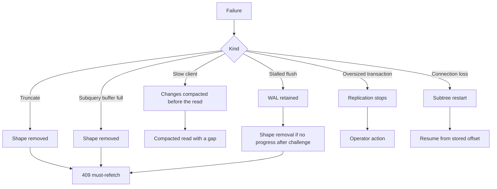

# Testing and Limitations

This document explains how the service is tested, how to run the tests, and what the service does not do. It separates the documented limits from the limits that the source code makes visible.

## Test layout

The package has 115 test files. It also has one test helper, `test/test_helper.exs`, and 19 support files under `test/support/`, so `test/` holds 135 files. The tests are organized by subsystem:

| Directory | Content |
|-----------|---------|
| `test/electric/` | Unit and component tests for each module |
| `test/electric/plug/` | Router and endpoint tests |
| `test/electric/replication/` | Replication client and collector tests |
| `test/electric/shape_cache/` | Storage and shape cache tests |
| `test/electric/shapes/` | Shape, filter, and consumer tests |
| `test/integration/` | End-to-end tests with a real HTTP (Hypertext Transfer Protocol) interface and client |
| `test/pg_interop/` | PostgreSQL type conversion tests |
| `test/support/` | Shared setup and test helpers |

The table lists some directories after the directory that contains them: `test/electric/plug/`, `test/electric/replication/`, `test/electric/shape_cache/`, and `test/electric/shapes/` are inside `test/electric/`. The same directory also holds `test/electric/connection/`, `test/electric/postgres/`, `test/electric/stack_supervisor/`, and `test/electric/telemetry/`.

The test support directory is compiled into the test build. The `mix.exs` file adds it to the compile path only in the test environment:

```elixir
# packages/sync-service/mix.exs:85
defp elixirc_paths(:test), do: ["lib", "test/support"]
defp elixirc_paths(_), do: ["lib"]
```

This is why a test helper can define a module such as `Support.ComponentSetup` and use it from any test file.

## How to run the tests

The test environment needs the development services. Start them from the package directory:

```sh
mix start_dev
mix test
```

The `start_dev` alias runs `docker compose up -d` in `dev/`. The services are:

- PostgreSQL on port 54321.
- A second PostgreSQL on port 54322.
- PgBouncer on port 65432.
- NGINX on port 3002.

The test environment file `.env.test` supplies the connection settings. The tests read the environment at boot.

Run one file with:

```sh
mix test test/electric/plug/router_test.exs
```

Run one test by line number with:

```sh
mix test test/electric/shape_cache_test.exs:82
```

Stop the services with `mix stop_dev`. The alias also removes the volumes. Use `mix reset` to clean persistent state, stop the services, and start them again. The aliases are at `packages/sync-service/mix.exs:147-150`.

## Focused test loop

The suite has 115 test files. A focused loop keeps the feedback short.

1. **Run one test by line.** `mix test test/electric/shape_cache_test.exs:82` runs the matching test and the `setup` callbacks in its `describe` block. Use this first after a failing continuous integration (CI) run.
2. **Include an excluded tag when the test is tagged.** `mix test --only oracle` runs only the oracle tests. `mix test --include slow test/path.exs` includes slow tests with the default set. Without the flag, ExUnit filters a tagged test out even when you name its file. The four excluded tags are defined in the "Test configuration" section below.
3. **Fix the seed to reproduce an order-dependent failure.** ExUnit chooses a seed for each run. `--seed 0` makes the order repeatable. Add `--max-failures 1` to stop at the first failure.
4. **Respect the 400 millisecond assertion timeout.** `packages/sync-service/test/test_helper.exs:10` sets `assert_receive_timeout: 400`. A test that waits for a real timer must pass an explicit timeout to `assert_receive`, or use a helper with a longer default. The trace helper makes this explicit at `packages/sync-service/test/support/trace.ex:104-112`: it uses 1000 milliseconds because trace messages cross processes and arrive slower under CI load.
5. **Keep the Repatch list complete.** Repatch is a library that replaces a module at test time; the "Mocking" section below explains it. A **shared** patch applies to every test process, not only the process that installed it. If you patch a module in shared mode, its name must be in the pre-warm list at `packages/sync-service/test/test_helper.exs:31-61`. A missing module causes rare asynchronous failures that are hard to reproduce. `SKIP_REPATCH_PREWARM=true` is for timing-sensitive oracle runs, not for ordinary work.
6. **Read the JUnit report for CI failures.** The report is at `./junit/regular-test-junit-report.xml`. A telemetry build writes `telemetry-test-junit-report.xml`. The switch is the `telemetry_enabled?` value, which is true when the Mix target is `application` (`packages/sync-service/mix.exs:6-11`, `packages/sync-service/lib/electric.ex:148-149`). The value selects the report name at `packages/sync-service/config/config.exs:13-23`. [06-telemetry-and-observability.md](06-telemetry-and-observability.md) describes the build.

The focused loop proves one behavior. It does not prove that the change is safe for the whole system. Before you merge, run the default suite and the relevant integration file. The cross-package system tests in `../../integration-tests/` are a separate run.

## Test configuration

The test helper sets a short receive timeout and excludes slow groups:

```elixir
# packages/sync-service/test/test_helper.exs:7-13
ExUnit.configure(formatters: [JUnitFormatter, ExUnit.CLIFormatter])

ExUnit.start(
  assert_receive_timeout: 400,
  exclude: [:slow, :oracle, :performance, :memory],
  capture_log: true
)
```

The four excluded tags are:

| Tag | Meaning |
|-----|---------|
| `:slow` | Long-running tests |
| `:oracle` | Tests that compare against a live PostgreSQL oracle |
| `:performance` | Throughput or latency tests |
| `:memory` | Memory growth tests |

Run an excluded group with `mix test --include oracle`, or with `--only slow`. The default run stays fast and deterministic.

The JUnit formatter writes an Extensible Markup Language (XML) report to `./junit`. The report name depends on the telemetry target. A telemetry build writes `telemetry-test-junit-report.xml`. A normal build writes `regular-test-junit-report.xml`.

## Test harness

The harness has two levels.

```mermaid
flowchart TD
    ExUnit[ExUnit test] --> CS[Support.ComponentSetup]
    CS --> Stack[StackSupervisor or parts]
    CS --> Store[Test storage]
    CS --> Insp[Stub or Erlang Term Storage (ETS) inspector]
    CS --> Pub[Test publication manager]
    ExUnit --> IS[Support.IntegrationSetup]
    IS --> Bandit[Bandit on port 0]
    Bandit --> Router[Electric.Plug.Router]
    IS --> Client[Electric.Client]
    Client --> Bandit
    Stack --> DB[("PostgreSQL on 54321")]
```

`Support.ComponentSetup` builds individual parts of the stack. It provides:

- A test storage backend.
- A no-op publication manager. This process accepts the publication calls and does nothing, so a test that does not care about publications needs no database.
- A test publication manager. This process records each call and sends it to the test process, so the test can assert the publication sequence.
- A stub inspector.
- Helpers to start the shape cache, the consumer supervisor, and the log collector.

`Support.IntegrationSetup` starts a real Bandit listener on an ephemeral port. It starts an Electric client pointed at that listener. The port is `0`, so the operating system chooses a free port. The helper returns the actual port and the base Uniform Resource Locator (URL).

The integration tests use the real client from the sibling `elixir-client` package. The package directory is `elixir-client`; its Open Telecom Platform (OTP) application name is `electric_client`. The sync service itself is the OTP application `:electric` (`packages/sync-service/mix.exs:29`). The client package is a test-only dependency. The test helper starts the client application directly at `packages/sync-service/test/test_helper.exs:19`. The comment explains the reason: `electric_client` lists `:electric` as an optional dependency. When the client compiles in the sync-service context, that optional dependency enters its application list. OTP then tries to start both applications, and each waits for the other. Starting the client application by hand skips the dependency resolution and breaks the deadlock.

## Mocking

The service uses `Repatch` to replace modules at test time. Repatch recompiles a module on the first patch. That recompilation invalidates Erlang trace patterns and ETS references. Concurrent tests can then fail in rare cases.

The test helper pre-warms the modules that tests patch:

```elixir
# Condensed excerpt from packages/sync-service/test/test_helper.exs:31-61
if not skip_repatch_prewarm? do
  Repatch.setup(
    recompile: [
      Postgrex,
      Plug.Conn,
      Electric.StatusMonitor,
      Electric.Telemetry.Sampler,
      Electric.Connection.Manager,
      Electric.Connection.Restarter,
      Electric.Postgres.Configuration,
      Electric.Postgres.Inspector,
      Electric.Replication.PublicationManager,
      Electric.Replication.ShapeLogCollector,
      Electric.ShapeCache,
      Electric.ShapeCache.PureFileStorage
      # ... and more
    ]
  )
end
```

The pre-warm happens once at startup. Later patches only update ETS hooks. A hook is the ETS entry that tells the patched module which function to call instead of its own. Repatch recompiles a module on the first patch, and that recompilation destroys trace patterns, invalidates ETS references, and breaks function closures held by other tests. The pre-warm moves that recompilation to startup, when no test is running. The list must include every module that any test patches in shared mode. The comment in the file states this rule. A missing module causes rare asynchronous failures.

The pre-warm slows the suite. Set `SKIP_REPATCH_PREWARM=true` to skip it. The oracle performance tests use this setting because the pre-warm cost changes their timing.

## Test levels

The package guide `packages/sync-service/AGENTS.md` recommends three levels:

1. **Router tests.** These run the full HTTP interface with a test stack. They are in `test/electric/plug/router_test.exs` and `low_privilege_router_test.exs`.
2. **Client integration tests.** These use the real client and a real HTTP listener. They are in `test/integration/`.
3. **System tests.** These run the full stack across packages. They live in `../../integration-tests/` and use Lux. Lux is a separate test runner that starts real processes and drives them from script files with the `.lux` extension. These tests are slow and are not part of `mix test` in this package.

Pick the lowest level that proves the change. A change to a plug should have a router test. A change to the change protocol should have a client integration test. The change protocol is the internal message format that carries a row change from the replication client through the collector to a consumer. A client integration test proves that the format still produces correct HTTP rows.

## Integration test files

The main integration files are:

| File | What it proves |
|------|----------------|
| `streaming_test.exs` | A client can stream a shape |
| `oracle_property_test.exs` | Random operations match a PostgreSQL oracle |
| `oracle_restore_test.exs` | A restore matches the oracle |
| `stalled_serve_memory_test.exs` | A stalled reader does not grow memory without bound |
| `subquery_dependency_update_test.exs` | A change in the dependency shape updates a dependent shape |
| `subquery_move_out_test.exs` | A row that leaves a subquery is handled |

The oracle tests are tagged `:oracle`. They compare the shape stream with a direct Structured Query Language (SQL) query over the same table. The harness polls the shape until it reports up to date, then runs the query and compares the row set. The check is at `packages/sync-service/test/support/oracle_harness/shape_checker.ex:119-146`. They are the strongest correctness evidence in the package.

## Coverage and static analysis

Coverage uses ExCoveralls. The coverage configuration excludes test support and a few modules:

```elixir
# packages/sync-service/mix.exs:42-51
test_coverage: [
  tool: ExCoveralls,
  ignore_modules: [
    Electric,
    Electric.Telemetry,
    Electric.Postgres.ReplicationClient.State,
    ~r/Electric.Postgres.LogicalReplication.Messages.*/,
    ~r/^Support.*/
  ]
],
```

Run coverage with `mix coveralls`, `mix coveralls.html`, or one of the other formats. The Mix project maps these tasks to the `test` environment at `packages/sync-service/mix.exs:75-80`, so the run uses the test build automatically.

Dialyzer is available in the test environment. Run it with:

```sh
MIX_ENV=test mix dialyzer
```

Dialyzer needs a Persistent Lookup Table (PLT), its cached model of the code. The Dialyzer configuration adds the `mix` and `ex_unit` applications to that table and checks the table on each run, at `packages/sync-service/mix.exs:52-55`. The first run is slow because it builds the table. Later runs reuse it. The Mix project already maps `dialyzer` to the `test` environment at `packages/sync-service/mix.exs:74`, so the explicit `MIX_ENV=test` only makes the choice visible.

Formatting uses `mix format`. The formatter configuration is in `.formatter.exs`.

## Documented limitations

The Electric repository root file `LIMITATIONS.md` has two entries.

### TRUNCATE is not handled

> Electric doesn't handle TRUNCATE messages.
> First implementation is to invalidate the shapes that are possibly affected by TRUNCATE.

The implementation removes the shape. It does not apply the truncate to the log. A client must fetch the shape again. The code comment calls the approach naive. Any relevant truncate in a transaction discards the whole transaction for that shape.

The partition module expands a partition truncate to the root table. This makes the invalidation set correct for partitioned tables. It does not preserve the shape.

### No transaction boundaries in shape logs

> No transaction boundaries in shape logs

The log has row changes with offsets. It has no begin or commit marker. The transaction part of an offset and the row `lsn` header group changes by commit. The `lsn` header is a decimal string with the same value as the transaction part of the offset. It is the commit log sequence number, not a separate value, and the producer sets both from `change.log_offset` (`packages/sync-service/lib/electric/log_items.ex:43-47`, `:68-72`, `:93-97`). [03-shape-log-and-storage.md](03-shape-log-and-storage.md) lists the other headers. Nothing marks where a group starts or ends, so a client cannot apply the group atomically from the stream alone.

This limit causes the conservative flush rule. When not all shapes have flushed, the service acknowledges a log sequence number (LSN) one byte before the minimum flushed commit position, not the position itself. When every shape has flushed, it acknowledges the exact last seen position. The rule is safe but adds replication lag under load. [04-replication-and-consumers.md](04-replication-and-consumers.md) gives the tracker algorithm.

## Observed limitations

The source code shows additional limits that are not in the limitations file.

### Read path only

The service has no write endpoint. It does not proxy inserts, updates, or deletes. All writes go directly to PostgreSQL.

### One stack per service process

The package has no cluster membership, no distributed process registry, and no storage-directory lock. Each stack owns its storage directory. A second process that uses the same slot waits on a PostgreSQL advisory lock for that slot, but the lock does not protect the storage directory. The second process therefore does not take over the first process.

### Shape deletion is opt-in

Both run modes read the same rule. The runtime configuration sets `allow_shape_deletion?` to the value of `ELECTRIC_ENABLE_INTEGRATION_TESTING`, which is false when unset. The setting is at `packages/sync-service/config/runtime.exs:216`. A `DELETE /v1/shape` request against a normal deployment returns status 405 with the text `DELETE not allowed`. It does not delete the shape. The gate is at `packages/sync-service/lib/electric/shapes/api/delete.ex:12-20`, and the default is at `packages/sync-service/lib/electric/config.ex:77`.

### Compaction can remove rows before a slow client reads them

Compaction applies only when the shape was created with the `experimental_compaction` request parameter (`packages/sync-service/lib/electric/shapes/api/params.ex:159`, `:337`). It keeps the last two complete chunks by default and rewrites the older chunks into one compacted set whose name contains `.compacted.`. Successive updates to the same row are merged. A client that falls behind the boundary cannot read the intermediate changes that compaction dropped. The service does not return a 409 for this case. It reads the compacted file from its first retained chunk (`packages/sync-service/lib/electric/shape_cache/pure_file_storage.ex:1175-1212`). Rows at or below the requested offset are filtered out (`packages/sync-service/lib/electric/shape_cache/pure_file_storage/log_file.ex:287-330`). The client therefore receives a response with a gap, and the service reports no error. The source has no recovery path for this case. This is a client-visible data-loss risk for a compacted shape, and the source does not state whether the team intends it as a hard retention limit. The compaction merge groups the operations of each key by operation type. Each group holds the operations of one type for one key. A group with more than one operation is treated as a series of updates and becomes one record of that operation type at the offset of the last operation in the group. For a group of update operations, the record is one update whose value merges the values in offset order. Its value merges the values in offset order, and a later update wins on a column that both updates set. Its headers keep only `operation` and `relation`. A group with a single operation stays as it is, so a single insert or a single delete is not changed. The compacted file is therefore a current-state base, not a full version history. The rule is at `packages/sync-service/lib/electric/shape_cache/pure_file_storage/action_file.ex:33-55`, `:64-85`, and `packages/sync-service/lib/electric/log_items.ex:187-203`. [03-shape-log-and-storage.md](03-shape-log-and-storage.md) records the intended recovery as an open question.

### The maximum shape limit removes data

When the shape count is greater than `ELECTRIC_MAX_SHAPES`, the expiry manager removes the least recently used shape, which is the shape with the smallest `last_read_time` (`packages/sync-service/lib/electric/shape_cache/expiry_manager.ex:54-75`, `packages/sync-service/lib/electric/shape_cache/shape_status.ex:379-394`). The expiry manager is `Electric.ShapeCache.ExpiryManager`; it runs in the core supervisor and checks every 60 seconds (`packages/sync-service/lib/electric/core_supervisor.ex:78-79`, `packages/sync-service/lib/electric/shape_cache/expiry_manager.ex:12`). The removal deletes the shape data. The shape is not moved to a secondary store.

### Oversized transactions stop replication

The `max_txn_size` default is 250 mebibytes (MiB). A transaction above the limit stops the replication client. The source comment states that streaming a large transaction to disk is not implemented. A database with very large bulk loads can therefore interrupt replication.

### Subquery buffer overflow removes a shape

A subquery shape keeps a buffer of transactions. The buffer limit defaults to 1000 transactions. An overflow marks the shape for removal. The shape is not paused or retried.

### A storage write failure stops the shape consumer

A failed storage write raises in the shape consumer. The consumer is a `:temporary` child, so the supervisor does not restart it (`packages/sync-service/lib/electric/shapes/consumer.ex:2`). The stored shape stays. The next transaction that routes to the shape starts a restored consumer (`packages/sync-service/lib/electric/shapes/consumer_registry.ex:126-133`). The source does not define how a record lost by the failed write is recovered. The client gets no 409 for this case.

### A stalled flush pins the write-ahead log

A consumer that stops flushing holds the stack-wide flush boundary. The collector detects a stall at a periodic check after the grace period, which defaults to 60 seconds. It sends the consumer a `:verify_flush_progress` message, which the source calls a challenge. A consumer that is buffering on purpose answers with a deferred-flush message. A consumer that stays silent loses the shape at the next check, one grace period later. A shape with no live writer is removed at the first check. Until then, PostgreSQL retains the write-ahead log (WAL) for the slot. This is the main disk-growth risk.

### The LiveDashboard has no authentication

The dashboard exposes virtual machine and process state. The runtime configuration warns that it must be firewalled. This is an operational limit, not a code bug.

### Temporary slots do not match persistent storage

A temporary slot is a replication slot that PostgreSQL deletes on shutdown, because Electric created it with the `TEMPORARY` option (`packages/sync-service/lib/electric/postgres/replication_client/connection_setup.ex:251`). If the storage outlives the slot, the stored shapes cannot resume. The service logs a warning only when a temporary slot with a randomly generated name is configured (`packages/sync-service/lib/electric/application.ex:104-112`). It cannot prevent the combination.

### No cross-shape atomicity

Two shapes that receive changes from one PostgreSQL transaction may receive them at different times. Each shape has its own consumer and its own log. The service does not provide a cross-shape transaction marker.

## Failure modes

The following diagram groups the failure modes by effect.



The common recovery for a removed or invalid shape is a must-refetch response. The client drops local state and starts from offset `-1`. The service creates a new shape handle and a new snapshot. A compaction gap has no such response. The client receives the retained rows and does not know that rows are missing.

## What is not tested

The package tests do not prove these properties:

- Behavior under a real multi-node deployment, because there is no cluster support.
- Correctness for every PostgreSQL type, though the type conversion tests are broad.
- Behavior with a transaction above `max_txn_size`.
- Behavior with a truncate that preserves rows, because the service removes the shape instead.
- Long-term operation with a constantly changing schema.

These are open areas. Treat them as risks, not as tested behavior.

## Key insight

The tests are strongest at the module and request level. They are strong at the integration level for streaming and subqueries. They are weak at the failure level. The known limits are not edge cases. They are the places where the design chooses a simple recovery over a complete implementation. A production review should test those limits against the workload, especially truncates, very large transactions, and slow clients.

## Related documents

- [02-http-api-and-shapes.md](02-http-api-and-shapes.md) explains the must-refetch response.
- [03-shape-log-and-storage.md](03-shape-log-and-storage.md) explains compaction.
- [04-replication-and-consumers.md](04-replication-and-consumers.md) explains the flush tracker and truncate handling.
- [05-configuration-and-deployment.md](05-configuration-and-deployment.md) explains the development services.
- [06-telemetry-and-observability.md](06-telemetry-and-observability.md) explains the metrics that detect these failures.
