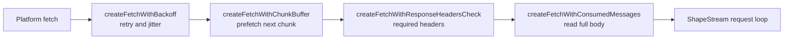
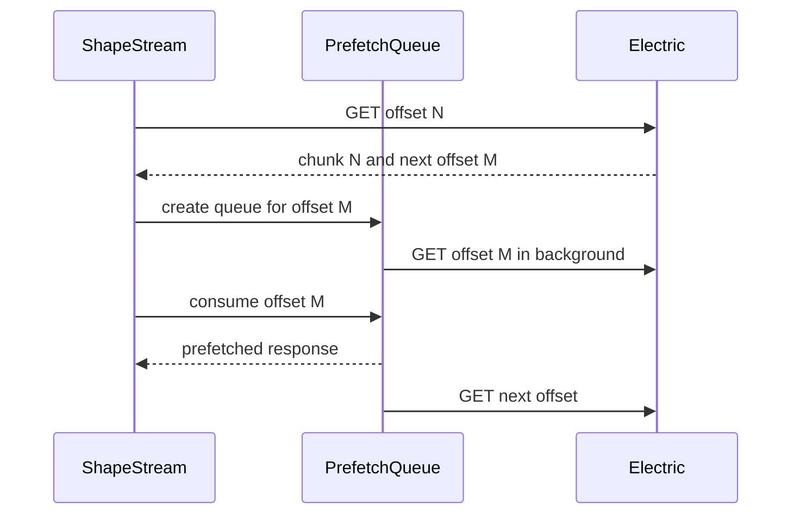

# Fetching, Caching, and Reconnect

The client must keep a stream alive across network failures, proxy errors, content delivery network (CDN) caches, sleeping laptops, and background tabs. It does this with four mechanisms: a retry wrapper, a chunk prefetch queue, an expired handle cache, and a set of reconnect triggers. Each mechanism has a narrow job.

The mechanisms are composed in the `ShapeStream` constructor. The citation is `src/client.ts:789-815`.

The order matters. In call order, the request loop calls the body consumer, which calls the header check, which calls the chunk buffer, which calls backoff, which calls the platform `fetch`. Backoff is therefore closest to the network. A prefetched request also receives retry behavior. The header check sees the final response. The body consumer is closest to the request loop, so the loop receives a response whose body is already read. The citation is `src/client.ts:806-815` and `src/fetch.ts:229-239`.

## Retry with backoff

`createFetchWithBackoff` wraps a fetch client. It returns a new fetch client with the same signature. The citation is `src/fetch.ts:104-192`.

The defaults are:

| Option | Default | Meaning |
|--------|---------|---------|
| `initialDelay` | 1000 milliseconds | Upper bound of the first full-jitter wait |
| `maxDelay` | 32000 milliseconds | Delay cap |
| `multiplier` | 2 | Growth factor |
| `maxRetries` | `Infinity` | Retry without a fixed limit |

The citation is `src/fetch.ts:49-54`.

The wrapper retries any failure except a client error. A client error is a status from 400 to 499. The status 429 is the exception: the wrapper retries it. The citation is `src/fetch.ts:133-145`.

The wait time uses full jitter. The client delay is a random value between zero and the current delay. The current delay is capped at `maxDelay`. The citation is `src/fetch.ts:166-173`.

The server `Retry-After` header is a floor. The wrapper parses both the delta-seconds form and the Hypertext Transfer Protocol (HTTP) date form. A date is clamped to the range from zero to one hour. The citation is `src/fetch.ts:61-79` and `src/fetch.ts:160-173`.

The final wait is `max(server minimum, client jitter)`. This rule lets a server slow down a client beyond the client cap. The citation is `src/fetch.ts:173`.

The delay grows after each attempt. It stops growing at `maxDelay`. The citation is `src/fetch.ts:187`.

The sleep is abortable. An abort signal cancels the timer and throws `FetchBackoffAbortError`. This behavior lets a system wake end a long backoff immediately. The citation is `src/fetch.ts:81-102`.

**Aha:** the client does not use exponential backoff without jitter. It uses full jitter, so many clients that fail at the same time do not retry at the same moment. The server minimum is a floor, not a replacement. A `Retry-After` value can increase the wait beyond the client cap, but it cannot shorten it. The citation is `src/fetch.ts:166-173`.

## Response body consumption

`consumeResponseBody` reads the full body before the request loop uses the response. It skips status codes 201, 204, and 205, because these codes have no body. The citation is `src/fetch.ts:194-226`.

The reason is subtle. The stream needs to know that the body is valid before it advances the offset. A body read failure becomes a `FetchError` with the response status and headers. The citation is `src/fetch.ts:208-225`.

`createFetchWithConsumedMessages` applies the consumer to every response. The citation is `src/fetch.ts:229-239`.

## Required header check

`createFetchWithResponseHeadersCheck` rejects a response that lacks Electric headers. The required set depends on the request type:

| Request type | Required headers | Source |
|--------------|------------------|--------|
| All shape responses | `electric-offset`, `electric-handle` | `src/fetch.ts:310-313` |
| Live response | `electric-cursor` | `src/fetch.ts:315` |
| Non-live response | `electric-schema` | `src/fetch.ts:317` |
| Snapshot response | none; the check returns early | `src/fetch.ts:337-347` |

A missing header throws `MissingHeadersError`. The error text names the uniform resource locator (URL) and the missing headers. It also names cross-origin resource sharing (CORS) as a common cause. The citation is `src/fetch.ts:361-363` and `src/error.ts:108-118`.

## Chunk prefetch

A non-live response can say where the next chunk is. The client reads `electric-handle` and `electric-offset`, builds the next URL, and starts the next request before the caller asks for it. The queue holds at most two requests. The limit is fixed in the stream constructor; the stream does not pass an option to change it. The citation is `src/fetch.ts:245-247` and `src/fetch.ts:475-512`.

The prefetch rules are strict:

1. Prefetch only a `GET` request.
2. Prefetch only when the response has a handle and an offset.
3. Do not prefetch when the response has the `electric-up-to-date` header.
4. Do not prefetch a snapshot response; the `electric-snapshot` header is `true`.
5. Do not prefetch a request that has the `live` query parameter.
6. Do not prefetch when the response handle equals the `expired_handle` query parameter.

The citation is `src/fetch.ts:268-278` and `src/fetch.ts:475-510`.

The queue matches by URL only. For this reason, a request with a method other than `GET` aborts the queue. A POST request with the same URL must not consume a prefetched GET response. The citation is `src/fetch.ts:270-278`.

A consumed request starts a new prefetch if the queue tail exists. The queue head advances only in URL order. A request that is not at the head returns nothing, and the caller performs its own fetch. The citation is `src/fetch.ts:400-432`.

## Fast loop detection

A proxy or CDN can return the same cached response forever. The offset never advances. The client would loop with no delay. The stream detects this case in `#checkFastLoop`. The citation is `src/client.ts:1137-1211`.

The detector keeps recent request entries for 500 milliseconds. It flags a fast loop when five requests use the same offset inside that window. The constants are `#fastLoopWindowMs = 500` and `#fastLoopThreshold = 5`. The citation is `src/client.ts:710-716`.

The first detection clears the expired handle cache and the up-to-date tracker. It resets the stream. The citation is `src/client.ts:1176-1199`.

If the loop repeats, the client adds exponential delay with jitter. Each detection that reaches the threshold increments a consecutive count. When that count reaches five, the client throws a `FetchError` with status 502 and a troubleshooting message. The check runs before the reset branch, so the fifth detection throws instead of resetting. The citation is `src/client.ts:1154-1174`.

## Stale response recovery

A stale response has a handle that the client already marked expired. The client stores expired handles in a least-recently-used (LRU) cache. The key is the canonical shape key. The cache keeps at most 250 entries and persists them in `localStorage`. The citation is `src/expired-shapes-cache.ts:9-46`.

The canonical key removes all Electric protocol parameters. It keeps the custom parameters and sorts them. The citation is `src/client.ts:594-607`.

The client sends the expired handle to the server as the `expired_handle` query parameter. The server can use it to avoid the stale cache entry. When a response handle equals that expired handle, the state machine enters `StaleRetryState`. That state adds a random `cache-buster` query parameter. The citation is `src/client.ts:1351-1353`, `src/shape-stream-state.ts:296-320`, and `src/shape-stream-state.ts:472-475`.

The client retries at most three times. The constant is `#maxStaleCacheRetries = 3`. The citation is `src/client.ts:707`.

If the retries fail, the client deletes the expired entry and performs one self-healing retry without the `expired_handle` parameter. It also arms a check. The check records the stale handle. On the next accepted response, it compares that handle with the response handle. If they are equal, the client warns that the proxy or CDN ignores cache-buster parameters and is still serving the stale response. The citation is `src/client.ts:1445-1506` and `src/client.ts:1400-1420`.

A 409 response means the server no longer has the shape handle. The client marks the current handle as expired. It reads the new handle from the response. It publishes a synthetic `must-refetch` message and resets the state to offset `-1`. The citation is `src/client.ts:1083-1111`.

## Replay mode and the up-to-date tracker

After a page reload, a CDN can serve cached chunks. The client could notify subscribers with data that it already reported in the previous session. The up-to-date tracker prevents this duplicate notification. The citation is `src/up-to-date-tracker.ts:6-16`.

The tracker stores a timestamp and a cursor for each shape key. All entries live in one `localStorage` entry under the key `electric_up_to_date_tracker`; the stored value is a JSON object whose keys are shape keys. An entry lives for 60000 milliseconds. The citation is `src/up-to-date-tracker.ts:17-24` and `src/up-to-date-tracker.ts:43-49`.

The tracker throttles `localStorage` writes to once per 60000 milliseconds. The in-memory data is always current. The citation is `src/up-to-date-tracker.ts:54-76`.

On a fresh stream, the client asks the tracker for a recent cursor. If one exists, the state becomes `ReplayingState`. The state suppresses the first up-to-date message when the cursor has not changed. The citation is `src/shape-stream-state.ts:637-650`.

## Server-Sent Events and fallback

The `liveSse` option selects Server-Sent Events (SSE) for live updates. The client adds `live_sse=true` to the request. The citation is `src/client.ts:1639-1650`.

SSE has a failure mode. A proxy can close the connection immediately. The state machine counts short connections. A connection shorter than 1000 milliseconds is short. After three short connections, the client falls back to long polling. The fallback flag stays in the live state for the rest of that stream generation. A stream reset or a return to replay creates a new live state and clears the flag. The citation is `src/client.ts:700-703` and `src/shape-stream-state.ts:567-596`.

The fallback warning names the common proxy settings. Nginx needs `X-Accel-Buffering: no`. Caddy needs `flush_interval -1`. The citation is `src/client.ts:1826-1834`.

The SSE reader flushes its buffer on every up-to-date message. This rule keeps batch boundaries the same as long polling. The citation is `src/client.ts:1764-1779`.

## Request timeout watchdog

A live request can hang in some React Native fetch implementations. The client races the request against a timer. The default timeout is 45000 milliseconds. This value is longer than the Electric server long-poll timeout of 20 seconds. The citation is `src/client.ts:784-787` and `src/client.ts:1655-1685`.

The watchdog aborts the request with the reason `live-request-timeout`. The request loop treats this abort as a restart and sends a new request. The citation is `src/client.ts:1670-1677` and `src/client.ts:1050-1066`.

The timeout applies only to a live request or a refresh catch-up request. A normal non-live request is not timed. The citation is `src/client.ts:1660-1667`.

## Visibility and system wake

A hidden browser tab pauses the stream. The stream acquires the `visibility` reason in the pause lock. A visible tab releases the reason and resumes. The citation is `src/client.ts:2010-2052`.

A non-browser runtime has no `document` object. The client uses a timer to detect a system sleep. The timer checks every 2000 milliseconds. If the total gap is more than 6000 milliseconds (4000 milliseconds beyond the interval), the client refreshes the stream. The citation is `src/client.ts:2094-2122`.

The refresh aborts the active request with the reason `system-wake`. The request loop treats the abort as a restart. The next request is a catch-up request without long polling. The citation is `src/client.ts:2066-2092`.

## Snapshot retries

A snapshot request can receive a 409 response when the shape handle changed. The snapshot path retries at most five times. The constant is `#maxSnapshotRetries = 5`. The citation is `src/client.ts:718` and `src/client.ts:2307-2320`.

The snapshot path updates only the handle. It does not reset the offset, the schema, or the pause lock. The main stream is paused and must not be disturbed. The citation is `src/client.ts:2327-2337`.

Read [02-shape-protocol-and-offsets.md](02-shape-protocol-and-offsets.md) for the headers and offsets used here. Read [04-api-reference.md](04-api-reference.md) for the option names and defaults.
