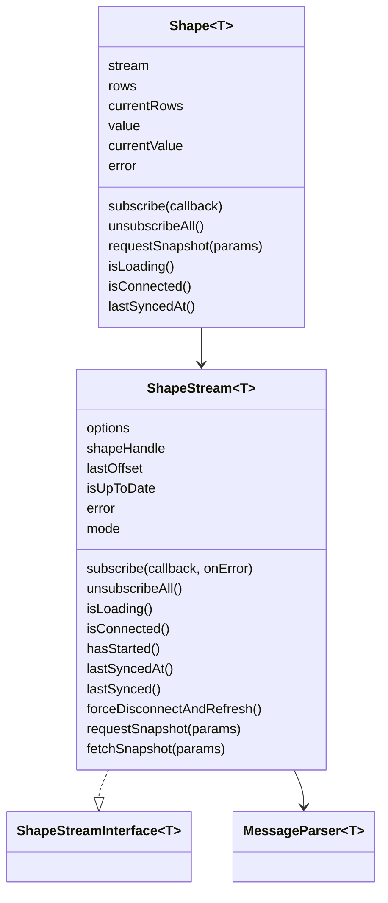
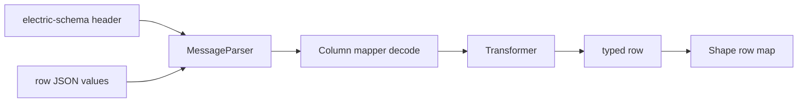

# API Reference

This document lists the public application programming interface (API) of `@electric-sql/client`. It covers the options, the classes, the helper functions, the types, the errors, and the constants. The package entry point re-exports the client, the shape, the types, the three guards, two errors, the backoff helper, the protocol constants, the column mapper, and the expression compiler (`src/index.ts:1-19`). The parser symbols and the other error classes are internal: the entry point does not export them.

## Class map



The diagram shows the main class relationships, not every member. The tables below are the complete reference. `ShapeStream` is declared in `src/client.ts:649-2417`. `Shape` is declared in `src/shape.ts:78-360`. `ShapeStreamInterface` is declared in `src/client.ts:557-589`. `MessageParser` is declared in `src/parser.ts:99-209`.

## ShapeStreamOptions

The type is in `src/client.ts:300-555`.

| Option | Type | Default | Behavior | Source |
|--------|------|---------|----------|--------|
| `url` | `string` | none | Full shape endpoint uniform resource locator (URL) | `src/client.ts:300-305` |
| `offset` | `Offset` | `-1` | Start position in the shape log | `src/client.ts:307-315` |
| `handle` | `string` | none | Shape handle for resume | `src/client.ts:317-321` |
| `headers` | `ExternalHeadersRecord` | none | Static or function-valued Hypertext Transfer Protocol (HTTP) headers | `src/client.ts:323-329` |
| `params` | `ExternalParamsRecord` | none | Shape parameters and custom query parameters | `src/client.ts:331-344` |
| `subscribe` | `boolean` | `true` | Continue live synchronization | `src/client.ts:346-350`, `src/client.ts:730` |
| `liveSse` | `boolean` | `false` | Use Server-Sent Events (SSE) for live data | `src/client.ts:357-360` |
| `experimentalLiveSse` | `boolean` | none | Deprecated alias of `liveSse` | `src/client.ts:352-355` |
| `log` | `changes_only` or `full` | `full` | Row content mode | `src/client.ts:362-365`, `src/client.ts:784` |
| `signal` | `AbortSignal` | none | Stop signal | `src/client.ts:367` |
| `fetchClient` | `typeof fetch` | platform fetch | Custom HTTP client | `src/client.ts:368` |
| `runtimeVisibility` | `RuntimeVisibilityAdapter` | platform default | Background and foreground adapter; an object with optional `getCurrentState()` and required `subscribe(callback)` | `src/client.ts:256-262`, `src/client.ts:370-375` |
| `backoffOptions` | `BackoffOptions` | `BackoffDefaults` | Retry timing | `src/client.ts:376` |
| `liveRequestTimeoutMs` | `number` or `false` | `45000` | Watchdog for a live request | `src/client.ts:378-391`, `src/client.ts:787` |
| `parser` | `Parser<T>` | `defaultParser` | Column value parser | `src/client.ts:392` |
| `transformer` | `TransformFunction<T>` | none | Row value transformer | `src/client.ts:394-436` |
| `columnMapper` | `ColumnMapper` | none | Column name mapper | `src/client.ts:438-472` |
| `onError` | `ShapeStreamErrorHandler` | none | Error recovery callback | `src/client.ts:474-526` |
| `subsetMethod` | `GET` or `POST` | `GET` | HTTP method for snapshots | `src/client.ts:528-547` |
| `warnOnHttp` | `boolean` | true outside tests | Warn that HTTP limits a browser to six connections per host; each live shape can hold one | `src/client.ts:549-554`, `src/client.ts:2530-2531` |

`headers` and `params` accept function values. The client resolves them in parallel on each request. The citation is `src/client.ts:194-240`.

Reserved parameter names are `cursor`, `handle`, `live`, `offset`, and `cache-buster`. The client throws `ReservedParamError` when a caller supplies one. The citation is `src/client.ts:93-99`, `src/client.ts:165-171`, and `src/client.ts:2446-2455`.

The `params` object also accepts the PostgreSQL-specific fields `table` (string), `columns` (array of column names), `where` (SQL string), `params` (array or numeric-keyed object of `WHERE` values), and `replica` (`default` or `full`). The citation is `src/client.ts:113-151`.

The subset request parameters use the prefix `subset__`. They are `subset__where`, `subset__params`, `subset__limit`, `subset__offset`, `subset__order_by`, `subset__where_expr`, and `subset__order_by_expr`. These names are internal to `requestSnapshot` and `fetchSnapshot`; they are not in the reserved-name set. The citation is `src/constants.ts:26-33`.

A subset call can use a string clause or a structured expression:

```ts
await stream.requestSnapshot({
  where: 'status = $1',
  params: { '1': 'active' },
  limit: 10,
  orderBy: 'created_at desc',
})
```

The same call can use `whereExpr: { type: 'func', name: 'eq', args: [...] }` and `orderByExpr` instead. The citation is `src/types.ts:79-118`.

## ShapeStream methods and properties

| Member | Return type | Behavior | Source |
|--------|-------------|----------|--------|
| `options` | `ShapeStreamOptions` | The normalized options object | `src/client.ts:657` |
| `subscribe(callback, onError?)` | `() => void` | Add a subscriber and start the stream | `src/client.ts:1848-1865` |
| `unsubscribeAll()` | `void` | Remove all subscribers and listeners | `src/client.ts:1867-1871` |
| `isLoading()` | `boolean` | True before the first up-to-date | `src/client.ts:1889-1892` |
| `isConnected()` | `boolean` | True after a successful response | `src/client.ts:1884-1887` |
| `hasStarted()` | `boolean` | True after the first subscription | `src/client.ts:1894-1896` |
| `isPaused()` | `boolean` | True when the pause lock is held | `src/client.ts:1898-1900` |
| `lastSyncedAt()` | `number` or `undefined` | Unix time of the last sync | `src/client.ts:1873-1876` |
| `lastSynced()` | `number` | Milliseconds since the last sync | `src/client.ts:1878-1882` |
| `forceDisconnectAndRefresh()` | `Promise<void>` | Abort a live request and catch up | `src/client.ts:1935-1956` |
| `requestSnapshot(params)` | `Promise<{ metadata, data }>` | Fetch a subset and inject it | `src/client.ts:2152-2235` |
| `fetchSnapshot(params)` | `Promise<{ metadata, data, responseOffset, responseHandle }>` | Fetch a subset without injection | `src/client.ts:2248-2372` |
| `shapeHandle` | `string` or `undefined` | Current handle | `src/client.ts:820-822` |
| `lastOffset` | `Offset` | Current offset | `src/client.ts:832-834` |
| `isUpToDate` | `boolean` | True in the live state | `src/client.ts:828-830` |
| `error` | `unknown` | Last stream error | `src/client.ts:824-826` |
| `mode` | `LogMode` | Current log mode | `src/client.ts:836-838` |
| `Replica.FULL` | `full` | Value for the `params.replica` parameter: send the whole row and `old_value` | `src/client.ts:652-655` |
| `Replica.DEFAULT` | `default` | Value for the `params.replica` parameter: send changed columns only | `src/client.ts:652-655` |

The `Replica` constants are values for `params.replica`. They do not set the `log` option. The `log` option independently selects `full` or `changes_only`.

The subscriber callback receives an array of `Message<T>`. It can return a promise. The stream waits for all subscriber promises before it processes the next batch. The citation is `src/client.ts:1848-1865` and `src/client.ts:1958-1994`.

## Shape class

The type is in `src/shape.ts:78-360`.

| Member | Return type | Behavior | Source |
|--------|-------------|----------|--------|
| `stream` | `ShapeStreamInterface<T>` | The underlying stream | `src/shape.ts:79` |
| `rows` | `Promise<T[]>` | Resolve when the shape is up to date | `src/shape.ts:109-111` |
| `currentRows` | `T[]` | Current rows without waiting | `src/shape.ts:113-115` |
| `value` | `Promise<ShapeData<T>>` | Resolve the row map when up to date | `src/shape.ts:117-129` |
| `currentValue` | `ShapeData<T>` | Current row map | `src/shape.ts:131-133` |
| `isUpToDate` | `boolean` | True when the projection is current | `src/shape.ts:97-99` |
| `lastOffset` | `Offset` | Offset of the underlying stream | `src/shape.ts:101-103` |
| `handle` | `string` or `undefined` | Handle of the underlying stream | `src/shape.ts:105-107` |
| `error` | `FetchError` or `false` | Last shape error | `src/shape.ts:135-137` |
| `lastSyncedAt()` | `number` or `undefined` | Unix time of the last sync | `src/shape.ts:139-142` |
| `lastSynced()` | `number` | Milliseconds since the last sync | `src/shape.ts:144-147` |
| `isLoading()` | `boolean` | Delegate to the stream | `src/shape.ts:149-152` |
| `isConnected()` | `boolean` | Delegate to the stream | `src/shape.ts:154-157` |
| `mode` | `LogMode` | Delegate to the stream | `src/shape.ts:159-162` |
| `subscribe(callback)` | `() => void` | Add a projection subscriber | `src/shape.ts:180-188` |
| `unsubscribeAll()` | `void` | Remove all projection subscribers | `src/shape.ts:190-192` |
| `numSubscribers` | `number` | Current subscriber count | `src/shape.ts:194-196` |
| `requestSnapshot(params)` | `Promise<void>` | Request a subset and apply it | `src/shape.ts:168-178` |

The subscriber callback receives `{ value, rows }`. The `value` is the map. The `rows` is the array. The citation is `src/shape.ts:10-14`.

The `Shape` notification behavior is defined in `src/shape.ts:18-40`. The rules are N1 and N2 in [02-shape-protocol-and-offsets.md](02-shape-protocol-and-offsets.md).

`Shape` also stores the requested snapshot parameters. After a `must-refetch` message, it re-executes those snapshots. The citation is `src/shape.ts:274-307`.

## Types

| Type | Definition | Source |
|------|------------|--------|
| `Value<Extensions>` | String, number, boolean, bigint, null, extension, array, or object | `src/types.ts:5-13` |
| `Row<Extensions>` | `Record<string, Value<Extensions>>` | `src/types.ts:15` |
| `Offset` | `-1`, `now`, `<number>_<number>`, or `<bigint>_<number>` | `src/types.ts:26-30` |
| `Operation` | `insert`, `update`, or `delete` | `src/types.ts:49` |
| `MoveTag` | A string naming one reason a row belongs to a shape; composite parts are separated by `|` | `src/types.ts:50-60` |
| `MovePattern` | `{ pos: number; value: string }` | `src/types.ts:62-69` |
| `SerializedExpression` | Reference, value, or function node | `src/types.ts:79-82` |
| `SerializedOrderByClause` | Column, direction, null order | `src/types.ts:87-91` |
| `SubsetParams` | String `where`/`orderBy`, structured `whereExpr`/`orderByExpr`, positional `params`, `limit`, `offset`, and `method` | `src/types.ts:93-118` |
| `ControlMessage` | Control header and optional snapshot fields | `src/types.ts:120-128` |
| `EventMessage` | Event header and move patterns | `src/types.ts:130-132` |
| `ChangeMessage<T>` | Key, value, old value, and change headers | `src/types.ts:134-146` |
| `Message<T>` | Union of all message types | `src/types.ts:149-152` |
| `ColumnInfo` | Union of PostgreSQL column descriptions | `src/types.ts:217-225` |
| `Schema` | Map of column name to `ColumnInfo` | `src/types.ts:227` |
| `SnapshotMetadata` | Snapshot mark, database log sequence number, and visibility fields | `src/types.ts:245-249` |

## Helper functions

| Function | Behavior | Source |
|----------|----------|--------|
| `isChangeMessage(message)` | True when the message has a `key` | `src/helpers.ts:28-32` |
| `isControlMessage(message)` | True when the message has a `control` header | `src/helpers.ts:51-55` |
| `isUpToDateMessage(message)` | True for an `up-to-date` control message | `src/helpers.ts:57-61` |
| `getOffset(message)` | Build an offset from `global_last_seen_lsn` | `src/helpers.ts:68-72` |
| `bigintSafeStringify(value)` | JavaScript Object Notation (JSON) stringify that converts bigint to string | `src/helpers.ts:85-87` |
| `canonicalBigintSafeStringify(value)` | Sorted-key JSON stringify | `src/helpers.ts:94-107` |
| `isVisibleInSnapshot(txid, snapshot)` | PostgreSQL visibility test | `src/helpers.ts:116-132` |
| `canonicalShapeKey(url)` | Key without Electric protocol parameters | `src/client.ts:594-607` |
| `resolveValue(value)` | Resolve a value or a function value | `src/client.ts:194-201` |

## Parsing and mapping

The parser symbols are internal. The package entry point does not export them, and a caller reaches them only through the client options.

`MessageParser` merges a caller parser over `defaultParser`. The default parser handles `int2`, `int4`, `int8`, `bool`, `float4`, `float8`, `json`, and `jsonb`. Every other PostgreSQL type passes through as its raw string. The citation is `src/parser.ts:32-41`, `src/parser.ts:99-111`, and `src/parser.ts:192-194`.

`pgArrayParser` parses a PostgreSQL array literal. It supports quoting, escaping, nesting, and `NULL`. The citation is `src/parser.ts:44-97`.

`ColumnMapper` has two methods. `decode` maps a database column name to an application column name. `encode` maps the reverse direction. The citation is `src/column-mapper.ts:46-58`.

`createColumnMapper(mapping)` builds a mapper from an explicit mapping. `snakeCamelMapper(schema?)` builds a bidirectional snake_case and camelCase mapper. The citation is `src/column-mapper.ts:159-177` and `src/column-mapper.ts:372-392`.

`compileExpression(expr, columnMapper?)` turns a structured `WHERE` expression into Structured Query Language (SQL). It supports comparison, logical, special, string, and `coalesce` operators. The citation is `src/expression-compiler.ts:18-100`.

`compileOrderBy(clauses, columnMapper?)` turns structured ordering clauses into a SQL `ORDER BY` string. The citation is `src/expression-compiler.ts:116-132`.



The transformer order is fixed. The column mapper decodes first. The transformer runs second. The citation is `src/client.ts:757-779`.

## Backoff options

`BackoffOptions` is declared in `src/fetch.ts:28-47`.

| Field | Type | Default | Behavior |
|-------|------|---------|----------|
| `initialDelay` | `number` | 1000 | First delay ceiling |
| `maxDelay` | `number` | 32000 | Delay cap |
| `multiplier` | `number` | 2 | Growth factor |
| `onFailedAttempt` | `() => void` | none | Callback after a failure |
| `debug` | `boolean` | false | Log retry decisions |
| `maxRetries` | `number` | `Infinity` | Retry limit |

The defaults are in `src/fetch.ts:49-54`.

## Error classes

Only `FetchError` and `FetchBackoffAbortError` are exported from the package entry point (`src/index.ts:9`). The other classes below are internal to the package; they appear here because the client may throw them or use them in control flow.

| Error | Meaning | Source |
|-------|---------|--------|
| `FetchError` | HTTP or body error with status, text, JSON, headers, URL | `src/error.ts:1-46` |
| `FetchBackoffAbortError` | Retry sleep interrupted by an abort | `src/error.ts:48-53` |
| `InvalidShapeOptionsError` | Invalid option value | `src/error.ts:55-60` |
| `MissingShapeUrlError` | No `url` option | `src/error.ts:62-67` |
| `InvalidSignalError` | Signal is not an `AbortSignal` | `src/error.ts:69-74` |
| `MissingShapeHandleError` | Offset needs a handle | `src/error.ts:76-83` |
| `ReservedParamError` | Reserved parameter name used | `src/error.ts:85-92` |
| `ParserNullValueError` | Null in a non-nullable column | `src/error.ts:94-99` |
| `ShapeStreamAlreadyRunningError` | Declared but not thrown anywhere in this package | `src/error.ts:101-106` |
| `MissingHeadersError` | Required Electric headers absent | `src/error.ts:108-118` |
| `StaleCacheError` | Internal signal that a stale cached response started a retry; the request loop catches it | `src/error.ts:120-125`, `src/client.ts:1059-1068` |

## Protocol constants

| Constant | Value | Source |
|----------|-------|--------|
| `LIVE_CACHE_BUSTER_HEADER` | `electric-cursor` | `src/constants.ts:1` |
| `SHAPE_HANDLE_HEADER` | `electric-handle` | `src/constants.ts:2` |
| `CHUNK_LAST_OFFSET_HEADER` | `electric-offset` | `src/constants.ts:3` |
| `SHAPE_SCHEMA_HEADER` | `electric-schema` | `src/constants.ts:4` |
| `CHUNK_UP_TO_DATE_HEADER` | `electric-up-to-date` | `src/constants.ts:5` |
| `SNAPSHOT_HEADER` | `electric-snapshot` | `src/constants.ts:6` |
| `EXPIRED_HANDLE_QUERY_PARAM` | `expired_handle` | `src/constants.ts:9` |
| `LIVE_QUERY_PARAM` | `live` | `src/constants.ts:11` |
| `OFFSET_QUERY_PARAM` | `offset` | `src/constants.ts:12` |
| `SHAPE_HANDLE_QUERY_PARAM` | `handle` | `src/constants.ts:10` |
| `LOG_MODE_QUERY_PARAM` | `log` | `src/constants.ts:26` |
| `CACHE_BUSTER_QUERY_PARAM` | `cache-buster` | `src/constants.ts:34` |
| `ELECTRIC_PROTOCOL_QUERY_PARAMS` | Array of protocol parameters | `src/constants.ts:37-54` |

The server sets `electric-up-to-date` on a response that has reached a sync boundary. The chunk buffer reads it to decide not to prefetch. The server sets `electric-snapshot` to `true` on a subset response. The chunk buffer reads it to skip prefetch. The client sends `expired_handle` when it knows a handle is stale, so the server can bypass that cache entry. The citations are `src/fetch.ts:475-506` and `src/client.ts:1351-1353`.

## Minimal examples

```ts
import { ShapeStream, Shape } from '@electric-sql/client'

const stream = new ShapeStream({
  url: 'http://localhost:3000/v1/shape',
  params: { table: 'todos' },
})

const shape = new Shape(stream)
const rows = await shape.rows
```

The `Shape` constructor takes one argument: the `ShapeStream` (or any `ShapeStreamInterface`) to project. The constructor subscribes to that stream immediately. The constructor has no options and no defaults. The citation is `src/client.ts:616-647` and `src/shape.ts:85-95`.

```ts
import { isChangeMessage } from '@electric-sql/client'

const unsubscribe = stream.subscribe((messages) => {
  for (const message of messages) {
    if (isChangeMessage(message)) {
      console.log(message.headers.operation, message.key)
    }
  }
})
```

The citation is `src/client.ts:1848-1865` and `src/helpers.ts:28-32`.

**Aha:** the client exposes two consistency levels with one protocol. `ShapeStream` is eventually consistent at the message level. `Shape` is consistent at the up-to-date boundary. A user interface that needs a stable snapshot should use `Shape`. A background indexer that wants every change should use `ShapeStream`. The same offset and handle serve both.

## Related documents

- [00-overview.md](00-overview.md) for the layer model.
- [01-shape-stream-client.md](01-shape-stream-client.md) for the request loop.
- [02-shape-protocol-and-offsets.md](02-shape-protocol-and-offsets.md) for the protocol.
- [03-fetching-caching-and-reconnect.md](03-fetching-caching-and-reconnect.md) for the transport.
- [React hooks](../react-hooks/README.md) for the React binding.
- [Y-Electric](../y-electric/README.md) for the Yjs binding.
- [Electric and Durable Streams](../README.md) for the parent study.
