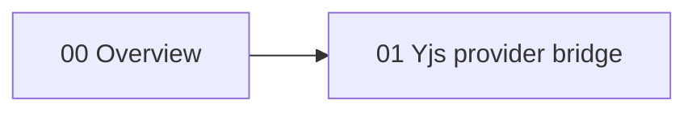
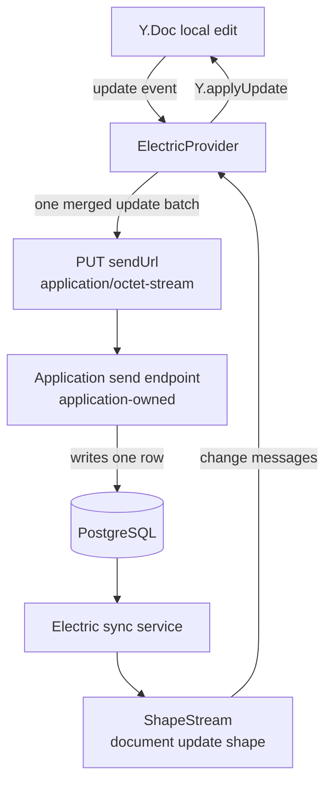

# Y-Electric

`@electric-sql/y-electric` connects a Yjs document to Electric. Yjs is a Conflict-free Replicated Data Type (CRDT) library for shared editing. An Electric shape is a live query over one PostgreSQL table. A `ShapeStream` is the client stream that receives the shape's change messages. The package batches local Yjs updates into one binary request body. An application-owned endpoint writes that body as a row. Electric then serves the rows through a document shape, and the provider applies each row to every client's document.

The package is published as `@electric-sql/y-electric` at version `0.1.54`. The license is Apache-2.0. It depends on `@electric-sql/client`, `lib0`, `y-protocols`, and `yjs`. The citation is `package.json:2-15` and `package.json:72`.

The package has three runtime modules and one types-only module:

| Area | Export | Purpose |
|------|--------|---------|
| `src/y-electric.ts` | `ElectricProvider` | The Yjs network provider |
| `src/local-storage-resume-state.ts` | `LocalStorageResumeStateProvider` | A reference resume-state store |
| `src/utils.ts` | `parseToDecoder` | A parser for PostgreSQL `bytea` rows |

The citation is `src/index.ts:1-4`.

## Reading order

| Order | Document | What you learn |
|-------|----------|----------------|
| 1 | [00-overview.md](00-overview.md) | The purpose, the two shapes, the events, and the public surface |
| 2 | [01-yjs-provider-bridge.md](01-yjs-provider-bridge.md) | The provider lifecycle, the send and receive paths, awareness, and resume state |

## Package map

All paths are relative to `packages/y-electric`.

| Area | File | Lines | Purpose |
|------|------|-------|---------|
| Public export | `src/index.ts` | 1-4 | Re-export every module |
| Provider | `src/y-electric.ts` | 1-489 | `ElectricProvider` and the `send` helper |
| Types | `src/types.ts` | 1-112 | Options, events, and resume state |
| Local Storage resume | `src/local-storage-resume-state.ts` | 1-61 | A reference persistence provider |
| Row parser | `src/utils.ts` | 1-23 | Hex `bytea` to Yjs decoder |
| Tests | `test/` | full tree | Provider behavior tests |

## The data path

The local edit path and the remote edit path meet at the same Yjs document. The update handler ignores updates whose origin is `server`. The citation is `src/y-electric.ts:341-349`. This guard stops an infinite echo.

**Aha:** the package does not synchronize a document as one blob. It synchronizes a stream of binary update batches. `batch` merges local updates with `Y.mergeUpdates`, so one row can hold one or several Yjs updates. The database is a durable log of update batches, and the Electric shape is the replay channel. Yjs can accept updates out of order because it buffers missing structs, but the log still gives every client the same delivery order. This is why two clients can edit the same document through different network paths and still converge.

## What the provider needs

The provider needs one shape for document updates. It can also need a second shape for awareness updates. Each shape has a sending endpoint. The citation is `src/types.ts:78-100`.

| Input | Required | Role |
|-------|----------|------|
| `doc` | yes | The Yjs document to synchronize |
| `documentUpdates.shape` | yes | Stream options for the document shape |
| `documentUpdates.sendUrl` | yes | Endpoint that accepts document updates |
| `documentUpdates.getUpdateFromRow` | yes | Extract a decoder from one row |
| `documentUpdates.sendErrorRetryHandler` | no | Decide whether a failed send retries |
| `awarenessUpdates.shape` | no | Stream options for the awareness shape |
| `awarenessUpdates.sendUrl` | no | Endpoint that accepts awareness updates |
| `awarenessUpdates.protocol` | no | The Yjs awareness protocol object |
| `awarenessUpdates.getUpdateFromRow` | no | Extract a decoder from one awareness row |
| `resumeState` | no | `{ document?: { offset, handle }, stableStateVector?: Uint8Array }`; the offset and handle identify the shape position, and the vector identifies the document state already sent |
| `connect` | no | Connect at construction, default true |
| `fetchClient` | no | Custom fetch implementation |
| `debounceMs` | no | Delay window before a document send |

## Events

The provider is an `ObservableV2` from `lib0`. It emits five events. The citation is `src/types.ts:36-45`.

| Event | Payload | When |
|-------|---------|------|
| `status` | `{ status }` | The connection state changes |
| `sync` | `boolean` | The provider reaches or leaves the up-to-date state |
| `synced` | `boolean` | The same condition as `sync`; both events fire on every change of that boolean |
| `resumeState` | `ResumeState` | After a receive boundary or a successful send |
| `connection-close` | none | The provider disconnects |

The citation is `src/y-electric.ts:148-168`, `src/y-electric.ts:335-336`, `src/y-electric.ts:384`, and `src/y-electric.ts:255`.

## Related studies

- [TypeScript client](../typescript-client/README.md) supplies `ShapeStream` and the message types.
- [TypeScript client protocol](../typescript-client/02-shape-protocol-and-offsets.md) explains offsets and the up-to-date boundary that this provider uses.
- [React hooks](../react-hooks/README.md) shows the user-interface binding for shapes.
- [Start](../start/README.md) creates an application that can host a Yjs editor.
- [Electric and Durable Streams](../README.md) is the parent study.

## Source of truth

Every claim in this directory comes from the source files under `packages/y-electric`. A citation has the form `src/y-electric.ts:120-145`. The line range is inclusive.

Return to the platform index: [../README.md](../README.md).
