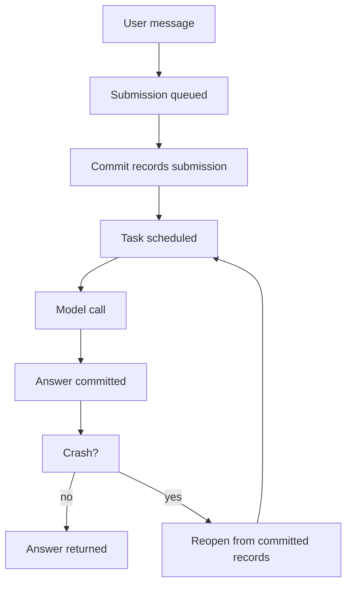
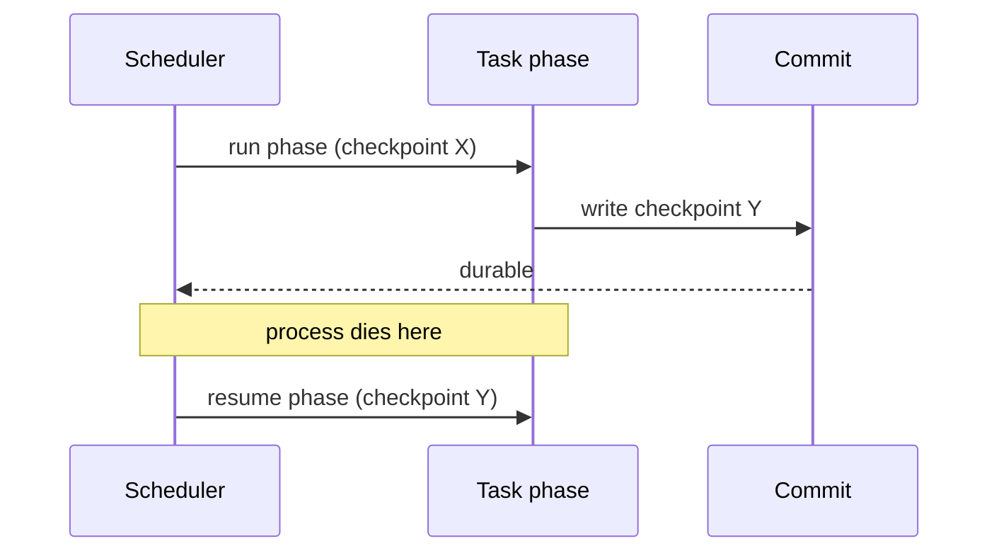

# 00 -- Overview

Three packages build one idea: an agent that survives a crash and resumes exactly where it stopped. `chord` gives objects an address and a contract. `durable` records every change as a committed, recoverable record. `codemode` runs untrusted code safely inside that record-keeping system. This document gives the shape of all three before the deep dives.

## The Problem

A normal agent loop keeps its state in memory. A crash loses the state. A restart starts over. A long tool call has no record. These packages fix that. They make state durable first, and run code on top of it.

Think of it this way. A database commit is the only moment the system promises something is true. `durable` makes that the rule for an agent. Every user message, every model answer, and every task transition is a commit. Nothing "happens" unless a commit says it happened.



## The Three Packages at a Glance

| Package | Role | Key idea |
|---------|------|----------|
| `chord` | Typed host runtime | Objects are state + code at an address |
| `durable` | Durable agent harness | Every change is an atomic commit |
| `codemode` | Sandboxed JS | Run user code in QuickJS-WASM |

### chord

`chord` is the smallest layer. An object is a piece of state plus the code that reads and writes it. The object lives at an address. Other objects talk to it through a contract. A contract says what methods an object has and what their inputs look like.

```ts
// packages/chord/src/contract.ts -- a remote method declaration (simplified shape)
export function remote() {
  return { kind: "remote" };
}
```

The runtime also does hot reload. You can swap the code behind an object without losing its state. A later document explains this. See [03-chord-runtime.md](./03-chord-runtime.md).

### durable

`durable` is the largest layer. It has a Session. A Session runs one mutation line. Every change goes through that line as a transaction. A transaction becomes a commit. A commit has a sequence number. Reopening a Session replays or reads committed records and recovers.

```ts
// packages/durable/src/session/session.ts -- a commit enqueues on one line
commit<T>(change: (tx: Tx) => T | Promise<T>, context: Context): Promise<T> {
  return this.commitWith(change, context);
}
```

`durable` has three storage backends. Memory is the reference. JSONL is portable and append-only. SQLite is indexed. See [05-durable-storage.md](./05-durable-storage.md).

### codemode

`codemode` runs JavaScript inside QuickJS-WASM. It locks down built-ins, sets an interrupt budget, and can run deterministically with a seeded clock. See [10-codemode.md](./10-codemode.md).

## The Big Idea: Recoverable Progress

The Aha moment is this. The system never trusts a process that is running. It trusts only what a commit recorded. A running task can be interrupted, aborted, or lose its process. The next process reads the committed records and continues.

This is why the task model has a checkpoint. A task phase returns a new checkpoint. The checkpoint is committed. If the process dies, the next process resumes from the checkpoint. The running code is ephemeral; the checkpoint is durable.



## Where This Is Headed

Later documents go deep. The storage document explains how a commit is atomic. The scheduler document explains how tasks own other tasks and how abort cascades work. The cross-cutting document translates the design to Rust and to production. If you want to build a resilient storage system, start with [05-durable-storage.md](./05-durable-storage.md) and finish with [12-cross-cutting.md](./12-cross-cutting.md).
