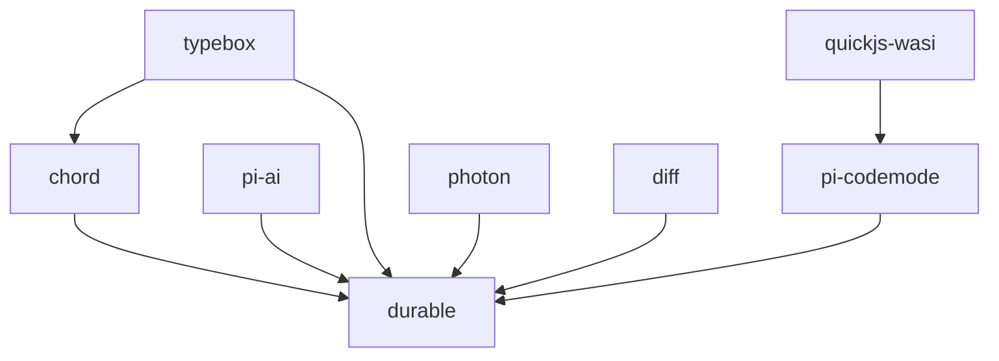
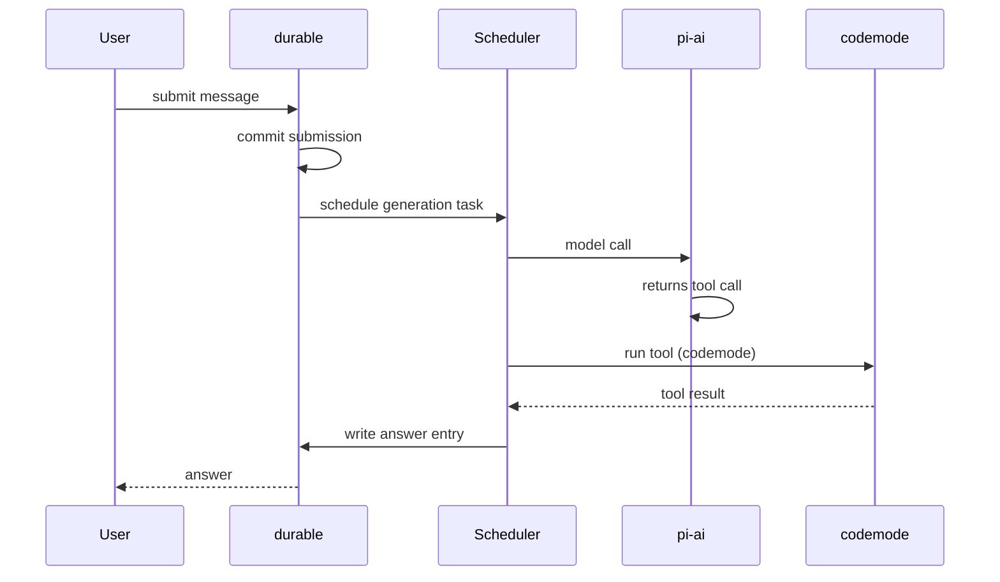

# 01 -- Architecture

Three packages stack in one direction. `chord` is the base. `durable` sits on chord and on `pi-ai`. `codemode` sits beside durable and plugs into its tool tasks. This document is a deep dive into the seams: the dependency graph, the wiring, and the bridge that carries durable state into chord observables.

## The Dependency Graph, Exactly

Each package lists one small set of runtime dependencies.

```jsonc
// packages/chord/package.json -- runtime dependencies (verbatim)
"dependencies": { "typebox": "1.3.27" }

// packages/durable/package.json -- runtime dependencies (verbatim)
"dependencies": {
  "@earendil-works/chord": "1.3.0",
  "@earendil-works/pi-ai": "1.3.0",
  "@earendil-works/pi-codemode": "1.3.0",
  "@silvia-odwyer/photon": "0.3.3",
  "diff": "8.0.4",
  "typebox": "1.3.27"
}

// packages/codemode/package.json -- runtime dependencies (verbatim)
"dependencies": { "quickjs-wasi": "3.6.2" }
```



The direction of an arrow is "is used by". chord uses only typebox. codemode uses only quickjs-wasi. durable uses chord, pi-ai, pi-codemode, photon, diff, and typebox directly.

The Aha is what each base depends on. chord's only runtime dependency is typebox, the JSON schema library. It does not depend on pi-ai. durable depends on chord, not the other way around. Nothing depends on codemode except durable. codemode is a leaf.

## Why Three Packages

Each package owns one hard problem.

| Package | Owns | Solves |
|---------|------|--------|
| `chord` | Identity and live code | "What object is this, and what code runs it?" |
| `durable` | State and recovery | "What did we promise, and how do we resume?" |
| `codemode` | Isolation | "How do we run user code without breaking the host?" |

Splitting them keeps each one small enough to reason about. durable does not re-implement identity. codemode does not re-implement storage.

## The Directory Shape

durable's source divides into four parts. The split mirrors the layering.

| Directory | Role |
|-----------|------|
| `session/` | The Session kernel and the chord observation bridge |
| `storage/` | Memory, JSONL, and SQLite backends |
| `harness/` | Agents, scheduler, tools, registry, generation, compaction |
| `env/` | The per-conversation environment seam |
| top-level `documents.ts`, `entries.ts`, `tasks.ts`, `types.ts` | The shared durable types |

`documents.ts` defines the document system. `entries.ts` defines the entry kinds. `tasks.ts` defines the task type. `types.ts` holds the `Storage` contract and the core records. Everything else is either the kernel or the harness.

## The Storage Interface Is the Seam

Every backend implements one `Storage` interface. The Session kernel reads and writes only through it.

```ts
// packages/durable/src/types.ts -- the Storage contract (abridged)
export interface Storage {
  commit(writes: readonly StorageWrite[], context: Context): Promise<Seq>;
  mintId<I extends Id<string>>(): Promise<I>;
  conversation(id: ConversationId, context: Context): Promise<ConversationRecord | undefined>;
  scanConversations(...): Promise<...>;
  entry(...): Promise<...>;
  findLatestHeadMarker(...): Promise<...>;
  scanEntries(...): Promise<...>;
  task(id: TaskId, context: Context): Promise<TaskRecord<...> | undefined>;
  scanTasks(...): Promise<...>;
  submission(id: SubmissionId, context: Context): Promise<SubmissionRecord | undefined>;
  scanSubmissions(...): Promise<...>;
  submissionByRequest(...): Promise<...>;
  findDocument(address, at, context): Promise<DocumentRecord | undefined>;
  document(id, at, context): Promise<StoredDocument | undefined>;
  scanDocuments(...): Promise<...>;
  close(context: Context): Promise<void>;
}
```

The Aha is that the whole harness is portable because its storage is a narrow interface. Memory, JSONL, and SQLite are interchangeable because the kernel only ever asks for commits, records, and documents. See [05-durable-storage.md](./05-durable-storage.md).

## The Wiring: How durable Composes

`HarnessImpl` is the composition point. Its constructor assembles the Session kernel with a scheduler, submissions, a task graph, and conversation views.

```ts
// packages/durable/src/harness/harness.ts -- the constructor (abridged)
class HarnessImpl<Tool> extends SessionImpl implements HarnessType {
  #tasks: TaskScheduler;
  #submissions: Submissions;
  #taskGraph: TaskGraphView;

  constructor(rawStorage: Storage, options: HarnessOptions<Tool>, context: Context) {
    const report = safeReport(options.onReport);
    const now = safeNow(options.now, report);
    super(rawStorage, now, () => hostSettings()?.documentRetentionMs);
    const storage = this.storage;   // now wrapped in the failure guard
    const settings = () => resolveSettings(hostSettings());
    this.#tasks = new TaskScheduler({
      session: this,
      storage,
      registry: options.registry,
      models: currentModels(options.models),
      agent: (id, snapshot, callContext) => this.resolveAgent(id, snapshot, callContext),
      settings,
      env: (id, callContext) => this.buildEnv(id, callContext),
      now,
      report: this.#report,
      // ...
    });
    this.#submissions = new Submissions(this, storage, now, settings, () => this.#tasks.resume());
    this.#taskGraph = new TaskGraphView(this, storage);
    this.#host = { harness: this, storage, tasks: this.#tasks, submissions: this.#submissions, views: new ConversationViews(this, storage), now, create: ... };
  }
}
```

The Aha is the dependency direction inside durable. The Session is built first. The scheduler, submissions, task graph, and views are built from the Session. Every component reads and writes through the Session's guarded storage, never through `rawStorage` again. That single wrapping is the failure guard explained in [04-durable-concepts.md](./04-durable-concepts.md).

### The Host Clock Seam

Time is a seam too. The host may supply its own clock. `safeNow` wraps it so a broken clock cannot stop commits.

```ts
// packages/durable/src/harness/harness.ts -- the host clock (abridged)
export function safeNow(now: (() => number) | undefined, report: (error: unknown) => void): () => number {
  if (now === undefined) return Date.now;
  let reported = false;
  return () => {
    try {
      return now();
    } catch (error) {
      if (!reported) { reported = true; report(error); }
      return Date.now();
    }
  };
}
```

The Aha is that the first clock throw is reported, then the harness falls back to `Date.now`. Later throws are silent, because the clock is read in every task change.

## The Built-In Tasks

The registry always holds three built-in tasks. They are not extensions and cannot be removed.

```ts
// packages/durable/src/harness/registry.ts -- built-ins (verbatim)
export const BUILTIN_TASKS: readonly AnyTask[] = [GenerationTask, ToolTask, CompactionTask];
```

`Harness.open` refuses to start if the registry lacks any of them. That is a guard against a misconfigured harness that could never run a turn.

## The Chord Bridge

durable uses chord for observable state. A committed document becomes a chord `ReplicatedStateSource`. The bridge lives in `packages/durable/src/session/observation.ts`.

```ts
// packages/durable/src/session/observation.ts -- a document becomes a chord state source (abridged)
export class CommittedStateSource<T = ObservedDocumentValue> implements ReplicatedStateSource<T> {
  #cursor = 0;
  #retired = false;

  advance(value: T, ops: readonly Op[], context: Context): void {
    if (this.#closed || this.#retired) return;
    this.#value = value;
    this.#cursor += 1;
    if (value === null) this.#retired = true;
    const frame = { cursor: this.#cursor, value, ops, context };
    for (const attachment of [...this.#attachments]) attachment.publish(frame);
  }
}
```

Each commit calls `advance` with the new value and the delta operations. The cursor is monotonic, matching chord's replicated-state contract. A `null` value retires the source.

```ts
// packages/durable/src/session/observation.ts -- the retirement op (verbatim)
export const RETIREMENT_OPERATIONS: readonly Op[] = [["r", null]];
```

The Aha is the division of truth. Storage is the source of truth. The chord observable is a live view of it. A UI watches the view; recovery reads the storage. The two never disagree, because every view change comes from a commit.

### The Watch Buffer

A slow watcher cannot grow memory unbounded. Each watch holds at most 100 pending frames.

```ts
// packages/durable/src/session/observation.ts -- the cap (verbatim)
const MAX_PENDING_WATCH_FRAMES = 100;
```

Past the cap, the pending frames collapse to one root replace of the newest value. The watcher catches up, not every frame. This is the same bounded-catch-up idea chord's connection flow control uses in [03-chord-runtime.md](./03-chord-runtime.md).

## How the Packages Compose in One Request

A user submits a message. durable records the submission. The scheduler runs a generation task. The generation task calls a model through `pi-ai`. If the model calls a tool, durable runs a tool task. A code tool runs codemode. The answer is written as an entry. Every step is a commit.



The full trace, including the crash points, is [11-data-flow.md](./11-data-flow.md).

## Where to Go Next

For the chord concepts behind identity and contracts, read [02-chord-concepts.md](./02-chord-concepts.md). For the chord runtime behind links and hot reload, read [03-chord-runtime.md](./03-chord-runtime.md). For the durable concepts behind sessions and documents, read [04-durable-concepts.md](./04-durable-concepts.md).
