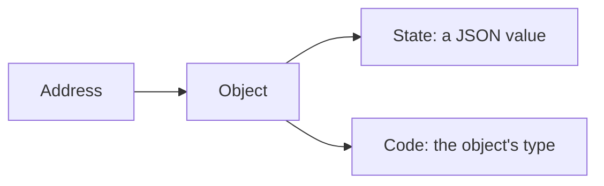
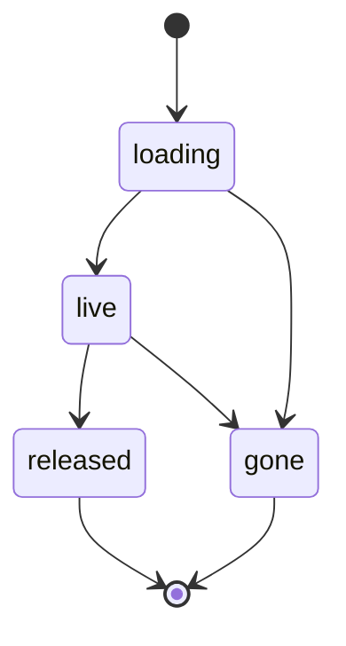

# 02 -- Chord Concepts: Deep Dive

chord is the typed host runtime durable sits on. Its central idea is one sentence: an object is state plus code, and the object lives at an address. This document is a deep dive into the five things chord adds around that idea: contracts, references, principals, observable state, and the delta operation vocabulary.

## Objects

An object is a value with a type. The type is the code that reads and writes the value. The object has an address. The address is stable while the code behind it can change.



The Aha is that identity and code are separate. Hot reload changes the code version, not the address. State lives at the address across reloads.

## Contracts

A contract describes what an object can do. It has a name, a scope (remote or local), a version, an input, and members. Members are methods, state, or opaque natives.

### Methods and Opaque Values

A member is built with `method()` or `opaque()`.

```ts
// packages/chord/src/contract.ts -- the member builders (abridged)
export function method<A, R>(args?: A, result?: R): MethodSpec {
  return { [MEMBER]: "method", args, result };
}
export const opaque = <T = unknown>(id: string): OpaqueSpec<T> => {
  if (!/^[^@\s]+@\d+$/.test(id)) throw new TypeError(`opaque id must be name@version: ${id}`);
  return { [MEMBER]: "opaque", id };
};
```

An opaque member is a native in-process object identified by `name@version`. It is local-only. A remote contract cannot expose one.

### Remote and Local

A remote contract lives across hosts. A local contract stays in one process. `LOCAL_VARIANT` is the empty string, the one unnamed variant a local contract has.

```ts
// packages/chord/src/contract.ts -- the local variant (verbatim)
export const LOCAL_VARIANT = "";
```

The Aha is that remote and local are different scopes with different rules. A remote contract carries a placement and variants. A local contract carries members and one empty variant.

### Placement

Placement says where a remote object lives. `HostNamed` names one host. `HostFamily<K>` names a host prefix plus a string field of the input.

```ts
// packages/chord/src/contract.ts -- the two placement kinds (verbatim)
export type Placement = HostNamed | HostFamily;
```

```ts
// packages/chord/src/contract.ts -- resolve a host from placement (abridged)
export function resolveHost(typeName: string, placement: Placement, input: unknown): string {
  if ("name" in placement) return placement.name;
  const value = (input as Record<string, unknown>)[placement.key];
  if (typeof value !== "string" || value === "")
    throw invalid("placement", `${typeName}: input field ${placement.key} names no host`);
  return placement.prefix + value;
}
```

A `hostFamily("session:", "session")` puts an object whose input has `{ session: "S1" }` on host `session:S1`. This is how a family spreads objects across hosts by a key.

### Variants

A remote contract has variants. Each variant has state members and methods.

```ts
// packages/chord/src/contract.ts -- a variant (verbatim)
export interface VariantDef {
  readonly state?: Readonly<Record<string, TSchema>>;
  readonly methods?: Readonly<Record<string, MethodSpec>>;
}
```

A member name cannot be both state and method. The runtime uses ten reserved names for its own bookkeeping.

```ts
// packages/chord/src/contract.ts -- reserved names (verbatim)
export const RESERVED_MEMBERS: ReadonlySet<string> = new Set([
  "variant", "status", "ready", "shape", "error",
  "onShape", "onStatus", "release", "then", "contract",
]);
```

### Fingerprint

A contract has a fingerprint: a hash of the canonical JSON of its description.

```ts
// packages/chord/src/contract.ts -- identity by hash (verbatim)
function finish<C extends AnyContract>(contract: Omit<C, "fingerprint">): C {
  return { ...contract, fingerprint: hash64(canonicalJson(contract.description)) } as C;
}
```

Two contracts are equal when their fingerprints match. The description travels over the wire; the fingerprint is recomputed, not sent.

### Coverage and Binding

`coverage()` returns why a provider does not cover a consumer, or nothing when it does. `bind()` decides how a consumer token binds to a provider.

```ts
// packages/chord/src/contract.ts -- bind (abridged)
export function bind(provider, accepts, consumer): Adapter | undefined {
  if (provider.fingerprint === consumer.fingerprint) return undefined;
  if (!samePlacement(provider.description, consumer.description)) {
    throw new ChordError("contract_mismatch", `... lives on ..., the consumer expects ...`);
  }
  if (provider.version === consumer.version) {
    const reason = coverage(provider.description, consumer.description);
    if (reason === undefined) return undefined;
    throw new ChordError("contract_mismatch", `... does not cover ... (${reason}); forgotten version bump?`);
  }
  const adapter = accepts?.[consumer.version];
  if (adapter === undefined) throw new ChordError("contract_mismatch", `... no accepts adapter`);
  return adapter;
}
```

The Aha is the three outcomes. Equal fingerprint: direct bind. Same version but not covering: mismatch, a forgotten version bump. Different version: an `accepts` adapter maps the old view to the new. Adapters are how a provider serves old consumers during a rollout.

## References

A reference points to an object. It is what a caller holds, not the object itself.

```ts
// packages/chord/src/types.ts -- reference status (verbatim)
export type RefStatus = "loading" | "live" | "released" | "gone";
```



A reference carries its contract token, its status, a ready promise, and the shape it is bound to.

```ts
// packages/chord/src/types.ts -- the reference base (abridged)
export interface RefBase<C extends AnyContract> {
  readonly contract: C;
  readonly status: RefStatus;
  readonly ready: Promise<void>;
  readonly variant: string | undefined;
  readonly shape: Shape | undefined;
  readonly error: unknown;
  onShape(listener: (shape: Shape) => void): () => void;
  onStatus(listener: (status: RefStatus, error: unknown) => void): () => void;
  release(): void;
}
```

The Aha is `ready`. A method-only reference is ready once its object is live. A state reference is ready once every state member has its value. The caller awaits `ready`, then reads state or calls methods.

### Getting a Reference

A call gets a reference through `Ctx.get`.

```ts
// packages/chord/src/types.ts -- Ctx.get (abridged)
get<C extends AnyContract>(type: C, input: InputOf<C>, options?: GetOptions<P>): Promise<Ref<C>>;
```

`GetOptions.state: false` asks for a method-only reference. It receives no state and is ready once the object is live. This saves bandwidth for a caller that only calls methods.

## Principals

A principal is an identity. `Ctx.principal` carries who the call acts as.

```ts
// packages/chord/src/types.ts -- the call context (abridged)
export interface Ctx<P = unknown> {
  readonly signal: AbortSignal;
  readonly rootId: string;
  readonly codeVersion: number;
  readonly principal: P;
  get<C extends AnyContract>(...): Promise<Ref<C>>;
}
```

The host maps a principal to an object key through `principalKey`. An equal principal from another host reaches the same objects. A remote call carries its principal across the link, and the far side checks it against its routes. The principal is why a remote call is data plus identity, checked at the far side.

## Observable State

chord has three state primitives: `Cell`, `Derived`, and `replicatedState`. A `Readable` is the common surface.

```ts
// packages/chord/src/types.ts -- a readable (abridged)
export interface Readable<T> {
  readonly value: T;
  subscribe(listener: (value: T) => void): () => void;
  events(listener: (event: StateEvent<T>) => void): () => void;
}
```

`subscribe` gives the value. `events` gives a delta stream: a snapshot immediately, then ops, or a reset after a migration.

```ts
// packages/chord/src/types.ts -- the state event (verbatim)
export type StateEvent<T> =
  | { readonly type: "snap"; readonly value: T }
  | { readonly type: "ops"; readonly ops: readonly Op[]; readonly value: T }
  | { readonly type: "reset"; readonly value: T };
```

### Cell

A cell holds a JSON value. It wraps the value in a box `{ v: value }` because the tracker tracks containers, and a scalar is not a container. Published ops are unboxed.

```ts
// packages/chord/src/cell.ts -- the box (verbatim)
interface Box<T> {
  v: T;
}
```

A cell changes through a synchronous draft callback or a whole-value replace.

```ts
// packages/chord/src/cell.ts -- change (abridged)
change(ctx: Ctx, fn: (draft: Draft<T>) => void): void {
  this.#guard(ctx);
  const change = this.#tracker.beginChange();
  try {
    fn(change.state.v as Draft<T>);
    prepared = change.prepare();
  } catch (error) {
    change.abort();
    throw error;
  }
  this.#publish(prepared, "ops");
}
```

The Aha is the box. It is a small trick with a big effect: wrapping a scalar in an object makes it trackable, then unboxing keeps the published ops scalar-shaped. The consumer never sees the box.

### Derived

A derived value is computed from other readables. When a source changes, the derivation recomputes and republishes.

```ts
// packages/chord/src/cell.ts -- a derivation install (abridged)
install(next: T): void {
  const before = this.#value;
  this.#value = next;
  const ops = before === undefined || next === undefined
    ? [["r", (next ?? null) as JsonValue]]
    : diffRevisions(before as JsonValue, next as JsonValue);
  if (ops.length > 0) this.fanout.emit({ type: "ops", ops, value: next });
}
```

Dependents recompute atomically with the write. A cell write that changes a derivation publishes the cell first, then the derivation. The computation is synchronous; the notifications are queued.

### replicatedState

`replicatedState(initial)` is authoritative mutable state. `replicatedState(source)` is a publication-only view of an external revision source.

```ts
// packages/chord/src/state.ts -- two forms (abridged)
export function replicatedState<T extends object>(initial: T): MutableReplicatedState<T>;
export function replicatedState<T>(source: ReplicatedStateSource<T>, options?): AttachedReplicatedState<T>;
```

A source delivers frames with a monotonic cursor. A gap is an error.

```ts
// packages/chord/src/state.ts -- cursor gap check (abridged)
const expected = this.#cursor + 1;
if (frame.cursor !== expected) {
  throw new Error(`Replicated state source cursor has a gap: expected ${expected}, received ${frame.cursor}`);
}
```

The Aha is that `replicatedState(source)` is how durable exposes a committed document as live state. The document is the source; the replicated state is the view. See [04-durable-concepts.md](./04-durable-concepts.md).

## The Delta Operation Vocabulary

The tracker turns changes into operations. Each operation is a tuple. This is the exact vocabulary.

```ts
// packages/chord/src/delta/index.ts -- the op type (verbatim)
export type Op =
  | readonly ["r", JsonValue]
  | readonly ["s", NonEmptyPath, JsonValue]
  | readonly ["d", NonEmptyPath]
  | readonly ["a", NonEmptyPath, string]
  | readonly ["t", NonEmptyPath, number]
  | readonly ["p", Path, number, number, JsonValue[]]
  | readonly ["m", Path, number[]];
```

| Op | Meaning |
|----|---------|
| `r` | Root replace: the only op that replaces the whole value |
| `s` | Set a field: `["s", path, value]` |
| `d` | Delete: `["d", path]` |
| `a` | Append to a string: `["a", path, suffix]` |
| `t` | Truncate a string: `["t", path, count]` |
| `p` | Splice an array: `["p", path, index, deleteCount, items]` |
| `m` | Reorder an array: `["m", path, permutation]` |

```ts
// packages/chord/src/delta/index.ts -- examples (concept)
// ["s", ["a", "b"], 5]      set a.b to 5
// ["d", ["a"]]              delete key a
// ["a", ["name"], "world"]  name = name + "world"
// ["t", ["name"], 3]        name = name.slice(3)
// ["p", ["xs"], 1, 1, [y]]  xs.splice(1, 1, y)
// ["m", ["xs"], [2, 0, 1]]  reorder xs by that permutation
```

`s`, `d`, `a`, and `t` can never target the root. Only `r`, `p`, and `m` may. This is why `isBase` works: a batch that begins with `r` is a full replacement.

The Aha is that `a` and `t` are string operations, and `p` is the array splice. Appending text and splicing arrays are the two shapes of small edits, so the vocabulary makes them one-op cheap.

### Applying

`apply` mutates a plain value in place. `applyImmutable` copies containers on the path first, so the previous value stays intact.

```ts
// packages/chord/src/delta/index.ts -- the two appliers (abridged)
export function apply<T>(target: T | undefined, ops: readonly Op[]): T { ... }
export function applyImmutable<T>(target: T | undefined, ops: readonly Op[]): T { ... }
```

The Aha is that immutable apply is what a replica uses. It copies only the containers a batch touches, then mutates the copies. The old value and the new value share every untouched subtree.

### The Wire Form and Path Interning

Ops cross a boundary in a compressed `WireOp` form. Two compressions apply: path interning and arity omission.

```ts
// packages/chord/src/delta/index.ts -- the wire op (abridged)
export type WireOp =
  | readonly ["r", JsonValue]
  | readonly ["s", PathRef<NonEmptyPath>, JsonValue]
  | readonly ["s", JsonValue]                 // short: reuse previous path
  | readonly ["#", number, Path];             // define an id on a path's second use
```

A path is interned on its second use. A definition `["#", id, path]` is emitted once; later ops reference the id. Arity omission drops the path when it matches the previous op.

```ts
// packages/chord/src/delta/index.ts -- intern on second use (abridged comment)
// Intern on SECOND use. A definition costs more than the path it replaces, so
// interning on first use loses on the many paths written exactly once.
```

The Aha is the recovery point. A `r` batch clears the interning dictionary, so a reader can replay from the last base with a fresh decoder.

### Path Safety

Ops are untrusted. A path segment must never reach the prototype chain.

```ts
// packages/chord/src/delta/index.ts -- reserved segments (verbatim)
export const RESERVED_SEGMENTS: ReadonlySet<string> = new Set(["__proto__", "constructor", "prototype"]);
```

The applier writes with `Object.defineProperty`, not assignment, so an inherited setter never runs. A `["s", ["__proto__", "isAdmin"], true]` would otherwise pollute `Object.prototype` for the whole process.

### The 4096-Op Cap

A delta is capped. Past `MAX_DELTA_OPERATIONS`, the tracker falls back to a root replace.

```ts
// packages/chord/src/delta/tracker.ts -- the cap (verbatim)
const MAX_DELTA_OPERATIONS = 4_096;
```

The Aha is why. A giant change is cheaper as a full value than as thousands of ops. The cap bounds both write size and apply time. durable inherits this when it stores document deltas. See [05-durable-storage.md](./05-durable-storage.md).

## Context

A `Context` carries identity and cancellation as immutable, invocation-scoped values.

```ts
// packages/chord/src/context/index.ts -- derive a cancelled child (abridged)
export function withAbortSignal(signal: AbortSignal, context: Context): Context {
  const parentSignal = context.abortSignal;
  const combined = parentSignal === undefined ? signal : AbortSignal.any([parentSignal, signal]);
  return withContextValue(ABORT_SIGNAL_CONTEXT_KEY, combined, context);
}
```

`withoutAbortSignal` strips caller cancellation for mandatory cleanup. `withCancel` makes an independently cancellable child. `awaitWithContext` observes a promise until it settles or the context cancels.

```ts
// packages/chord/src/context/index.ts -- await with context (abridged)
export function awaitWithContext<T>(promise: Promise<T>, context: Context): Promise<T> {
  const signal = context.abortSignal;
  if (signal === undefined) return promise;
  // reject only this waiter on abort; the underlying promise keeps running
}
```

The Aha is that cancellation rejects only the waiter, never the underlying promise. A cancelled caller stops waiting; the work it started is not silently aborted unless its own context says so.

## Where to Go Next

These concepts are the vocabulary. The next document explains the runtime that hosts them: links, flow control, and hot reload. Read [03-chord-runtime.md](./03-chord-runtime.md). For how durable uses the delta vocabulary, read [04-durable-concepts.md](./04-durable-concepts.md).
